# ERP — Documentação do sistema

**Versão do sistema:** 1.30.5 — Regras Fiscais
**Última atualização:** 16/10/2026 (Precificação simplificada, adicionais por produto, preço de atacado e ajuste de orçamentos)

## 1. Modo correção de bug

Reproduzir o sintoma com a empresa, a conta e o período informados. Conferir a tela, a chamada HTTP e os registros envolvidos antes de alterar a regra. Corrigir a causa, cobrir o caso com teste e atualizar esta documentação quando o comportamento percebido mudar.

## 2. Versões

### 2.1 Histórico

- **1.30.5 — Regras Fiscais (16/10/2026):** Orçamentos: **Fechar pedido** sempre converte, sem checkbox. Pagamento em Dinheiro, Pix, Boleto, Cartão de Débito ou Cartão de Crédito; boleto com parâmetro ativo escolhido e limites por parcela, crédito com parcelas dos cartões ativos. **Copiar pedido** em Mais opções; **Imprimir orçamento** e **Enviar ao cliente** no rodapé. Envio prepara PDF para WhatsApp, com download e anexação manual como alternativa. Migração aditiva aplicada somente no banco local; sem publicação.

- **1.30.4 — Regras Fiscais (16/10/2026):** Precificação com campos principais e adicionais recolhidos por produto, simulação comercial, margens independentes de venda/atacado e ajustes persistidos com revisão.

- **1.30.3 — Regras Fiscais (15/10/2026):** retirada da Formação de custo, ajustes, rateio e memórias da Precificação; cálculo anterior restaurado e gravação direta dos preços válidos.
- **1.30.1 — Regras Fiscais (14/10/2026):** Contas foi movido para Configurações → Financeiro → Contas. O endereço antigo redireciona; permissões e dados existentes são preservados. Perfil autorizado somente a Contas não recebe acesso às outras configurações.

- **1.30.0 — Regras Fiscais (14/10/2026):** Configurações → Fiscal → Regras Fiscais, somente administrador e por empresa. Crédito de ICMS da mercadoria e do CT-e pela nota ou alíquota pré-definida. ICMS ausente no modo nota dá zero; crédito do frete distribuído pelo rateio lançado. Apenas precificação; preços existentes, Auditoria e kardex não são recalculados automaticamente.

- **1.29.3 — Pedidos de venda (14/10/2026):** Precificação: borda externa e separadores acompanham a largura completa das linhas, sem atravessar colunas durante a rolagem horizontal. Produto/SKU permanecem fixos.

- **1.29.2 — Pedidos de venda (14/10/2026):** Auditoria de entradas inclui NF-e e NFS-e consolidadas, separa Pendentes/Concluídas e registra Auditada com usuário e data. Precificação somente para NF-e de revenda.

- **1.28.0 — Conciliação bancária (13/10/2026):** importação de OFX, CSV e Excel; comparação com baixas financeiras; vínculo em grupo, desvinculação, lançamento imediato e telas de fluxo realizado, movimentações, extratos e relatório.
- **1.28.1 — Conciliação bancária (13/10/2026):** em Orçamentos, **A retirar** esconde **Endereço de entrega** e **Frete**, e grava ambos vazios. **No ato** continua sem endereço e sem Frete.
- **1.28.2 — Conciliação bancária (13/10/2026):** em **Contas a Pagar**, a aba **Baixas** filtra por fornecedor, vencimento e emissão; a confirmação pede data e conta; **Pagamentos** permite cancelar baixa e recalcula saldo/status, mantendo o histórico.
- **1.28.3 — Conciliação bancária (13/10/2026):** em **Orçamentos**, o modal de **Salvar e finalizar** oferece **Ficar no orçamento**, que fecha o modal e mantém a ficha aberta; impressão continua somente por clique.
- **1.29.0 — Pedidos de venda (14/10/2026):** orçamento de venda com tabela sem NCM e sem coluna de desconto; desconto percentual em modal (substitui, não acumula); status **Em aberto / Expirado / Convertido**; condição **À vista / 30 dias / 60 dias**; **Finalizar** com o checkbox cria um **Pedido de venda** uma única vez. ST aparece zerado até haver regra fiscal.
- **1.29.1 — Pedidos de venda (14/10/2026):** ficha de orçamento com título **Orçamento de venda**, faixa única (cliente, datas somente leitura, condição, vendedor, tipo de entrega e Frete), preço unitário só leitura, ponto de estoque colorido, **Mais opções** (limpar, imprimir, e-mail) e aviso de múltiplo de venda. ST entra no total sem misturar no líquido (ainda 0 até a regra fiscal). Vendedor novo: usuário da sessão se o cargo contém “vendedor”; orçamentos antigos com 199 permanecem.

## 3. Mapa visual

### 3.1 Financeiro

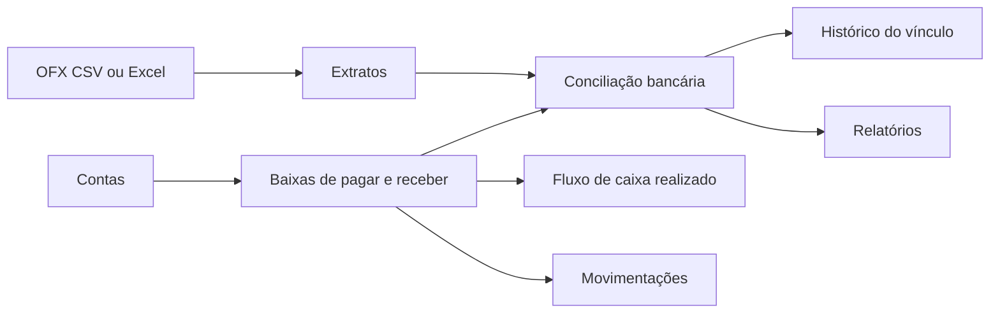

### 3.6 Roteiro por sintoma

- Orçamento não salva ou não fecha: escolher uma das cinco condições atuais; boleto exige parâmetro ativo da empresa, prazos positivos crescentes e limites por parcela; crédito exige parcelas de cartão ativo. Código: `pagamento-orcamento.ts` e `servico-orcamentos.ts`. Fechar sempre converte; nova tentativa no convertido retorna 409.
- WhatsApp sem anexo: no navegador sem compartilhamento de arquivos, o PDF é baixado; usar **Abrir WhatsApp e anexar PDF baixado** e anexar manualmente. Abrir o aplicativo não confirma envio. Telefone deve ter DDD. Código: `frontend/lib/compartilhar-orcamento.ts`.

- Build falha em Pedidos de venda com `Property 'permissao' does not exist`: lista e ficha devem usar `ProtegerRota chaveDaPagina="pedidos-venda"`, conforme o acesso por tela do papel. A API mantém a autorização `vendas:view` e o recorte por empresa.

  Validação em 15/10/2026: TypeScript do frontend aprovado (`tsc --noEmit --incremental false`) e 4 testes de `requisicoes-wms.test.ts` aprovados. As verificações de opções ausentes usam `not.toContain`, evitando comparações entre literais incompatíveis. Build completo local bloqueado pela configuração de desenvolvimento de `NEXT_PUBLIC_API_URL` (localhost); publicação não realizada. Versão mantida: correção de compilação sem nova funcionalidade ou mudança de uso.

- Precificação recusa preço: conferir produto vinculado, adicionais válidos, custo positivo, carga inferior a 100%, permissão e escolha de Transp. no Simples quando houver crédito de frete. Conflito 409 exige recarregar: dados, preços, parâmetros ou configurações mudaram. Não há confirmação de custo. Código: calculo-precificacao.ts e servico-precificacao-entrada.ts.

- Linha vertical atravessando colunas na Precificação: conferir o contêiner da grade em frontend/app/auditoria-entradas/[id]/precificacao/page.tsx (ConteudoPrecificacao); borda e separadores devem envolver w-max min-w-full, acompanhando a largura das linhas.

- Nota sumiu de Pendentes na Auditoria: conferir Concluídas e a data/responsável da auditoria; o status operacional permanece consolidado.
- Precificar ausente: somente NF-e consolidada com finalidade Revenda possui essa ação.

- Extrato não aparece: conferir conta, período, tipo do arquivo e linhas inválidas retornadas pela importação.
- Baixa não aparece: conferir `contaEmpresaId` e `pagoEm` da baixa. Baixa antiga sem conta não participa da conciliação.
- Sugestão não aparece: valor assinado e dia devem ser iguais; empate entre mais de uma baixa sem documento que desambigue não gera sugestão.
- Concluir está desabilitado: selecionar ao menos uma linha de cada lado e conferir se as somas assinadas fecham em centavos.
- Desvincular não apaga o pagamento: comportamento esperado; o vínculo é desfeito, mas título e baixa permanecem.
- Em Orçamentos, Frete aparece após selecionar **A retirar**: conferir a renderização por `entregaSemFrete` em `frontend/components/orcamentos/formulario-orcamento-layout.tsx` e a regra documentada em §6.21.

### 3.8 Mapa comercial

**Precificação:** após consolidar uma NF-e de Revenda, o operador confere os campos principais por produto. Margens e preços de venda e atacado são independentes. **+ Campos adicionais** abre a composição comercial do custo; **−** recolhe. A simulação preserva nota, financeiro e estoque. Somente **Gravar preços válidos** atualiza o cadastro e guarda os ajustes da linha. Margens atuais usam o custo da simulação e os preços atuais do cadastro; não representam margem histórica.

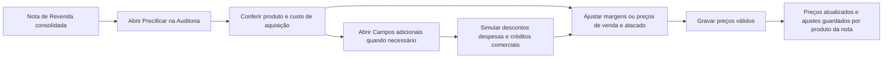

Desktop: Produto e Nome fixos; os produtos deslizam juntos na grade. Mobile: dados em grupos de duas colunas, com adicionais expansíveis por produto.

Auditoria de entradas: confira os documentos consolidados, conclua a conferência e consulte o histórico.

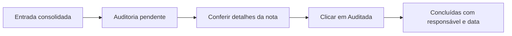


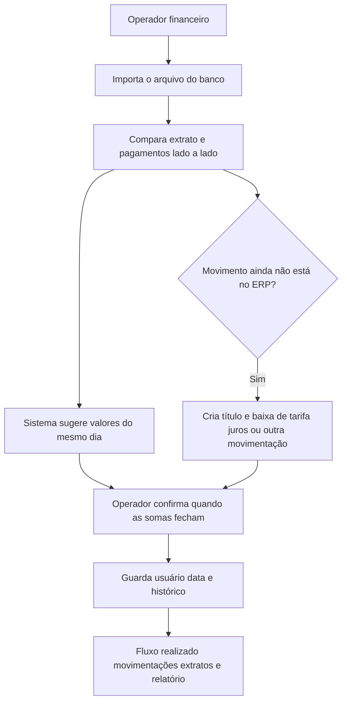

O módulo reduz a conferência manual entre banco e ERP. O operador continua responsável pela confirmação; uma sugestão nunca grava o vínculo sozinha. Divergência de valor bloqueia a conclusão.

## 6. Fichas das telas

### 6.1 Contas

Fonte das contas bancárias usadas nos filtros. Somente conta ativa do tipo **bancária** pode receber extrato e conciliação.

### 6.2 Conciliação bancária

**Rota:** `/conciliacao-bancaria`

- **Conta bancária** · Obrigatório · Operador · Vem de Contas · Filtra extrato e baixas · Só conta ativa bancária.
- **Período** · Obrigatório · Operador · Data inicial e final · Filtra data do extrato e `pagoEm` · A data final inclui o dia inteiro.
- **Tipo de lançamento** · Opcional · Operador · Crédito ou débito · Filtra pelo sinal do valor.
- **Status da conciliação** · Opcional · Operador · Conciliado, Pendente, Não identificado ou Não encontrado.
- **Importar extrato** · Escrita · Operador com `financeiro:edit` · Aceita OFX, CSV e Excel até 5 MB.
- **Novo lançamento** · Escrita · Cria Conta a Pagar para saída ou Conta a Receber para entrada, uma parcela com vencimento e baixa imediata na conta.
- **Concluir conciliação** · Escrita · Aceita várias linhas de cada lado · Exige soma algébrica igual em centavos.
- **Desvincular** · Escrita · Marca o vínculo como desfeito · Mantém título e baixa.

**Onde olhar no código:** `frontend/app/conciliacao-bancaria/page.tsx`, `frontend/components/conciliacao-bancaria/tela-conciliacao-bancaria.tsx`, `src/modulos/conciliacao-bancaria/servico-conciliacao-bancaria.ts`.

### 6.3 Fluxo de caixa

**Rota:** `/fluxo-de-caixa`  
Mostra somente o realizado, agrupando baixas por dia e conta. Parcela aberta ou projeção por vencimento não entra.

### 6.4 Movimentações

**Rota:** `/movimentacoes-financeiras`  
Lista única e somente leitura das baixas de pagar e receber, com conta, documento, valor e estado da conciliação.

### 6.5 Extratos

**Rota:** `/extratos-bancarios`  
Lista arquivos importados, conta, período coberto, quantidade de linhas, usuário e data. Abrir uma linha leva à conciliação do arquivo.

### 6.6 Relatórios

**Rota:** `/relatorios-financeiros`  
Apresenta total do extrato, conciliado, pendente e não identificado para uma conta e período, com exportação CSV.

## 7. Regras consolidadas

### 7.1 Isolamento e permissões

Toda consulta e escrita usa a empresa ativa da sessão. ID de outra empresa não é aceito. `financeiro:view` permite consultar; `financeiro:edit` permite importar, lançar, concluir e desvincular.

### 7.2 Importação e duplicidade

- OFX lê `STMTTRN`, data, valor, `FITID`, histórico e documento.
- CSV e Excel exigem as colunas, nesta ordem: **Data; Histórico; Documento; Valor**.
- Data da planilha: `dd/mm/aaaa`. Valor brasileiro aceita ponto de milhar e vírgula decimal.
- `FITID` identifica a linha OFX. Sem `FITID`, usa-se a combinação normalizada de conta, data, valor, documento e histórico.
- Reimportar a mesma linha na mesma conta não duplica a movimentação.

### 7.3 Sugestão e vínculo

- Sugestão: mesmo valor assinado e mesmo dia.
- Documento e descrição apenas desempatam. Empate restante não gera sugestão.
- Sugestão não grava.
- Uma linha do extrato e uma baixa só podem estar em um vínculo ativo.
- Uma conciliação aceita N linhas de extrato e N baixas.
- A soma algébrica precisa fechar em centavos. Divergência responde erro e não grava parcialmente.

### 7.4 Vencimento financeiro

Toda parcela criada pela conciliação exige vencimento. No Novo lançamento, vencimento e data de pagamento recebem a data da movimentação bancária.

### 7.5 Rastreabilidade

Concluir e desvincular registram usuário e data no histórico da conciliação e no log geral de auditoria. Desvincular não apaga o vínculo anterior nem a baixa.

## 8. Como usar

**Como usar — Integrações:** abra **Configurações → Integrações** e escolha **Assinatura digital**, **Buscador de NF** ou **Boleto**. Assinatura mantém Configuração/Documentos e senha de administrador para Documentos; Buscador mantém token e ambiente Focus; Boleto mantém a lista, **Novo**, **Editar**, ativo/inativo e **Padrão** por empresa. Só aparecem seções permitidas para o perfil. Links antigos continuam funcionando.


1. Cadastre ou confirme a conta em **Configurações → Financeiro → Contas**.
2. Abra **Financeiro → Conciliação bancária**.
3. Escolha conta e período.
4. Importe o OFX ou a planilha do modelo.
5. Selecione as linhas correspondentes nas duas grades.
6. Quando as somas forem iguais, clique **Concluir conciliação**.
7. Se uma tarifa ou entrada ainda não existir no ERP, selecione a linha do extrato, clique **Novo lançamento**, escolha o plano financeiro e salve.
8. Para corrigir um vínculo, selecione linhas do mesmo vínculo e clique **Desvincular**. O título e a baixa permanecem.
# SERP — Documentação do Sistema


| Item               | Valor                                                                                  |
| ------------------ | -------------------------------------------------------------------------------------- |
| Versão do sistema  | 1.30.4 — Regras Fiscais |
| Última atualização | 16/10/2026 (Precificação simplificada e atacado) |
| Formato            | Fonte oficial de comportamento: mapa, campos, regras, paths de código e roteiro de bug |
| Fonte oficial      | Este arquivo (`DOCUMENTACAO-SISTEMA.md`)                                               |


**Roadmap do ciclo de entrada (parcialmente entregue):** Fase 1 Kardex/estoque documentada abaixo (§6.17d). **Contagem cega web** (`/contagens`) entregue (§6.17e / §7.14). **Contas a Pagar** (`/contas-a-pagar`) — cadastro, lista, **baixas** e **geração automática na consolidação** da Entrada (§6.17f / §7.16). **Contas a Receber** (`/contas-a-receber`) — cadastro manual (Duplicata/Crédito), lista, **baixas** e anexos (§6.17h / §7.22); sem geração automática nesta fase. **Contas** (Configurações → Financeiro → Contas; `/contas` redireciona) — cadastro de conta **bancária** ou **caixa** da empresa (§6.23); na baixa de **Contas a Pagar** e **Contas a Receber** o operador escolhe a conta ativa (histórico antigo fica sem conta). **Recorrência** (Configurações → Financeiro) — serviços/consumo com valor esperado; NFS-e/documental auto-consolida (§6.11b / §7.23). **Cartões de Pagamento** e **Adquirentes** (Configurações → Financeiro) — bandeiras fixas e taxas por parcela; cadastro apenas nesta versão (§6.11d / §6.11e). **Parâmetros de Boleto** (Configurações → Financeiro → Boleto) — **vários** conjuntos nomeados por empresa (lista, Novo/Editar, ativo/inativo, **Padrão**); limites, encargos e credenciais da API; teste de conexão por registro só valida preenchimento; **não** emite boleto nem altera Contas a Receber nesta versão (§6.11f). **Plano financeiro automático via CFOP prevalente** na geração do título NFe entregue (§6.12 / §7.20). **Baixar contagem / Voltar para contagem** e **bloqueio temporário com desbloqueio** após divergência entregues (§6.17e / §7.14 / §7.17). **Conferência de preço/nome** em Aguardando chegada e tela **Auditoria de entradas** (`/auditoria-entradas`) entregues (§6.17c / §6.17g / §7.19). **Precificação** (`/auditoria-entradas/[id]/precificacao`) — grade da NF-e consolidada forma preços de venda e atacado sobre o **custo de aquisição**, com adicionais comerciais expansíveis, e grava no produto por ação explícita; Configurações → Vendas é o determinante permanente da empresa (§6.16 / §6.17k / §7.26). **Status automático do Pedido de Compra pós-entrada** (Concluído / Entregue parcialmente) entregue (§6.10 / §7.18). **Status "Aguardando chegada"** (toda NFe 55 com produto retida até liberar para contagem) entregue (§6.17c / §7.19). **DDA** (Configurações → Financeiro → DDA + card na Aguardando chegada) entregue nesta versão — consulta C6 em segundo plano, casa boleto com a NF; **não** paga boleto e **não** gera Contas a pagar nesta fase (§6.11c / §7.24). **Pendências** (`/pendencias`) — sino no cabeçalho + dock de até 3 cards por tela + lista agregada do estado vivo (vencimentos, anexos, estoque bloqueado, filas da Entrada) entregue (§6.20). **Endereços WMS** (`/enderecos-wms`) — árvore Local → Área → Rua → Bloco → Andar → Apartamento; código `A-RC-20-01-2-05`; tipo (PP/CX/CH/BC) no apartamento (§6.17i / §6.17j / §7.25). Configurações → Logística → Estrutura WMS aponta para essa tela. **Não** é picking nem saldo por endereço. **Requisições** (`/requisicoes`) — fila operacional do armazém. **Separação de pedidos** (`/separacao`) bipa o produto e soma 1 unidade até a quantidade da ordem; reserva ao iniciar e baixa o físico ao concluir. Os outros tipos continuam em **Executar** (`/requisicoes/[id]/executar`). Reposição **não** altera o total (§6.17l / §7.27). **Guardar mercadorias** (`/guardar-mercadorias`) — após consolidar NFe 55 Revenda, uma ordem por produto para bipar EAN/DUN e o endereço; **não** relança estoque (§6.17m / §7.27). **Orçamentos** (`/orcamentos`) — lista e formulário gravam na empresa; cliente digitado ou buscado no cadastro; total ao vivo; CEP pela Brasil API; imprimir no navegador e compartilhar PDF pelo WhatsApp; Fechar pedido converte (§6.21). **Receber pagamento** (`/receber-pagamento`) — um clique confirma a venda paga e cria uma Separação por produto, já Disponível em Separação de pedidos (§6.22). App Android, Hermes/IA, NF de devolução e crédito a receber na divergência — ainda futuros. **Não** inventar essas como prontas.

---

## 1. Como usar este documento

Este arquivo é a **fonte oficial de comportamento** do ERP. Em toda alteração, correção, ajuste ou implementação, consultar este documento **antes** de mudar código. A regra Cursor `.cursor/rules/manter-documentacao-sistema.mdc` exige isso.

### Protocolo obrigatório (agente / desenvolvimento)

1. Ler a tela e as conexões envolvidas (seções 3 e 6).
2. Confirmar regra esperada (seção 7 se aplicável).
3. Abrir só os arquivos em **Onde olhar no código** / índice (seção 5) / roteiro 3.6.
4. Alterar o mínimo necessário, alinhado ao documento.
5. Se o comportamento mudou, atualizar este arquivo na mesma entrega (seção 12), incluindo o **mapa comercial (§3.8)** quando a mudança for perceptível ao usuário.

### Modo validação (conferir se está certo)

1. Abrir a seção **3. Mapa visual de conexões** (diagramas + tabela Origem → Destino).
2. Conferir a linha **Sai de → Entra em** da ligação que importa.
3. Se precisar de detalhe do campo, abrir a ficha na seção da tela (mapa tela → aba → campo).
4. Executar o checklist (seção 9) e marcar certo/errado.

### Modo correção de bug (entender e achar a causa)

1. Anotar o sintoma: **tela**, **aba**, **campo**, **ação feita**, **resultado esperado** vs **resultado obtido**.
2. Abrir o **Mapa visual** (seção 3) e a tabela Origem → Destino — a falha pode ser vínculo / preenchimento automático, não “campo quebrado”.
3. Abrir o **roteiro sintoma → onde olhar** (seção 3.6).
4. Abrir a tela na seção 6: ler **Regra / bloqueio**, efeitos em cadeia e **Onde olhar no código**.
5. Se for status, crédito, parcela ou conclusão, conferir regras consolidadas (seção 7).
6. Aplicar a menor correção; se o comportamento mudou, atualizar este documento (seção 12).

Como ler cada ficha de campo:


| Coluna            | Significado                                     |
| ----------------- | ----------------------------------------------- |
| Aba / seção       | Onde o campo aparece                            |
| Campo             | Rótulo na tela                                  |
| O que é           | Função em linguagem simples                     |
| Obrigatório       | Sim / Não / Condicional                         |
| Quem preenche     | Digitação, seleção, busca automática ou cálculo |
| De onde vem       | Cadastro, API externa, vínculo ou contexto      |
| Para onde conecta | Outra tela, pedido, crédito, parcela ou status  |
| Como funciona     | Efeito ao preencher ou alterar                  |
| Regra / bloqueio  | O que impede salvar ou concluir                 |


---

## 2. Tecnologias utilizadas


| Camada                        | Tecnologia                                                                        | Função                                                                                                                                                                                                                                                                                                                              |
| ----------------------------- | --------------------------------------------------------------------------------- | ----------------------------------------------------------------------------------------------------------------------------------------------------------------------------------------------------------------------------------------------------------------------------------------------------------------------------------- |
| Interface web                 | Next.js 15 + React 19 + TypeScript                                                | Telas no navegador                                                                                                                                                                                                                                                                                                                  |
| Estilo e componentes          | Tailwind CSS 4, Radix UI, shadcn, IBM Plex Sans (400/500/600/700) + IBM Plex Mono | Layout, botões, modais, abas; títulos `font-bold` (`TituloPagina`); campos em `classes-campo.ts`                                                                                                                                                                                                                                    |
| Densidade / responsividade UI | Base `html` 14px + shell com hambúrguer                                           | `frontend/app/globals.css` (`font-size: 14px`; token `--border` mais escuro); fonte em `frontend/app/layout.tsx`; shell em `frontend/components/layout/layout-principal.tsx` (hambúrguer em qualquer largura, menu em Sheet overlay); cards com `border-2`; viewport sem `maximumScale` (usuário pode afastar o zoom)               |
| Ícones                        | Lucide, Phosphor                                                                  | Ícones do menu e das ações                                                                                                                                                                                                                                                                                                          |
| Comunicação HTTP              | Axios                                                                             | Chamadas da tela para a API                                                                                                                                                                                                                                                                                                         |
| API                           | Fastify 5 + TypeScript                                                            | Regras de negócio e endpoints                                                                                                                                                                                                                                                                                                       |
| Validação                     | Zod                                                                               | Impede dados inválidos na API                                                                                                                                                                                                                                                                                                       |
| Banco de dados                | PostgreSQL                                                                        | Persistência dos cadastros e pedidos                                                                                                                                                                                                                                                                                                |
| Acesso ao banco               | Prisma ORM                                                                        | Leitura e gravação no PostgreSQL                                                                                                                                                                                                                                                                                                    |
| Autenticação                  | JWT (@fastify/jwt) + bcrypt                                                       | Sessão (8 h) e senha criptografada                                                                                                                                                                                                                                                                                                  |
| Testes                        | Vitest                                                                            | Testes automatizados de regras                                                                                                                                                                                                                                                                                                      |
| Processo                      | PM2 (`ecosystem.config.cjs`)                                                      | Execução em ambiente de servidor                                                                                                                                                                                                                                                                                                    |
| Fila de operações demoradas   | Worker próprio sobre PostgreSQL (tabela `Job`, `FOR UPDATE SKIP LOCKED`)          | Sync Focus, DDA C6 e conferência por IA rodam fora do request HTTP; sem Redis. Desligar: `JOBS_WORKER=false`                                                                                                                                                                                                                        |
| CNPJ                          | BrasilAPI, com reserva OpenCNPJ (via API interna) + validação local alfanumérica  | Preenche razão social, endereço e CNAE quando a consulta responder; se a BrasilAPI falhar, tenta OpenCNPJ; validação local aceita CNPJ numérico e alfanumérico                                                                                                                                                                      |
| CEP                           | ViaCEP                                                                            | Preenche logradouro, bairro, cidade e UF                                                                                                                                                                                                                                                                                            |
| Assinatura                    | ZapSign                                                                           | Envio de documentos para assinatura                                                                                                                                                                                                                                                                                                 |
| E-mail                        | Resend                                                                            | Aviso interno de upload do fornecedor (`RESEND_AVISO_PARA`) — layout corporativo B2B                                                                                                                                                                                                                                                |
| WhatsApp                      | Link `wa.me` (manual)                                                             | Ícone + Enviar ao fornecedor/Enviar credenciais/Aprovar/Ajuste: abre `wa.me` em **todos** os telefones com a opção **WhatsApp** marcada no cadastro do fornecedor. Sem nenhum marcado (ou sem telefone), não abre — avisa para cadastrar/marcar. Sem modal de escolha. Sem toast de “WhatsApp aberto…”. Sem API de envio automático |
| IA (conferência de pedido)    | Anthropic (Claude) / OpenAI-compatível / Gemini — plugável por `.env`             | Extrai dados do documento do fornecedor para conferência                                                                                                                                                                                                                                                                            |


### 2.1 Histórico de versões

**1.30.1 — Regras Fiscais (14/10/2026):** Contas em Configurações → Financeiro → Contas; `/contas` redireciona. A chave `contas` permanece disponível nos papéis e na sessão, com `financeiro:view` / `create` / `edit`. Sem migração de dados.

- **1.29.3 — Pedidos de venda (14/10/2026):** Precificação: borda externa e separadores acompanham a largura completa das linhas, sem atravessar colunas durante a rolagem horizontal. Produto/SKU permanecem fixos.

Toda versão tem **número SemVer** e **nome** (rótulo da capacidade/tela entregue). Fontes alinhadas na mesma entrega: capa deste documento, esta tabela, `versao-sistema.json`, `package.json` (raiz e frontend) e exibição no login/cabeçalho.

**Quando subir versão**


| Mudança                                  | Bump            | Nome                             |
| ---------------------------------------- | --------------- | -------------------------------- |
| Tela ou página nova (módulo perceptível) | Minor (`1.X.0`) | **Novo** — igual ao rótulo da UI |
| Bug ou ajuste visível em tela existente  | Patch (`1.X.Y`) | **Mantém** o nome da minor       |
| Ciclo novo / quebra de contrato          | Major (`2.0.0`) | **Novo**                         |


Próxima tela nova = **1.31.0** + nome. Não inventar versão sem tela/módulo. Skill do agente: `.agents/skills/versao-sistema/SKILL.md`.


| Versão  | Nome                     | O que entrou                                                                                                                                                                                                                                                                                                                         | Telas / rotas                                                                                                        |
| ------- | ------------------------ | ------------------------------------------------------------------------------------------------------------------------------------------------------------------------------------------------------------------------------------------------------------------------------------------------------------------------------------ | -------------------------------------------------------------------------------------------------------------------- |
| 1.0.0   | Acesso e controle        | Login, início, empresas, usuários, papéis, auditoria de ações e configurações                                                                                                                                                                                                                                                        | `/login`, `/inicio`, `/cadastros`, `/users`, `/papeis`, `/auditoria`, `/configuracoes`                               |
| 1.1.0   | Cadastros essenciais     | Clientes, fornecedores, transportadoras, produtos; parâmetros de planos, CFOP e unidades                                                                                                                                                                                                                                             | `/clientes`, `/fornecedores`, `/transportadoras`, `/produtos`; Configurações → Financeiro / Fiscal / Logística       |
| 1.2.0   | Assinatura e clientes    | Aprovação de clientes, ZapSign e página pública de assinatura                                                                                                                                                                                                                                                                        | `/clientes/aprovacao`, `/assinatura/[token]`; Configurações → Geral (assinatura)                                     |
| 1.3.0   | Pedido de compra         | Lista e formulário de pedido (prazos, frete, itens, avaliação, conferência por IA)                                                                                                                                                                                                                                                   | `/pedidos-compra`, `/pedidos-compra/novo`, `/pedidos-compra/[id]`                                                    |
| 1.4.0   | Portal do fornecedor     | Login e consulta pública do pedido (sem preço); upload de documento                                                                                                                                                                                                                                                                  | `/portal-fornecedor/login`, `/portal-fornecedor/pedido`                                                              |
| 1.5.0   | Entrada de notas         | Pipeline de NF-e/CT-e, painéis e Buscador de NF (Focus)                                                                                                                                                                                                                                                                              | `/entrada-notas`, `/entrada-notas/[id]`; Configurações → Fiscal → Buscador de NF                                     |
| 1.6.0   | Kardex de estoque        | Consulta de saldos, movimentações e inventário                                                                                                                                                                                                                                                                                       | `/estoque`                                                                                                           |
| 1.7.0   | Contagem cega            | Contagem logística sem ver quantidade da nota; baixa administrativa                                                                                                                                                                                                                                                                  | `/contagens`, `/contagens/[id]`                                                                                      |
| 1.8.0   | Contas a pagar           | Títulos, baixas, geração na consolidação da entrada                                                                                                                                                                                                                                                                                  | `/contas-a-pagar`                                                                                                    |
| 1.9.0   | Contas a receber         | Cadastro manual (Duplicata/Crédito), baixas e anexos                                                                                                                                                                                                                                                                                 | `/contas-a-receber`                                                                                                  |
| 1.10.0  | Auditoria de entradas    | Dossiê só leitura da entrada (veredito, esperada × contada, bloqueios)                                                                                                                                                                                                                                                               | `/auditoria-entradas`, `/auditoria-entradas/[id]`                                                                    |
| 1.10.1  | Auditoria de entradas    | CT-e: emitente casa com Transportadora ou Fornecedor; badge/etapa **Vinculado**; `importarCtePorChave` rejeita Focus legado com tomador ≠ empresa                                                                                                                                                                                    | `/entrada-notas`, `/entrada-notas/[id]`                                                                              |
| 1.10.2  | Auditoria de entradas    | Menu hambúrguer em todas as larguras (Sheet overlay); barra lateral fixa removida no desktop                                                                                                                                                                                                                                         | shell (`layout-principal`, `cabecalho`)                                                                              |
| 1.10.3  | Auditoria de entradas    | X de fechar o menu alinhado no cabeçalho do drawer (ao lado de ERP), sem botão flutuante do Sheet                                                                                                                                                                                                                                    | `barra-lateral`, `layout-principal`                                                                                  |
| 1.10.4  | Auditoria de entradas    | Bordas de cards e tabelas mais grossas e escuras (`Card` border-2; token `--border`; Contagens)                                                                                                                                                                                                                                      | shell UI / `/contagens`                                                                                              |
| 1.10.5  | Auditoria de entradas    | Toda NFe 55 com produto vai para **Aguardando chegada** após o lançamento (com ou sem pedido; qualquer tipoCompra); NFS-e/CT-e documental seguem direto para contagem                                                                                                                                                                | `/entrada-notas`, `/entrada-notas/[id]`                                                                              |
| 1.10.6  | Auditoria de entradas    | Número e série da nota no **título** da Análise de entrada e na coluna **Nº** da lista (todos os painéis)                                                                                                                                                                                                                            | `/entrada-notas`, `/entrada-notas/[id]`                                                                              |
| 1.10.7  | Auditoria de entradas    | Campo **Plano financeiro padrão** no cadastro de CFOP só aparece e grava em CFOP de **saída** (some em entrada/importação)                                                                                                                                                                                                           | Configurações → Fiscal → CFOP                                                                                        |
| 1.10.8  | Auditoria de entradas    | Contagem: **Gravar** = rascunho editável + cópia/auditoria; **Finalizar** trava a logística; admin **Voltar para contagem** antes ou depois da baixa; concorrência por `versao`                                                                                                                                                      | `/contagens`, `/contagens/[id]`, `/entrada-notas`                                                                    |
| 1.10.9  | Auditoria de entradas    | Card **Resumo** da Análise de entrada exibe **Nº** e série da nota                                                                                                                                                                                                                                                                   | `/entrada-notas/[id]`                                                                                                |
| 1.10.10 | Auditoria de entradas    | Seção **Financeiro** (Plano financeiro padrão) no cadastro de CFOP some junto da sugestão em entrada/importação — só códigos de saída (5, 6 ou 7)                                                                                                                                                                                    | Configurações → Fiscal → CFOP                                                                                        |
| 1.10.11 | Auditoria de entradas    | Contagem: um único **Finalizar** abre modal — se bater, confirma encerramento; se divergir, pergunta se finaliza com divergência (sem botão extra na lateral)                                                                                                                                                                        | `/contagens/[id]`                                                                                                    |
| 1.10.12 | Auditoria de entradas    | Produtos > Compras: **Múltiplo de compra** e **Quantidade por embalagem (entrada)** independentes — salvar embalagem não preenche/altera o múltiplo                                                                                                                                                                                  | `/produtos`                                                                                                          |
| 1.10.13 | Auditoria de entradas    | Contagem cega: coluna **Und.** mostra unidade de compra (nome); **Qtd. Entrada** confere quantidade da NF; alerta `!` pulsante quando há fracionamento (sem revelar qtd esperada)                                                                                                                                                    | `/contagens/[id]`                                                                                                    |
| 1.10.14 | Auditoria de entradas    | Contagem: alerta `!` de embalagem abre automaticamente e só fecha ao clicar no **X** (clicar no `!` reabre)                                                                                                                                                                                                                          | `/contagens/[id]`                                                                                                    |
| 1.11.0  | Recorrência              | Configurações → Financeiro → **Recorrência**: fornecedor + produto/serviço + valor; NFS-e/NFe documental com valor igual consolida sozinha e gera Contas a pagar; valor divergente para em análise                                                                                                                                   | `/configuracoes?aba=financeiro&secao=recorrencia`                                                                    |
| 1.12.0  | DDA                      | Configurações → Financeiro → **DDA** (credenciais C6 mascaradas) + card **Conferência DDA** em Aguardando chegada; job `dda_sync` em segundo plano com rate limit; **não** trava Liberar para contagem; **não** paga boleto nem gera Contas a pagar                                                                                  | `/configuracoes?aba=financeiro&secao=dda`, `/entrada-notas`, `/entrada-notas/[id]`                                   |
| 1.12.1  | DDA                      | Recorrência: periodicidade mensal/anual, dia 1–28, vigência; **Cadastrar serviço** no modal (sem abrir Produtos); agenda do mês (Chegou / Aguardando nota); match só na vigência (anual no mês de aniversário)                                                                                                                       | `/configuracoes?aba=financeiro&secao=recorrencia`                                                                    |
| 1.13.0  | Pendências               | Tela **Pendências**, sino no cabeçalho e dock de até 3 cards no canto inferior esquerdo (fechar só esconde na visita; some de vez quando resolvido); agrega CAP/CAR, créditos, anexos, contagens, estoque bloqueado, recorrência e contadores da Entrada                                                                             | `/pendencias`, `/inicio`, shell                                                                                      |
| 1.13.1  | Pendências               | Recorrência: remove campo **Serviço** do modal; cadastro = fornecedor + valor + vigência; lista e agenda sem coluna Serviço; match inalterado (fornecedor + valor)                                                                                                                                                                   | `/configuracoes?aba=financeiro&secao=recorrencia`                                                                    |
| 1.13.2  | Pendências               | Entrada de Notas > aba Fiscal: grid comparativo **NF × SISTEMA** com linhas pareadas (NCM ↔ NCM cadastro, Origem ↔ Origem cadastro, CST/CSOSN na 3ª linha, CFOP ↔ CFOP de entrada)                                                                                                                                                   | `/entrada-notas/[id]`                                                                                                |
| 1.13.3  | Pendências               | Entrada de Notas > aba Cadastro: **Gravar** código original só grava com fornecedor vinculado; sem fornecedor, mensagem de erro inline no item e no banner (orienta **Cadastrar fornecedor**)                                                                                                                                        | `/entrada-notas/[id]`                                                                                                |
| 1.13.4  | Pendências               | NFS-e e NFe documental (custo/consumo): painel **Prontas para consolidar** (`pronta_para_consolidar`), sem contagem física; CFOP de entrada na NFS-e; plano fornecedor → CFOP → manual; consolidar com senha gera Contas a pagar; recorrência usa `diaVencimento` e auto-consolida                                                   | `/entrada-notas`, `/entrada-notas/[id]`                                                                              |
| 1.13.5  | Pendências               | Análise de **NFS-e** em **dossiê único** (sem abas): Dados da nota → Pedido/divergências (PO opcional) → Financeiro/prévia → Consolidar documental; `previaFinanceira` + `resumoPedidoCompra` no detalhe; `POST /financeiro-documental`                                                                                              | `/entrada-notas/[id]`                                                                                                |
| 1.13.6  | Pendências               | **Liberadas p/ contagem** (`entrada_contagem`) **não** entram no sino/dock/lista; pendência de contagem = sessão em andamento + **Baixar contagem** (NF a NF, contagem finalizada sem baixa) + divergência pós-baixa                                                                                                                 | `/pendencias`, `/entrada-notas`, shell                                                                               |
| 1.13.7  | Pendências               | Entrada de Notas: **Baixar PDF** (e XML) não navega para fora do ERP — download com link ancorado no DOM + validação `%PDF`                                                                                                                                                                                                          | `/entrada-notas`, `/entrada-notas/[id]`                                                                              |
| 1.13.8  | Pendências               | Produtos: **Código (SKU)** gravado sem ponto (ex.: `9.325` → `9325`); importação Santri e cadastro normalizam; script `migrar:remover-pontos-sku` para dados já importados                                                                                                                                                           | `/produtos`                                                                                                          |
| 1.13.9  | Pendências               | Busca de listas sem sugestão de login do navegador — campos **Pesquisar na lista** / barra de busca com anti-autofill (Chrome não preenche `admin@erp.local` nem abre popup de senha)                                                                                                                                                | `/entrada-notas`, `/fornecedores`, `/clientes`, `/pedidos-compra`, `/users`, `/transportadoras`                      |
| 1.13.10 | Pendências               | Entrada de Notas: **Baixar PDF** não redireciona ao login quando a Focus devolve 401/403 — API responde 502 com mensagem amigável; interceptor só desloga em 401 de sessão JWT                                                                                                                                                       | `/entrada-notas`, `servico-focus-nfe.ts`, `frontend/services/api.ts`                                                 |
| 1.13.11 | Pendências               | **Baixar PDF/DANFE** segue redirect **302** da Focus para URL S3 **sem** Authorization (doc Focus); se XML/BUSCAR ok e PDF falhar, mensagem orienta Ver nota — não acusa token inválido                                                                                                                                              | `cliente-focus-nfe.ts` (`baixarPdfUmaVez`), `servico-focus-nfe.ts` (`obterDanfeNota`)                                |
| 1.13.12 | Pendências               | **Baixar PDF**: registra **ciência** na Focus mesmo com XML local                                                                                                                                                                                                                                                                    | `servico-focus-nfe.ts` (`obterDanfeNota`)                                                                            |
| 1.13.13 | Pendências               | Mensagem **inconsistência com a Focus** quando XML/BUSCAR ok mas PDF (DANFE) falha no serviço deles                                                                                                                                                                                                                                  | `mensagens-focus-nfe.ts` (`mensagemInconsistenciaFocusPdf`)                                                          |
| 1.13.14 | Pendências               | **Baixar PDF** entrega **somente DANFE/DACTe oficial** da Focus; prévia gerada do XML removida; cache de prévia invalidado                                                                                                                                                                                                           | `servico-focus-nfe.ts` (`obterDanfeNota`), `armazenamento-danfe.ts`                                                  |
| 1.13.15 | Pendências               | Token Focus inválido (401): **sem** retry de manifesto; 429 de bloqueio de autenticação não espera 120s                                                                                                                                                                                                                              | `cliente-focus-nfe.ts`, `obterDanfeNota`                                                                             |
| 1.13.16 | Pendências               | **Baixar PDF**: HTTP 502/503 sem corpo não mostra mais “Servidor ZapSign indisponível” — usa a mensagem da Focus/API ou o padrão do botão (PDF continua Focus)                                                                                                                                                                       | `frontend/lib/extrair-mensagem-api.ts`, `/entrada-notas`                                                             |
| 1.13.17 | Pendências               | NFe 55 **uso/consumo** (fornecedor modo documental): abas Cadastro/Fiscal/Negociação completas — grid de itens + **Trocar** CFOP de entrada na Fiscal (não confundir com dossiê NFS-e)                                                                                                                                               | `/entrada-notas/[id]`                                                                                                |
| 1.13.18 | Pendências               | Contagem cega: operador conta sempre na **unidade de venda**; bip/master soma em UN; **Und.** = venda; esperado interno = qtd NF × multiplicador; tooltip `!` com composição (ex.: `1 fardo = 12 unidades`)                                                                                                                          | `/contagens/[id]`                                                                                                    |
| 1.13.19 | Pendências               | NFe 55: **Finalidade da entrada** (Revenda / Uso e Consumo) no Resumo — clique explícito; cadastro do fornecedor só habilita opções; sem finalidade o Cadastro bloqueia e não auto-lança                                                                                                                                             | `/entrada-notas/[id]`                                                                                                |
| 1.13.20 | Pendências               | **Planos financeiros**: árvore (Receitas/Despesas/Resultado) ordenada **numericamente** por código (`2.9` antes de `2.10`)                                                                                                                                                                                                           | Configurações → Financeiro → Planos                                                                                  |
| 1.13.21 | Pendências               | NFe 55 · Resumo: clique de novo na **Finalidade da entrada** marcada desmarca (volta ao vazio; Cadastro bloqueia de novo)                                                                                                                                                                                                            | `/entrada-notas/[id]`                                                                                                |
| 1.13.22 | Pendências               | NFe 55 · Resumo: com **um só tipo** no cadastro do fornecedor, a **Finalidade da entrada** já vem marcada e só essa opção aparece; com Revenda e Consumo/Prestador, o operador escolhe                                                                                                                                               | `/entrada-notas/[id]`                                                                                                |
| 1.13.23 | Pendências               | **Planos financeiros**: cabeçalhos do grid sem sobreposição (**Autoriza uso e consumo** × **Situação**) — larguras reequilibradas, quebra de linha nas flags e `min-w` maior                                                                                                                                                         | Configurações → Financeiro → Planos                                                                                  |
| 1.13.24 | Pendências               | NFe 55 **Uso e Consumo** no **mesmo dossiê da NFS-e** (Dados → Pedido → Financeiro → Consolidar). Dossiê: auto-lançamento **não** fala em contagem; picker só **CFOP de entrada** (sem “CFOP do CT-e”); **Pronta para consolidar** pede senha + Consolidar (não diz consolidada); banner “Nota de serviço” / “Nota de uso e consumo” | `/entrada-notas/[id]`                                                                                                |
| 1.13.25 | Pendências               | Entrada: combo **Plano financeiro** exibe `código + nome` (catálogo `GET /planos-financeiros` com `nome` e `descricao`; sem `undefined`)                                                                                                                                                                                             | `/entrada-notas/[id]`                                                                                                |
| 1.13.26 | Pendências               | NFe 55: **Finalidade da entrada** nunca pré-marca (mesmo com um só tipo no cadastro; clique / desmarca). NFS-e **Pronta para consolidar** pede senha + Consolidar (não diz consolidada); lista: emissão de agosto some no filtro **Mês atual**                                                                                       | `/entrada-notas`, `/entrada-notas/[id]`                                                                              |
| 1.14.0  | Endereços WMS            | Cadastro mestre do depósito: Local + Área + Tipo + Rua + Andar + Posição; código `A-RC-CH-20-2-05`; sem vínculo com produto/kardex nesta fase                                                                                                                                                                                        | `/enderecos-wms`                                                                                                     |
| 1.15.0  | Estrutura WMS            | Catálogo por empresa de Área, Tipo de endereço, Rua e Andar; no endereço esses campos são só seleção; Posição continua digitada; Local permanece A/B                                                                                                                                                                                 | `/estrutura-wms`, `/enderecos-wms`                                                                                   |
| 1.15.1  | Estrutura WMS            | Rua sem Nome: vincula a uma Área; código da rua único na empresa; no endereço a rua filtra pela área                                                                                                                                                                                                                                 | `/estrutura-wms`, `/enderecos-wms`                                                                                   |
| 1.15.2  | Estrutura WMS            | Local entra no catálogo (aba Local, 1 letra); endereço novo/editar fica na própria página (sem modal); Posição continua digitada                                                                                                                                                                                                     | `/estrutura-wms`, `/enderecos-wms`                                                                                   |
| 1.15.3  | Estrutura WMS            | Excluir o que o operador cadastrou (estrutura e endereço); seed inicial e item em uso recusam                                                                                                                                                                                                                                        | `/estrutura-wms`, `/enderecos-wms`                                                                                   |
| 1.15.4  | Estrutura WMS            | Excluir Local, Área, Tipo de endereço, Rua e Andar (também o seed); seed só na empresa vazia; item em uso recusa                                                                                                                                                                                                                     | `/estrutura-wms`                                                                                                     |
| 1.16.0  | Parametrização de custos | Configurações → **Vendas**: percentuais por competência da empresa ativa. Auditoria: botão **Precificar** e tabela **Itens da NF** com custo da entrada, custo anterior e variação. Formação de preço de venda **ainda não** usa esses percentuais                                                                                   | `/configuracoes?aba=vendas`, `/auditoria-entradas`                                                                   |
| 1.17.0  | Precificação             | Grade da NFe 55 consolidada: custo da entrada + encargos de Vendas + margem → preço sugerido; **Gravar** atualiza `Produto.precoVenda`. CBS/IBS/juros visíveis e fora do divisor                                                                                                                                                     | `/auditoria-entradas/[id]/precificacao`                                                                              |
| 1.17.1  | Precificação             | Configurações → Vendas: um determinante por empresa (sem competência). Grade Precificar: custo comercial (mercadoria + frete lançado + IPI − créditos da NF; ICMS só com CFOP aproveitar crédito) e preço por dentro. Kardex e Itens da NF da Auditoria continuam no custo antigo                                                    | `/configuracoes?aba=vendas`, `/auditoria-entradas/[id]/precificacao`                                                 |
| 1.17.2  | Precificação             | Auditoria: barra horizontal sempre visível nas tabelas (lista, dossiê e Precificar)                                                                                                                                                                                                                                                  | `/auditoria-entradas`, `/auditoria-entradas/[id]/precificacao`                                                       |
| 1.17.3  | Precificação             | Precificar: barra embaixo de cada produto (`LinhaRolavel`); desliza só aquele item                                                                                                                                                                                                                                                   | `/auditoria-entradas/[id]/precificacao`                                                                              |
| 1.17.4  | Precificação             | Menu hambúrguer em grupos (Cadastros, Compras, Estoque, Financeiro); **Estrutura WMS** sai do menu e fica em Configurações → Logística; item Cadastros do menu passa a **Empresas**                                                                                                                                                  | `/configuracoes?aba=logistica&secao=estrutura`; `barra-lateral`, `menu-grupos.ts`                                    |
| 1.17.5  | Precificação             | Buscador de NF / Focus: throttle e lote via `.env`; orçamento req/min por categoria; circuit breaker após 429; reserva de cota de emissão (esqueleto, usados=0) no painel                                                                                                                                                            | `/configuracoes?aba=fiscal&secao=buscador`; `cliente-focus-nfe.ts`, `protecao-focus-nfe.ts`, `cota-emissao-focus.ts` |
| 1.17.6  | Precificação             | Menu: **Usuários** e **Papéis** saem do hambúrguer e ficam em Configurações → Geral; **Aprovação de clientes** entra no grupo Cadastros                                                                                                                                                                                              | `/configuracoes?aba=geral&secao=usuarios`; `menu-grupos.ts`, `configuracoes/page.tsx`                                |
| 1.17.7  | Precificação             | CT-e que referencia NF só com resumo DistDFe: `importarNfePorChave` espera 2,5s e tenta de novo o XML; se ainda `resNFe`, usa itens do JSON `completa=1`. Auto-vínculo aceita NF com `<det>` **ou** itens já no banco                                                                                                                | `importar-nfe-por-chave.ts`, `servico-vinculo-cte.ts`                                                                |
| 1.17.8  | Precificação             | **BUSCAR** na Entrada não mostra mais “já existe sincronização”: acompanha o sync do agendador                                                                                                                                                                                                                                       | `servico-jobs.ts`, `entrada-notas/page.tsx`                                                                          |
| 1.17.9  | Precificação             | BUSCAR não fica em “Sincronizando…” eterno: órfão compara `lockedAt` em UTC; poll para em 45s se o job não iniciar (6 min no total); job travado é abandonado e outro é criado                                                                                                                                                       | `repositorio-jobs.ts`, `acompanharJob`, `jobAtivoEstaTravado`, `worker-jobs.ts`                                      |
| 1.17.10 | Precificação             | Precificar: **uma** barra horizontal para a Grade da nota inteira (`GradeRolavel`); todos os itens deslizam juntos; nome/SKU ficam fixos à esquerda                                                                                                                                                                                  | `/auditoria-entradas/[id]/precificacao`                                                                              |
| 1.17.11 | Precificação             | Recorrência documental: exige CFOP de entrada antes de auto-consolidar (não pula dossiê)                                                                                                                                                                                                                                             | Entrada de Notas                                                                                                     |


| 1.17.12 | Precificação | Busca das listas **não** recebe e-mail/senha salvos do Chrome: `CampoBuscaLista` (`one-time-code` + `readOnly` até o foco); Entrada descarta busca que parece e-mail no `sessionStorage` | `/entrada-notas`, `/fornecedores`, `/clientes`, `/pedidos-compra`, `/users`, `/transportadoras`, `/enderecos-wms` |
| 1.17.13 | Precificação | Painel **Canceladas**: só NF-e / NFS-e. CT-e fora do fluxo (tomador ≠ empresa) permanece cancelado no banco e **não** aparece na lista até haver destino | `/entrada-notas` |
| 1.17.14 | Precificação | Busca de produto **não** exige ponto visual: `9325` e `9.325` acham o mesmo SKU; `6500` acha `6.500K` no nome | `/produtos`, Pedido, Estoque, Conciliar |
| 1.17.15 | Precificação | Painel **Prontas para consolidar**: API aceita `pronta_consolidar` (antes caía no filtro de Em análise e listava as mesmas notas) | Entrada de Notas / `paineis-entrada-listagem.ts` |
| 1.17.16 | Precificação | Menu: grupo **Estoque** vira **Logística**; **Contagens de entrada** sai de Compras e entra nesse grupo (Kardex + Endereços WMS) | `menu-grupos.ts`; `/contagens`, `/estoque`, `/enderecos-wms` |
| 1.17.17 | Precificação | Cadastro de CFOP: **Plano financeiro padrão** só aparece e grava em CFOP de **entrada** (1, 2 ou 3); sugestão de entrada continua só na saída | Configurações → Fiscal → CFOP |
| 1.17.18 | Precificação | NFe 55: com **um só tipo** no cadastro do fornecedor, a **Finalidade da entrada** já vem marcada e o fluxo segue; com dois tipos continua exigindo clique (desmarcar só então) | `/entrada-notas/[id]` |
| 1.17.19 | Precificação | **Conciliar produto** abre modal: busca por **produto/código** e por **marca** (campos de texto); lista com nome, marca, unidade e características por extenso | `/entrada-notas/[id]` |
| 1.17.20 | Precificação | **Endereços WMS** em árvore (Local → Área → Rua → Bloco → Andar → Apartamento); código `A-RC-20-01-2-05`; tipo no apartamento; gerar estrutura (teto 10 mil); Configurações → Estrutura WMS vira atalho | `/enderecos-wms` |
| 1.17.21 | Precificação | Produto (Logística): **Endereços de estoque** busca e seleciona o apartamento já cadastrado em Endereços WMS; cadastro novo continua nessa tela | `/produtos`, `/enderecos-wms` |
| 1.17.22 | Precificação | Combobox de endereço no produto abre a lista **fora** do modal (não some atrás do rodapé); busca só **apartamento**, não Local/Área da árvore | `/produtos` |
| 1.17.23 | Precificação | Lista de endereço WMS no produto **sempre abaixo** do campo; aba Logística tem folga de scroll | `/produtos` |
| 1.17.24 | Precificação | Kardex: painel do produto mostra **Endereços de estoque** cadastrados (só leitura); a grade de movimentos não ganha coluna | `/estoque` |
| 1.17.25 | Precificação | **Endereços WMS:** modal **Cadastrar endereços** (um AP ou faixa; cria local/área no próprio fluxo; prévia ao vivo); após gerar a árvore abre nos andares; **+** visível na linha | `/enderecos-wms` |
| 1.17.26 | Precificação | Produto já cadastrado: **Salvar neste produto** na aba Logística grava só os endereços (não apaga fornecedor nem embalagem); produto novo continua no **Cadastrar produto** | `/produtos` |
| 1.17.27 | Precificação | Endereço no produto mostra local, área, rua, bloco, andar, apartamento e tipo (não só o código) | `/produtos` |
| 1.17.28 | Precificação | **Endereços WMS:** coluna **Nível** na árvore; **Excluir** na linha (bloqueia se houver produto no endereço); **Gerar em massa** no menu do item (caminho travado) | `/enderecos-wms` |
| 1.18.0  | Requisições  | Tela **Requisições**: fila do armazém (criar ordem, atribuir, iniciar/pausar/concluir). Conclusão **não** move kardex. Sem motor automático, sem bip e sem PDA. | `/requisicoes`, `/requisicoes/nova`, `/requisicoes/[id]` |
| 1.18.1  | Requisições  | Kardex **Abrir cadastro** (painel e “Nenhum endereço…”) abre o produto já na aba **Logística** (`/produtos?id=&aba=logistica`) | `/estoque`, `/produtos` |
| 1.18.2  | Requisições  | Tela **Executar**: bip origem/produto/quantidade/destino; concluir recusa sem conferência. Separação: reserva no iniciar e saída física no concluir (idempotente). Reposição/movimentação/conferência/limpeza/inventário **não** mexem no total do kardex. Sem saldo por endereço. | `/requisicoes/[id]/executar` |
| 1.18.3  | Requisições  | **Liberar para contagem** exige **Quem vai contar**; cria ordem **Contagem de entrada** (uma por NF). Operador só vê e bipa as notas designadas a ele; admin vê todas. O bip continua em Contagens. | `/entrada-notas`, `/contagens`, `/requisicoes` |
| 1.18.4  | Requisições  | Card **Contagem divergente** na Análise da nota mostra Produto · Esperada · Contada · Diferença (Faltou/Sobrou/Bateu) · Situação. `/contagens` permanece cego. | `/entrada-notas/[id]`, `/auditoria-entradas/[id]` |
| 1.19.0  | Guardar mercadorias | Tela **Guardar mercadorias**: ao consolidar NFe 55 Revenda nasce 1 ordem por produto (destino do cadastro). Operador bipa EAN-13/DUN-14 e o endereço. Kardex continua só na consolidação. NFS-e e Uso e Consumo não geram ordem. Sem slotting automático e sem etiqueta. | `/guardar-mercadorias`, `/requisicoes/[id]/executar` |
| 1.19.1  | Guardar mercadorias | **Atribuir** na ficha de Requisições: mesmo responsável já dono da ordem (status Atribuída) **não** grava evento nem atualiza; botão desabilitado. Trocar de operador continua com um único evento. | `/requisicoes/[id]` |
| 1.19.2  | Guardar mercadorias | Contagem: **Qtd. Entrada** permite apagar o `0` (campo fica em branco enquanto digita); ao sair do campo, vazio grava `0`. | `/contagens/[id]` |
| 1.19.3  | Guardar mercadorias | NFe 55 **Uso e Consumo**: consolidar gera Contas a pagar pela prévia (`parcelasFinanceiras` + plano), igual à NFS-e — **não** depende de `cobr/dup` do XML. Nota já consolidada sem título: abrir o detalhe repara (idempotente). | `/entrada-notas/[id]`, `/contas-a-pagar` |
| 1.19.4  | Guardar mercadorias | Precificação: rótulo **Custo contábil** (antes Custo comercial); soma seguro (`vSeg`) e outras despesas (`vOutro`); crédito ICMS = `vICMS` da nota ou 12% da mercadoria se ausente; flag do CFOP não zera o crédito nesta grade. Kardex e Custo da entrada inalterados. | `/auditoria-entradas/[id]/precificacao` |
| 1.20.0  | Cartões de Pagamento | Configurações → Financeiro → **Adquirentes** e **Cartões de Pagamento**: bandeiras fixas (Visa, Mastercard, Elo, Amex, Hipercard), tipo crédito/débito, taxas %, prazo em dias e valor fixo por parcela. Cadastro apenas — ainda não calcula taxa em Contas a Receber. | `/configuracoes?aba=financeiro&secao=cartoes`, `/configuracoes?aba=financeiro&secao=adquirentes` |
| 1.20.1  | Cartões de Pagamento | Entrada / Contas a pagar / Contas a receber / CFOP: combo **Plano financeiro** lista **todas** as folhas ativas (sem corte de 50 no carregamento); busca por código ou nome (§7.13) encontra planos de qualquer posição na árvore (ex.: 2.8.24). Com `q` na API, limite 50 entre as folhas que casam. | `/entrada-notas/[id]`, `GET /planos-financeiros` |
| 1.20.2  | Cartões de Pagamento | Fornecedor só **Prestador de serviço**: não exige campos de transportadora (frete). | `/fornecedores` |
| 1.20.3  | Cartões de Pagamento | Contas a pagar: aba Títulos mostra **uma linha por duplicata** (`cobr/dup`); vencimento em data civil; modal NFe lista as parcelas; **reparo em lote em todas as empresas** (listar/abrir/sync Focus / `npm run reparar:duplicatas-cap`) se o título aberto sem baixa não bater com o XML. | `/contas-a-pagar` |
| 1.20.4  | Cartões de Pagamento | Configurações → Financeiro → Cartões de Pagamento: **Prazo em dias** é digitado (inteiro 0–365), não lista fechada. | `/configuracoes?aba=financeiro&secao=cartoes` |
| 1.21.0  | Separação de Pedidos | Tela **Separação de pedidos**: fila e ficha da Separação. Cada bip válido soma 1 unidade até a quantidade da ordem. Código de outro produto não confirma. Concluir continua reservando no iniciar e baixando o físico. Sem pedido de venda e sem saldo por endereço. | `/separacao`, `/separacao/[id]` |
| 1.21.1  | Separação de Pedidos | Ordem **Atribuída** a outra pessoa não mostra **Iniciar**. O aviso diz para trocar **Atribuir a** e clicar **Atribuir**; sem permissão de edição, só informa o responsável. | `/requisicoes/[id]`, `/separacao/[id]` |
| 1.21.2  | Separação de Pedidos | Motivo de cancelar ou bloquear começa fechado. `/separacao` usa o menu hambúrguer normal. **Concluir separação** abre modal na mesma página (concluída ou a mensagem de erro). | `/requisicoes/[id]`, `/separacao/[id]` |
| 1.22.0  | Orçamentos | Tela **Orçamentos**: lista e formulário Novo Orçamento com o exemplo fixo na tela. Não grava, não chama API e não gera pedido de venda. Menu **Vendas**. Admin vê; os demais só se a página for vinculada. | `/orcamentos`, `/orcamentos/novo` |
| 1.22.1  | Orçamentos | Orçamento grava na empresa (`GET/POST/PATCH /orcamentos`). Novo abre em branco. Total ao vivo. CEP pela Brasil API. Imprimir abre a impressão do navegador. Finalizar marca Enviado e imprime. E-mail sai pelo Resend. Não gera pedido de venda. Quem tem `vendas:view` vê o menu. | `/orcamentos`, `/orcamentos/novo`, `/orcamentos/[id]` |
| 1.22.2  | Orçamentos | Cartão Cliente: **Digitar** esconde Código. **Buscar cliente** preenche nome, documento, telefone e e-mail pelo cadastro; o código é o CNPJ ou CPF, só leitura. Trocar de modo zera os campos. Não cria vínculo nem pedido de venda. | `/orcamentos/novo`, `/orcamentos/[id]` |
| 1.22.3  | Orçamentos | **Separação de pedidos** sai do botão em Requisições e entra no menu **Logística**, depois de Guardar mercadorias. Quem vê Requisições continua abrindo a fila. | `/separacao` |
| 1.22.4  | Orçamentos | Configurações → Financeiro → Cartões de Pagamento: **Prazo em dias** é caixa de texto, sem setas e sem lista, igual à Taxa (%). Inteiro de 0 a 365. | `/configuracoes?aba=financeiro&secao=cartoes` |
| 1.23.0  | Receber pagamento | Tela **Receber pagamento**: um clique grava a venda paga e cria uma requisição de **Separação** por produto, já Disponível. Nova requisição não oferece mais Separação. | `/receber-pagamento`, `/receber-pagamento/novo`, `/separacao` |
| 1.23.1  | Receber pagamento | Card **Em desenvolvimento** no topo da lista e da Nova venda. O formulário fica visível e desabilitado: **Confirmar pagamento** não grava pela tela. A API continua confirmando. | `/receber-pagamento`, `/receber-pagamento/novo` |
| 1.24.0  | Tipos de Veículos | Configurações → Logística → **Tipos de Veículos**: nome, peso máximo (kg) e ativo por empresa; busca por nome, editar e desativar (sem excluir, sem imagem). Transportadora ganha **Tipo de veículo** opcional (só tipos ativos) e a coluna na lista. Catálogo começa vazio. | `/configuracoes?aba=logistica&secao=veiculos`, `/transportadoras` |
| 1.24.1  | Tipos de Veículos | Tipo de veículo ganha **Ícone** opcional, escolhido numa galeria fixa (Van, Caminhão, Carreta, Carro, Utilitário, Moto, Bicicleta, Ônibus); sem upload. Sem ícone mostra um caminhão cinza. O ícone aparece na lista de Tipos de Veículos, no seletor **Tipo de veículo** e na coluna da lista de Transportadoras. | `/configuracoes?aba=logistica&secao=veiculos`, `/transportadoras` |
| 1.25.0  | Parâmetros de Boleto | Configurações → Financeiro → **Boleto**: limites (valor mín/máx, prazo, parcelamento), multa/juros, flags de cobrança, banco (lista fixa), ambiente, URL, Client ID/Secret (mascarado no GET), certificado mTLS em disco. **Testar conexão** só confere campos preenchidos — não chama o banco. **Não** emite boleto nem altera Contas a Receber nesta versão. | `/configuracoes?aba=financeiro&secao=boleto` |
| 1.25.1  | Parâmetros de Boleto | **Boleto** deixa de ser um único bloco por empresa: **lista** de parâmetros nomeados, **Novo parâmetro** / **Editar**, **Ativar/Desativar**, **Padrão** (um por empresa). API `GET/POST/PUT/PATCH` em `/parametros-boleto` e `POST .../:id/testar-conexao`. Registro legado vira nome **Padrão** na migration. | `/configuracoes?aba=financeiro&secao=boleto` |
| 1.25.2  | Parâmetros de Boleto | Configurações → Financeiro → **Cartões de Pagamento**: após preencher bandeira, nome, adquirente ou taxa (ou ao **Editar** cartão salvo), **Crédito** e **Débito** não alternam mais; a API recusa troca de tipo na edição. | `/configuracoes?aba=financeiro&secao=cartoes` |
| 1.25.3  | Parâmetros de Boleto | Configurações → Financeiro → **Boleto**: rótulo **Juros por atraso (% ao mês)**; o percentual gravado permanece o mesmo (coluna interna `jurosAtrasoPercentualDia`). | `/configuracoes?aba=financeiro&secao=boleto` |
| 1.26.0  | Autoatendimento | **Receber pagamento**: totem (`/receber-pagamento/totem`) confirma Pix/crédito/débito/boleto e gera Separação; **Chame um atendente** espera o caixa; caixa só **Receber em dinheiro** ou o chamado. Sem maquininha, sem QR Pix e sem comprovante impresso nesta versão. | `/receber-pagamento`, `/receber-pagamento/totem`, `/receber-pagamento/novo` |
| 1.26.1  | Autoatendimento | Configurações → Logística → **Tipos de Veículos**: galeria de ícones reduzida (Caminhão, Carro, Pick up, Moto); cadastros Van, Carreta, Bicicleta e Ônibus **desativados** na migration (sem apagar); nome **Utilitário** vira **Pick up** quando não houver conflito. Transportadora continua só com tipos ativos. | `/configuracoes?aba=logistica&secao=veiculos`, `/transportadoras` |
| 1.26.2  | Autoatendimento | **Orçamentos**: nº, data, validade (dias em Configurações → Vendas) e status automáticos e somente leitura; **Tipo de entrega** (No ato, A retirar, Entregar, Por encomenda); busca de produto no catálogo; endereço do cliente ao escolher cadastro + botão **Usar endereço do cadastro**; CEP pela Brasil API. | `/orcamentos/novo`, `/configuracoes?aba=vendas` |
| 1.26.3  | Autoatendimento | **Receber pagamento**: totem e caixa buscam **orçamento enviado/aprovado** (número ou CPF/CNPJ); Pix mostra **Chave Pix** (Configurações → Vendas); cartão conclui em **Aprovado na maquininha** (sem TEF); comprovante via impressão do navegador; caixa lista **A receber**, troco em dinheiro e recebe chamado do totem. | `/receber-pagamento`, `/receber-pagamento/totem`, `/configuracoes?aba=vendas` |
| 1.27.0  | Contas | Menu **Financeiro → Contas** (`/contas`): lista, **Nova conta**, editar e ativar/desativar. **Caixa** exige só **Nome**; **Bancária** exige banco (lista fixa), agência e CC; dígitos e limite de cheque especial opcionais. Nome único por empresa; mesma agência+conta não repete. Permissão `financeiro:view` / `create` / `edit`. | `/contas`, `GET/POST/PUT/PATCH /contas` |
| 1.27.1  | Contas | Papéis **comprador**, **administrativo** e **logistica** com menu operacional inicial; permissões Ver/Criar/Editar por módulo. | Configurações → Geral → Papéis; `registro-de-permissoes.ts` |
| 1.27.2  | Contas | **Papéis por tela e aba:** em Configurações → Geral → Papéis, bloco **Telas e abas** (árvore por grupo do menu). Menu e abas vêm de `RolePageAccess` / `RoleTabAccess`; API recusa aba não marcada (`exigirAcessoAba`). Migração: `npm run db:backfill-role-telas`. Usuário **não** marca páginas — só papéis. | `registro-de-abas.ts`, `repositorio-acesso-telas.ts`, `frontend/components/compartilhado/arvore-telas-papel.tsx`, `PUT /roles/:id/telas` |
| 1.27.3  | Contas | **Orçamentos**: **Tipo de entrega** **No ato** esconde a aba **Endereço de entrega** e grava CEP, logradouro, número, bairro, cidade e UF vazios; **A retirar**, **Entregar** e **Por encomenda** mantêm a aba (endereço opcional). | `/orcamentos/novo`, `/orcamentos/[id]` |
| 1.27.5  | Contas | **Receber pagamento** · totem: layout em pé, cartões **Número do orçamento** / **CPF/CNPJ**, visor e **teclado numérico na tela**; nº enviado como `ORC-` + dígitos; leitor com Enter no passo identificação. | `/receber-pagamento/totem`, `teclado-numerico-totem.tsx`, `termoBuscaTotem` |
| 1.27.6  | Contas | **Orçamentos**: **Salvar e finalizar** abre modal (**Imprimir proposta**, **Ir para Receber pagamento**, **Voltar à lista**); deixa de imprimir automaticamente. | `/orcamentos/novo`, `/orcamentos/[id]`, `formulario-orcamento-layout.tsx` |
| 1.27.7  | Contas | **Orçamentos**: **Salvar** e **Salvar e finalizar** (cabeçalho e rodapé); **Salvar** volta à lista; lista com coluna **Ações** → **Finalizar** (Em elaboração, confirmação). | `/orcamentos`, `formulario-orcamento-layout.tsx` |
| 1.27.8  | Contas | **Receber pagamento** · totem: passo pagamento touch (cards grandes Pix / débito / crédito), **Trocar forma de pagamento**, parcelas unificadas dos **Cartões de Pagamento** ativos; grava `numeroParcelas` na venda; **sem boleto** no totem. | `/receber-pagamento/totem`, `GET /receber-pagamento/opcoes-totem`, `opcoes-totem-vendas.ts`, `passo-pagamento-totem.tsx` |
| 1.27.9  | Contas | **Orçamentos**: **Tipo de entrega No ato** esconde aba **Endereço de entrega**, campo **Frete** e linha Frete no total; grava endereço vazio, `frete` vazio e `valorFrete` 0. **A retirar**, **Entregar** e **Por encomenda** mantêm aba e Frete. Totem inalterado. | `/orcamentos/novo`, `/orcamentos/[id]`, `entregaNoAto`, `fretePersistido` |
| 1.27.10 | Contas | **Fornecedores** (e o mesmo fluxo em **Clientes** / **Transportadoras**): ao sair do CNPJ, a consulta tenta a BrasilAPI e, se ela falhar, a OpenCNPJ; preenche razão, CNAE, endereço e Simples. Se as duas falharem, mostra **Não foi possível consultar a Receita Federal** e o cadastro manual segue. | `/fornecedores`, `/clientes`, `/transportadoras`, `GET /integracoes/cnpj/:documento` |
| 1.27.11 | Contas | **Entrada de notas** (NFS-e e NFe Uso e Consumo): um único par **Plano financeiro + CFOP Padrão** no fornecedor preenche CFOP e plano na análise (abrir / Reanalisar). Dois ou mais pares ou CFOP já gravado: operador escolhe com **Trocar**. Vencimento da parcela continua obrigatório. | `/entrada-notas/[id]`, `/fornecedores` |
| 1.27.12 | Contas | **Contas a Pagar** e **Contas a Receber** · aba **Baixas**: campo **Conta** obrigatório (contas ativas de `/contas`); `POST .../baixas` exige `contaId`; histórico mostra coluna **Conta** (baixas antigas: —). | `/contas-a-pagar`, `/contas-a-receber`, `/contas` |
| 1.27.13 | Contas | **Contas**, **Fornecedores** e **Transportadoras**: o seletor de banco consulta a lista oficial da BrasilAPI (código COMPE ou ISPB, nome e nome completo). Conta bancária preenchida exige **Dígito da conta**; dados antigos não são reescritos e passam pela nova validação somente ao editar. Parâmetros de Boleto permanecem com a lista própria de seis bancos. | `/contas`, `/fornecedores`, `/transportadoras`, `GET /integracoes/bancos` |
| 1.28.1 | Conciliação bancária | **Orçamentos**: **A retirar** esconde **Endereço de entrega** e **Frete**, e grava ambos vazios. **No ato** continua sem endereço e sem Frete. | `/orcamentos/novo`, `/orcamentos/[id]`, `entregaSemEndereco`, `entregaSemFrete` |
| 1.28.2 | Conciliação bancária | **Contas a Pagar** · **Baixas**: filtros cumulativos por fornecedor, vencimento da parcela e emissão do título; **Baixar selecionados** confirma data e conta antes de gravar. **Pagamentos** cancela uma baixa mantendo a linha como **Cancelada** e recalculando saldo/status; baixas antigas seguem ativas. | `/contas-a-pagar`, `GET /para-baixar`, `POST /baixas/:baixaId/cancelar` |
| 1.28.3 | Conciliação bancária | **Orçamentos**: o modal de **Salvar e finalizar** troca **Voltar à lista** por **Ficar no orçamento**; fecha o modal sem sair da ficha. Impressão permanece manual em **Imprimir proposta**. | `/orcamentos/novo`, `/orcamentos/[id]`, `formulario-orcamento-layout.tsx` |
| 1.29.0 | Pedidos de venda | **Orçamentos** no contrato do PRD: itens com estoque colorido, desconto só no modal, prazo de pagamento, anexos e histórico. **Finalizar** com **Converter em pedido após aprovação** cria `PedidoVenda` e trava o orçamento em **Convertido**. Tela **Pedidos de venda** (somente leitura). ST gravado em 0. Caixa recebe `em_aberto` e `convertido`. | `/orcamentos`, `/pedidos-venda`, `src/modulos/orcamentos/`, `src/modulos/pedidos-venda/` |
| 1.29.1 | Pedidos de venda | Ficha **Orçamento de venda**: faixa única, preço de catálogo somente leitura, ponto de estoque, **Mais opções**, aviso de múltiplo. ST soma no total (coluna à parte; valor ainda 0). Vendedor da sessão se o cargo contém “vendedor”. | `/orcamentos/novo`, `/orcamentos/[id]`, `formulario-orcamento-layout.tsx`, `resumirOrcamento`, `totalDoOrcamento` |

| 1.29.4 | Pedidos de venda | Configurações: nova aba **Integrações** reúne **Assinatura digital**, **Buscador de NF** e **Boleto** completo; links antigos e permissões existentes preservados. | `/configuracoes?aba=integracoes` |

| 1.30.0 | Regras Fiscais | Créditos ICMS de mercadoria e transporte por empresa: XML ou alíquota pré-definida. Ausência no XML gera zero; CT-e segue rateio lançado. Configuração alterada com grade aberta exige recarga antes de gravar preços. | `/configuracoes?aba=fiscal&secao=regras`, `/auditoria-entradas/[id]/precificacao` |
| 1.30.1 | Regras Fiscais | Contas em Configurações → Financeiro → Contas; `/contas` redireciona. Permissões preservadas, sem liberar outras configurações ao perfil autorizado somente a Contas. | `/configuracoes?aba=financeiro&secao=contas` |
| 1.30.3 | Regras Fiscais | Retirada da Formação de custo, ajustes, rateio, memórias e confirmação obrigatória; Precificação volta ao cálculo anterior e à gravação direta. Dados históricos e preços existentes preservados. | `/auditoria-entradas/[id]/precificacao` |

| 1.30.4 | Regras Fiscais | Precificação simplificada: campos principais, adicionais expansíveis, simulação comercial, venda/atacado e ajustes por item com revisão. | `/auditoria-entradas/[id]/precificacao` |

**Versão vigente:** 1.30.4 — Regras Fiscais.

### Endereços em desenvolvimento local


| Componente         | Endereço                          |
| ------------------ | --------------------------------- |
| Interface          | `http://localhost:3333`           |
| API                | `http://localhost:8885`           |
| Proxy da interface | `http://localhost:3333/api` → API |


Com `npm run dev`, a API imprime cada request em texto legível no terminal (`METHOD rota → status (ms)`; erros incluem a mensagem). Em produção (`NODE_ENV=production`) o log continua em JSON. Código: `src/infraestrutura/http/servidor.ts`, `src/infraestrutura/http/logs-http.ts`.

### O que este sistema não faz hoje

- Emissão de NF-e
- Pedidos de venda
- Formação avançada de preço (ST, desconto, atacado, CBS/IBS no divisor)
- Docker no repositório
- Gateway de pagamento (Stripe ou similar)

---

## 3. Mapa visual de conexões

Leitura rápida: **qual tela/aba/campo alimenta qual outra**. Detalhe de cada campo fica nas seções seguintes.

### 3.1 Arquitetura (técnico)

```text
Navegador  →  Frontend (Next.js :3333)  →  /api  →  API Fastify (:8885)  →  PostgreSQL
                                                      ↓                        ↑
                                              BrasilAPI / ZapSign        tabela Job
                                                                              ↓
                                              Worker de jobs (mesmo processo da API)
                                                      ↓
                                              Focus NFe · C6 DDA · IA (PDF) · outros externos
Frontend também consulta ViaCEP diretamente em CEP de cadastros. O CEP do orçamento consulta a Brasil API (`/api/cep/v2`).
```

**Operações demoradas não ficam no request.** A API grava o pedido de trabalho na tabela `Job` e responde **202** com `jobId`; a tela acompanha por `GET /jobs/:id`. O worker reivindica o job com `FOR UPDATE SKIP LOCKED`, executa e grava progresso/resultado na mesma linha.


| Tipo de job      | Quem enfileira                                                        | Dedupe (um ativo por vez) | Handler                                 |
| ---------------- | --------------------------------------------------------------------- | ------------------------- | --------------------------------------- |
| `focus_sync`     | **BUSCAR** na Entrada de Notas + agendador (~2 min)                   | Empresa                   | `servico-focus-nfe.ts` (`executarSync`) |
| `ia_conferencia` | **Conferir com IA** no Pedido                                         | Pedido                    | `servico-pedidos-compra.ts`             |
| `dda_sync`       | Lançar para Aguardando chegada + **Buscar DDA** + agendador (~15 min) | Empresa                   | `servico-dda.ts` (`executarSync`)       |


`focus_sync`: segunda chamada (**BUSCAR**) **reusa** o job ativo (202 + mesmo `jobId`), salvo se estiver travado (`pendente` > 45s ou `rodando` > 8 min) — aí encerra o antigo e cria outro. A tela para o poll em 45s sem `rodando` ou 6 min no total. `ia_conferencia` e `dda_sync`: segunda chamada devolve **409**. Queda da API: job `rodando` sem heartbeat em UTC volta para `pendente`. A **fila serial da Focus** (`cliente-focus-nfe.ts`) continua existindo, mas é só rate limit HTTP (429) — não é o orquestrador.

### 3.2 Diagrama geral — cadastros que alimentam o pedido

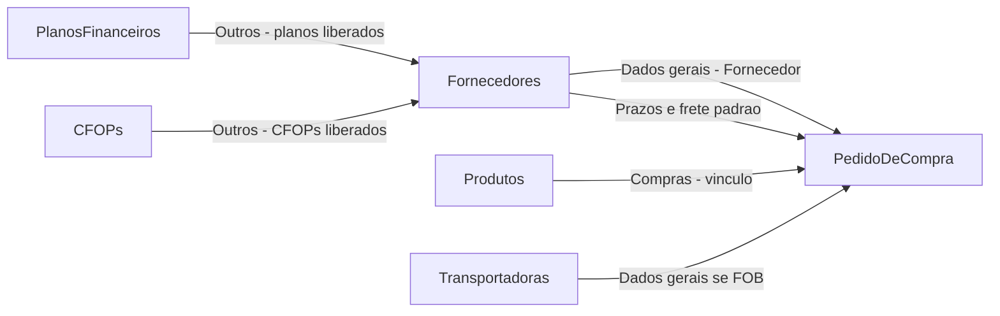


Leitura em texto:

```text
Planos financeiros (subgrupo Despesa) ──► Fornecedores > Outros
CFOPs (entrada)                       ──► Fornecedores > Outros
Fornecedores (prazos / frete)         ──► Pedido > Dados gerais + Pagamento
Produtos > Compras (código/unidade)   ──► Pedido > Lançamento de produtos
Transportadoras                       ──► Pedido > Dados gerais (só se FOB)
```

### 3.3 Diagrama aba → aba (o que o pedido puxa)

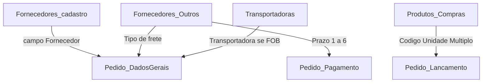


| Aba / cadastro de origem      | Aba do pedido que recebe | O que leva                                              |
| ----------------------------- | ------------------------ | ------------------------------------------------------- |
| Fornecedores (cadastro)       | Dados gerais             | Campo Fornecedor + painel (créditos, pendências)        |
| Fornecedores > Outros         | Dados gerais             | Tipo de frete padrão                                    |
| Fornecedores > Outros         | Pagamento e prazos       | Prazo 1–6 → dias das parcelas                           |
| Transportadoras               | Dados gerais             | Transportadora (obrigatória se FOB)                     |
| Produtos > Compras            | Lançamento de produtos   | Código original, unidade, múltiplo, itens por embalagem |
| Planos financeiros > Despesas | **Para no Fornecedor**   | Não vira campo no pedido                                |
| CFOPs (entrada)               | **Para no Fornecedor**   | Não vira campo no pedido                                |


### 3.4 Tabela Origem → Destino (ligações para validar)


| Sai de (Tela > Aba > Campo)                                                    | Entra em (Tela > Aba > Campo)                                 | O que acontece                                                                                                                                                                                                                                                                                                                                                                    |
| ------------------------------------------------------------------------------ | ------------------------------------------------------------- | --------------------------------------------------------------------------------------------------------------------------------------------------------------------------------------------------------------------------------------------------------------------------------------------------------------------------------------------------------------------------------- |
| Planos financeiros > Despesas > subgrupo ativo                                 | Fornecedores > Outros > Planos financeiros liberados          | Só subgrupo de Despesa ativo                                                                                                                                                                                                                                                                                                                                                      |
| CFOPs > (tipo entrada) > Código                                                | Fornecedores > Outros > CFOPs liberados para entrada          | Só CFOP de entrada                                                                                                                                                                                                                                                                                                                                                                |
| Fornecedores > Outros > Planos + CFOPs + Pares                                 | (permanece no fornecedor)                                     | Parametrização fiscal/financeira; **sem campo no pedido**                                                                                                                                                                                                                                                                                                                         |
| Fornecedores > Outros > Prazo 1–6                                              | Pedido > Pagamento e prazos > Dia                             | Herda os dias das parcelas                                                                                                                                                                                                                                                                                                                                                        |
| Fornecedores > Outros > Tipo de frete                                          | Pedido > Dados gerais > Tipo de frete                         | Obrigatório no cadastro; sugere modalidade (FOB/CIF); **não** afeta Entrada de Notas                                                                                                                                                                                                                                                                                              |
| Fornecedores > Outros > Regra de rateio do frete (CT-e)                        | Entrada de Notas > Frete/CT-e + rateio nos itens              | Obrigatória no cadastro se FOB; oculta em CIF. Se ausente e `modFrete=1`, trava em Frete antes do Cadastro                                                                                                                                                                                                                                                                        |
| Fornecedores > Outros > Fornecedores relacionados                              | Entrada de Notas > Negociação > Pedido de compra              | Rede transitiva (grupo econômico): NF de um CNPJ casa com PO aberto de outro CNPJ do grupo; auto se 1 PO; select lista todos                                                                                                                                                                                                                                                      |
| Fornecedores (lista ativa)                                                     | Pedido > Dados gerais > Fornecedor                            | Seleção obrigatória; carrega contexto                                                                                                                                                                                                                                                                                                                                             |
| Produtos > Compras > Fornecedor                                                | Pedido > Lançamento > Produto                                 | Mesmo fornecedor do cabeçalho do pedido                                                                                                                                                                                                                                                                                                                                           |
| Produtos > Compras > Código Original                                           | Pedido > Lançamento > Código original                         | Preenche sozinho                                                                                                                                                                                                                                                                                                                                                                  |
| Produtos > Compras > Unidade na entrada                                        | Pedido > Lançamento > Unidade                                 | Preenche sozinho                                                                                                                                                                                                                                                                                                                                                                  |
| Produtos > Compras > Múltiplo de compra                                        | Pedido > Lançamento > Múltiplo de compra                      | Valida / sugere quantidade                                                                                                                                                                                                                                                                                                                                                        |
| Produtos > Compras > Quantidade por embalagem                                  | Pedido > Lançamento > Itens por embalagem                     | Base do cálculo de Qtd total UN                                                                                                                                                                                                                                                                                                                                                   |
| Transportadoras (ativa)                                                        | Pedido > Dados gerais > Transportadora                        | Obrigatória se frete FOB                                                                                                                                                                                                                                                                                                                                                          |
| Configurações > Logística > Tipos de Veículos (ativo)                          | Transportadoras > Identificação > Tipo de veículo             | Opcional; só tipos ativos da mesma empresa. Desativar não limpa quem já usa (aparece “(Inativo)”). Não conecta com Pedido nem Entrada                                                                                                                                                                                                                                              |
| Pedido > Dados gerais > Data de faturamento                                    | Pedido > Pagamento > Vencimento                               | Recalcula vencimentos pelos dias                                                                                                                                                                                                                                                                                                                                                  |
| Pedido > Dados gerais > ícone WhatsApp (ao lado do fornecedor)                 | WhatsApp Web/app do comprador                                 | Clique abre `wa.me/<telefone>?text=...` em **todos** os telefones com opção WhatsApp marcada no cadastro. Sem toast de sucesso. Sem nenhum marcado, não abre e avisa para marcar no cadastro. Rota `GET /pedidos-compra/:id/whatsapp-credenciais`                                                                                                                                 |
| Pedido > **Aprovar pedido** (rodapé, rascunho → enviado)                       | Pedido > aba **Avaliação do pedido**                          | Status vira `enviado`; **não** libera o portal e **não** abre WhatsApp. Abre a aba Avaliação. Depois use **Enviar ao fornecedor** (rodapé da Avaliação) para liberar o portal                                                                                                                                                                                                     |
| Pedido > Avaliação (rodapé) > **Enviar ao fornecedor**                         | Portal do fornecedor (público) > Login                        | Botão no painel de comando: cria (ou reabre) acesso (CNPJ + nº do pedido) e abre WhatsApp com a senha em todos os números marcados WhatsApp                                                                                                                                                                                                                                       |
| Pedido > Avaliação (rodapé) > **Enviar credenciais**                           | WhatsApp Web/app nos números marcados do fornecedor           | Com portal liberado: no rodapé, junto de Rascunho/Aprovar; reabre `wa.me` com CNPJ + senha + link em todos os marcados (`GET .../whatsapp-credenciais`). Sem toast de sucesso; sem marca/telefone, avisa                                                                                                                                                                          |
| Pedido > Avaliação (rodapé) > **Rascunho** (voltar para rascunho)              | Pedido (status `enviado` → `rascunho`) + Portal do fornecedor | Popup confirma; status volta a rascunho e o portal é bloqueado (`portalBloqueadoEm` + sessões revogadas). **Preserva todos os dados do pedido** (itens, prazos, frete, observações, crédito, anexos). Reabre só com **Enviar ao fornecedor** após concluir o pedido de novo                                                                                                       |
| Pedido > Avaliação do pedido > Anexar documento do fornecedor (upload interno) | Pedido > Avaliação do pedido > Lista de anexos                | Comprador também pode anexar o documento oficial (recebido por e-mail/WhatsApp, por exemplo) sem depender do upload do próprio fornecedor no portal                                                                                                                                                                                                                               |
| Portal do fornecedor (público) > Upload de documento                           | Pedido > Avaliação do pedido > Lista de anexos                | Anexo aparece no painel interno; e-mail interno de aviso                                                                                                                                                                                                                                                                                                                          |
| Pedido > Avaliação do pedido > Anexo > Conferir com IA                         | Modal de conferência (relatório) + cópia PDF na lista         | Extrai e compara com os itens do pedido; não altera o pedido; gera PDF datado na lista (`tipoAnexo='relatorio_conferencia_ia'`)                                                                                                                                                                                                                                                   |
| Modal Conferir com IA > Aprovar / Solicitar ajuste                             | Anexo (`statusConferencia`) + WhatsApp ao fornecedor          | Aprovar exige senha do ERP; Solicitar ajuste exige motivo escrito; abre `wa.me` em todos os telefones com opção WhatsApp marcada                                                                                                                                                                                                                                                  |
| Modal Conferir com IA > Solicitar ajuste                                       | Anexo (`relatorioConferenciaJson`)                            | Toda conferência salva o relatório (com foto do produto) para consulta futura no painel interno; **o relatório não é exposto no portal do fornecedor** — o fornecedor só vê o motivo do ajuste em texto                                                                                                                                                                           |
| Pedido > Avaliação do pedido > Excluir (anexo)                                 | Lista de anexos + arquivo físico                              | Remove anexo `pendente` ou `ajuste_solicitado` (registro + arquivo em disco) e registra auditoria; **bloqueado** para anexo já `aprovado` (é pré-requisito da aprovação do pedido)                                                                                                                                                                                                |
| Pedido > Avaliação (rodapé) > **Aprovar pedido**                               | Pedido (status `enviado` → `aprovado`) + Portal fechado       | Exige ao menos um anexo com `statusConferencia='aprovado'`; popup avisa que o fornecedor perde o acesso ao portal e o pedido segue no sistema; confirmação com senha do ERP; muda o status, grava `portalBloqueadoEm` e revoga sessões (`aprovar_pedido` + `portalBloqueado: true`); pedido fica **somente leitura** para edição estrutural (ainda pode ser cancelado com motivo) |
| Clientes (lista ativa)                                                         | Contas a Receber > Cliente                                    | Combobox; cliente opcional                                                                                                                                                                                                                                                                                                                                                        |
| Planos financeiros > Receitas > subgrupo ativo                                 | Contas a Receber > Plano financeiro                           | Combobox; plano opcional                                                                                                                                                                                                                                                                                                                                                          |
| Recorrência > Fornecedor + Valor + Vigência                                    | Entrada de Notas (NFS-e / documental)                         | Match só se a emissão está na vigência; valor igual consolida; valor diferente na vigência para em análise                                                                                                                                                                                                                                                                        |
| Recorrência > Agenda do mês                                                    | Lista Chegou / Aguardando nota                                | Consultivo; **não** gera Contas a pagar sem a nota ter chegado                                                                                                                                                                                                                                                                                                                    |
| Estado vivo (parcelas, anexos, estoque, filas)                                 | Pendências (`/pendencias`) + sino + dock                      | `GET /pendencias` / `/resumo`; clique abre a tela de origem; sem “marcar como lida”                                                                                                                                                                                                                                                                                               |
| Endereços WMS > árvore (Local → Área → Rua → Bloco → Andar)                    | Endereços WMS > Apartamento                                   | O `+` na linha cria o próximo nível; o código completo nasce dos ancestrais + AP; coluna **Nível** identifica o item                                                                                                                                                                                                                                                           |
| Endereços WMS > Cadastrar endereços / Gerar em massa na linha                  | Endereços WMS > um AP ou faixas                               | Prévia ao vivo + gravação; pula duplicata no mesmo andar; teto 10 mil; na linha o caminho do item já vem preenchido                                                                                                                                                                                                                                                              |
| Endereços WMS > Excluir (menu da linha)                                        | Estrutura / AP; recusa se produto usar o código               | Sem produto: apaga o AP ou a subárvore vazia. Com produto: 409 — realocar em Produtos > Logística                                                                                                                                                                                                                                                                               |
| Endereços WMS > Apartamento (código completo)                                  | Produtos > Logística > Endereços de estoque                   | Combobox busca o AP ativo; produto já gravado usa **Salvar neste produto** (`PUT /produtos/:id/enderecos-estoque`); produto novo só no **Cadastrar produto**; código como texto (sem FK; sem saldo por endereço)                                                                                                                                                                 |
| Configurações > Vendas > Parametrização de custos                              | Precificação da nota consolidada                              | Determinante permanente da empresa (Total Venda) alimenta a formação de preço; **não** entra no custo contábil, no custo da Auditoria nem no kardex                                                                                                                                                                                                                              |
| Requisições > Nova / ficha (tipo, prioridade, origem, destino, produto, responsável) | Requisições > fila do operador / lista da empresa        | Ordem operacional; **não** gera movimento de estoque ao concluir                                                                                                                                                                                                                                                                                                                |
| Entrada de Notas > Liberar para contagem (**Quem vai contar**)                         | Requisições (tipo **Contagem de entrada**) + Contagens   | Cria/reabre uma OS atribuída; o bip cego continua em `/contagens`; POST `/requisicoes` **não** cria esse tipo                                                                                                                                                                                                                                                                   |
| Auditoria de entradas > Precificar                                             | Precificação (`/auditoria-entradas/[id]/precificacao`)        | Abre a grade de formação de preço; clique na linha da lista continua abrindo o dossiê só leitura                                                                                                                                                                                                                                                                                  |
| Precificação > Gravar                                                          | Produtos > Compras > Preço de venda                           | Atualiza `Produto.precoVenda` (não sobrescreve preço de custo)                                                                                                                                                                                                                                                                                                                    |
| Orçamentos (`/orcamentos`, `/orcamentos/novo`, `/orcamentos/[id]`)             | `Orcamento` + `PedidoVenda` (`POST /orcamentos/:id/finalizar`) | Grava proposta; desconto em modal; anexos e histórico. **Fechar pedido** cria um pedido de venda e trava o orçamento. Não mexe em estoque nem financeiro. ST nesta versão é 0 e soma no total sem misturar no líquido.                                                                                                                                                                       |
| Pedidos de venda (`/pedidos-venda`)                                            | `PedidoVenda` copiado na conversão                            | Lista e ficha somente leitura. **Copiar pedido** no orçamento lê estes itens sem alterar a origem                                                                                                                                                                                                                                                                              |
| Receber pagamento (totem / dinheiro / chamado)                                 | Separação de pedidos (`RequisicaoWms` tipo `separacao`)       | Confirmar pago grava `VendaCaixa` + uma Separação por produto. **Chame um atendente** não gera Separação até o caixa confirmar. Crédito no totem: parcelas vindas de Configurações → **Cartões de Pagamento** (união de N× ativos) gravadas em `VendaCaixa.numeroParcelas`. Forma só o nome (sem gateway)                                                                                                                                                                                                                     |


### 3.5 O que NÃO conecta no pedido

- **Plano financeiro** — não existe campo de plano na tela do pedido. Fica só em **Fornecedores > Outros**.
- **CFOP** — não existe campo de CFOP na tela do pedido. Fica só em **Fornecedores > Outros**.
- **Pares Plano + CFOP** — idem: só no fornecedor.
- **Kardex / inventário** — não é alimentado pelo pedido nesta fase; ledger próprio em `/estoque`. Entrada de Notas: **Liberar para contagem** só muda status; **Consolidar estoque** (senha) grava físico + fiscal no kardex (`entrada_nf`).
- **Contas a Receber** — não nasce de NF-e de saída nem de pedido de venda nesta fase (só cadastro manual). Tipo **Crédito** é classificação do título, **não** é o crédito/pendência do fornecedor no pedido.
- **Endereços WMS** — o cadastro mestre (`/enderecos-wms`) alimenta **só** a busca/seleção do código em **Produtos > Logística > Endereços de estoque**. Produto já existente grava com **Salvar neste produto**; produto novo, com **Cadastrar produto**. **Não** alimenta Kardex, Contagem, Entrada nem Precificação nesta fase (sem saldo/picking por endereço). O código é montado pela árvore (LOCAL-ÁREA-RUA-BLOCO-ANDAR-AP); o tipo fica no apartamento. Novo AP continua só na tela Endereços WMS.
- **Parametrização de custos (Configurações → Vendas)** — um registro por empresa (sem mês). Alimentam **só** a formação de preço (encargos / Total Venda). **Não** alteram o custo contábil, o custo da Auditoria nem o kardex. Mudar o determinante **não** reescreve o catálogo — o preço no produto só muda no **Gravar** da grade. CBS, IBS e juros ficam fora do divisor nesta fase.
- **Orçamentos** (`/orcamentos`) — grava a proposta da empresa. **Fechar pedido** cria um `PedidoVenda` (uma vez). **Não** alimenta pedido de compra, estoque nem contas a receber. O caixa continua recebendo o orçamento (`em_aberto` ou `convertido`).

### 3.5b Estoque / Kardex (Fase 1)

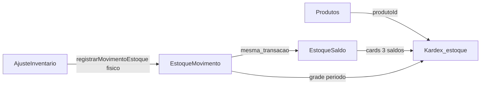


| Sai de                                | Entra em                        | O que acontece                                                                                                                                |
| ------------------------------------- | ------------------------------- | --------------------------------------------------------------------------------------------------------------------------------------------- |
| Produtos (`controlaEstoque`)          | EstoqueSaldo                    | Saldo 0 sob demanda na consulta/movimento                                                                                                     |
| Produtos + `ProdutoFornecedor` + `ProdutoEnderecoEstoque` | Painel do Kardex                | Ficha + vínculos (leitura) + códigos de endereço atuais; custo atual de `Produto.precoCusto`                                                   |
| Ajuste de inventário                  | EstoqueMovimento + EstoqueSaldo | Só físico; modo qtd final / entrada / saída; opcional `pessoaId`; `precoCusto` editável na linha; fiscal inalterado                           |
| Entrada de Notas (Consolidar estoque) | EstoqueMovimento + EstoqueSaldo | NFe 55 com produto `controlaEstoque`: físico + fiscal (`entrada_nf`); exige `entrada_contagem_ok`; painel **Entradas consolidadas**           |
| Contagens de entrada (`/contagens`)   | ContagemEntrada + OS Contagem de entrada + status NFe | Sessão cega; operador só nas NFs designadas; admin vê **Quem vai contar**; **Gravar** = rascunho; **Finalizar** OK → `entrada_contagem_ok` + OS concluída |
| Endereços WMS (`/enderecos-wms`)      | Produtos > Logística            | Combobox lê APs ativos (`GET /enderecos-wms?q=` + teto 80); grava `codigoCompleto` em `ProdutoEnderecoEstoque.endereco` (**Salvar neste produto** no produto existente ou **Cadastrar produto** no novo). O Kardex **mostra** esse texto no painel; Contagem e Entrada **não** leem `EnderecoWms` |


### 3.6 Roteiro rápido sintoma → onde olhar

Usar esta tabela ao receber um bug no fluxo de compra / cadastros ligados. Depois abrir a ficha da tela (seção 6) e os arquivos listados.


| Sintoma típico                                                                                                                                | Provável tela / aba                                                                         | Conexão / regra                                                                                                                                                                                                                                                                                                                                                                                                                                                                                                                                                                                                                | Onde olhar no código                                                                                                                                                                                                                                                                                                                                           |
| --------------------------------------------------------------------------------------------------------------------------------------------- | ------------------------------------------------------------------------------------------- | ------------------------------------------------------------------------------------------------------------------------------------------------------------------------------------------------------------------------------------------------------------------------------------------------------------------------------------------------------------------------------------------------------------------------------------------------------------------------------------------------------------------------------------------------------------------------------------------------------------------------------ | -------------------------------------------------------------------------------------------------------------------------------------------------------------------------------------------------------------------------------------------------------------------------------------------------------------------------------------------------------------- |
| Código ou unidade vazios no item do pedido                                                                                                    | Produtos > Compras + Pedido > Lançamento                                                    | Vínculo produto × fornecedor                                                                                                                                                                                                                                                                                                                                                                                                                                                                                                                                                                                                   | `frontend/components/produtos/lista-fornecedores-produto.tsx`, `frontend/components/pedidos-compra/lancamento-itens-pedido.tsx`, `frontend/lib/preencher-item-pedido-compra.ts`, `src/modulos/pedidos-compra/normalizar-itens-pedido-compra.ts`, `src/modulos/pedidos-compra/servico-pedidos-compra.ts`                                                        |
| Ao salvar produto, múltiplo de compra vira igual à quantidade por embalagem                                                                   | Produtos > Compras                                                                          | Campos independentes; save não deve copiar embalagem → múltiplo                                                                                                                                                                                                                                                                                                                                                                                                                                                                                                                                                                | `esquema-produtos.ts` (`esquemaProdutoFornecedor`), `lista-fornecedores-produto.tsx`                                                                                                                                                                                                                                                                           |
| Transportadora exigida / FOB vs CIF                                                                                                           | Pedido > Dados gerais                                                                       | Modalidade FOB limpa/exige transportadora                                                                                                                                                                                                                                                                                                                                                                                                                                                                                                                                                                                      | `frontend/components/pedidos-compra/formulario-pedido-compra.tsx`, `frontend/lib/pedido-compra-shared.ts`, `src/modulos/pedidos-compra/modalidade-transporte.ts`                                                                                                                                                                                               |
| Parcelas / dias / vencimento errados                                                                                                          | Fornecedores > Outros + Pedido > Pagamento                                                  | Prazos 1–6 herdados                                                                                                                                                                                                                                                                                                                                                                                                                                                                                                                                                                                                            | `frontend/components/pedidos-compra/bloco-pagamento-prazos.tsx`, `frontend/lib/prazos-pagamento.ts`, `src/modulos/pedidos-compra/parcelas-pagamento.ts`                                                                                                                                                                                                        |
| Prazo diverge na Negociação com datas na NF × dias no pedido                                                                                  | Entrada de Notas > Negociação > Prazo                                                       | Comparação em **dias**: vencimentos da NF (`dVenc`) → dias = vencimento − emissão; pedido usa `condicaoPagamento` (`28/42/…`)                                                                                                                                                                                                                                                                                                                                                                                                                                                                                                  | `src/modulos/entrada-notas/analise-negociacao/analisar-negociacao.ts`, `normalizar-prazo-negociacao.ts`, `servico-pipeline-entrada.ts` (`dataEmissao`)                                                                                                                                                                                                         |
| Soma das parcelas ≠ total líquido                                                                                                             | Pedido > Pagamento (rateio manual)                                                          | Tolerância de soma                                                                                                                                                                                                                                                                                                                                                                                                                                                                                                                                                                                                             | `frontend/lib/parcelas-pagamento-pedido.ts`, `bloco-pagamento-prazos.tsx`, serviço pedidos                                                                                                                                                                                                                                                                     |
| Plano ou CFOP “não aparece no pedido”                                                                                                         | —                                                                                           | **Não é bug**: não há campo no pedido (seção 3.5)                                                                                                                                                                                                                                                                                                                                                                                                                                                                                                                                                                              | Só validar se o vínculo está em Fornecedores > Outros                                                                                                                                                                                                                                                                                                          |
| Crédito excede saldo / não aplica                                                                                                             | Pedido > Pagamento                                                                          | Reserva ≤ saldo                                                                                                                                                                                                                                                                                                                                                                                                                                                                                                                                                                                                                | formulário pedido + `src/modulos/pedidos-compra/servico-movimentacao-credito.ts`, `servico-creditos-pendencias.ts`                                                                                                                                                                                                                                             |
| Não salva rascunho / não conclui                                                                                                              | Pedido (validações)                                                                         | Seção 7.1                                                                                                                                                                                                                                                                                                                                                                                                                                                                                                                                                                                                                      | `formulario-pedido-compra.tsx`, `src/modulos/pedidos-compra/servico-pedidos-compra.ts`, `esquema-pedidos-compra.ts`                                                                                                                                                                                                                                            |
| Status não muda (rascunho ↔ enviado)                                                                                                          | Pedido salvar/concluir                                                                      | `concluir=true` → enviado (rótulo na UI: **Enviado**)                                                                                                                                                                                                                                                                                                                                                                                                                                                                                                                                                                          | `resolver-status-edicao-pedido.ts`, repositório pedidos                                                                                                                                                                                                                                                                                                        |
| Botão "Aprovar pedido" desabilitado                                                                                                           | Pedido > Avaliação (rodapé)                                                                 | Exige anexo com `statusConferencia='aprovado'` e pedido com status `enviado` (não exige ter rodado a IA)                                                                                                                                                                                                                                                                                                                                                                                                                                                                                                                       | `frontend/components/pedidos-compra/formulario-pedido-compra.tsx` (rodapé), `src/modulos/pedidos-compra/servico-pedidos-compra.ts` (`aprovarPedidoCompra`)                                                                                                                                                                                                     |
| Não consegue aprovar documento sem Conferir com IA                                                                                            | Pedido > Avaliação > Documentos                                                             | **Não é bug**: Aprovar e Solicitar ajuste ficam na lista do anexo; a IA é opcional                                                                                                                                                                                                                                                                                                                                                                                                                                                                                                                                             | `aba-avaliacao-pedido.tsx` (ações Aprovar / Solicitar ajuste), rotas `POST .../aprovar` e `.../solicitar-ajuste`                                                                                                                                                                                                                                               |
| Não consegue excluir anexo                                                                                                                    | Pedido > Avaliação do pedido                                                                | Bloqueado se anexo já `aprovado`                                                                                                                                                                                                                                                                                                                                                                                                                                                                                                                                                                                               | `src/modulos/portal-fornecedor/servico-portal-fornecedor.ts` (`excluirAnexo`), rota `DELETE .../anexos-fornecedor/:anexoId`                                                                                                                                                                                                                                    |
| Pedido aprovado ainda editável                                                                                                                | Pedido formulário                                                                           | Status `aprovado` bloqueia edição estrutural                                                                                                                                                                                                                                                                                                                                                                                                                                                                                                                                                                                   | `frontend/lib/pedido-compra-shared.ts` (`pedidoEditavel`), `formulario-pedido-compra.tsx`                                                                                                                                                                                                                                                                      |
| Aba Avaliação não aparece / não abre sozinha                                                                                                  | Pedido > abas                                                                               | Só visível com status enviado/aprovado/parcial/recebido; auto-abre ao concluir ou ao reabrir pedido enviado                                                                                                                                                                                                                                                                                                                                                                                                                                                                                                                    | `formulario-pedido-compra.tsx`, `pedido-compra-shared.ts` (`pedidoExibeAbaAvaliacao`)                                                                                                                                                                                                                                                                          |
| Fornecedor não recebe WhatsApp / portal não liberado                                                                                          | Pedido > Enviar ao fornecedor (rodapé Avaliação)                                            | Portal **não** libera ao concluir o pedido (rascunho → enviado); exige clicar **Enviar ao fornecedor**; WhatsApp exige telefone **com opção WhatsApp marcada** no cadastro                                                                                                                                                                                                                                                                                                                                                                                                                                                     | `src/modulos/portal-fornecedor/servico-portal-fornecedor.ts` (`liberarParaFornecedor`), `src/modulos/notificacoes-whatsapp/mensagens-whatsapp-portal.ts`, botão no rodapé de `formulario-pedido-compra.tsx`                                                                                                                                                    |
| Não edita / não cancela pedido                                                                                                                | Lista ou formulário                                                                         | Bloqueio se cancelado, recebido ou aprovado (edição); cancelamento bloqueado se recebido                                                                                                                                                                                                                                                                                                                                                                                                                                                                                                                                       | `pedido-compra-shared.ts` (`pedidoEditavel`), serviço cancelar                                                                                                                                                                                                                                                                                                 |
| Plano recusado no fornecedor                                                                                                                  | Fornecedores > Outros                                                                       | Só subgrupo Despesa ativo                                                                                                                                                                                                                                                                                                                                                                                                                                                                                                                                                                                                      | `src/modulos/fornecedores/validacao-planos-fornecedor.ts`, `servico-fornecedores.ts`                                                                                                                                                                                                                                                                           |
| Busca de fornecedores vinculados cortada / lista não aparece no modal                                                                         | Fornecedores > Outros > Fornecedores vinculados                                             | Dropdown absoluto era cortado pelo `overflow-y-auto` do modal; lista usa portal + `fixed`                                                                                                                                                                                                                                                                                                                                                                                                                                                                                                                                      | `frontend/components/fornecedores/fornecedores-relacionados-field.tsx`, `frontend/components/ui/modal.tsx`                                                                                                                                                                                                                                                     |
| Erro Prisma `documentoFavorecido` Expected String / provided Object ao salvar Fornecedor ou Transportadora                                    | Fornecedores / Transportadoras > Dados Bancários                                            | Função local de normalizar campos do formulário não pode se chamar `normalizarDocumento` (sombreia o import que limpa CPF/CNPJ string)                                                                                                                                                                                                                                                                                                                                                                                                                                                                                         | `src/modulos/fornecedores/repositorio-fornecedores.ts` (`criarDadosBancarios`, `normalizarCamposFornecedor`), `src/modulos/transportadoras/repositorio-transportadoras.ts` (`criarDadosBancarios`, `normalizarCamposTransportadora`), `src/compartilhado/validacoes/documentos.ts` (`normalizarDocumento`)                                                     |
| CNPJ preenchido no cadastro e razão/CNAE/endereço não vêm da Receita                                                                          | Fornecedores / Clientes / Transportadoras > Identificação                                   | BrasilAPI 5xx/timeout no CNPJ; o proxy tenta OpenCNPJ; se as duas falharem, a tela mostra **Não foi possível consultar a Receita Federal** (não engole o erro)                                                                                                                                                                                                                                                                                                                                                                                                                                                                | `src/modulos/integracoes/servico-brasil-api.ts`, `GET /integracoes/cnpj/:documento`, `frontend/hooks/use-consulta-documento.ts`, `frontend/lib/brasil-api.ts`                                                                                                                                                                                                   |
| SKU duplicado / próximo SKU / ponto no código                                                                                                 | Produtos > Principal                                                                        | Unicidade por empresa; SKU gravado sem ponto                                                                                                                                                                                                                                                                                                                                                                                                                                                                                                                                                                                   | `src/modulos/produtos/normalizar-sku.ts`, `sku-sequencial.ts`, `servico-produtos.ts`                                                                                                                                                                                                                                                                           |
| Carga em lote Santri (catálogo / vínculo)                                                                                                     | Scripts CLI (sem tela)                                                                      | Import ODS → produtos; CSV de-para → `ProdutoFornecedor`                                                                                                                                                                                                                                                                                                                                                                                                                                                                                                                                                                       | `scripts/migrar-produtos-santri.ts`, `scripts/migrar-vinculos-fornecedor-santri.ts`, `scripts/migracao-santri/README.md`                                                                                                                                                                                                                                       |
| Login falha / menu vazio                                                                                                                      | Login / Usuários                                                                            | JWT, páginas liberadas                                                                                                                                                                                                                                                                                                                                                                                                                                                                                                                                                                                                         | `frontend/app/login/page.tsx`, `src/modulos/autenticacao/servico-autenticacao.ts`, cadastro de páginas do usuário                                                                                                                                                                                                                                              |
| Menu sem tela esperada                                                                                                                        | Usuários > Permissões                                                                       | Páginas liberadas                                                                                                                                                                                                                                                                                                                                                                                                                                                                                                                                                                                                              | `frontend/app/users/conteudo-pagina-usuarios.tsx`, `src/modulos/usuarios/servico-usuarios.ts`                                                                                                                                                                                                                                                                  |
| Permissão negada na API                                                                                                                       | Papéis / Usuários                                                                           | Telas e abas do papel (`RoleTabAccess`) + grade Ver/Criar/Editar/Excluir + extras do usuário                                                                                                                                                                                                                                                                                                                                                                                                                                                                                                                                                                                                   | `frontend/app/papeis/conteudo-pagina-papeis.tsx`, `src/modulos/acesso/servico-acesso-aba.ts`, middleware de autorização                                                                                                                                                                                                                                            |
| Transportadora não aparece no pedido FOB                                                                                                      | Transportadoras + Pedido                                                                    | Cadastro ativo                                                                                                                                                                                                                                                                                                                                                                                                                                                                                                                                                                                                                 | `frontend/app/transportadoras/page.tsx`, formulário pedido                                                                                                                                                                                                                                                                                                     |
| Fornecedor não consegue entrar no portal                                                                                                      | Portal do fornecedor (login)                                                                | CNPJ + senha (nº do pedido); rate limit; sessão expira em 7 dias; ou portal fechado (`portalBloqueadoEm`) após **Rascunho** ou **Aprovar pedido**                                                                                                                                                                                                                                                                                                                                                                                                                                                                              | `src/modulos/portal-fornecedor/servico-portal-fornecedor.ts`, `rate-limit-login-portal.ts`, `repositorio-portal-fornecedor.ts`                                                                                                                                                                                                                                 |
| Anexo do fornecedor não aparece no painel interno                                                                                             | Pedido > Avaliação do pedido                                                                | Upload só é aceito com sessão de portal válida ou upload interno do comprador                                                                                                                                                                                                                                                                                                                                                                                                                                                                                                                                                  | `src/modulos/portal-fornecedor/controlador-portal-fornecedor.ts`, `armazenamento-anexo-fornecedor.ts`                                                                                                                                                                                                                                                          |
| Anexo conferido com IA não aparece como "Conferido com IA" na lista                                                                           | Pedido > Avaliação do pedido > Documentos                                                   | Frontend não recarregava anexos após `POST conferir-ia`                                                                                                                                                                                                                                                                                                                                                                                                                                                                                                                                                                        | `frontend/components/pedidos-compra/modal-conferencia-ia.tsx` (`aoConferirConcluida`), `formulario-pedido-compra.tsx` (`carregarPedidoNoForm`)                                                                                                                                                                                                                 |
| Cópia do relatório IA não aparece na lista                                                                                                    | Pedido > Avaliação do pedido > Documentos                                                   | Conferência deve criar anexo PDF com timestamp                                                                                                                                                                                                                                                                                                                                                                                                                                                                                                                                                                                 | `src/modulos/pedidos-compra/servico-pedidos-compra.ts` (`conferirAnexoComIa`), `nome-arquivo-copia-conferencia-ia.ts`                                                                                                                                                                                                                                          |
| "Conferir com IA" falha ou fica indisponível                                                                                                  | Pedido > Avaliação do pedido > Anexo                                                        | Sem `IA_PROVIDER`/`IA_API_KEY` no `.env` → 503 na hora (validado antes de enfileirar); PDF ilegível → `falha_extracao`; 2 chamadas simultâneas no mesmo pedido → 409 (dedupe do job); a extração roda no worker, então **não** há mais `ECONNRESET`/socket hang up por request longo — a falha aparece como `status=erro` no `GET /jobs/:id`, com o log `[conferencia-ia]` por etapa no terminal da API; erro de sobrecarga do modelo ("high demand"/503) → tenta de novo automaticamente até 3x (`[ia] tentativa N/3...` no log) e, se persistir, cai para um modelo de fallback mais leve antes de reportar `falha_extracao` | `src/compartilhado/ia/config-ia.ts`, `src/compartilhado/ia/provedor-resiliente.ts` (retry + fallback de modelo), `src/modulos/pedidos-compra/conferencia-arquivo/servico-conferencia-arquivo.ts`, `src/modulos/pedidos-compra/extrator-texto-pdf.ts` (extração de texto do PDF via `unpdf`), `src/compartilhado/jobs/`                                         |
| Relatório da IA aponta item "sem match" ou "sobra"                                                                                            | Modal Conferir com IA                                                                       | Sem código de barras/original em comum e nome/preço abaixo do limiar (`IA_LIMIAR_NOME`)                                                                                                                                                                                                                                                                                                                                                                                                                                                                                                                                        | `src/modulos/pedidos-compra/conferencia-arquivo/matcher-itens.ts`                                                                                                                                                                                                                                                                                              |
| "Aprovar" recusa mesmo digitando a senha certa                                                                                                | Modal Conferir com IA                                                                       | Confirmação usa a senha da conta ERP do usuário logado (não é senha do portal)                                                                                                                                                                                                                                                                                                                                                                                                                                                                                                                                                 | `frontend/components/compartilhado/confirmacao-com-senha.tsx`, `src/modulos/autenticacao/servico-autenticacao.ts` (`verificarSenhaDoUsuario`)                                                                                                                                                                                                                  |
| "Solicitar ajuste" / "Aprovar" / "Enviar ao fornecedor" / ícone WhatsApp não abre                                                             | Pedido                                                                                      | Sem telefone no cadastro, nenhum com opção WhatsApp marcada, ou popup bloqueado pelo navegador (2+ abas)                                                                                                                                                                                                                                                                                                                                                                                                                                                                                                                       | `frontend/lib/whatsapp-portal.ts`, `GET /pedidos-compra/:id/whatsapp-credenciais`, `src/modulos/fornecedores/repositorio-fornecedores.ts` (`criarContatos`), flag WhatsApp no cadastro                                                                                                                                                                         |
| Upload interno falha com PDF/Excel válido                                                                                                     | Pedido > Avaliação > Documentos do fornecedor                                               | Navegador (Windows) pode enviar `mimeType` vazio — frontend infere pela extensão antes da API                                                                                                                                                                                                                                                                                                                                                                                                                                                                                                                                  | `frontend/lib/anexo-fornecedor.ts` (`inferirMimeTypeAnexo`, `validarArquivoAnexoFornecedor`), `formulario-pedido-compra.tsx`, `portal-fornecedor/pedido/page.tsx`                                                                                                                                                                                              |
| "Voltar pedido para rascunho" / **Rascunho** não aparece                                                                                      | Pedido > Avaliação (rodapé)                                                                 | Só com status `enviado`, portal liberado e não bloqueado                                                                                                                                                                                                                                                                                                                                                                                                                                                                                                                                                                       | `frontend/components/pedidos-compra/formulario-pedido-compra.tsx`, `POST /pedidos-compra/:id/voltar-para-rascunho`                                                                                                                                                                                                                                             |
| Fornecedor pergunta pelo relatório da conferência no portal                                                                                   | Portal do fornecedor (público) > Pedido                                                     | **Não é bug**: o relatório (KPIs, divergências, foto do produto) é exclusivo do painel interno (modal "Conferir com IA"); no portal, o fornecedor só vê o motivo do ajuste em texto                                                                                                                                                                                                                                                                                                                                                                                                                                            | `src/modulos/portal-fornecedor/servico-portal-fornecedor.ts` (`mapearPedidoParaPortal`), `frontend/app/portal-fornecedor/pedido/page.tsx`                                                                                                                                                                                                                      |
| Foto do produto não aparece no relatório (modal ou PDF)                                                                                       | Pedido > item / Produto                                                                     | Produto sem foto do tipo "miniatura" cadastrada; ou relatório foi salvo antes desta funcionalidade (`fotoUrl` não existia)                                                                                                                                                                                                                                                                                                                                                                                                                                                                                                     | `src/modulos/pedidos-compra/conferencia-arquivo/servico-conferencia-arquivo.ts`, `src/modulos/produtos/armazenamento-foto-produto.ts`                                                                                                                                                                                                                          |
| Comprador não vê "Baixar PDF" no modal Conferir com IA                                                                                        | Pedido > Avaliação do pedido > anexo > Conferir com IA                                      | Só aparece depois que o relatório é carregado no modal (seja de uma conferência nova, seja de um relatório salvo aberto como "Conferido com IA"); anexo nunca conferido não tem relatório para gerar PDF                                                                                                                                                                                                                                                                                                                                                                                                                       | `src/modulos/pedidos-compra/servico-pedidos-compra.ts` (`baixarRelatorioConferenciaAnexo`), `frontend/components/pedidos-compra/modal-conferencia-ia.tsx`                                                                                                                                                                                                      |
| Foto do produto aparece quebrada (ícone de imagem quebrada) no portal do fornecedor                                                           | Portal do fornecedor (público) > Itens                                                      | `/uploads/...` precisa ser rota pública no Next; sem isso, o middleware redireciona a imagem para `/login` (sem cookie `erp_token`) e o `` quebra                                                                                                                                                                                                                                                                                                                                                                                                                                                                         | `frontend/middleware.ts` (`ROTAS_PUBLICAS` deve incluir `/uploads`), `frontend/next.config.ts` (rewrite `/uploads` → API)                                                                                                                                                                                                                                      |
| UI muito grande / “zoom perto demais” / pouco conteúdo na tela                                                                                | Qualquer tela (shell)                                                                       | Densidade tipográfica global 14px (IBM Plex Sans); padding do conteúdo                                                                                                                                                                                                                                                                                                                                                                                                                                                                                                                                                         | `frontend/app/globals.css` (`html { font-size: 14px }`), `frontend/app/layout.tsx` (fonte + viewport), `frontend/components/layout/layout-principal.tsx`                                                                                                                                                                                                       |
| Scroll horizontal excessivo em listagens / lançamento de itens                                                                                | Listagens ou Pedido > Lançamento                                                            | Tabelas com `min-w` + colunas ocultas em breakpoints                                                                                                                                                                                                                                                                                                                                                                                                                                                                                                                                                                           | `frontend/components/pedidos-compra/lancamento-itens-pedido.tsx`, páginas de listagem (`clientes`, `users`, `pedidos-compra`, etc.)                                                                                                                                                                                                                            |
| Cabeçalho do grid de planos com texto sobreposto (ex.: Autoriza uso e consumo × Situação)                                                     | Configurações → Financeiro → Planos                                                         | `table-fixed` + `whitespace-nowrap` com coluna estreita demais                                                                                                                                                                                                                                                                                                                                                                                                                                                                                                                                                                 | `frontend/components/planos-financeiros/arvore-planos-financeiros.tsx`, `linha-overlay-drag.tsx`, `cabecalho-coluna-ordenavel.tsx` (`quebrarTexto`)                                                                                                                                                                                                            |
| Auditoria sem “Por página” / não muda quantidade de registros                                                                                 | Auditoria                                                                                   | Paginação server-side com `ControlesPaginacao`                                                                                                                                                                                                                                                                                                                                                                                                                                                                                                                                                                                 | `frontend/app/auditoria/page.tsx`, `frontend/components/ui/controles-paginacao.tsx`, `src/modulos/auditoria/rotas-auditoria.ts`, `repositorio-auditoria.ts` (`pagina` + `limite` 10/25/50)                                                                                                                                                                     |
| Lista de produtos lenta / timeout / derruba o BD ao abrir Produtos ou Pedido                                                                  | Produtos / Pedido > Lançamento                                                              | Catálogo grande: listagem **sempre** paginada no servidor; pedido busca sob demanda                                                                                                                                                                                                                                                                                                                                                                                                                                                                                                                                            | `src/modulos/produtos/paginacao-produtos.ts`, `repositorio-produtos.ts` (`listarPorEmpresa`), `frontend/app/produtos/page.tsx`, `formulario-pedido-compra.tsx`, `combobox-produto.tsx`                                                                                                                                                                         |
| Endereço de estoque no produto é texto livre / não acha o AP do depósito                                                                      | Produtos > Logística                                                                        | Combobox `GET /enderecos-wms?q=` (tokens AND, teto 80); lista em portal **sempre abaixo** do input; folga de scroll na aba; só **apartamento**; cadastro novo em `/enderecos-wms`; duplicata bloqueia a aba                                                                                                                                                                                                                                                                                                                                                     | `combobox-endereco-wms.tsx`, `lista-enderecos-estoque.tsx`, `resolverTakeListagemEnderecoWms`, `repositorio-enderecos-wms.ts`                                                                                                                                                                                                                                  |
| Busca de produto / catálogo só acha se digitar “exato” / várias palavras não funcionam                                                        | Produtos, Pedido, Entrada Conciliar, Estoque, CFOP, planos, marcas, fornecedor (nome)       | **Regra §7.13:** palavras separadas por espaço (AND) + trecho parcial case-insensitive — não frase contínua. Helpers únicos. Conciliar: modal com `q` + `marca`                                                                                                                                                                                                                                                                                                                                                                                                                                                                | `filtro-busca-textual.ts`, `normalizar-busca.ts`, `repositorio-produtos.ts` (`montarWhereListagem`), `filtro-busca-produto.ts` (`filtroMarcaProduto`), `modal-conciliar-produto.tsx`, `[id]/page.tsx` (debounce), `combobox-produto.tsx`                                                                                                                       |
| Combo **Plano financeiro** na Entrada (ou Contas a pagar) não acha plano habilitado (ex.: digita `ates` e “Nenhum resultado”)               | Entrada > Financeiro / títulos a gerar; Contas a pagar/receber; CFOP                        | Catálogo sem `q` deve listar **todas** as folhas ativas (`children: none`); `take: 50` só com `q`. UI filtra no cliente (§7.13 / §7.20)                                                                                                                                                                                                                                                                                                                                                                                                                                                                                      | `opcoes-listar-folhas-ativas.ts`, `repositorio-planos-financeiros.ts` (`listarFolhasAtivas`), `combobox-plano-financeiro.tsx`, `entrada-notas/[id]/page.tsx`                                                                                                                                                                                                   |
| Busca de produto só acha se digitar o ponto (`9.325` / `6.500K`)                                                                              | Produtos, Pedido, Estoque, Conciliar                                                        | Ponto visual do Santri/milhar é **ignorado** no SKU e no nome (`9325` = `9.325`)                                                                                                                                                                                                                                                                                                                                                                                                                                                                                                                                               | `normalizar-sku.ts` (`tokensSkuParaBusca`), `filtro-busca-produto.ts`, `repositorio-produtos.ts`, `combobox-produto.tsx`, `textoContemTermoIgnorandoPontos`                                                                                                                                                                                                    |
| Chrome preenche e-mail/senha salva na busca da lista (ex.: `admin@erp.local` em **Pesquisar na lista**)                                       | Entrada de Notas, Fornecedores, Clientes, Pedidos, Usuários, Transportadoras, Endereços WMS | Campos de busca de lista usam `CampoBuscaLista` (`autoComplete=one-time-code`, `readOnly` até o primeiro foco, `name` não-credencial, `data-1p-ignore`). Na Entrada, busca que parece e-mail é descartada do `sessionStorage` — não confundir com login                                                                                                                                                                                                                                                                                                                                                                        | `frontend/components/compartilhado/campo-busca-lista.tsx`, `frontend/lib/atributos-campo-busca-lista.ts`, `entrada-notas/page.tsx`, `fornecedores/page.tsx`, `clientes/page.tsx`, `pedidos-compra/page.tsx`, `users/page.tsx`, `transportadoras/page.tsx`, `enderecos-wms/page.tsx`                                                                            |
| Código WMS recusado / duplicado / letra na rua                                                                                                | Endereços WMS                                                                               | Formato `A-RC-20-01-2-05`; unicidade por pai (AP no andar) e `codigoCompleto` por empresa; código montado pela árvore                                                                                                                                                                                                                                                                                                                                                                                                                                                                 | `nomenclatura-endereco-wms.ts`, `servico-enderecos-wms.ts`, `servico-estrutura-wms.ts`, `frontend/app/enderecos-wms/page.tsx`, §7.25                                                                                                                                                                                                                                                       |
| Sync Focus OK mas lista Entrada vazia / só NFe sem NFS-e                                                                                      | Entrada de Notas / Focus                                                                    | DistDFe vazio ou flag **Recebimento de NFSes do ambiente nacional** off; filtro de datas só no banco local; sync em lotes de 10 (botões manuais)                                                                                                                                                                                                                                                                                                                                                                                                                                                                               | `src/modulos/focus-nfe/servico-focus-nfe.ts`, `cliente-focus-nfe.ts`, `MANUAL-FOCUS-NFE.md`                                                                                                                                                                                                                                                                    |
| CT-e pede cadastro de fornecedor mesmo com transportadora já cadastrada                                                                       | Entrada de Notas > CT-e > Cadastro                                                          | Emitente do CT-e deve casar com Pessoa papel **fornecedor ou transportadora** (`aceitarTransportadoraComoEmitente`); atalho UI oferece Transportadoras / Fornecedores                                                                                                                                                                                                                                                                                                                                                                                                                                                          | `analisar-cadastro.ts`, `buscarFornecedorPorCnpj({ aceitarTransportadora })`, `[id]/page.tsx`                                                                                                                                                                                                                                                                  |
| CT-e vinculado parece travado em “Em análise” / pede lançar                                                                                   | Entrada de Notas > CT-e                                                                     | Esperado: CT-e **não** lança sozinho — custo/título saem na NF. Lista mostra etapa **Vinculado** + badge; detalhe aponta para NF (`?aba=frete`); aba Lançamento não oferece Liberar                                                                                                                                                                                                                                                                                                                                                                                                                                            | `analisarNotaDocumental`, `entrada-notas/page.tsx` (`rotuloEtapaLista`), `[id]/page.tsx`                                                                                                                                                                                                                                                                       |
| BUSCAR não traz CT-e / CT-e sumiu após sync                                                                                                   | Entrada de Notas / Focus / CTe                                                              | (1) **Filtro “mês atual”** esconde CT-e de meses anteriores — aviso âmbar + **Ver todas**; (2) falha XML → cursor **não** avança; (3) cursor > 0 com zero CT-es → DistDFe travado (`reparar-cursor-nfe-focus.ts`); (4) lote de 10; (5) cursor no tip (`qtd=0`) = Focus sem novidade; (6) tomador ≠ empresa → **não grava** (esperado) + cursor avança; legados cancelados no reparo; (7) job `focus_sync` órfão `rodando` eterno (BUSCAR reusa) — ver linha “Sincronizando… para sempre”                                                                                                                                       | `page.tsx` (`ctesForaDoFiltroData`), `servico-focus-nfe.ts`, `importar-cte-por-chave.ts`, `diagnostico-cte-focus.ts`, `repositorio-jobs.ts`                                                                                                                                                                                                                    |
| CT-e com XML mas `nfeCompleta=false` / DistDFe rebaixa o mesmo CT-e                                                                           | Entrada de Notas / CTe                                                                      | `reprocessarXmlsLocais` (pós-BUSCAR) usava `xmlNfeTemItensParseaveis` também em CT-e/NFS-e (sem `det`/`prod`) e marcava incompleto                                                                                                                                                                                                                                                                                                                                                                                                                                                                                             | `servico-focus-nfe.ts` (`reprocessarXmlsLocais`: só NFe 55 usa parse de itens; CT-e/NFS-e ficam `nfeCompleta=true` se há XML)                                                                                                                                                                                                                                  |
| Sync Focus OK (`qtd=0`) mas faltam NFe 55 / cursor `ultimaVersaoNfe` >> maior `versaoFocus` salva                                             | Entrada de Notas / Focus                                                                    | Cursor avançava com header `x-max-version` sem processar o lote inteiro (pula NSUs)                                                                                                                                                                                                                                                                                                                                                                                                                                                                                                                                            | `servico-focus-nfe.ts` (cursor só sobe com versão **processada**); reparo: `scripts/reparar-cursor-nfe-focus.ts` (NFe, NFS-e e CTe)                                                                                                                                                                                                                            |
| Nome do emitente aparece com `&` (ex.: POSTO & MOTEL)                                                                                         | Entrada de Notas > lista / detalhe Emitente                                                 | XML fiscal grava `&` como `&`; parser e lista devem decodificar                                                                                                                                                                                                                                                                                                                                                                                                                                                                                                                                                                | `entidades-xml.ts` (`decodificarEntidadesXml`), `parser-xml-nfe.ts` (`extrairCampoXml`), `repositorio-focus-nfe.ts` (`upsertNfeRecebida`), `servico-focus-nfe.ts` (`listarPendentes`)                                                                                                                                                                          |
| Cadastrei fornecedor e NF ainda diz “não cadastrado”                                                                                          | Entrada de Notas / Fornecedores                                                             | `POST /fornecedores` deve chamar `reanalisarNotasPendentesPorDocumento`; atalho grava `sessionStorage` na origem e `router.push('/fornecedores')` (sem query/`replaceState`)                                                                                                                                                                                                                                                                                                                                                                                                                                                   | `servico-fornecedores.ts` (`criarFornecedor`), `fornecedor-deep-link.ts`, `fornecedores/page.tsx`, `entrada-notas/[id]/page.tsx`                                                                                                                                                                                                                               |
| Atalho “Cadastrar fornecedor” abre lista sem modal                                                                                            | Entrada de Notas → Fornecedores                                                             | Intent em `sessionStorage` (`fornecedores:deepLinkNovo`) **antes** do push; destino só lê storage e abre modal (não usar `router.replace`/`history.replaceState` na abertura)                                                                                                                                                                                                                                                                                                                                                                                                                                                  | `frontend/lib/fornecedor-deep-link.ts`, `entrada-notas/[id]/page.tsx`, `fornecedores/page.tsx`                                                                                                                                                                                                                                                                 |
| Filtro de data volta ao mês atual ao abrir/voltar nota                                                                                        | Entrada de Notas                                                                            | Filtros devem persistir em `sessionStorage` (`entrada-notas:filtros`)                                                                                                                                                                                                                                                                                                                                                                                                                                                                                                                                                          | `frontend/app/entrada-notas/page.tsx`                                                                                                                                                                                                                                                                                                                          |
| DANFE/PDF dá 404/429 toda vez / botão NFS-e some                                                                                              | Entrada de Notas                                                                            | Cache em disco + `danfeStatus`; NFe e NFS-e; não reconsulta Focus se cache/`indisponivel`                                                                                                                                                                                                                                                                                                                                                                                                                                                                                                                                      | `obterDanfeNota`, `armazenamento-danfe.ts`, `entrada-notas/page.tsx`                                                                                                                                                                                                                                                                                           |
| Baixar PDF sai do ERP / volta ao login / não baixa                                                                                            | Entrada de Notas > lista / detalhe / modal Ver nota                                         | (1) Download sem `appendChild`; (2) Focus 401 repassado deslogava; (3) **PDF usa 302→S3** — GET na URL final **sem** Authorization (doc Focus). Se BUSCAR/XML ok: não é token inválido                                                                                                                                                                                                                                                                                                                                                                                                                                         | `cliente-focus-nfe.ts` (`baixarPdfUmaVez`), `disparar-download-arquivo.ts`, `servico-focus-nfe.ts` (`obterDanfeNota`)                                                                                                                                                                                                                                          |
| “Token inválido para o ambiente” ao baixar PDF mas BUSCAR traz NFe                                                                            | Entrada de Notas > Baixar PDF                                                               | Falso positivo: redirect PDF com Authorization no S3 ou 401 genérico. Corrigido redirect manual; se XML local/Focus ok, mensagem **DANFE indisponível — use Ver nota**                                                                                                                                                                                                                                                                                                                                                                                                                                                         | `cliente-focus-nfe.ts`, `servico-focus-nfe.ts`                                                                                                                                                                                                                                                                                                                 |
| Baixar PDF mostra “DANFE indisponível…” ou erro Focus                                                                                         | Entrada de Notas > Baixar PDF                                                               | Só DANFE oficial da Focus; se XML ok e PDF não → **inconsistência com a Focus**; se 401 → revisar token em Configurações → Focus NFe                                                                                                                                                                                                                                                                                                                                                                                                                                                                                           | `obterDanfeNota`, `mensagemInconsistenciaFocusPdf`                                                                                                                                                                                                                                                                                                             |
| Baixar PDF mostra “Servidor ZapSign indisponível”                                                                                             | Entrada de Notas > lista / detalhe                                                          | Download **é** Focus (`GET …/danfe`); o helper genérico de 502/503 citava ZapSign quando o corpo do erro (blob/proxy) não tinha `mensagem`. Corrigido: mostra a mensagem da API/Focus ou o padrão do botão                                                                                                                                                                                                                                                                                                                                                                                                                     | `frontend/lib/extrair-mensagem-api.ts`, `frontend/services/api.ts` (`normalizarCorpoErroBinario`), `entrada-notas/page.tsx`, `[id]/page.tsx`                                                                                                                                                                                                                   |
| Abrir detalhe da NF gera vários `429` no XML Focus / demora 20–40s                                                                            | Entrada de Notas > detalhe                                                                  | **Abrir detalhe nunca aguarda Focus** (`obterDetalhe` / `processarAposXml` com `importarFocusSeAusente: false`; NFe sem itens só reparo local + `avisoReparoXml`). Focus em Reanalisar / Ver nota / BUSCAR. Cliente: timeout 30s no GET detalhe. Remounts: dedupe. Fila serial Focus só afeta o job `focus_sync`                                                                                                                                                                                                                                                                                                               | `servico-pipeline-entrada.ts` (`obterDetalhe`, `processarAposXml`), `[id]/page.tsx` (`timeout: 30000`), `cliente-focus-nfe.ts`                                                                                                                                                                                                                                 |
| "Application error: a client-side exception…" ao abrir qualquer nota                                                                          | Entrada de Notas > detalhe                                                                  | Página usa `useSearchParams` — precisa de `<Suspense>` (padrão Produtos/Fornecedores). Resumos Cadastro/Negociação/Etapa e o render do detalhe não podem chamar `.map`/`.toLowerCase`/`.match` em valor não-string (`itens`/`parcelas`/`bloqueios`/`achados`). Após deploy, ChunkLoadError antigo também gera a mesma tela — Ctrl+F5. Boundary: `[id]/error.tsx`                                                                                                                                                                                                                                                               | `[id]/page.tsx` (Suspense), `cadastro-resumo.tsx`, `negociacao-resumo.tsx`, `etapa-resumo.tsx`, `[id]/error.tsx`                                                                                                                                                                                                                                               |
| Cadastro vazio / "Nota sem itens parseados do XML" (resNFe ou download incompleto)                                                            | Entrada de Notas > Cadastro                                                                 | Abrir detalhe **não** baixa Focus (só reparo local + `avisoReparoXml`). **Reanalisar** / **BUSCAR** (`reprocessarXmlsLocais`) completam na Focus (ciência + XML + retry 2,5s + JSON `completa=1`) e reparseiam itens + `modFrete`. `importarNfePorChave` (via CT-e) usa o **mesmo** trio; `nfeCompleta=true` só com `<det>`; se só JSON tiver itens, grava linhas e auto-vincula. Falha DistDFe só se Focus não liberar XML **nem** itens JSON — aí Importar XML ou script `reparar-itens-nfe-sem-xml-parse.ts`                                                                                                                | `servico-pipeline-entrada.ts` (`completarXmlNfeNaFocusSePreciso`, `analisarNota`, `obterDetalhe`), `importar-nfe-por-chave.ts`, `servico-vinculo-cte.ts`, `servico-focus-nfe.ts` (`reprocessarXmlsLocais`, `completarXmlDaFocus`), `obterXmlNota`, `scripts/reparar-itens-nfe-sem-xml-parse.ts`                                                                |
| Cliente diz “NF não puxa itens” mas o grid mostra linhas NF e um item **Sem vínculo**                                                         | Entrada de Notas > Cadastro                                                                 | **Não** é XML vazio: itens já vieram do XML. Falhou o **auto-vínculo** (barras/código original sem match no cadastro). Match tenta: barras exatas + DUN-14↔EAN-13 (últimos 13 / `0`+13) em unidade e embalagem master; depois cProd exato e normalizado (sem `.` `-` espaços). Se ainda falhar: **Conciliar produto** ou cadastrar barras/código no produto×fornecedor                                                                                                                                                                                                                                                         | `repositorio-entrada-notas.ts` (`buscarProdutoPorGtin`, `buscarProdutoPorCodigoOriginal`), `codigo-barras-gtin.ts` (`variantesCodigoBarrasParaBusca`, `normalizarCodigoOriginalComparacao`), `analisar-cadastro.ts`                                                                                                                                            |
| NFe Fortlev (ou outra) vinculou CT-e cujo tomador é o fornecedor / ✓ verde indevido na lista                                                  | Entrada de Notas > Frete/CT-e + lista                                                       | **Regra permanente (§7.7):** import DistDFe **só** se tomador = empresa. **Auto-vínculo** idem + NFe com itens. Vínculo manual permanece (CT-e precisa existir — XML manual ou já elegível). **F5/abrir lista** e **BUSCAR** → `repararCtesTomadorIndevido` (marca Focus legados `cancelada` no banco, **sem** listar no painel Canceladas) + `repararVinculosCteTomadorIndevido`                                                                                                                                                                                                                                              | `servico-vinculo-cte.ts` (`tentarVincularCteAutomatico`, `repararCtesTomadorIndevido`, `repararVinculosCteTomadorIndevido`), `importar-cte-por-chave.ts`, `controlador-entrada-notas.ts`, `parser-xml-nfe.ts` (`extrairCnpjTomadorCte`), `entrada-notas/page.tsx`, `repositorio-focus-nfe.ts` (`listarNfesPorPainel` exclui `cte` em `painel=cancelada`)       |
| Detalhe CT-e demora / trava ao clicar                                                                                                         | Entrada de Notas > detalhe CT-e                                                             | Antes: open → Focus (fila do agendador) → UI em "Carregando nota…" sem log API (onResponse nunca fecha). Agora: vínculo local; `processarAposXml` na abertura sem Focus; Focus só Reanalisar                                                                                                                                                                                                                                                                                                                                                                                                                                   | `servico-pipeline-entrada.ts`                                                                                                                                                                                                                                                                                                                                  |
| "Carregando nota…" eterno / GET `/entrada-notas/:id` não aparece no log                                                                       | Entrada de Notas > detalhe                                                                  | Request pendente (logger só no `onResponse`); causa típica: await Focus atrás de `comFilaSerial`, hoje só alcançável pelo job `focus_sync`                                                                                                                                                                                                                                                                                                                                                                                                                                                                                     | Zero Focus em `obterDetalhe`; timeout UI 30s                                                                                                                                                                                                                                                                                                                   |
| BUSCAR fica "Sincronizando…" para sempre / Conferir com IA nunca conclui                                                                      | Entrada de Notas / Pedido                                                                   | Worker desligado (`JOBS_WORKER=false`) ou derrubado: o job fica `pendente` e ninguém executa. Conferir no boot da API: "Worker de jobs ativo". Job travado em `rodando` sem heartbeat volta sozinho para `pendente` em até ~3 min (`recuperarOrfaos` compara `lockedAt` em **UTC** — sem `Date` do Node, que no fuso BR não expirava e o BUSCAR reusava o mesmo job eterno)                                                                                                                                                                                                                                                    | `src/compartilhado/jobs/repositorio-jobs.ts`, `worker-jobs.ts`, `src/aplicacao.ts`, `GET /jobs/:id`                                                                                                                                                                                                                                                            |
| "Já existe uma sincronização/conferência em andamento" (409) / BUSCAR “Sincronizando…” eterno                                                 | Entrada de Notas / Pedido                                                                   | **BUSCAR** reusa o `focus_sync` do agendador (sem 409). Se o job ficar `pendente` > 45s ou o poll passar de 6 min, a tela para e pede BUSCAR de novo; o backend abandona o travado e cria outro. Conferência IA no Pedido continua 409. Heartbeat órfão ~3 min                                                                                                                                                                                                                                                                                                                                                                 | `servico-jobs.ts` (`reusarAtivo`, `jobAtivoEstaTravado`), `entrada-notas/page.tsx` (`acompanharJob`), `worker-jobs.ts`                                                                                                                                                                                                                                         |
| DDA não aparece / "não configurado" / Liberar continua habilitado                                                                             | Entrada de Notas > Aguardando chegada                                                       | Esperado: sem cert mTLS o ERP **não** chama o C6. Card informativo. **Não** trava logística. Config em Configurações → Financeiro → DDA                                                                                                                                                                                                                                                                                                                                                                                                                                                                                        | `servico-dda.ts`, `card-conferencia-dda.tsx`, §7.24                                                                                                                                                                                                                                                                                                            |
| Import XML NFS-e retorna 400 / tipo errado                                                                                                    | Entrada de Notas > Importar XML                                                             | Parser deve aceitar `<NFSe>` / Id `NFS…`; pipeline `tipoDocumento=nfse` sem estoque                                                                                                                                                                                                                                                                                                                                                                                                                                                                                                                                            | `parser-xml-nfe.ts`, `servico-focus-nfe.ts` (`importarXml`), `servico-pipeline-entrada.ts` (`analisarNotaNfse`)                                                                                                                                                                                                                                                |
| Consolidar estoque bloqueado / pede contagem logística                                                                                        | Entrada de Notas > Lançamento / Contagens                                                   | NFe 55 com produtos: baixar/consolidar só com `entrada_contagem_ok` **e** sessão baixada. Divergente: baixar e **Bloquear estoque**. Conferência pendente em Aguardando chegada → 409 até confirmar                                                                                                                                                                                                                                                                                                                                                                                                                            | `status-entrada-contagem.ts`, `servico-pipeline-entrada.ts` (`lancar`, `baixarContagem`), `servico-contagens.ts`, `[id]/page.tsx`, `/contagens`                                                                                                                                                                                                                |
| Desbloqueou e Auditoria / lista ainda mostram Bloqueio; produto no Estoque continua retido                                                    | Entrada consolidadas / Auditoria / Kardex                                                   | Badge antigo só lia `divergenciaDesfecho`; desbloqueio precisa espelhar movimentos reais (não recalcular NF) e expor `divergenciaDesbloqueioEm`. Residual parcial: reabrir formulário se `aindaBloqueados > 0`                                                                                                                                                                                                                                                                                                                                                                                                                 | `servico-estoque.ts` (`desbloquearMovimentosDivergenciaNota`), `servico-focus-nfe.ts` (`divergenciaDesbloqueioEm`), `auditoria-entradas/page.tsx`, `entrada-notas/page.tsx`, `[id]/page.tsx`, §7.17                                                                                                                                                            |
| Precificar não abre | Auditoria de entradas / Precificação | Somente NF-e Revenda consolidada da empresa ativa. | `servico-precificacao-entrada.ts`, §6.17k / §7.26 |
| Precificação recusa / preço não muda | Precificação | Permissão produtos:edit; custo positivo; carga menor que 100%; produto vinculado e linha explícita quando repetido. Mudança de regras fiscais ou conflito transacional retorna 409. | `servico-precificacao-entrada.ts`, `formacao-preco-venda.ts`, §7.26 |
| Aba Vendas vazia / parametrização some ao trocar empresa                                                                                      | Configurações → Vendas                                                                      | Só admin; empresa = sessão (sem seletor Santri); um registro por empresa, sem competência; GET/PUT `/configuracoes/parametrizacao-custos`. Percentuais alimentam a Precificação de qualquer NF                                                                                                                                                                                                                                                                                                                                                                                                                                 | `painel-parametrizacao-custos.tsx`, `servico-parametrizacao-custos.ts`, §6.16 / §7.26                                                                                                                                                                                                                                                                          |
| Nota lançada não aparece em `/contagens` / cliente diz "sumiu" após lançar                                                                    | Entrada de Notas > Lançamento                                                               | Comportamento esperado (§7.19): **NFe 55 com finalidade Revenda** e item de produto vai para **Aguardando chegada** (`aguardando_chegada`), não para contagem — só aparece em `/contagens` depois de **Liberar para contagem** com **Quem vai contar** (o operador só vê a NF se a OS for dele). NFS-e e NFe 55 com finalidade **Uso e Consumo** vão para **Prontas para consolidar** (`pronta_para_consolidar`) — **nunca** para contagem                                                                                                                                                                                                                                               | `status-entrada-contagem.ts` (`STATUS_AGUARDANDO_CHEGADA`, `STATUS_PRONTA_PARA_CONSOLIDAR`), `servico-pipeline-entrada.ts` (`statusPosLancamento`, `lancarProntaParaConsolidar`), §7.19                                                                                                                                                                        |
| Bip na contagem não acha o produto                                                                                                            | Contagens de entrada                                                                        | Código deve estar no produto (unidade) ou embalagem master **e** o produto precisa estar na sessão                                                                                                                                                                                                                                                                                                                                                                                                                                                                                                                             | `servico-contagens.ts` (`resolverBipNaSessao`), cadastro Produto                                                                                                                                                                                                                                                                                               |
| Não consegue apagar o `0` em Qtd. Entrada / precisa digitar outro número antes                                                                | Contagens de entrada → sessão                                                               | Input controlado convertia `""` em `0` (`Number("") === 0`). Corrigido: rascunho de texto por item; vazio só vira `0` no blur / flush                                                                                                                                                                                                                                                                                                                                                                                                                                                                                          | `frontend/app/contagens/[id]/page.tsx`, `frontend/lib/qtd-contagem-input.ts`, §6.17e / §7.14                                                                                                                                                                                                                                                                                                                                    |
| Nota sumiu da contagem cega ao sair sem finalizar                                                                                             | Contagens de entrada                                                                        | Comportamento esperado: **Sair** mantém sessão `em_andamento` — a NF continua `entrada_contagem` (não conclui). Ela some da lista de novas contagens enquanto a sessão estiver aberta; retome em **Contagens em andamento** → **Continuar contagem**. Para liberar de novo sem retomar, use **Cancelar** na sessão                                                                                                                                                                                                                                                                                                             | `repositorio-contagens.ts` (`listarSessoesAtivas`, `listarNotasDisponiveis`), `servico-contagens.ts` (`listarDisponiveis`), `frontend/app/contagens/page.tsx`, `frontend/app/contagens/[id]/page.tsx`, §7.14                                                                                                                                                   |
| Contagem avisa item divergente sem dizer a quantidade                                                                                         | Contagens de entrada                                                                        | Comportamento esperado (cega): só nomes; `qtdEsperada` só no servidor                                                                                                                                                                                                                                                                                                                                                                                                                                                                                                                                                          | `servico-contagens.ts` (`gravar`, `mapearItemCego`)                                                                                                                                                                                                                                                                                                            |
| Fiscal bloqueia sem CST/CFOP e senha não resolve                                                                                              | Entrada de Notas > Fiscal                                                                   | Caminho correto: card **Manifestação do destinatário** (Desconhecimento / Operação não realizada) **só na aba Fiscal** (não existe na Negociação). Em Com problemas, desconhecer fica no card **Nota com problema**                                                                                                                                                                                                                                                                                                                                                                                                            | `analisar-fiscal-itens.ts`, `manifestar`, `[id]/page.tsx` (`CardManifestoDestinatario`)                                                                                                                                                                                                                                                                        |
| Lançar com crítica ainda bloqueante                                                                                                           | Entrada de Notas > Lançamento                                                               | API recusa se cadastro/fiscal não-liberável/negociação sem liberação **ou** frete destinatário sem CT-e **ou** regra de rateio ausente no fornecedor quando há frete a ratear                                                                                                                                                                                                                                                                                                                                                                                                                                                  | `servico-pipeline-entrada.ts` (`pipelineProntoParaLancar`, `lancar`)                                                                                                                                                                                                                                                                                           |
| NFe com frete destinatário não lança / pede CT-e                                                                                              | Entrada de Notas > Frete/CT-e                                                               | `modFrete=1` exige `NfeCteVinculo`; aba Frete abre com destaque “Incluir CT-e manualmente” (chave 44 dígitos); não libera por senha                                                                                                                                                                                                                                                                                                                                                                                                                                                                                            | `servico-pipeline-entrada.ts`, `servico-vinculo-cte.ts`, `[id]/page.tsx`                                                                                                                                                                                                                                                                                       |
| Frete trava pedindo regra de rateio no fornecedor                                                                                             | Entrada de Notas > Frete/CT-e                                                               | `regraRateioFrete` nula no fornecedor e `modFrete=1`; aba Frete bloqueia com CTA para `/fornecedores`; após preencher Outros → Reanalisar                                                                                                                                                                                                                                                                                                                                                                                                                                                                                      | `servico-pipeline-entrada.ts` (gate frete + `sincronizarRateioAposCadastro` / `aplicarRateioEDespesasFrete`), `[id]/page.tsx`, Fornecedores > Outros                                                                                                                                                                                                           |
| Frete por und em item Sem vínculo / rateio “igual” cedo demais                                                                                | Entrada de Notas > Cadastro                                                                 | Rateio **só** depois de **todos** os itens com `produtoId`; gate Frete **não** grava `custoFreteRateado`. Regra peso: `produto.pesoKg × qtdEntrada` — sem peso → Cadastro bloqueante (sem fallback valor/igual). UI: **Frete por und** só se vinculado + rateado **> 0**, **depois** de Qtd entrada (espelho). Nunca mix (uns com frete, um com R$ 0,00)                                                                                                                                                                                                                                                                       | `sincronizarRateioAposCadastro`, `ratear-custo-frete.ts`, `item-vinculo-cadastro-grid.tsx`                                                                                                                                                                                                                                                                     |
| Um item com Frete por und R$ 0,00 e os outros com valor                                                                                       | Entrada de Notas > Cadastro                                                                 | Peso da linha daquele produto ausente/zerado **ou** `valorFrete=0` no vínculo sem fallback. Correto: bloquear se faltar peso em qualquer item; total do rateio = `resolverTotalTransporteFrete` (`valorFrete>0` senão `cte.valorTotal`); abrir detalhe recalcula/limpa                                                                                                                                                                                                                                                                                                                                                         | `parcelaFreteDoVinculo`, `obterDetalhe` + `sincronizarRateioAposCadastro`, Produtos peso                                                                                                                                                                                                                                                                       |
| Cadastro trava pedindo peso do produto (regra Por peso)                                                                                       | Entrada de Notas > Cadastro + Produtos                                                      | Com todos vinculados e `regraRateioFrete=peso`, falta `produto.pesoKg` → bloqueio no Cadastro; cadastrar peso ou mudar regra no fornecedor → Reanalisar / Conciliar de novo                                                                                                                                                                                                                                                                                                                                                                                                                                                    | `sincronizarRateioAposCadastro`, `bloqueiosPesoRateio`, Produtos                                                                                                                                                                                                                                                                                               |
| Frete remetente (`modFrete≠1`) exige preencher CT-e/CFOP/financeiro                                                                           | Entrada de Notas > Frete/CT-e                                                               | Remetente é **consultivo**: etapa `ok`, avança automaticamente ao Cadastro; UI desabilita vincular CT-e, Trocar CFOP e Financeiro                                                                                                                                                                                                                                                                                                                                                                                                                                                                                              | `servico-pipeline-entrada.ts` (`analisarNota` — gate remetente), `[id]/page.tsx` (`freteConsultivo`)                                                                                                                                                                                                                                                           |
| Frete destinatário trava sem Valor Frete / CFOP de entrada / prévia financeira                                                                | Entrada de Notas > Frete/CT-e                                                               | Gate `modFrete=1` exige CT-e + Valor Frete > 0 + CFOP entrada **com Conhecimento de frete** (sugestão ou Trocar; `GET /cfops?tipo=entrada&subtipo=03`) + regra rateio + **Financeiro (prévia) salva com Data de vencimento** (§7.4)                                                                                                                                                                                                                                                                                                                                                                                            | `servico-pipeline-entrada.ts` (gate frete, `salvarFinanceiroFrete`), `CfopEntradaFreteCampos`, `[id]/page.tsx`, §7.11 / §7.4                                                                                                                                                                                                                                   |
| Frete ok sem data de vencimento na prévia                                                                                                     | Entrada de Notas > Frete/CT-e                                                               | **Regra permanente §7.4:** vencimento obrigatório em toda parcela (1 ou N); Salvar prévia + gate bloqueiam sem vencimento                                                                                                                                                                                                                                                                                                                                                                                                                                                                                                      | `normalizarParcelasFinanceiroFrete`, `financeiroFreteStubCompleto`, `[id]/page.tsx` (`vencOk`)                                                                                                                                                                                                                                                                 |
| Select CFOP de entrada do CT-e lista CFOPs “normais” / sem Conhecimento de frete                                                              | Entrada de Notas > Frete/CT-e                                                               | **Regra permanente:** só aparecem CFOPs com checkbox **Conhecimento de frete** (`subtipoCfop=03`). Cadastrar/marcar em Configurações → Fiscal → CFOP                                                                                                                                                                                                                                                                                                                                                                                                                                                                           | `GET /cfops?subtipo=03`, `cfopEhConhecimentoFrete`, `definirCfopEntradaCte`, §7.11                                                                                                                                                                                                                                                                             |
| Voltei para Frete e não consigo avançar / só vejo Financeiro (prévia)                                                                         | Entrada de Notas > Frete/CT-e                                                               | Após **Voltar etapa** → Frete, o pipeline para em Frete mesmo com frete `ok`. Usar **Avançar para Cadastro** (`pararEm: cadastro` — para no Cadastro). **Reanalisar** completa o fluxo inteiro. Se frete `bloqueante`, vincular CT-e ou regra de rateio                                                                                                                                                                                                                                                                                                                                                                        | `[id]/page.tsx`, `controlador-entrada-notas.ts` (`pararEm`), `servico-pipeline-entrada.ts`                                                                                                                                                                                                                                                                     |
| Base/Alíq/Valor ICMS do frete em "—" com CT-e vinculado e XML com ICMS                                                                        | Entrada de Notas > Frete/CT-e                                                               | Parser lia só `vBC`/`pICMS`/`vICMS` (ex.: ICMS00); grupo `ICMSOutraUF` usa `vBCOutraUF`/`pICMSOutraUF`/`vICMSOutraUF`                                                                                                                                                                                                                                                                                                                                                                                                                                                                                                          | `parser-xml-nfe.ts` (`extrairIcmsDoXmlCte`), detalhe monta `ctesVinculados[].icms`                                                                                                                                                                                                                                                                             |
| CT-e diz NF referenciada ausente                                                                                                              | Entrada de Notas > Vínculo NF                                                               | Automação para CT-es com chave **e** tomador = empresa: **BUSCAR** = `forcarRetryFocus: true` + reparo de vínculos indevidos; **F5/abrir lista** = `forcarRetryFocus: false`. **Abrir detalhe CT-e** = só vínculo local (sem Focus); **Reanalisar** = Focus (`importarNfePorChave`: retry 2,5s + JSON `completa=1`). Ao **Importar XML**/sync da NF, `tentarVincularNfesPendentesAoCte` vincula CT-es elegíveis da chave. Terminal: `console.table` do lote                                                                                                                                                                    | `servico-vinculo-cte.ts`, `importar-nfe-por-chave.ts`, `logs-focus-nfe.ts` (`logTabelaVinculoCte`), `entrada-notas/page.tsx`, `[id]/page.tsx`, `servico-pipeline-entrada.ts` (`obterDetalhe`)                                                                                                                                                                  |
| Produto vinculado errado (código de barras/código original/manual) só percebido em Fiscal/Negociação/já lançada                               | Entrada de Notas > Cadastro + Produtos                                                      | Item **já vinculado** fica **travado** na Entrada (sem Trocar/Desvincular). Corrigir pela raiz: cadastro do produto (código de barras / código original no vínculo fornecedor). **Voltar etapa** só reabre a nota em Cadastro para conferência — **não** rematcha `produtoId` já gravado no Reanalisar. Só item **Sem vínculo** pode **Conciliar produto**                                                                                                                                                                                                                                                                     | `item-vinculo-cadastro-grid.tsx`, `servico-pipeline-entrada.ts` (`vincularItem`/`desvincularItem` 409), Produtos                                                                                                                                                                                                                                               |
| Cadastro bloqueante por item sem produto e aparece botão/mensagem de **cadastrar fornecedor** mesmo com fornecedor já vinculado               | Entrada de Notas > Cadastro                                                                 | Comportamento esperado do bloqueio (item sem produto continua bloqueante até conciliar); o botão/mensagem de fornecedor só deve aparecer se `nota.fornecedor` for nulo — se aparecer com fornecedor vinculado, é bug de UI (condição `!nota.fornecedor` ausente)                                                                                                                                                                                                                                                                                                                                                               | `[id]/page.tsx` (botão **Cadastrar fornecedor**, `motivoBloqueioLiberacao`), `analisar-cadastro.ts` (mensagem por item), `servico-pipeline-entrada.ts` (`pipelineProntoParaLancar`, `liberarCriticas`)                                                                                                                                                         |
| **Gravar** código original some a tela / pula de aba                                                                                          | Entrada de Notas > Cadastro                                                                 | `postAcao` não deve chamar `carregar()` para `/gravar-codigo-original` (evita `setCarregando` + `abaInicial`); spinner `Loader2` no link **Gravar** enquanto a API responde                                                                                                                                                                                                                                                                                                                                                                                                                                                    | `[id]/page.tsx` (`postAcao`), `item-vinculo-cadastro-grid.tsx`                                                                                                                                                                                                                                                                                                 |
| **Gravar** código original sem fornecedor vinculado                                                                                           | Entrada de Notas > Cadastro                                                                 | UI valida `nota.fornecedor` antes da API; mensagem inline no item + banner vermelho orientando **Cadastrar fornecedor**; backend recusa `POST /gravar-codigo-original` se `fornecedorPessoaId` nulo                                                                                                                                                                                                                                                                                                                                                                                                                            | `[id]/page.tsx`, `item-vinculo-cadastro-grid.tsx`, `servico-pipeline-entrada.ts` (`gravarCodigoOriginal`)                                                                                                                                                                                                                                                      |
| Escolher CFOP de entrada (Trocar) e a aba pula para Negociação                                                                                | Entrada de Notas > Fiscal                                                                   | `postAcao` **não** deve chamar `setAbaAtiva(abaInicial)` para `/definir-cfop-entrada` nem `/definir-cfop-entrada-cte` (mesma exclusão de `/financeiro-frete`); backend só grava `cfopEntradaId` sem mudar etapa                                                                                                                                                                                                                                                                                                                                                                                                                | `[id]/page.tsx` (`postAcao`), `item-vinculo-fiscal-grid.tsx`, `cfop-entrada-frete.tsx`                                                                                                                                                                                                                                                                         |
| NFe 55 uso/consumo abre wizard de 5 abas / Fiscal por item / “CFOP do CT-e” no dossiê / card diz consolidada com badge Pronta para consolidar | Entrada de Notas > detalhe                                                                  | Esperado: **mesmo dossiê da NFS-e** (Dados da nota → Pedido → Financeiro → Consolidar). CFOP só no documento, rótulo **CFOP de entrada** (nunca CT-e). Status `pronta_para_consolidar` pede senha + Consolidar; só `entrada_consolidada` mostra “Documento consolidado”. Auto-lançamento: pronta para consolidar, **sem** contagem. Wizard de 5 abas = só Revenda                                                                                                                                                                                                                                                              | `[id]/page.tsx` (`ehDossieDocumental`, `entradaConsolidada`, `notaLiberadaOuConsolidada` **sem** pronta, `mensagemAposAnalisar`), `card-dados-nota-entrada.tsx`, `cfop-entrada-frete.tsx` (`exibirCfopXml`), `acoes-consolidar-documental.tsx` (`jaConsolidada`), §7.9 / §7.12                                                                                 |
| NFS-e some da lista / “não acho mais essa nota”                                                                                               | Entrada de Notas                                                                            | Painel **Prontas para consolidar** (não Em análise). Filtro de data padrão = **mês atual**; emissão em outro mês some — **Ver todas (sem data)** ou ampliar De/até                                                                                                                                                                                                                                                                                                                                                                                                                                                             | `entrada-notas/page.tsx` (`PAINEIS`, `primeiroDiaMesAtual`)                                                                                                                                                                                                                                                                                                    |
| Fiscal OK / avança com item “Sem sugestão” (CFOP de entrada vazio)                                                                            | Entrada de Notas > Fiscal                                                                   | Gate obrigatório: após sugestão, item sem `cfopEntradaId` → Fiscal `bloqueante`, para em `fiscal`; **não** libera por senha — só **Trocar**                                                                                                                                                                                                                                                                                                                                                                                                                                                                                    | `servico-pipeline-entrada.ts` (`sugerirCfopEntradaItensSemEscolha`, `fiscalExigeCfopEntrada`, `podeAvancarFiscal`), §7.12                                                                                                                                                                                                                                      |
| Cadastrei sugestão de CFOP de entrada e a nota ainda mostra “Sem sugestão”                                                                    | Entrada de Notas > Fiscal                                                                   | Após gravar `cfopSugestaoEntradaId` no CFOP de saída (ex. `6.102`), usar **Reanalisar** no card Análise fiscal (`pararEm: fiscal`). Pipeline casa CFOP da NF sem ponto (`6102`) com o cadastro (`6.102`) via `variantesCodigoCfopParaBusca`. Cabeçalho **Reanalisar** também aplica, mas completa o fluxo                                                                                                                                                                                                                                                                                                                      | `[id]/page.tsx`, `sugerirCfopEntradaItensSemEscolha`, `mapaSugestaoCfopEntradaPorCodigo`, `variantesCodigoCfopParaBusca`                                                                                                                                                                                                                                       |
| Cadastrei par CFOP + plano no fornecedor e a NFS-e continua “Sem sugestão”                                                                    | Entrada de Notas > dossiê                                                                   | Esperado se houver **dois ou mais** pares, CFOP/plano inativo, ou CFOP já gravado na nota. Com **um** par ativo, abrir a nota ou **Reanalisar** preenche CFOP e plano; vencimento continua na prévia                                                                                                                                                                                                                                                                                                                                                                                                                          | `parUnicoPlanoCfopFornecedor`, `sugerirParUnicoDocumentalNaNota`, §7.12 / §7.20                                                                                                                                                                                                                                                                                |
| NFS-e / NFe documental para em análise com “valor não confere” / recorrência                                                                  | Entrada de Notas / Configurações → Recorrência                                              | Fornecedor tem recorrência **ativa e na vigência** e o valor da nota ≠ valor cadastrado (centavos) — esperado; conferir nota ou a regra                                                                                                                                                                                                                                                                                                                                                                                                                                                                                        | `casar-recorrencia.ts`, `vigencia-recorrencia.ts`, `avaliar-recorrencia-pipeline.ts`, §7.23                                                                                                                                                                                                                                                                    |
| Recorrência não bloqueia nota com valor diferente                                                                                             | Entrada / Recorrência                                                                       | Esperado se a emissão está **fora da vigência** (anual só no mês de aniversário; mensal só entre início e fim) — fluxo normal                                                                                                                                                                                                                                                                                                                                                                                                                                                                                                  | `vigencia-recorrencia.ts`, `avaliar-recorrencia-pipeline.ts`, §7.23                                                                                                                                                                                                                                                                                            |
| Recorrência casou mas não consolidou / sem título a pagar                                                                                     | Entrada / Contas a pagar                                                                    | Sem vencimento resolvível (XML sem prazo e fornecedor sem `prazoPagamento1`); ou recorrência inativa                                                                                                                                                                                                                                                                                                                                                                                                                                                                                                                           | `resolver-parcelas-recorrencia.ts`, `gerar-titulos-entrada.ts`, cadastro do fornecedor (prazo 1), §7.23 / §7.4                                                                                                                                                                                                                                                 |
| NFe Uso e Consumo consolidada sem Contas a pagar                                                                                              | Entrada / Contas a pagar                                                                    | Esperado: título nasce no **Consolidar (documental)** pela prévia (`parcelasFinanceiras` + plano) — **não** pelo `cobr/dup` do XML. Se a nota já está `entrada_consolidada` sem título, **abrir o detalhe** dispara reparo idempotente. Sem prévia completa na nota antiga: cadastrar CAP manual                                                                                                                                                                                                                                                                                                                              | `gerar-titulos-entrada.ts` (modo documental), `servico-pipeline-entrada.ts` (`lancar` consolidar + `obterDetalhe`), §7.16 / §7.9                                                                                                                                                                                                                               |
| Contas a pagar mostra 1 linha com total da NF e vencimento “um dia antes”                                                                     | Contas a pagar > Títulos                                                                    | Esperado: **1 linha por `<dup>`** (nDup, dVenc civil, vDup). Título único por NF. Se gravou 1 parcela = total e XML tem N dups sem baixa: listar/abrir repara. Data só dia não desloca no fuso BR                                                                                                                                                                                                                                                                                                                                                                                                                              | `expandirLinhasTitulosContaPagar`, `dataCivilDoIso`, `parseDataEmissao`, `substituirParcelasSemBaixa`, §7.16                                                                                                                                                                                                                                                     |
| Agenda do mês vazia / anual não aparece                                                                                                       | Configurações → Recorrência                                                                 | Anual só no mês de aniversário (mês de Início); desabilitadas não entram; competência fora da vigência                                                                                                                                                                                                                                                                                                                                                                                                                                                                                                                         | `GET /recorrencias-financeiras/agenda`, `vigencia-recorrencia.ts`, §6.11b                                                                                                                                                                                                                                                                                      |
| Fim da vigência anterior ao início                                                                                                            | Recorrência > modal                                                                         | Esperado: cadastro rejeita                                                                                                                                                                                                                                                                                                                                                                                                                                                                                                                                                                                                     | `esquema-recorrencias-financeiras.ts`, modal                                                                                                                                                                                                                                                                                                                   |
| NF de fornecedor Consumo/Prestador exige vínculo de produto (ex.: posto, limpeza)                                                             | Entrada de Notas > Resumo + Cadastro                                                        | A NFe 55 usa **Finalidade da entrada** no Resumo (tipo único pré-marca; dois tipos exigem clique). `uso_consumo` = documental (sem estoque/contagem). `exigirItensEntrada` só exige vínculo para conferência — não vira revenda. Sem finalidade, Cadastro bloqueia                                                                                                                                                                                                                                                                                                                                                             | `resolver-modo-documental-entrada.ts`, `analisar-cadastro.ts`, `POST /entrada-notas/:id/finalidade-entrada`, `[id]/page.tsx`, Fornecedores > Outros, §7.9                                                                                                                                                                                                      |
| Kardex não carrega / saldos zerados                                                                                                           | Estoque `/estoque`                                                                          | Produto + período + tipo; saldo criado sob demanda se `controlaEstoque`                                                                                                                                                                                                                                                                                                                                                                                                                                                                                                                                                        | `frontend/components/estoque/tela-kardex-estoque.tsx`, `src/modulos/estoque/servico-estoque.ts`                                                                                                                                                                                                                                                                |
| Sugestões de produto cortadas no card de filtros                                                                                              | Estoque `/estoque` > Produto                                                                | Card com `overflow-hidden` cortava o dropdown absoluto — usar `permitirOverflow` no `CardPadrao`                                                                                                                                                                                                                                                                                                                                                                                                                                                                                                                               | `tela-kardex-estoque.tsx` (`permitirOverflow`), `busca-produto-estoque.tsx`, `card-padrao.tsx`                                                                                                                                                                                                                                                                 |
| Inventário mexeu no fiscal                                                                                                                    | Estoque > Ajuste de inventário                                                              | **Bug** se fiscal mudar — inventário só `dimensao=fisico`                                                                                                                                                                                                                                                                                                                                                                                                                                                                                                                                                                      | `servico-estoque.ts` (`ajusteInventario`, `registrarMovimentoEstoque`)                                                                                                                                                                                                                                                                                         |
| Preço/Custo vazio no inventário                                                                                                               | Estoque / Produtos                                                                          | Snapshot vem de `Produto.precoCusto` no momento do movimento                                                                                                                                                                                                                                                                                                                                                                                                                                                                                                                                                                   | Cadastro do produto + `ajusteInventario`                                                                                                                                                                                                                                                                                                                       |
| Fornecedor recusado no inventário                                                                                                             | Estoque > Ajuste                                                                            | Só `ProdutoFornecedor` do produto                                                                                                                                                                                                                                                                                                                                                                                                                                                                                                                                                                                              | `fornecedorVinculadoAoProduto`                                                                                                                                                                                                                                                                                                                                 |
| Não consegue editar/apagar linha do kardex                                                                                                    | Estoque                                                                                     | **Não é bug**: ledger append-only; correção = novo movimento                                                                                                                                                                                                                                                                                                                                                                                                                                                                                                                                                                   | API sem PUT/DELETE de movimento                                                                                                                                                                                                                                                                                                                                |
| Menu sem Estoque                                                                                                                              | Usuários > páginas / papéis                                                                 | Página `estoque` + permissão `estoque:view`                                                                                                                                                                                                                                                                                                                                                                                                                                                                                                                                                                                    | `registro-de-paginas.ts`, `registro-de-permissoes.ts`                                                                                                                                                                                                                                                                                                          |
| Menu sem Estrutura WMS                                                                                                                        | Configurações → Logística                                                                   | Esperado: **não** está no hambúrguer; a seção em Configurações aponta para **Endereços WMS**. `/estrutura-wms` redireciona.                                                                                                                                                                                                                                                                                                                                                                                                                                    | `registro-de-paginas.ts`, `menu-grupos.ts`, `configuracoes/page.tsx`                                                                                                                                                                                                                                                                                           |
| Menu sem Usuários / Papéis                                                                                                                    | Configurações → Geral                                                                       | Esperado: **não** estão no hambúrguer; admin abre em **Configurações → Geral** (`?secao=usuarios` / `papeis`). `/users` e `/papeis` redirecionam                                                                                                                                                                                                                                                                                                                                                                                                                                                                               | `registro-de-paginas.ts`, `menu-grupos.ts`, `configuracoes/page.tsx`                                                                                                                                                                                                                                                                                           |
| Menu sem Aprovação de clientes                                                                                                                | Cadastros                                                                                   | Esperado: item no grupo **Cadastros** (admin). Rota continua `/clientes/aprovacao`                                                                                                                                                                                                                                                                                                                                                                                                                                                                                                                                             | `registro-de-paginas.ts`, `menu-grupos.ts`                                                                                                                                                                                                                                                                                                                     |
| Menu sem Endereços WMS                                                                                                                        | Usuários > páginas / papéis                                                                 | Página `enderecos-wms` + `estoque:view` (admin vê todas); item no grupo **Logística**                                                                                                                                                                                                                                                                                                                                                                                                                                                                                                                                          | `registro-de-paginas.ts`, `menu-grupos.ts`                                                                                                                                                                                                                                                                                                                     |
| Não acho onde cadastrar apartamento                                                                                                           | Endereços WMS                                                                               | **Cadastrar endereços** no topo ou **Gerar em massa** no menu da linha. O `+` na linha do andar também cria um AP.                                                                                                                                                                                                                                                                                                                                 | `modal-gerar-estrutura-wms.tsx`, `arvore-enderecos-wms.tsx`, §6.17i                                                                                   |
| Escolhi o endereço no produto e o rodapé Salvar está cinza / o endereço some                                                                 | Produtos > Logística                                                                        | Esperado se outra aba estiver inválida: o rodapé grava o produto inteiro. Com produto **já cadastrado**, use **Salvar neste produto** no bloco de endereços. Produto novo: só **Cadastrar produto**.                                                                                                                                                                                                                                                                                                                                                          | `lista-enderecos-estoque.tsx`, `PUT /produtos/:id/enderecos-estoque`, `servico-produtos.ts` (`substituirEnderecosEstoque`), §6.8 / §7.25               |
| Não consigo digitar o código completo no endereço                                                                                             | Endereços WMS                                                                               | Esperado: o código nasce da árvore; o operador informa só o segmento do nível ou o AP                                                                                                                                                                                                                                                                                                                                                                                                                                                                                                                                          | `frontend/app/enderecos-wms/page.tsx`, `servico-estrutura-wms.ts`                                                                                                                                                                                                                                                                                              |
| “Já existe um apartamento … neste andar” ao salvar                                                                                            | Endereços WMS                                                                               | Código do AP duplicado no mesmo andar                                                                                                                                                                                                                                                                                                                                                                                                                                                                                                                                                                                          | `MSG_DUPLICATA_AP`, §7.25                                                                                                                                                                                                                                                                                                                                      |
| Requisições não aparece no menu                                                                                                               | Logística → Requisições                                                                     | Página `requisicoes` (módulo `estoque`); precisa `estoque:view` ou vínculo da página                                                                                                                                                                                                                                                                                                                                                                                                                                                                                                                                           | `registro-de-paginas.ts`, `menu-grupos.ts`, §6.17l                                                                                                                                                                                                                                                                                                             |
| Não inicia / “Só o responsável pode executar”                                                                                                 | Requisições > ficha                                                                         | Em **Atribuída**, **Iniciar** só aparece para o responsável. Quem não é o responsável vê o aviso: com edição, troca **Atribuir a** e clica **Atribuir**. Em **Disponível**, Iniciar autoatribui. Outro operador na API = 403                                                                                                                                                                                                                                                                                                                                                                                                 | `barra-acoes-requisicao.tsx`, `tela-separacao-pedido.tsx`, `servico-requisicoes-wms.ts`, §6.17l                                                                                                                                                                                                                                                               |
| Histórico com várias linhas Atribuída → Atribuída                                                                                              | Requisições > ficha > Histórico                                                             | Esperado: Atribuir o **mesmo** responsável já dono = sem evento (botão desabilitado). Só troca de operador gera uma linha                                                                                                                                                                                                                                                                                                                                                                                                                                                                                                      | `transicionar` (no-op atribuir), `barra-acoes-requisicao.tsx`, §6.17l / §7.27                                                                                                                                                                                                                                                                                  |
| Iniciar Separação pede produto / “disponível insuficiente”                                                                                    | Requisições > ficha                                                                         | Separação exige produto+qtd na ficha; se `controlaEstoque` e disponível < qtd → 409 (não inicia)                                                                                                                                                                                                                                                                                                                                                                                                                                                                                                                               | `validarOsParaIniciar`, `registrarMovimentoEstoque`, §7.27                                                                                                                                                                                                                                                                                                     |
| Concluir na ficha / sem bip                                                                                                                   | Requisições > Executar ou Separação de pedidos                                              | Esperado: Separação conclui em `/separacao/:id` com a quantidade bipada (`POST /bipar`); os outros tipos só em `/requisicoes/:id/executar` depois dos passos. POST direto sem conferência = 409 | `POST /requisicoes/:id/bipar`, `POST /requisicoes/:id/conferir`, `POST .../concluir`, `tela-separacao-pedido.tsx`, `tela-execucao-requisicao.tsx` |
| Bip errado / quantidade diferente                                                                                                             | Requisições > Executar                                                                      | Match no servidor: código do AP, SKU (sem ponto) / barras / master, qtd igual à ordem                                                                                                                                                                                                                                                                                                                                                                                                                                                                                                                                          | `efeito-estoque-requisicao.ts`                                                                                                                                                                                                                                                                                                                                 |
| Reposição baixou o estoque da empresa                                                                                                         | Requisições / Kardex                                                                        | **Bug** se `qtdFisica` cair — reposição não gera movimento                                                                                                                                                                                                                                                                                                                                                                                                                                                                                                                                                                     | `tipoMoveKardexSeparacao`, §7.27                                                                                                                                                                                                                                                                                                                               |
| Guardar mercadorias não aparece / não gera OS                                                                                                 | Logística → Guardar mercadorias                                                             | Página `guardar-mercadorias` (módulo `estoque`). Só NFe 55 Revenda consolidada gera OS. NFS-e / uso e consumo: nenhuma OS. Idempotente por NF+produto                                                                                                                                                                                                                                                                                                                                                                                                                                                                         | `os-armazenagem-entrada.ts`, `lancarEstoqueAoConsolidar`, §6.17m / §7.27                                                                                                                                                                                                                                                                                       |
| Guardar recusa / Sem endereço / Sem barras                                                                                                    | Guardar mercadorias                                                                         | Esperado: linha visível; Iniciar 400 se cadastro sem AP ativo ou sem EAN-13/DUN-14. Não inventa endereço                                                                                                                                                                                                                                                                                                                                                                                                                                                                                                                       | `validarOsParaIniciar`, §6.17m                                                                                                                                                                                                                                                                                                                                 |
| Bip SKU em Guardar / destino errado / AP inativo                                                                                              | Guardar > Executar                                                                          | SKU não vale; só EAN-13/DUN-14. Destino errado = 400; AP inativo = 409. Concluir não gera `EstoqueMovimento`                                                                                                                                                                                                                                                                                                                                                                                                                                                                                                                   | `produtoConfereBarrasArmazenagem`, `tipoMoveKardexSeparacao('armazenagem')` = false, §7.27                                                                                                                                                                                                                                                                     |
| Vê requisição de outra empresa                                                                                                                | Requisições                                                                                 | Isolamento por `companyId` da sessão; outro tenant = 404 / lista vazia                                                                                                                                                                                                                                                                                                                                                                                                                                                                                                                                                         | `repositorio-requisicoes-wms.ts`, `middlewareEmpresaAtiva`                                                                                                                                                                                                                                                                                                     |
| “Código já cadastrado neste nível da estrutura”                                                                                               | Endereços WMS                                                                               | Mesmo código no mesmo pai da árvore                                                                                                                                                                                                                                                                                                                                                                                                                                                                                                                                                                                            | `servico-estrutura-wms.ts`, §7.25                                                                                                                                                                                                                                                                                                                              |
| “Este endereço está indisponível porque seu … está bloqueado.”                                                                                | Endereços WMS                                                                               | Ancestral bloqueado/inativo impede criar filho ou AP                                                                                                                                                                                                                                                                                                                                                                                                                                                                                                                                                                           | `status-efetivo-wms.ts`, §7.25                                                                                                                                                                                                                                                                                                                                 |
| “Há produtos vinculados a este endereço” / “…abaixo deste nível” ao excluir                                                                   | Endereços WMS                                                                               | Esperado: realoque o código em Produtos > Logística e tente de novo                                                                                                                                                                                                                                                                                                                                                                                                                                                                                            | `vinculo-produto-endereco-wms.ts`, `excluirEndereco`, `excluirNivel`, §7.25                                                                           |
| Menu sem Contas a Receber                                                                                                                     | Usuários > páginas / papéis                                                                 | Página `contas-a-receber` (admin vê todas) **ou** `financeiro:view`                                                                                                                                                                                                                                                                                                                                                                                                                                                                                                                                                            | `registro-de-paginas.ts`                                                                                                                                                                                                                                                                                                                                       |
| Não encontra Contas | Configurações → Financeiro → Contas | Item saiu do menu Financeiro. Exige página `contas` e `financeiro:view`; perfil só de Contas mantém acesso somente a essa seção. | `registro-de-paginas.ts`, `frontend/lib/menu-grupos.ts`, `frontend/app/configuracoes/page.tsx` |
| Baixa recusada / botão Baixar desabilitado                                                                                                    | Contas a Pagar ou Receber · aba Baixas                                                      | Sem **Conta** ativa selecionada → não envia POST; API sem `contaId` ou conta inativa → 400. Cadastre em **Configurações → Financeiro → Contas**                                                                                                                                                                                                                                                                                                                                                                                                                                                                                                | `esquemaBaixaLote`, `servico-contas.ts` (`obterContaAtivaParaBaixa`), `tela-baixas-contas-a-pagar.tsx`, `tela-baixas-contas-a-receber.tsx`                                                                                                                                                                                                                      |
| Parcela não aparece em Baixas                                                                                                                | Contas a Pagar · aba Baixas                                                                 | Conferir fornecedor, vencimento individual da parcela e emissão do título; filtros preenchidos são cumulativos. Sem emissão, o título não aparece quando Emissão está filtrada                                                                                                                                                                                                                                                                                                                                                                                                                                                | `GET /para-baixar`, `montarWhere`, `listarParaBaixar`, `tela-baixas-contas-a-pagar.tsx`                                                                                                                                                                                                                                                                                            |
| Cancelar pagamento em Contas a Pagar                                                                                                         | Contas a Pagar · aba Pagamentos                                                            | Baixa ativa pode ser cancelada com `financeiro:edit`; linha permanece como Cancelada, principal volta ao saldo e juros/multa deixam de compor os totais                                                                                                                                                                                                                                                                                                                                                                                                             | `POST /baixas/:baixaId/cancelar`, `cancelarBaixa`, `ContaPagarBaixa.canceladaEm`                                                                                                                                                                                                                                                                                                     |
| Não grava título a receber sem vencimento                                                                                                     | Contas a Receber                                                                            | Esperado §7.4 / §7.22: vencimento obrigatório (1 parcela no cadastro manual)                                                                                                                                                                                                                                                                                                                                                                                                                                                                                                                                                   | `esquema-contas-a-receber.ts`, `servico-contas-a-receber.ts`, `frontend/lib/contas-a-receber.ts`                                                                                                                                                                                                                                                               |
| Tipo Tributos no Contas a Receber                                                                                                             | Contas a Receber                                                                            | Esperado: só **Duplicata** e **Crédito** (Tributos é de Contas a Pagar)                                                                                                                                                                                                                                                                                                                                                                                                                                                                                                                                                        | `TIPOS_CONTA_RECEBER`                                                                                                                                                                                                                                                                                                                                          |
| Card de pendência fechou e sumiu para sempre / não reaparece                                                                                  | Qualquer tela + dock                                                                        | Esperado: **X** só esconde nesta visita; F5 ou sair e voltar reabre. Some de vez só quando o estado resolve (baixou, aprovou, desbloqueou)                                                                                                                                                                                                                                                                                                                                                                                                                                                                                     | `provedor-pendencias.tsx`, `servico-pendencias.ts`                                                                                                                                                                                                                                                                                                             |
| Fechar pedido no orçamento não cria pedido                                                                                                        | Vendas → Orçamentos                                                                         | **Fechar pedido** sempre exige `vendas:approve`, cliente, itens e pagamento válido; cria um pedido em **Pedidos de venda** e o status vira Convertido                                                                                                                                                                                                                                                                                                                                                                                                                                                         | `POST /orcamentos/:id/finalizar`, `repositorio-orcamentos.ts` (`finalizar`), §6.21 / §7.28                                                                                                                                                                                                                                                                      |
| Totem / caixa não acha o orçamento                                                                                                            | Receber pagamento                                                                           | Só `em_aberto` e `convertido`. Expirado não entra. Condição À vista/30/60 dias não escolhe a forma (padrão Pix)                                                                                                                                                                                                                                                                                                                                                                                                                                                                                                                | `STATUS_ORCAMENTO_RECEBIVEL`, `formaPadraoDoOrcamento`, §6.22 / §7.28                                                                                                                                                                                                                                                                                           |
| ST no orçamento sempre zero                                                                                                                   | Orçamentos → itens                                                                          | Esperado nesta versão: `calcularStItem()` = 0 até haver regra fiscal; coluna à parte e soma no total (hoje 0) sem misturar no líquido                                                                                                                                                                                                                                                                                                                                                                                                                                                                                                                                       | `calcularStItem`, `resumirOrcamento`, §6.21 / §7.28                                                                                                                                                                                                                                                                                                            |
| Desconto aplicado duas vezes parece acumular                                                                                                  | Orçamentos → modal Desconto                                                                 | Esperado: o percentual **substitui** o anterior (10 depois 5 = 5)                                                                                                                                                                                                                                                                                                                                                                                                                                                                                                                                                              | `aplicarDesconto`, `POST /orcamentos/:id/desconto`, §7.28                                                                                                                                                                                                                                                                                                      |
| Sino sem número / dock vazio com títulos vencidos                                                                                             | Cabeçalho / Contas a pagar                                                                  | Permissão `financeiro:view` (ou compras/estoque conforme o tipo); empresa ativa; janela = vencidos + até 7 dias                                                                                                                                                                                                                                                                                                                                                                                                                                                                                                                | `GET /pendencias/resumo`, `servico-pendencias.ts`                                                                                                                                                                                                                                                                                                              |
| Clique no card da Entrada não troca o painel                                                                                                  | Entrada de Notas                                                                            | URL deve trazer `?painel=` (analise, aguardando_chegada, contagem, problemas, consolidada)                                                                                                                                                                                                                                                                                                                                                                                                                                                                                                                                     | `entrada-notas/page.tsx` (hidrata `searchParams`)                                                                                                                                                                                                                                                                                                              |
| Menu sem Pendências                                                                                                                           | Usuários / papéis                                                                           | Página entra com `financeiro:view` **ou** `compras:view` **ou** `estoque:view` **ou** `clientes:view` (admin vê todas)                                                                                                                                                                                                                                                                                                                                                                                                                                                                                                         | `registro-de-paginas.ts` (`pendencias`)                                                                                                                                                                                                                                                                                                                        |
| Crédito/Débito ainda alternam depois de preencher o cartão                                                                                    | Configurações → Financeiro → Cartões de Pagamento                                           | Esperado: com bandeira, nome, adquirente ou taxa preenchidos (ou em **Editar**), o botão do outro tipo fica desabilitado; mensagem “O tipo fica travado neste cartão.”                                                                                                                                                                                                                                                                                                                                                                                                                                                          | `formulario-cartao-pagamento.tsx`, `trava-tipo-cartao.ts`                                                                                                                                                                                                                                                                                                      |


---

### 3.7 Portal do fornecedor + conferência por IA + aprovação do Spedido (fluxo)

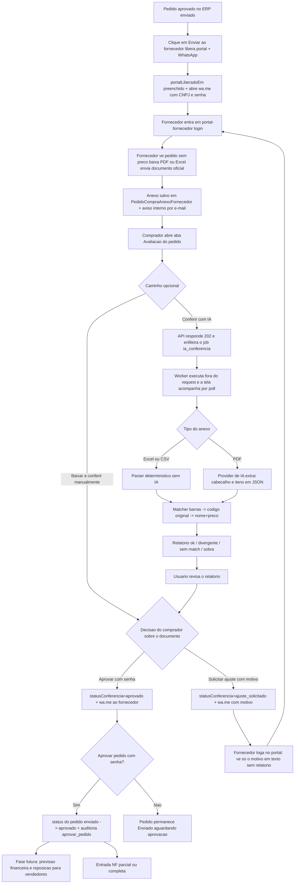


Pontos fixos:

- O fornecedor **nunca** acessa o ERP; só a página pública `/portal-fornecedor`.
- A IA só roda quando alguém clica **Conferir com IA** no painel interno (permissão `compras:edit`); upload do fornecedor não dispara IA. O botão só aparece enquanto o anexo estiver `pendente` — depois de decidido (aprovado ou ajuste solicitado), não reconfere mais aquele anexo.
- **Conferir com IA é opcional.** O comprador pode baixar o arquivo, conferir visualmente e **Aprovar** ou **Solicitar ajuste** direto na lista de documentos — sem abrir o modal e sem relatório.
- A IA só extrai dados; quem decide e corrige o pedido é o usuário — sem auto-aplicar.
- Ao **Aprovar pedido** no rodapé (rascunho → enviado), o status vira Enviado e **abre a aba Avaliação** — **sem** liberar o portal e **sem** abrir WhatsApp.
- O portal só abre com **Enviar ao fornecedor** (rodapé da aba Avaliação). Fecha ao **Rascunho** (voltar para rascunho) ou ao **Aprovar pedido** (status `aprovado`) — ambos gravam `portalBloqueadoEm` e revogam sessões. **Não há** botão/ação manual "Bloquear portal". **Enviar ao fornecedor** reabre e abre novamente o WhatsApp (inclusive após voltar a rascunho e concluir de novo).
- O fornecedor não vê preço nem total no portal (nem na tela, nem no Excel/PDF) — só código de barras, código original, produto, unidade e quantidade.
- O comprador gerencia documentos na **aba Avaliação do pedido** e as ações de portal/ciclo (Rascunho, Enviar ao fornecedor, Enviar credenciais, Aprovar) no **rodapé** (visível quando status ∈ enviado, aprovado, parcial, recebido).
- O comprador também pode anexar o documento oficial do fornecedor direto pela aba Avaliação (`POST /pedidos-compra/:id/anexos-fornecedor`), sem depender do upload do próprio fornecedor no portal.
- **Conferir com IA roda em segundo plano.** O clique devolve **202** com `jobId` e o modal acompanha o job (`GET /jobs/:id`) até `ok`/`erro` — o relatório vem no campo `resultado` do job. Enquanto um pedido tem conferência em andamento, outro clique no mesmo pedido devolve **409**. Fechar o modal não cancela: o relatório continua sendo salvo no anexo.
- Ao concluir **Conferir com IA**, o sistema salva `relatorioConferenciaJson` e `conferidoEm` no documento original, recarrega a lista no ERP e cria uma **cópia PDF** na lista (`tipoAnexo='relatorio_conferencia_ia'`, nome `Conferência IA - {arquivo} - {DD-MM-YYYY HHhmm}.pdf`). Cada nova conferência ("Conferir novamente") gera outra cópia. As cópias são só para download no painel interno — **não** aparecem no portal do fornecedor e **não** entram no fluxo de aprovação do documento.
- **Aprovar documento** (lista da aba Avaliação **ou** modal Conferir com IA) muda só o `statusConferencia` do anexo **documento_fornecedor** — **não exige** ter rodado a IA. **Aprovar pedido** (rodapé da Avaliação) exige ao menos um documento do fornecedor aprovado + senha do ERP, muda o status do pedido para `aprovado` e **fecha o portal** — a partir daí o pedido fica somente leitura para edição estrutural.
- Comprador pode **excluir** anexo `pendente` ou `ajuste_solicitado` (`DELETE .../anexos-fornecedor/:anexoId`); anexo já `aprovado` não pode ser excluído.
- Ao "Solicitar ajuste", se houver relatório no modal ele é salvo no anexo (`relatorioConferenciaJson`) para consulta futura **só no painel interno**; na decisão direto na lista o motivo basta. O portal do fornecedor **não exibe o relatório** — o fornecedor vê apenas o motivo do ajuste em texto, junto com o status "Ajuste solicitado".

**Backlog (fora do escopo atual):** ao aprovar o pedido, gerar previsão financeira e painel de previsão de entrega/reposição para vendedores.

### 3.8 Mapa comercial (apresentação a cliente)

**Precificação:** após consolidar uma NF-e de Revenda, o operador confere os campos principais por produto. Margens e preços de venda e atacado são independentes. **+ Campos adicionais** abre a composição comercial do custo; **−** recolhe. A simulação preserva nota, financeiro e estoque. Somente **Gravar preços válidos** atualiza o cadastro e guarda os ajustes da linha. Margens atuais usam o custo da simulação e os preços atuais do cadastro; não representam margem histórica.


Desktop: Produto e Nome fixos; os produtos deslizam juntos na grade. Mobile: dados em grupos de duas colunas, com adicionais expansíveis por produto.


Visão **comercial** do que o sistema já faz hoje, em linguagem para cliente leigo (sem jargão técnico). Atualizar **nesta seção** sempre que a documentação registrar tela, fluxo, módulo, automação ou diferencial novo/alterado/removido.

**Regras Mermaid:** nunca apontar seta para ID de subgraph; ligar só nós reais; fluxos entre áreas em diagramas separados; preferir vários diagramas detalhados a um único magro.

**Ainda não faz parte do sistema:** tela de "Consolidação de financeiro" (confirmação do gestor antes do título gerado pela Entrada virar disponível para baixa), app mobile, emissão de nota de saída, pedidos de venda.

#### O que o sistema entrega hoje

Um ERP focado no **ciclo de compras e entrada**: cadastrar a operação, comprar com regras, conversar com o fornecedor em portal próprio, conferir documentos (inclusive com inteligência artificial), receber notas fiscais com checagens e controlar estoque.

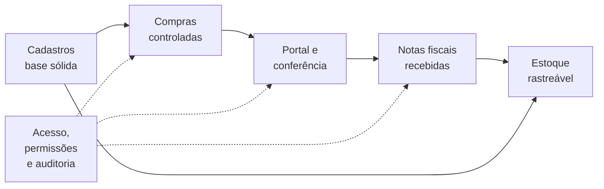


---

#### 3.8.1 Visão rápida dos módulos

```mermaid
flowchart TD
  ERP["Sistema de Gestão Empresarial"]

  ERP --> A1["Acesso e Controle"]
  ERP --> OR1["Orçamentos"]
  ERP --> PV1["Pedidos de venda"]
  ERP --> RP1["Receber pagamento"]
  ERP --> C1["Cadastros Essenciais"]
  ERP --> P1["Compras Inteligentes"]
  ERP --> F1["Relação com Fornecedores"]
  ERP --> N1["Entrada de Notas Fiscais"]
  ERP --> E1["Controle de Estoque"]
  ERP --> AP1["Contas a Pagar"]
  ERP --> AR1["Contas a Receber"]
  ERP --> CE1["Contas"]
  ERP --> PD1["Pendências"]
  ERP --> R1["Parâmetros do Negócio"]
  ERP --> S1["Segurança e Rastreabilidade"]

  A1 --- A2["Quem entra, o que vê e em qual empresa"]
  OR1 --- OR2["Proposta gravada; desconto em janela; pode virar pedido"]
  PV1 --- PV2["Cópia dos itens do orçamento convertido; só consulta"]
  RP1 --- RP2["Totem e caixa; forma escolhida na hora do recebimento"]
  C1 --- C2["Clientes, fornecedores, produtos e transportadoras"]
  P1 --- P2["Pedido completo: frete, prazos, itens e aprovação"]
  F1 --- F2["Portal, WhatsApp, documentos e conferência com IA"]
  N1 --- N2["Busca automática, conferência e lançamento"]
  E1 --- E2["Kardex, saldos, inventário, endereços, requisições, guardar mercadorias e separação de pedidos"]
  AP1 --- AP2["Cadastro e consulta de títulos a pagar"]
  AR1 --- AR2["Cadastro e recebimento de títulos a receber"]
  CE1 --- CE2["Contas bancarias e caixas da empresa"]
  PD1 --- PD2["Sino, cards e lista do que precisa de atenção"]
  R1 --- R2["Planos, recorrencia, adquirentes, cartoes, codigos fiscais e buscador"]
  S1 --- S2["Permissões, senha crítica e auditoria"]
```


---

#### 3.8.2 Acesso e Controle — detalhe

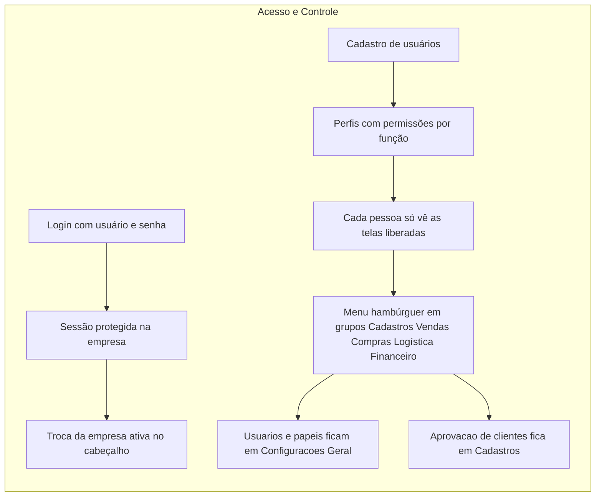


**Benefício:** a operação multiempresa fica organizada e cada colaborador enxerga só o que precisa.

---

#### 3.8.3 Cadastros Essenciais — detalhe

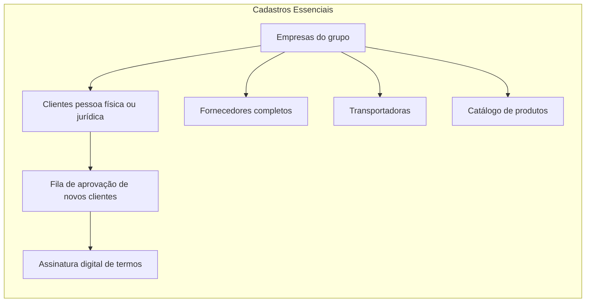


##### Clientes

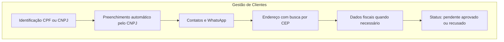


##### Fornecedores

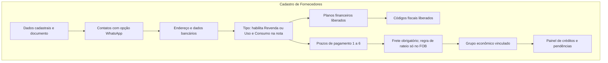


##### Produtos e transportadoras

```mermaid
flowchart TD
  subgraph Produtos["Produtos"]
    PR1["Código interno e descrição"]
    PR2["Fotos do produto"]
    PR3["Controle se entra no estoque"]
    PR4["Vínculo com cada fornecedor"]
    PR5["Código original do fornecedor"]
    PR6["Unidade; múltiplo e embalagem separados"]
    PR7["Endereço do depósito: busca o apartamento já cadastrado"]
    PR8["Produto já gravado: Salvar neste produto"]
    PR1 --> PR2 --> PR3 --> PR4 --> PR5 --> PR6 --> PR7 --> PR8
  end

  subgraph Transportadoras["Transportadoras"]
    TR1["Cadastro ativo"]
    TR2["Dados e contatos"]
    TR3["Usada no pedido quando frete é por conta do comprador"]
    TR1 --> TR2 --> TR3
  end
```


**Processo automático:** CNPJ e CEP preenchem razão social, endereço e demais dados quando disponíveis.

---

#### 3.8.4 Compras Inteligentes — detalhe

##### Ciclo do pedido

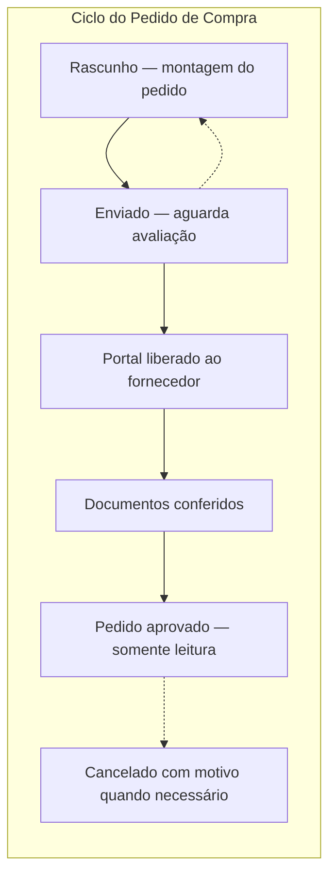


##### O que o pedido controla

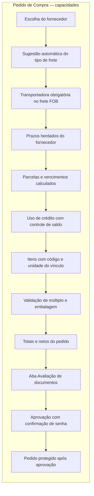


**Controles inteligentes:** não conclui pedido incompleto; crédito não passa do saldo; FOB exige transportadora; após aprovado, edição estrutural fica bloqueada.

---

#### 3.8.5 Relação com Fornecedores — detalhe

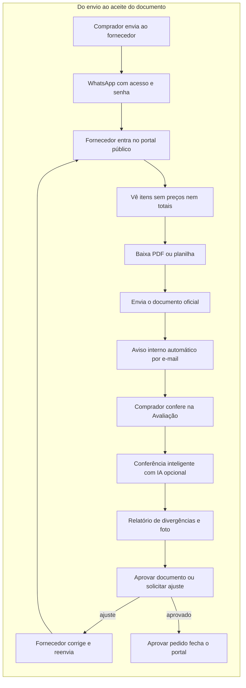


**Diferenciais**

- Fornecedor **nunca** entra no sistema interno
- Preços ficam protegidos
- IA ajuda a conferir, mas a decisão final é sempre da equipe
- Relatório detalhado fica só no painel interno
- A conferência trabalha **em segundo plano**: o documento é analisado mesmo que a tela demore, e o sistema avisa quando o relatório fica pronto

---

#### 3.8.6 Entrada de Notas Fiscais — detalhe

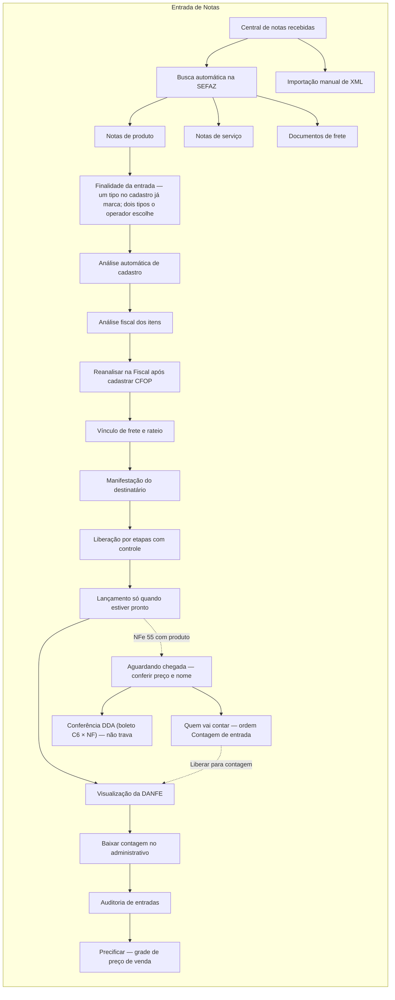


**NFS-e (nota de serviço) — dossiê na análise:**

```mermaid
flowchart TD
  D1["O que entrou?\nDados da nota"]
  D2["Tem pedido de compra?\nOpcional — compara valor"]
  D3["Quanto pagar e quando?\nPlano + vencimentos"]
  D4["Consolidar com senha\ngera Contas a pagar"]
  D1 --> D2 --> D3 --> D4
```

Com **um** par Plano financeiro + CFOP Padrão no cadastro do fornecedor, o CFOP e o plano já vêm preenchidos nesse dossiê. Com dois ou mais pares, o operador escolhe em **Trocar**. A data de vencimento da parcela continua a ser informada na prévia.


**NFe 55 Uso e Consumo** usa o **mesmo dossiê** da NFS-e (não o wizard de Revenda). Banner do pedido: NFS-e = “Nota de serviço”; NFe uso/consumo = “Nota de uso e consumo”.

**Controles inteligentes:** trava etapas incompletas; exige frete vinculado, Valor Frete, CFOP de entrada e **Financeiro (prévia) com Data de vencimento** quando o frete é do destinatário; **exige CFOP de entrada em cada item na aba Fiscal** (sugestão automática ou Trocar — sem preencher não avança); se a sugestão de CFOP foi cadastrada depois da primeira análise, o operador usa **Reanalisar** no card da aba Fiscal para puxar o vínculo e permanecer na etapa; pede regra de rateio no fornecedor; frete do remetente é só consultivo; permite liberação responsável apenas em pontos previstos (NCM/origem e negociação — **nunca** CFOP de entrada). Documentos de frete em que a empresa **não** é o tomador saem do fluxo e **não** aparecem no painel Canceladas (a lista Canceladas é só nota recusada pelo operador). No vínculo de produtos (aba Cadastro), o espelho **NF × SISTEMA** alinha **cara a cara** (desktop: linhas pareadas) barras → código original → qtd; **Frete por und** fica **no final** só na coluna SISTEMA (célula NF vazia nessa linha) e só aparece depois que **todos** os produtos estão vinculados e o frete destinatário foi rateado (`produto.pesoKg × qtd entrada` quando a regra é Por peso — sem peso cadastrado o Cadastro trava). **Qtd entrada** (quantidade × preço já fracionado pelo múltiplo de embalagem) fica no par da **Qtd × unit.** da NF. Em **Conciliar produto**, abre um **modal**: dois campos de texto (**Produto / código** e **Marca**); a descrição da NF fica no topo (não entra sozinha na busca); a lista mostra nome, marca, unidade e características por extenso. Palavras-chave e pedaços de palavra (ex.: `esgoto 75`, `esg`) seguem a mesma regra do restante do sistema; marca é filtro extra só no campo marca. **Toda NFe 55 com item de produto** fica em **Aguardando chegada** após o lançamento (com ou sem pedido; qualquer tipo de compra). Se o preço unitário (unidade de venda) variar **30% ou mais** em relação à última NF consolidada do mesmo produto, ou o nome da NF for muito diferente do nome do sistema, o operador confirma no card **Conferência de preço e nome** antes de **Liberar para contagem** (modal **Quem vai contar** — sem pessoa a nota não sai de Aguardando chegada). O card **Conferência DDA** tenta casar o boleto do banco (C6) com a NF (CNPJ + valor + nº) em segundo plano — **não** impede Liberar para contagem. **NFS-e** e NFe com finalidade **Uso e Consumo** (escolhida no Resumo/dossiê — o tipo do fornecedor só habilita; **não** pré-marca; clique de novo na marcada desmarca) vão para **Prontas para consolidar** (sem contagem física); **as duas** usam o dossiê descrito acima.

#### 3.8.6b Depois da consolidação — três trilhos (não se travam)

A consolidação da NFe 55 **não** é o fim. Abre três trabalhos independentes.

```mermaid
flowchart TD
  nf[NFe 55 consolidada]
  est[1 Estoque — Kardex já sobe]
  pre[2 Precificação — grade da nota]
  gua[3 Guardar mercadorias — bip produto e endereço]
  nf --> est
  nf --> pre
  nf --> gua
```


| Situação        | O que o operador vê                                                    | Estado                                                                                                                                                                                          |
| --------------- | ---------------------------------------------------------------------- | ----------------------------------------------------------------------------------------------------------------------------------------------------------------------------------------------- |
| 1. Estoque      | Tela **Estoque**                                                       | Pronto — quantidade e custo no kardex na consolidação                                                                                                                                           |
| 2. Precificação | Auditoria → **Precificar**                                             | Grade da nota: uma barra horizontal para todos os itens (deslizam juntos); nome/SKU fixos à esquerda. Custo de aquisição e adicionais comerciais → margens independentes de venda/atacado → **Gravar preços válidos** no produto |
| 3. Movimentação | Menu **Logística → Guardar mercadorias** (e cadastro em **Endereços WMS**) | Depois de consolidar Revenda, o operador **guarda** cada produto no endereço do cadastro (bip produto → destino). O cadastro do depósito continua em Endereços WMS; o produto escolhe o endereço na aba Logística. Ainda sem saldo por endereço |


Contas a pagar já nasce na consolidação (trilho financeiro). Pedido de venda nasce da conversão do orçamento (§6.21b). Emissão de NF de saída continua fora.

---

#### 3.8.7 Controle de Estoque — detalhe

```mermaid
flowchart TD
  subgraph Estoque["Estoque e Kardex"]
    direction TB
    ES1["Consulta por produto"]
    ES2["Três saldos em destaque"]
    ES3["Grade de movimentações no período"]
    ES4["Ajuste de inventário"]
    ES4b["Arvore de enderecos WMS"]
    ES4d["Cadastrar enderecos no modal"]
    ES4f["Gerar em massa e excluir na linha"]
    ES4c["Atalho Configuracoes — Estrutura WMS"]
    ES4e["No produto: Salvar neste produto"]
    ES4g["Fila de Requisicoes"]
    ES9["Enderecos cadastrados no painel do Kardex"]
    ES5["Informar quantidade final"]
    ES6["Informar entrada"]
    ES7["Informar saída"]
    ES8["Histórico rastreável da movimentação"]
    ES1 --> ES2 --> ES3
    ES3 --> ES4
    ES1 --> ES4b
    ES4d --> ES4b
    ES4f --> ES4b
    ES4b --> ES4e
    ES4e --> ES9
    ES1 --> ES9
    ES4c --> ES4b
    ES1 --> ES4g
    ES4 --> ES5
    ES4 --> ES6
    ES4 --> ES7
    ES5 --> ES8
    ES6 --> ES8
    ES7 --> ES8
  end
```


**Observação comercial:** o estoque e o inventário já operam; a logística confere a mercadoria na tela **Contagens de entrada** (sem ver quantidade da nota); o administrativo **baixa a contagem** (OK consolida com senha; divergente só trava a logística) e só então o estoque sobe. Se o estoque foi **bloqueado** por divergência, a peça no Kardex mostra aviso claro de quantidade bloqueada (não circula no disponível) e o motivo no extrato. O painel **Entradas consolidadas** lista as notas já consolidadas (com badge quando há bloqueio); o dossiê só leitura fica em **Auditoria de entradas** — com veredito, tabela esperada × contada (faltou/sobrou), **lista dos itens bloqueados** (quantidade retida e se já desbloqueou), conferência de preço/nome lado a lado e anexos de bloqueio. Depois da consolidação o operador ainda **precifica** (trilho separado) e, quando precisar guardar a peça, usa **Endereços WMS**: **Cadastrar endereços** no topo ou **Gerar em massa** no próprio item da árvore (um apartamento ou uma faixa, com prévia do código `A-RC-20-01-2-05`). A coluna **Nível** diz se a linha é rua, andar etc. **Excluir** na linha some com o endereço vazio; se algum produto ainda usa aquele código, o sistema pede para realocar em Produtos > Logística. O tipo (porta-pallet, caixa, chão, bancada) fica no apartamento, não no meio do código. No cadastro do **produto**, a aba Logística **busca e escolhe** esse endereço; se o produto **já existe**, **Salvar neste produto** grava só o endereço (sem esperar o rodapé do cadastro). O **Kardex** lista esses códigos no painel do produto (só leitura). Nesta fase o cadastro WMS **não** tem saldo por posição. A tela **Requisições** é a fila do dia: o operador **Executa** bipando origem, produto, quantidade e destino. **Separação** reserva o disponível ao iniciar e baixa o estoque físico ao concluir. **Reposição** só muda o endereço da ordem — o total da empresa no kardex **não** cai.

---

#### 3.8.7b Contagem de entrada (logística) — detalhe

```mermaid
flowchart TD
  subgraph ContagemLog["Contagens de entrada"]
    direction TB
    C0["Ve historico recente: quem fez e quando"]
    C1["Lista entradas liberadas"]
    C2["Seleciona uma ou varias notas"]
    C3["Inicia sessao de contagem"]
    C4["Bipa unidade ou caixa master"]
    C5["Digita se nao conseguir bipar"]
    C6["Gravar rascunho — continua editavel"]
    C6b["Finalizar — trava a logistica"]
    C7["Se bate: contagem OK"]
    C8["Se diverge: avisa o item sem quantidade"]
    C9["Reconta ou confirma no modal para pendente admin"]
    C10["Admin baixa a contagem"]
    C11["Admin pode Voltar para contagem"]
    C0 --> C1
    C1 --> C2 --> C3 --> C4
    C3 --> C5
    C4 --> C6
    C5 --> C6
    C6 --> C4
    C6 --> C6b
    C6b --> C7
    C6b --> C8 --> C9
    C7 --> C10
    C9 --> C10
    C7 --> C11
    C9 --> C11
    C11 --> C4
  end
```


**Para o cliente:** ao **Liberar para contagem**, alguém é escolhido para contar. Na lista de Contagens, o operador vê só o que foi designado a ele; o administrador vê todas e **quem vai contar**. O conferente vê o **histórico recente** (quem contou, horário de início/fim e se deu OK, divergência ou cancelamento). O conferente não vê a quantidade da nota (evita “chutar”). Conta sempre na **unidade de venda** do produto (ex.: UN, peça); o código de barras só define o fator (+1 na unidade, +4 na caixa master, +12 no fardo…). A coluna **Und.** mostra o nome da unidade de venda; se a embalagem fraciona (ex.: `1 fardo = 12 unidades`) ou há caixa master cadastrada, um **!** vermelho pulsante abre sozinho com a explicação (sem revelar quantas veio na nota) e só some se a pessoa clicar no **X**. Pode **Gravar** o progresso (almoço, fim de expediente, volume achado depois) e continuar; só **Finalizar** trava a edição — se houver divergência, o sistema pergunta no modal se quer finalizar com divergência (sem segundo botão na lateral). Cada Gravar/Finalizar deixa **cópia** com quem fez e horário. Depois de finalizar, o administrativo **baixa a contagem** (ou **Volta para contagem** se precisar recontar). Se bateu, a baixa já consolida o estoque (com senha). Se deu erro, a baixa só trava a logística; o admin bloqueia o estoque com explicação e foto da negociação — o sistema **abre um aviso** dizendo que o estoque ficou bloqueado e **por quê**, e o motivo continua visível na nota, na lista (**Entradas consolidadas**) e na peça no Estoque. Depois pode desbloquear.

---

#### 3.8.7c Contas a Pagar — detalhe

```mermaid
flowchart TD
  subgraph ContasPagar["Contas a Pagar"]
    direction TB
    A0["Entrada consolidar fiscal"]
    A1["Abrir Contas a Pagar"]
    A2["Aba Titulos — manual ou gerados pela NF"]
    A2f["Filtrar titulos buscando fornecedor e plano"]
    A2b["Buscar fornecedor e plano ao cadastrar"]
    A2c["Anexar boleto ou comprovante no titulo"]
    A3["Aba Baixas — filtrar fornecedor vencimento e emissao"]
    A4["Informar principal juros e multa"]
    A5["Confirmar data e conta; registrar baixa"]
    A6["Aba Pagamentos — consultar e cancelar baixa"]
    A7["Saldo recalculado; historico marcado Cancelada"]
    A0 --> A2
    A1 --> A2
    A1 --> A2f --> A2
    A2 --> A2b
    A2 --> A2c
    A1 --> A3 --> A4 --> A5
    A2 --> A3
    A5 --> A6
    A6 --> A7
    A1 --> A6
  end
```


**Para o cliente:** cadastra manualmente **ou** recebe títulos gerados quando a Entrada **consolida** (Baixar contagem OK, Consolidar ou Bloquear estoque) — mercadoria + frete. Na lista, **filtra** digitando o nome do fornecedor ou o código/nome do plano financeiro; ao **escolher**, digitar código/documento ou mudar data, a grade **atualiza sozinha** (sem Filtrar/Atualizar). No cadastro, **busca** fornecedor e plano financeiro digitando; pode **anexar** PDF (até 2 MB) ou imagem depois de gravar o título — foto maior que 2 MB é reduzida automaticamente. Na aba **Baixas**, filtra juntos por fornecedor, vencimento da parcela e emissão do título; ao baixar, confirma a data e a conta. Em **Pagamentos**, pode cancelar uma baixa ainda ativa: o saldo é recalculado e o registro continua visível como **Cancelada**.

---

#### 3.8.7d Contas a Receber — detalhe

```mermaid
flowchart TD
  subgraph ContasReceber["Contas a Receber"]
    direction TB
    B1["Abrir Contas a Receber"]
    B2["Aba Titulos — cadastro manual"]
    B2f["Filtrar titulos buscando cliente e plano"]
    B2b["Tipo Duplicata ou Credito"]
    B2c["Buscar cliente e plano ao cadastrar"]
    B2d["Informar vencimento valor e comissao"]
    B2e["Anexar comprovante no titulo"]
    B3["Aba Baixas — selecionar varios"]
    B4["Informar principal juros e multa"]
    B5["Receber selecionados"]
    B6["Aba Recebimentos — ver o que ja entrou"]
    B1 --> B2
    B1 --> B2f --> B2
    B2 --> B2b
    B2 --> B2c
    B2 --> B2d
    B2 --> B2e
    B1 --> B3 --> B4 --> B5
    B2 --> B3
    B5 --> B6
    B1 --> B6
  end
```


**Para o cliente:** cadastra títulos a receber (Duplicata ou Crédito). Na lista, **filtra** digitando o nome do cliente ou o código/nome do plano financeiro; ao **escolher**, digitar código/documento ou mudar data, a grade **atualiza sozinha** (sem Filtrar/Atualizar). No cadastro, busca o **cliente** e o plano financeiro, informa vencimento (obrigatório) e valor. Depois de gravar, pode anexar PDF/imagem até 2 MB. Na aba **Baixas** recebe um ou vários títulos (total ou parcial, com juros/multa). A aba **Recebimentos** mostra o histórico do que já entrou. Nesta fase o título **não** nasce sozinho de nota fiscal de saída.

---

#### 3.8.7d2 Contas — detalhe

```mermaid
flowchart TD
  subgraph ContasEmpresa["Contas"]
    direction TB
    C1["Configurações → Financeiro → Contas"]
    C2["Nova conta ou Editar"]
    C3["Tipo Caixa ou Bancaria"]
    C4["Escolher banco oficial e informar digito da conta"]
    C5["Ativar ou Desativar"]
    C1 --> C2 --> C3 --> C4
    C1 --> C5
  end
```

**Para o cliente:** cadastra as **contas bancárias** e **caixas** usadas pela empresa (ex.: Itaú matriz, Caixa loja). **Caixa** pede só um **nome**. **Bancária** busca o banco na lista oficial da BrasilAPI e exige agência, conta corrente e **dígito da conta**; dígito da agência e limite de cheque especial permanecem opcionais. Não pode repetir o mesmo nome nem a mesma combinação banco+agência+conta. Desativar mantém o histórico. Na baixa de título a pagar ou a receber, o operador escolhe uma conta ativa.

---

#### 3.8.7e Requisições do armazém — detalhe

```mermaid
flowchart TD
  subgraph ReqWms["Requisicoes"]
    direction TB
    R1["Gestor cria a ordem"]
    R1b["Entrada libera Contagem de entrada"]
    R1c["Consolidar Revenda gera Guardar"]
    R2["Fila por prioridade"]
    R3["Operador inicia pausa e conclui"]
    R4["Historico de quem fez o que"]
    R1 --> R2 --> R3 --> R4
    R1b --> R2
    R1c --> R2
  end
```

**Para o cliente:** a tela **Requisições** é a lista do que o armazém precisa fazer hoje (separar, repor, conferir, mover, limpar, inventariar, **contagem de entrada** e **guardar mercadorias**). O gestor cria e atribui as manuais; a **Contagem de entrada** nasce sozinha quando a Entrada escolhe **quem vai contar**; **Guardar mercadorias** nasce sozinha ao consolidar NFe 55 de **Revenda** (uma ordem por produto). O operador vê **Minha fila**. Na **Separação de pedidos**, ele bipa o código do produto e a quantidade sobe de um em um; código de outro produto não confirma o item. Na contagem de entrada, **Contar** abre a tela cega de Contagens. Em guardar, **Guardar** abre o bip produto → destino. **Concluir** nas demais **não baixa estoque**, salvo Separação. Guardar **não** relança quantidade — o kardex já subiu na consolidação.

---

#### 3.8.8 Parâmetros do Negócio — detalhe

```mermaid
flowchart TD
  subgraph Params["Configurações"]
    direction TB
    PA1["Geral — usuários, papéis e atalhos"]
    PA2["Vendas — parametrização de custos"]
    PA3["Logística — unidades de medida e tipos de veículos"]
    PA4["Financeiro — planos, recorrência, adquirentes e cartões"]
    PA5["Fiscal — codigos de operacao"]
    PA6["Integrações — assinatura digital, buscador de notas e boleto"]
    PA7["Parametros alimentam cadastros e compras"]
    PA1 --> PA2 --> PA3 --> PA4 --> PA5 --> PA6 --> PA7
  end
```


```mermaid
flowchart TD
  RF1["Cadastra fornecedor e valor"]
  RF2["Escolhe mensal ou anual, dia 1 a 28 e vigência"]
  RF3["Agenda do mês mostra o que deve chegar"]
  RF4["Nota chega com o mesmo valor na vigência"]
  RF5["Sistema lança, consolida e gera o título a pagar"]
  RF7["Atalho cadastrar fornecedor e voltar para Recorrência"]
  RF1 --> RF2
  RF2 --> RF3
  RF3 --> RF4
  RF4 --> RF5
  RF7 --> RF1
```


```mermaid
flowchart TD
  AC1["Cadastra adquirente Stone Cielo Rede"]
  AC2["Escolhe bandeira Visa Mastercard Elo Amex Hipercard"]
  AC3["Define credito ou debito"]
  AC4["Informa taxas prazo e valor fixo por parcela"]
  AC5["Cartao fica pronto para uso futuro nas vendas"]
  AC1 --> AC2 --> AC3 --> AC4 --> AC5
```


```mermaid
flowchart TD
  TV1["Cadastra o tipo de veiculo Van Caminhao Carreta"]
  TV2["Informa o peso maximo em quilos"]
  TV3["Tipo ativo aparece no cadastro da transportadora"]
  TV4["Transportadora passa a mostrar qual veiculo usa"]
  TV5["Desativar tira da escolha nova sem apagar o historico"]
  TV1 --> TV2 --> TV3 --> TV4
  TV3 --> TV5
```


**Para o cliente:** em **Vendas** o administrador informa os **percentuais permanentes** da empresa (PIS, COFINS, IR, CS, custo fixo, comissão…). Não escolhe mês: mudou custo fixo de 10% para 11%, a **próxima** formação usa 11% em todo produto. Esses números alimentam **só** a tela **Precificação** (encargos). **Não** mudam o custo da Auditoria nem o estoque. O preço no cadastro só muda quando alguém clica **Gravar** na grade da nota. Juros, CBS e IBS aparecem na Precificação e ainda não entram na conta do preço. Em **Financeiro** há seções — **Planos Financeiros** (árvore de contas), **Recorrência**, **Adquirentes**, **Cartões de Pagamento**. A aba **Integrações** reúne **Assinatura digital**, **Buscador de NF** e **Boleto** (lista de parâmetros nomeados — limites, multa/juros e credenciais do banco; um marcado como **Padrão** da empresa). Na Recorrência o financeiro cadastra **fornecedor** e **valor esperado**, escolhe se é **mensal** ou **anual**, o **dia** (1 a 28) e a **vigência**. A **agenda do mês** mostra o que deve chegar e o que já chegou. Dá para **cadastrar fornecedor** com retorno para esta tela. Quando a nota de serviço/consumo chega com o **mesmo valor** e a emissão está **dentro da vigência**, o sistema consolida a entrada e gera o título a pagar sozinho. Valor diferente **na vigência** para em análise. Fora da vigência, a nota segue o fluxo normal. A agenda **não** gera título sem a nota ter chegado. Em **Adquirentes** cadastra a operadora do cartão. Em **Cartões de Pagamento** escolhe a **bandeira** (Visa, Mastercard, Elo, Amex ou Hipercard), se é **crédito** ou **débito**, e monta a tabela de **taxas**, **prazo em dias** (número digitado, 0 a 365) e **valor fixo** por parcela. Nesta versão o cadastro **não** calcula ainda a taxa no Contas a Receber. Em **Parâmetros de Boleto** cadastra **vários** conjuntos com **nome**, escolhe qual é o **Padrão** da empresa, ativa ou desativa cada um e testa a conexão **por registro** — ainda **sem** emitir boleto. DDA consulta os boletos no banco C6 para casar com a nota em Aguardando chegada. Em **Logística → Tipos de Veículos** a empresa cadastra os veículos das entregas (Caminhão 3/4, Pick up, Carro de Passeio…) com o **peso máximo** em quilos e, se quiser, um ícone da galeria (Caminhão, Carro, Pick up ou Moto). O tipo ativo aparece para escolha no cadastro da **Transportadora**. Desativar tira o tipo da escolha nova sem apagar quem já usa. Nesta versão não há foto do veículo e o tipo não calcula frete nem rota.

---

#### 3.8.9 Segurança e Rastreabilidade — detalhe

```mermaid
flowchart TD
  subgraph Seg["Segurança"]
    direction TB
    SE1["Permissões por perfil"]
    SE2["Telas liberadas por usuário"]
    SE3["Senha nas decisões críticas"]
    SE4["Aprovar documento e aprovar pedido"]
    SE5["Bloqueio do portal após aprovação"]
    SE6["Auditoria de ações importantes"]
    SE7["Histórico de anexos e conferências"]
    SE1 --> SE2 --> SE3 --> SE4 --> SE5 --> SE6 --> SE7
  end
```


---

#### 3.8.10 Como as áreas se conectam

```mermaid
flowchart LR
  Planos["Planos financeiros"] --> Fornecedor["Fornecedor"]
  Codigos["Códigos fiscais"] --> Fornecedor
  Fornecedor -->|"prazos e frete"| Pedido["Pedido de Compra"]
  Produto["Produto vinculado"] -->|"código e unidade"| Pedido
  Transportadora["Transportadora"] -->|"FOB no pedido"| Pedido
  Transportadora -->|"emitente do CT-e"| Notas["Entrada de Notas"]
  Pedido -->|"libera acesso"| Portal["Portal do Fornecedor"]
  Portal -->|"documento"| Avaliacao["Avaliação / IA"]
  Avaliacao -->|"pedido aprovado"| Notas
  Fornecedor -->|"cadastro"| Notas
  Produto --> Estoque["Estoque / Kardex"]
  Notas -->|"consolidada"| Precificacao["Precificação"]
  Precificacao -->|"preço de venda"| Produto
  Receber["Receber pagamento"] -->|"uma ordem por produto"| SeparacaoPedidos["Separação de pedidos"]
```


---

#### 3.8.11 Mapa mental completo

```mermaid
mindmap
  root((Sistema de Gestão Empresarial))
    Acesso e Controle
      Login seguro
      Várias empresas
      Troca de empresa ativa
      Usuários
      Perfis e permissões
      Menu hambúrguer sob medida
        Cadastros
          Aprovação de clientes
        Vendas
          Orçamentos
          Pedidos de venda
          Receber pagamento
        Compras
        Logística
        Financeiro
        Configuracoes
          Usuarios e papeis
    Cadastros Essenciais
      Empresas
      Clientes
        CPF ou CNPJ
        Aprovação
        Assinatura digital
        Contato e endereço
      Fornecedores
        WhatsApp marcado
        Dados bancários
        Planos e códigos fiscais
        Prazos e frete
        Créditos e grupo econômico
      Produtos
        Fotos
        Estoque sim ou não
        Vínculo com fornecedor
        Múltiplo e embalagem
        Endereço do depósito neste produto
        Guardar mercadorias após consolidar
      Transportadoras
    Compras Inteligentes
      Lista de pedidos
      Rascunho até aprovado
      Frete e transportadora
      Parcelas calculadas
      Crédito controlado
      Itens com regras
      Avaliação de documentos
      Aprovação com senha
      Pedido protegido
    Relação com Fornecedores
      Portal exclusivo
      Envio por WhatsApp
      Itens sem preço
      PDF e planilha
      Upload do documento
      Aviso por e-mail
      Conferência com IA
      Relatório de divergências
      Solicitar ajuste
      Fechar portal
    Entrada de Notas
      Central de notas
      Busca automática SEFAZ
      XML manual
      Produto serviço frete
      Análise de cadastro
      Análise fiscal
      Rateio de frete
      Manifestação
      Liberação por etapas
      Lançamento controlado
      DANFE
    Controle de Estoque
      Kardex
      Saldos
      Movimentações
      Auditoria de entradas
        Precificação
      Inventário
        Quantidade final
        Entrada
        Saída
      Endereços WMS
        Local área tipo rua andar posição
      Requisições
        Fila por prioridade
        Atribuir e executar
        Conferir origem produto quantidade destino
        Separação reserva e baixa
        Reposição sem mudar o total
    Parâmetros
      Assinatura digital
      Parametrização de custos
      Unidades
      Tipos de Veículos
        Nome e peso máximo
        Escolha na transportadora
      Estrutura WMS
        Local
        Área
        Tipo de endereço
        Rua
        Andar
      Planos financeiros
      Recorrência
      DDA
      Códigos fiscais
      Buscador de notas
    Segurança
      Permissões
      Senha crítica
      Auditoria
      Histórico de conferências
```


---

#### 3.8.12 Mockups detalhados de tela

##### 12.1 Pedido de Compra

```mermaid
flowchart TB
  subgraph PedidoUI["Tela: Pedido de Compra"]
    direction TB
    H["Cabeçalho — número do pedido · status · fornecedor"]
    T["Abas"]
    T1["Dados gerais — fornecedor frete transportadora datas"]
    T2["Pagamento — prazos parcelas crédito"]
    T3["Lançamento — produtos quantidades múltiplos totais"]
    T4["Avaliação — documentos conferência IA WhatsApp"]
    F["Rodapé — Rascunho · Enviar ao fornecedor · Enviar credenciais · Aprovar"]
    H --> T
    T --> T1
    T --> T2
    T --> T3
    T --> T4
    T4 --> F
  end
```


##### 12.2 Portal do Fornecedor

```mermaid
flowchart TB
  subgraph PortalUI["Tela: Portal do Fornecedor"]
    direction TB
    PL["Login — CNPJ + senha do pedido"]
    PI["Pedido — código barras · código original · produto · qtd"]
    PA["Sem preços e sem totais — proteção comercial"]
    PD["Baixar PDF ou planilha"]
    PU["Enviar documento oficial"]
    PJ["Ver status e motivo de ajuste se houver"]
    PL --> PI --> PA --> PD --> PU --> PJ
  end
```


##### 12.3 Entrada de Notas

```mermaid
flowchart TB
  subgraph NotasUI["Tela: Entrada de Notas"]
    direction TB
    NL["Lista — colunas com número da nota"]
    NB["Ações — buscar notas · importar XML · ver DANFE"]
    NBc["Painel Liberadas — só Baixar ou Voltar contagem"]
    ND["Detalhe — título e resumo com número da NF · série · chave"]
    NE1["Cadastro — vínculo espelho · frete por und após todos vinculados · qtd entrada"]
    NE2["Fiscal — NCM origem CFOP · Reanalisar · Trocar · avançar"]
    NE3["Frete e rateio"]
    NE4["Negociação / liberação"]
    NE5["Lançamento"]
    NCanc["Painel Canceladas — só notas recusadas pelo operador"]
    NL --> NB
    NL --> NBc
    NL --> NCanc
    NB --> ND
    NBc --> ND
    ND --> NE1 --> NE2 --> NE3 --> NE4 --> NE5
  end
```


##### 12.4 Estoque / Kardex

```mermaid
flowchart TB
  subgraph EstoqueUI["Tela: Controle de Estoque"]
    direction TB
    EK1["Busca do produto"]
    EK1b["Modal se houver bloqueio"]
    EK2["Cards de saldos"]
    EK3["Grade do kardex no periodo"]
    EK4["Botao ajustar inventario"]
    EK5["Modal — qtd final ou entrada ou saida"]
    EK1 --> EK1b --> EK2 --> EK3 --> EK4 --> EK5
  end
```


##### 12.4b Endereços WMS

```mermaid
flowchart TB
  subgraph WmsUI["Tela: Endereços WMS"]
    direction TB
    W1["Árvore com busca"]
    W2["Mais cria o próximo nível"]
    W3["Gerar estrutura com prévia"]
    W4["Código montado A-RC-20-01-2-05"]
    W5["Tipo no apartamento"]
    W1 --> W2 --> W4
    W1 --> W3 --> W4
    W4 --> W5
  end
```


##### 12.4c Estrutura WMS

```mermaid
flowchart TB
  subgraph EstruturaUI["Tela: Configuracoes Logistica — Estrutura WMS"]
    direction TB
    E1["Atalho para Endereços WMS"]
    E2["Árvore e geração em massa"]
    E1 --> E2
  end
```


```mermaid
flowchart TB
  subgraph VeiculosUI["Tela: Configuracoes Logistica — Tipos de Veiculos"]
    direction TB
    V1["Botão Novo tipo de veiculo"]
    V2["Busca por nome"]
    V3["Formulário — nome, peso maximo em kg e ativo"]
    V6["Ícone — escolher um desenho: van, caminhão, carreta, carro, utilitário, moto, bicicleta ou ônibus"]
    V4["Lista — ícone, nome, peso, situação, editar e desativar"]
    V5["Transportadora escolhe o tipo ativo e vê o ícone"]
    V1 --> V3
    V3 --> V6
    V2 --> V4
    V3 --> V4
    V4 --> V5
  end
```


##### 12.5 Fornecedores

```mermaid
flowchart TB
  subgraph FornUI["Tela: Fornecedores"]
    direction TB
    FL["Lista com busca e status"]
    FA["Abas do cadastro"]
    F1["Identificação"]
    F2["Contato"]
    F3["Endereço"]
    F4["Dados bancários"]
    F5["Outros — planos CFOP prazos frete vínculos"]
    FL --> FA
    FA --> F1
    FA --> F2
    FA --> F3
    FA --> F4
    FA --> F5
  end
```


---

##### 12.7 Pendências

```mermaid
flowchart TB
  subgraph PendUI["Tela e shell: Pendências"]
    direction TB
    Sino["Sino no cabeçalho — total e resumo por tipo"]
    Dock["Dock inferior esquerdo — até 3 cards da tela atual"]
    Lista["Lista /pendencias — grupos por tipo"]
    Inicio["Início — 3 mais urgentes"]
    Sino --> Lista
    Dock --> Lista
    Inicio --> Lista
  end
```


---

##### 12.8 Configurações — Vendas

```mermaid
flowchart TB
  subgraph VendasUI["Tela: Configurações aba Vendas"]
    direction TB
    V1["Empresa ativa da sessão"]
    V2["Escolher mês e ano"]
    V3["Informar percentuais de venda"]
    V4["Total soma sozinho"]
    V5["Juros CBS e IBS ficam fora do total"]
    V6["Gravar"]
    V1 --> V2 --> V3 --> V4
    V3 --> V5
    V4 --> V6
    V5 --> V6
  end
```


##### 12.8b Configurações — Geral

```mermaid
flowchart TB
  subgraph GeralUI["Tela: Configuracoes aba Geral"]
    direction TB
    G0["Sub-abas"]
    G1["Usuarios — quem entra no sistema"]
    G2["Papeis — permissoes reutilizaveis"]
    G3["Assinatura digital"]
    G4["Atalhos de teclado"]
    G0 --> G1
    G0 --> G2
    G0 --> G3
    G0 --> G4
  end
```


---

##### 12.9 Requisições

```mermaid
flowchart TB
  subgraph ReqUI["Tela: Requisicoes"]
    direction TB
    H["Cabecalho — Minha fila ou Todas"]
    F["Filtros — busca tipo status prioridade"]
    L["Lista ordenada por prioridade"]
    D["Ficha — iniciar pausar historico"]
    E["Executar — bip e concluir"]
    H --> F --> L --> D --> E
  end
```

---

##### 12.10 Orçamentos e Pedidos de venda

```mermaid
flowchart TB
  L["Vendas → Orçamentos — lista e novo orçamento"] --> F["Orçamento de venda — cliente, entrega e itens"]
  F --> P["Condição de pagamento — Dinheiro, Pix, Boleto, Débito ou Crédito"]
  P --> B["Boleto — escolher parâmetro ativo e informar prazos crescentes"]
  B --> BL["Conferir valor por boleto, quantidade e prazo médio"]
  P --> C["Crédito — escolher parcelas dos cartões ativos"]
  F --> M["Mais opções — Copiar pedido ou Limpar itens"]
  M --> CP["Copiar substitui itens; pedido de origem permanece intacto"]
  P --> S["Salvar orçamento — permanece Em aberto"]
  P --> Z["Fechar pedido — exige aprovação, cliente, itens e pagamento válido"]
  Z --> PV["Pedidos de venda — um pedido por orçamento"]
  PV --> PC["Consulta — condição, parcelas, valores e vencimentos de boleto"]
  Z --> T["Orçamento Convertido — edição bloqueada"]
  F --> I["Rodapé — Imprimir orçamento"]
  F --> E["Rodapé — Enviar ao cliente"]
  E --> PDF["Salvar se editável e preparar PDF"]
  PDF --> W["Compartilhar pelo WhatsApp quando suportado"]
  PDF --> A["Alternativa — baixar PDF, abrir WhatsApp e anexar manualmente"]
```

---

#### 3.8.13 Diferenciais de valor (falar com o cliente)


| Diferencial                        | O que o cliente ganha                                                                                                             |
| ---------------------------------- | --------------------------------------------------------------------------------------------------------------------------------- |
| Portal exclusivo do fornecedor     | Colaboração sem abrir o ERP interno                                                                                               |
| Itens sem preço no portal          | Proteção da margem e da negociação                                                                                                |
| WhatsApp no ciclo                  | Acesso e ajustes chegam rápido ao fornecedor                                                                                      |
| Conferência com IA                 | Menos erro e menos tempo conferindo PDF                                                                                           |
| Pendências (sino + cards)          | O operador vê o que vence, o que bloqueou e o que falta aprovar sem caçar em cada tela                                            |
| Relatório só interno               | Transparência para a equipe, sem vazar para o fornecedor                                                                          |
| Aprovação com senha                | Decisões importantes com responsabilidade                                                                                         |
| Busca automática de notas          | Menos digitação e menos nota perdida                                                                                              |
| Tarefas demoradas em segundo plano | Buscar notas, consultar DDA e conferir documentos não travam o sistema; se a API reiniciar no meio, o trabalho é retomado sozinho |
| Liberação por etapas               | Nota só lança quando cadastro e fiscal estão ok                                                                                   |
| Herança de prazos e frete          | Pedido montado mais rápido e padronizado                                                                                          |
| Kardex e inventário                | Visão clara do estoque físico                                                                                                     |
| Fila de requisições do armazém     | Operador vê o que fazer agora, sem misturar com a contagem da nota                                                                |
| Auditoria e permissões             | Rastro de quem fez o quê                                                                                                          |
| Preenchimento CNPJ/CEP             | Cadastro mais rápido e com menos erro                                                                                             |
| Orçamento que vira pedido          | A proposta vira pedido de venda uma vez, com desconto controlado e ficha travada depois da conversão                              |


---

#### 3.8.14 Próximas evoluções (roadmap — não vender como pronto)

- App mobile de conferência
- Motor automático de requisições, bip obrigatório e PDA
- Hermes / IA
- Nota fiscal de devolução e crédito a receber na divergência
- Previsão financeira após aprovar pedido
- Estorno de baixa / cancelamento que desfaz título gerado pela Entrada

## 4. Ordem correta de cadastro (fluxo de compra)


| Ordem | Tela               | O que preparar                                                           |
| ----- | ------------------ | ------------------------------------------------------------------------ |
| 1     | Planos financeiros | Subgrupo de **Despesa**, ativo                                           |
| 2     | CFOPs              | CFOP de **entrada**, ativo                                               |
| 3     | Fornecedores       | Plano + CFOP + pares (quando tipo consumo/serviço); prazos; frete padrão |
| 4     | Produtos           | Vínculo com o mesmo fornecedor (código, unidade, múltiplo)               |
| 5     | Transportadoras    | Necessária se o frete do pedido for FOB                                  |
| 6     | Pedidos de compra  | Fornecedor → frete → pagamento → itens → rascunho ou concluir            |


Sem as etapas 1–4, o pedido pode falhar ou ficar incompleto (código/unidade vazios, planos inválidos no fornecedor).

---

## 5. Índice de telas


| Tela                                    | Rota                                                                                                 | Arquivo UI principal                                                                                                    |
| --------------------------------------- | ---------------------------------------------------------------------------------------------------- | ----------------------------------------------------------------------------------------------------------------------- |
| Login                                   | `/login`                                                                                             | `frontend/app/login/page.tsx`                                                                                           |
| Início                                  | `/inicio`                                                                                            | `frontend/app/inicio/page.tsx`                                                                                          |
| Empresas (Cadastros)                    | `/cadastros`                                                                                         | `frontend/app/cadastros/page.tsx`                                                                                       |
| Clientes                                | `/clientes`                                                                                          | `frontend/app/clientes/page.tsx`                                                                                        |
| Aprovação de clientes                   | `/clientes/aprovacao` (menu Cadastros)                                                               | `frontend/app/clientes/aprovacao/page.tsx`                                                                              |
| Fornecedores                            | `/fornecedores`                                                                                      | `frontend/app/fornecedores/page.tsx`                                                                                    |
| Transportadoras                         | `/transportadoras`                                                                                   | `frontend/app/transportadoras/page.tsx`                                                                                 |
| Produtos                                | `/produtos`                                                                                          | `frontend/app/produtos/page.tsx`                                                                                        |
| Orçamentos (lista)                      | `/orcamentos` (menu **Vendas**)                                                                      | `frontend/app/orcamentos/page.tsx`                                                                                      |
| Novo orçamento                          | `/orcamentos/novo`                                                                                   | `frontend/app/orcamentos/novo/page.tsx` + `formulario-orcamento-layout.tsx`                                             |
| Orçamento (ficha)                       | `/orcamentos/[id]`                                                                                   | `frontend/app/orcamentos/[id]/page.tsx` + `formulario-orcamento-layout.tsx`                                             |
| Pedidos de venda (lista)                | `/pedidos-venda` (menu **Vendas**)                                                                   | `frontend/app/pedidos-venda/page.tsx`                                                                                   |
| Pedido de venda (ficha)                 | `/pedidos-venda/[id]`                                                                                | `frontend/app/pedidos-venda/[id]/page.tsx`                                                                              |
| Receber pagamento                       | `/receber-pagamento` (menu **Vendas**); totem `/receber-pagamento/totem`; dinheiro `/receber-pagamento/novo` | `frontend/lib/receber-pagamento-desenvolvimento.ts`, `frontend/components/receber-pagamento/formulario-venda-caixa.tsx`, `frontend/app/receber-pagamento/page.tsx`, `frontend/app/receber-pagamento/novo/page.tsx`, `frontend/app/receber-pagamento/totem/page.tsx`, `src/modulos/vendas-caixa/` |
| Pedidos de compra (lista)               | `/pedidos-compra`                                                                                    | `frontend/app/pedidos-compra/page.tsx`                                                                                  |
| Pedido novo / edição                    | `/pedidos-compra/novo`, `/pedidos-compra/[id]`                                                       | páginas + `frontend/components/pedidos-compra/formulario-pedido-compra.tsx`                                             |
| Entrada de Notas                        | `/entrada-notas`                                                                                     | `frontend/app/entrada-notas/page.tsx`                                                                                   |
| Contagens de entrada                    | `/contagens` (menu **Logística**)                                                                    | `frontend/app/contagens/page.tsx` + `[id]/page.tsx`                                                                     |
| Auditoria de entradas                   | `/auditoria-entradas`                                                                                | `frontend/app/auditoria-entradas/page.tsx` + `[id]/page.tsx`                                                            |
| Precificação                            | `/auditoria-entradas/[id]/precificacao`                                                              | `frontend/app/auditoria-entradas/[id]/precificacao/page.tsx`                                                            |
| Parametrização de custos                | Configurações → Vendas (`?aba=vendas`) — só admin                                                    | `PainelParametrizacaoCustos` em `frontend/components/configuracoes/painel-parametrizacao-custos.tsx`                    |
| Contas a Pagar                          | `/contas-a-pagar`                                                                                    | `frontend/app/contas-a-pagar/page.tsx`                                                                                  |
| Contas a Receber                        | `/contas-a-receber`                                                                                  | `frontend/app/contas-a-receber/page.tsx`                                                                                |
| Contas | Configurações → Financeiro → Contas (`?aba=financeiro&secao=contas`); redirect `/contas` | `frontend/app/contas/conteudo-contas.tsx` + `frontend/app/configuracoes/page.tsx`; API `src/modulos/contas/` |
| Pendências                              | `/pendencias`                                                                                        | `frontend/app/pendencias/page.tsx` + `frontend/components/pendencias/`                                                  |
| Kardex de Estoque                       | `/estoque` (menu **Logística**)                                                                      | `frontend/app/estoque/page.tsx` + `frontend/components/estoque/`                                                        |
| Endereços WMS                           | `/enderecos-wms` (menu **Logística**)                                                                | `frontend/app/enderecos-wms/page.tsx`                                                                                   |
| Requisições                             | `/requisicoes` (menu **Logística**); execução dos outros tipos em `/requisicoes/[id]/executar` | `frontend/app/requisicoes/` + `tela-execucao-requisicao.tsx`                                                             |
| Separação de pedidos                    | `/separacao` (menu **Logística**; página `separacao`, módulo `estoque`; quem só tem `requisicoes` também entra). Guia ilustrado: `guias/separacao-de-pedidos.pdf` | `frontend/app/separacao/` + `tela-separacao-pedido.tsx`                                                                   |
| Guardar mercadorias                     | `/guardar-mercadorias` (menu **Logística**); bip reusa `/requisicoes/[id]/executar`                  | `frontend/app/guardar-mercadorias/page.tsx`                                                                              |
| Estrutura WMS                           | Configurações → Logística (`?aba=logistica&secao=estrutura`); redirect `/estrutura-wms`              | `ConteudoDaPaginaEstruturaWms` em `frontend/app/estrutura-wms/conteudo-pagina-estrutura-wms.tsx`                        |
| Usuários                                | Configurações → Geral (`?aba=geral&secao=usuarios`); redirect `/users`                               | `ConteudoDaPaginaDeUsuarios` em `frontend/app/users/conteudo-pagina-usuarios.tsx`                                       |
| Papéis                                  | Configurações → Geral (`?aba=geral&secao=papeis`); redirect `/papeis`                                | `ConteudoDaPaginaDePapeis` em `frontend/app/papeis/conteudo-pagina-papeis.tsx`                                          |
| Auditoria                               | `/auditoria`                                                                                         | `frontend/app/auditoria/page.tsx`                                                                                       |
| Configurações                           | `/configuracoes` (abas Geral · Vendas · Logística · Financeiro · Fiscal)                             | `frontend/app/configuracoes/page.tsx`                                                                                   |
| Unidades de medida (parâmetro)          | Configurações → Logística (`?aba=logistica&secao=unidades`)                                          | `PainelUnidadesMedida` em `frontend/components/configuracoes/painel-unidades-medida.tsx`                                |
| Tipos de Veículos (parâmetro)           | Configurações → Logística (`?aba=logistica&secao=veiculos`)                                          | `PainelTiposVeiculo` em `frontend/components/configuracoes/painel-tipos-veiculo.tsx`                                    |
| Planos financeiros (parâmetro)          | Configurações → Financeiro → Planos (`?aba=financeiro&secao=planos`); redirect `/planos-financeiros` | `ConteudoDaPaginaPlanosFinanceiros` em `frontend/app/planos-financeiros/page.tsx`                                       |
| Recorrência (parâmetro)                 | Configurações → Financeiro → Recorrência (`?aba=financeiro&secao=recorrencia`)                       | `PainelRecorrenciasFinanceiras` + `modal-recorrencia-financeira.tsx` em `frontend/components/recorrencias-financeiras/` |
| Recorrência — agenda                    | `GET /recorrencias-financeiras/agenda?competencia=YYYY-MM`                                           | `rotas-recorrencias-financeiras.ts`, `vigencia-recorrencia.ts`                                                          |
| Adquirentes (parâmetro)                 | Configurações → Financeiro → Adquirentes (`?aba=financeiro&secao=adquirentes`)                       | `PainelAdquirentes` em `frontend/components/adquirentes/`                                                               |
| Cartões de Pagamento (parâmetro)        | Configurações → Financeiro → Cartões de Pagamento (`?aba=financeiro&secao=cartoes`)                  | `PainelCartoesPagamento` + `formulario-cartao-pagamento.tsx` em `frontend/components/cartoes-pagamento/`                |
| DDA (parâmetro)                         | Configurações → Financeiro → DDA (`?aba=financeiro&secao=dda`) — só admin                            | `PainelConfiguracaoDda` em `frontend/components/dda/`                                                                   |
| CFOP (parâmetro)                        | Configurações → Fiscal → CFOP (`?aba=fiscal&secao=cfop`); redirect `/cfops`                          | `ConteudoDaPaginaCfops` em `frontend/app/cfops/page.tsx`                                                                |
| Buscador de NF (ex-Focus NFe)           | Configurações → Integrações → Buscador de NF (`?aba=integracoes&secao=buscador`)                               | `painel-configuracao-focus-nfe.tsx`                                                                                     |
| Assinatura digital (parâmetro)          | Configurações → Integrações (`?aba=integracoes&secao=assinatura`)                                                          | painéis ZapSign em `frontend/components/assinatura-zapsign/`                                                            |
| Assinatura pública                      | `/assinatura/[token]`                                                                                | `frontend/app/assinatura/[token]/page.tsx`                                                                              |
| Portal do fornecedor — login (público)  | `/portal-fornecedor/login`                                                                           | `frontend/app/portal-fornecedor/login/page.tsx`                                                                         |
| Portal do fornecedor — pedido (público) | `/portal-fornecedor/pedido`                                                                          | `frontend/app/portal-fornecedor/pedido/page.tsx`                                                                        |


O menu aberto pelo hambúrguer do cabeçalho lista só as páginas liberadas (`paginasPermitidas`), agrupadas em acordeão: **Cadastros** (Clientes, **Aprovação de clientes**, Fornecedores, Transportadoras, Produtos, Empresas), **Vendas** (Orçamentos, Pedidos de venda, Receber pagamento), **Compras** (Pedidos de Compra, Entrada de Notas, Auditoria de entradas), **Logística** (Contagens de entrada, Kardex/Estoque, Endereços WMS, Requisições, Guardar mercadorias, Separação de pedidos) e **Financeiro**. **Pendências**, **Configurações** e **Auditoria** ficam avulsas. **Sem** itens separados de Usuários, Papéis, CFOP, Planos financeiros, Assinatura Digital, Focus NFe, Unidades de medida ou **Estrutura WMS** — esses parâmetros ficam em **Configurações**. Usuários e Papéis (só admin) abrem em **Configurações → Geral**. Em **Configurações → Geral → Papéis**, o bloco **Telas e abas** define menu e recorte de abas; a grade Ver/Criar/Editar/Excluir controla ações. Menu vem de `RolePageAccess` (não mais `modulo:view` nem vínculo de páginas no usuário). Após deploy 1.27.2, rodar `npm run db:backfill-role-telas` uma vez. Rotas antigas (`/users`, `/papeis`, `/cfops`, `/planos-financeiros`, `/estrutura-wms`, `/configuracoes/focus-nfe`, `/configuracoes/assinatura`) redirecionam para a aba correspondente. O portal do fornecedor é público (fora do menu do ERP) — ver seção 6.19.

---

## 6. Mapa tela → aba → campo

### 6.1 Login — `/login`

**Objetivo:** autenticar e abrir a sessão.

**Onde olhar no código**


| Camada           | Caminho                                            |
| ---------------- | -------------------------------------------------- |
| Página UI        | `frontend/app/login/page.tsx`                      |
| Rotas API        | `src/modulos/autenticacao/rotas-autenticacao.ts`   |
| Serviço (regras) | `src/modulos/autenticacao/servico-autenticacao.ts` |
| Esquema          | `src/modulos/autenticacao/esquema-autenticacao.ts` |


| Aba / seção | Campo  | O que é                  | Obrigatório | Quem preenche | De onde vem          | Para onde conecta | Como funciona                   | Regra / bloqueio                                              |
| ----------- | ------ | ------------------------ | ----------- | ------------- | -------------------- | ----------------- | ------------------------------- | ------------------------------------------------------------- |
| Formulário  | E-mail | Identificação do usuário | Sim         | Digitação     | Cadastro em Usuários | Sessão JWT        | Envia `POST /auth/login`        | Usuário inexistente, inativo ou senha errada bloqueia entrada |
| Formulário  | Senha  | Credencial de acesso     | Sim         | Digitação     | Hash bcrypt no banco | Sessão            | Senha não é salva em texto puro | Idem                                                          |


**Após o login:** `GET /auth/me` carrega perfil, empresas, páginas e permissões. Sessão válida por **8 horas**. Admin entra em **Configurações → Geral → Usuários**.

**Como validar**


| #   | Ação                             | Resultado esperado                           |
| --- | -------------------------------- | -------------------------------------------- |
| 1   | Informar e-mail e senha corretos | Entra no sistema e vê o menu liberado        |
| 2   | Senha incorreta                  | Mensagem de erro; não entra                  |
| 3   | Usuário sem páginas              | Menu vazio ou aviso de páginas não liberadas |


---

### 6.2 Início — `/inicio`

**Objetivo:** tela inicial após o login e hub das **3 pendências mais urgentes** (estado vivo).

Quando o usuário tem páginas liberadas: card **Pendências mais urgentes** com até 3 itens e link **Ver todas**. Quando não tem páginas: aviso para contatar o administrador.

**Onde olhar no código:** `frontend/app/inicio/page.tsx`, `GET /pendencias?tela=/inicio&limite=3`.

---

### 6.3 Empresas (Cadastros) — `/cadastros`

**Objetivo:** cadastrar as empresas do ambiente multiempresa.

**Onde olhar no código**


| Camada    | Caminho                                                         |
| --------- | --------------------------------------------------------------- |
| Página UI | `frontend/app/cadastros/page.tsx`                               |
| Rotas API | `src/modulos/empresas/rotas-empresas.ts` (prefixo `/companies`) |
| Serviço   | `src/modulos/empresas/servico-empresas.ts`                      |
| Modelo    | `Company` em `prisma/schema.prisma`                             |


**Lista — colunas:** Nome, CNPJ, Telefone, Cidade/UF, Status.


| Aba / seção   | Campo                                                   | O que é                              | Obrigatório | Quem preenche      | De onde vem                   | Para onde conecta             | Como funciona                                | Regra / bloqueio                                                                     |
| ------------- | ------------------------------------------------------- | ------------------------------------ | ----------- | ------------------ | ----------------------------- | ----------------------------- | -------------------------------------------- | ------------------------------------------------------------------------------------ |
| Identificação | Razão social                                            | Nome jurídico da empresa             | Sim         | Digitação ou CNPJ  | BrasilAPI                     | Todos os cadastros da empresa | Base do multiempresa                         | Sem razão social não salva                                                           |
| Identificação | CNPJ                                                    | Documento (numérico ou alfanumérico) | Sim         | Digitação          | BrasilAPI (quando disponível) | Unicidade / busca             | Ao completar CNPJ válido, tenta buscar dados | CNPJ inválido (DV) ou já usado bloqueia; aceita letras A–Z nas 12 primeiras posições |
| Identificação | Telefone                                                | Contato                              | Não         | Digitação          | —                             | Cadastro da empresa           | —                                            | —                                                                                    |
| Identificação | E-mail corporativo                                      | Contato                              | Não         | Digitação          | —                             | Cadastro                      | —                                            | —                                                                                    |
| Endereço      | CEP                                                     | Código postal                        | Não         | Digitação          | ViaCEP                        | Endereço                      | Preenche logradouro, bairro, cidade, UF      | CEP inválido não preenche                                                            |
| Endereço      | Logradouro, Número, Complemento, Bairro, Cidade, Estado | Endereço completo                    | Parcial     | Digitação / ViaCEP | ViaCEP                        | Cadastro                      | CEP preenche a maior parte                   | —                                                                                    |


**Efeitos em cadeia:** a **empresa ativa** no cabeçalho determina quais fornecedores, produtos e pedidos aparecem.

---

### 6.4 Clientes — `/clientes`

**Objetivo:** cadastrar clientes PF/PJ.

**Abas:** Identificação · Contato · Endereço.

**Lista — colunas:** Tipo, Razão social, Nome fantasia, CPF/CNPJ, UF, Aprovação, Status, Cadastro.


| Aba / seção   | Campo                                     | O que é                 | Obrigatório | Quem preenche      | De onde vem                               | Para onde conecta      | Como funciona                                     | Regra / bloqueio                                                                                         |
| ------------- | ----------------------------------------- | ----------------------- | ----------- | ------------------ | ----------------------------------------- | ---------------------- | ------------------------------------------------- | -------------------------------------------------------------------------------------------------------- |
| Identificação | PF / PJ                                   | Tipo de pessoa          | Sim         | Seleção            | —                                         | Máscara CPF/CNPJ       | Troca campos exibidos                             | —                                                                                                        |
| Identificação | CPF / CNPJ                                | Documento               | Sim         | Digitação          | BrasilAPI, reserva OpenCNPJ / consulta por documento | Unicidade na empresa   | Busca automática em CNPJ; se as duas fontes falharem, mostra **Não foi possível consultar a Receita Federal** | CPF só numérico; CNPJ numérico ou alfanumérico (DV módulo 11 / ASCII−48); inválido ou duplicado bloqueia |
| Identificação | Nome completo (PF) / Razão social (PJ)    | Identificação principal | Sim         | Digitação / API    | Consulta CNPJ                             | Listagens              | —                                                 | Obrigatório                                                                                              |
| Identificação | Nome fantasia (PJ)                        | Nome comercial          | Não         | Digitação / API    | Consulta CNPJ                             | Lista                  | —                                                 | —                                                                                                        |
| Identificação | RG / Data de nascimento (PF)              | Dados PF                | Não         | Digitação          | —                                         | Cadastro               | —                                                 | —                                                                                                        |
| Identificação | IE / IM / SUFRAMA / Data de fundação (PJ) | Dados fiscais           | Condicional | Digitação / API    | Consulta CNPJ (fundação); IE digitada | Cadastro / NF-e futuro | SUFRAMA 8 ou 9 dígitos                            | Formato inválido bloqueia                                                                                |
| Identificação | Indicador IE (NF-e)                       | Situação na IE          | Condicional | Seleção            | —                                         | Dados fiscais          | Contribuinte / isento / não contribuinte          | —                                                                                                        |
| Identificação | Exige NF-e modelo 55                      | Flag fiscal             | Não         | Checkbox           | —                                         | Operação fiscal        | —                                                 | —                                                                                                        |
| Identificação | Simples Nacional                          | Indicador               | Não         | API / edição       | Consulta CNPJ                             | Cadastro               | —                                                 | —                                                                                                        |
| Contato       | E-mail, Telefone, WhatsApp                | Contatos                | Condicional | Digitação          | —                                         | Comunicação            | Contato simples ou múltiplos                      | Validação de formato                                                                                     |
| Endereço      | CEP e endereço completo + Código IBGE     | Localização             | Condicional | Digitação / ViaCEP | ViaCEP                                    | Entrega / cadastro     | CEP preenche logradouro, bairro, cidade, UF, IBGE | —                                                                                                        |


**Fluxo ligado:** clientes novos podem ficar **pendentes** até `/clientes/aprovacao`. Assinatura de termos usa `/assinatura/[token]` e ZapSign.

---

### 6.5 Aprovação de clientes — `/clientes/aprovacao`

**Objetivo:** aprovar ou reprovar cadastros pendentes (acesso administrativo).

**Menu:** grupo **Cadastros** (não fica avulso no hambúrguer).

**Onde olhar no código**


| Camada    | Caminho                                         |
| --------- | ----------------------------------------------- |
| Página UI | `frontend/app/clientes/aprovacao/page.tsx`      |
| Menu      | `frontend/lib/menu-grupos.ts` (grupo Cadastros) |


| Aba / seção | Campo / ação       | O que é            | Obrigatório             | Quem preenche  | De onde vem          | Para onde conecta | Como funciona               | Regra / bloqueio                   |
| ----------- | ------------------ | ------------------ | ----------------------- | -------------- | -------------------- | ----------------- | --------------------------- | ---------------------------------- |
| Análise     | Aprovar            | Libera o cliente   | —                       | Clique         | Lista pendente       | Status do cliente | Cliente passa a operar      | Exige permissão admin              |
| Análise     | Reprovar           | Recusa o cadastro  | Motivo (quando exigido) | Digitação      | —                    | Status            | Remove da fila de pendentes | —                                  |
| ZapSign     | Envio de documento | Assinatura digital | Condicional             | Fluxo do modal | Configuração ZapSign | Link público      | Envia documento             | Depende de config e senha sensível |


---

### 6.6 Fornecedores — `/fornecedores`

**Objetivo:** cadastrar quem vende para a empresa e configurar plano, CFOP, prazos e frete usados no pedido.

**Resumo visual (conexões desta tela):**

```text
Identificação / Contato / Endereço / Dados Bancários
  (cadastro da pessoa)     ──► Pedido > Dados gerais > Fornecedor (seleção)

Outros
  Tipo Revenda/Consumo/Serviço ──► habilita opções de finalidade na Entrada (não define a nota)
  Prazo 1 … Prazo 6            ──► Pedido > Pagamento > Dia
  Tipo de frete                ──► Pedido > Dados gerais > Tipo de frete (obrigatório; não afeta Entrada)
  Regra de rateio do frete     ──► Entrada de Notas > Frete (obrigatória se FOB; some em CIF)
  Planos liberados             ──► (fica no fornecedor; NÃO vai para o pedido)
  CFOPs liberados              ──► (fica no fornecedor; NÃO vai para o pedido)
  Pares Plano + CFOP           ──► (fica no fornecedor; NÃO vai para o pedido)
```

**Lista — colunas:** Razão social, Nome fantasia, CPF/CNPJ, UF, Status, Cadastro.

**Abas do modal:** Identificação · Contato · Endereço · Dados Bancários · Outros.

**Onde olhar no código**


| Camada                           | Caminho                                                                                                                                                    |
| -------------------------------- | ---------------------------------------------------------------------------------------------------------------------------------------------------------- |
| Página UI                        | `frontend/app/fornecedores/page.tsx`                                                                                                                       |
| Campo vínculos (grupo econômico) | `frontend/components/fornecedores/fornecedores-relacionados-field.tsx`                                                                                     |
| Rotas API                        | `src/modulos/fornecedores/rotas-fornecedores.ts`                                                                                                           |
| Serviço (regras)                 | `src/modulos/fornecedores/servico-fornecedores.ts` (`criarFornecedor` → reanalisa NFs pendentes)                                                           |
| Validação planos                 | `src/modulos/fornecedores/validacao-planos-fornecedor.ts`                                                                                                  |
| Vínculos entre fornecedores      | `src/modulos/fornecedores/vinculos-fornecedor.ts`                                                                                                          |
| Repositório                      | `src/modulos/fornecedores/repositorio-fornecedores.ts`                                                                                                     |
| Consulta CNPJ                    | `src/modulos/integracoes/servico-brasil-api.ts`, `GET /integracoes/cnpj/:documento`                                                                         |
| Modelos                          | `Pessoa`, `PessoaPapel`, `DadosFornecedor`, `FornecedorPlanoFinanceiro`, `FornecedorCfopEntrada`, `FornecedorParPlanoCfopPadrao` em `prisma/schema.prisma` |


#### Aba Identificação


| Campo                                  | O que é          | Obrigatório | Quem preenche       | De onde vem                                               | Para onde conecta                        | Como funciona                                                    | Regra / bloqueio                                                                                                                       |
| -------------------------------------- | ---------------- | ----------- | ------------------- | --------------------------------------------------------- | ---------------------------------------- | ---------------------------------------------------------------- | -------------------------------------------------------------------------------------------------------------------------------------- |
| PF / PJ                                | Tipo de pessoa   | Sim         | Seleção             | —                                                         | Máscara do documento                     | Alterna CPF/CNPJ                                                 | —                                                                                                                                      |
| CNPJ / CPF                             | Documento        | Sim         | Digitação           | BrasilAPI, reserva OpenCNPJ / `/fornecedores/por-documento` | Unicidade por empresa (papel fornecedor) | CNPJ preenche razão, fantasia, CNAE, endereço (se a consulta responder); se as duas fontes falharem, mostra **Não foi possível consultar a Receita Federal** | CPF só numérico; CNPJ numérico ou alfanumérico; inválido ou já usado como fornecedor bloqueia (reativação possível em casos previstos) |
| Simples Nacional                       | Indicador fiscal | Não         | Automático / edição | Consulta CNPJ                                             | Cadastro                                 | Vem da consulta CNPJ                                             | —                                                                                                                                      |
| Nome completo (PF) / Razão social (PJ) | Nome principal   | Sim         | Digitação / API     | Consulta CNPJ                                             | Lista e pedido                           | —                                                                | Obrigatório                                                                                                                            |
| Nome fantasia                          | Nome comercial   | Não         | Digitação / API     | Consulta CNPJ                                             | Lista                                    | —                                                                | —                                                                                                                                      |
| RG / Data de nascimento (PF)           | Dados PF         | Não         | Digitação           | —                                                         | Cadastro                                 | —                                                                | —                                                                                                                                      |
| IE / IM / Data de fundação (PJ)        | Dados fiscais PJ | Não         | Digitação / API     | —                                                         | Cadastro                                 | —                                                                | —                                                                                                                                      |
| CNAEs                                  | Atividades       | Não         | Digitação / API     | Consulta CNPJ                                             | Cadastro                                 | Pode haver vários                                                | —                                                                                                                                      |
| Observações                            | Texto livre      | Não         | Digitação           | —                                                         | Cadastro                                 | —                                                                | —                                                                                                                                      |


#### Aba Contato


| Campo                 | O que é         | Obrigatório | Quem preenche | De onde vem | Para onde conecta                   | Como funciona                                                                                     | Regra / bloqueio                                                                        |
| --------------------- | --------------- | ----------- | ------------- | ----------- | ----------------------------------- | ------------------------------------------------------------------------------------------------- | --------------------------------------------------------------------------------------- |
| E-mail                | Contato         | Não         | Digitação     | —           | Cadastro                            | Contato simples ou lista múltipla                                                                 | Formato de e-mail                                                                       |
| Telefone              | Contato         | Não         | Digitação     | —           | Cadastro                            | —                                                                                                 | Máscara                                                                                 |
| Telefone com WhatsApp | Flag            | Não         | Checkbox      | —           | Cadastro + avisos `wa.me` do pedido | Marca cada telefone que deve receber Enviar ao fornecedor / enviar credenciais / aprovar / ajuste | Sem nenhum marcado, o ERP **não** abre WhatsApp — avisa para marcar a opção no cadastro |
| Contatos adicionais   | Bloco repetível | Não         | Digitação     | —           | Cadastro                            | Nome, e-mail, telefone por linha                                                                  | —                                                                                       |


#### Aba Endereço


| Campo                                           | O que é             | Obrigatório | Quem preenche      | De onde vem | Para onde conecta | Como funciona                                 | Regra / bloqueio          |
| ----------------------------------------------- | ------------------- | ----------- | ------------------ | ----------- | ----------------- | --------------------------------------------- | ------------------------- |
| CEP                                             | Código postal       | Condicional | Digitação          | ViaCEP      | Endereço          | Preenche logradouro, bairro, cidade, UF, IBGE | CEP inválido não preenche |
| Logradouro, Número, Complemento, Bairro, Cidade | Endereço            | Condicional | Digitação / ViaCEP | ViaCEP      | Cadastro          | —                                             | Validações por campo      |
| Estado (UF)                                     | Unidade federativa  | Condicional | Seleção / ViaCEP   | ViaCEP      | Lista (coluna UF) | —                                             | —                         |
| Código IBGE                                     | Código do município | Não         | ViaCEP / digitação | ViaCEP      | Cadastro fiscal   | 7 dígitos                                     | —                         |
| Endereços adicionais                            | Bloco repetível     | Não         | Digitação          | —           | Cadastro          | Tipos (principal, etc.)                       | —                         |


#### Aba Dados Bancários


| Campo                            | O que é                  | Obrigatório | Quem preenche                 | De onde vem               | Para onde conecta                                               | Como funciona                                                                | Regra / bloqueio                                              |
| -------------------------------- | ------------------------ | ----------- | ----------------------------- | ------------------------- | --------------------------------------------------------------- | ---------------------------------------------------------------------------- | ------------------------------------------------------------- |
| Banco, agência, conta, dígito, PIX, tipo | Dados para pagamento | Não | Digitação / BrasilAPI | `GET /integracoes/bancos` | Cadastro (`PessoaDadosBancario`, inclusive `digitoConta`) | Bloco repetível; banco pesquisável por código, ISPB ou nome | Conta preenchida exige banco, agência, conta e dígito (0–9 ou X) |
| Favorecido                       | Nome do titular da conta | Não         | Digitação / cópia do cadastro | Identificação (nome)      | Cadastro (`PessoaDadosBancario.favorecido`)                     | Texto livre                                                                  | —                                                             |
| Documento do favorecido          | CPF/CNPJ do favorecido   | Não         | Digitação / cópia do cadastro | Identificação (documento) | Cadastro (`PessoaDadosBancario.documentoFavorecido`, `String?`) | Normalizado como string (só dígitos/alfanuméricos) via `normalizarDocumento` | Prisma espera string ou null — não objeto                     |


#### Aba Outros (ligação com compra)


| Campo                                           | O que é                                             | Obrigatório                                       | Quem preenche      | De onde vem                   | Para onde conecta                                                                                                  | Como funciona                                                                                                                                                                                              | Regra / bloqueio                                                                                                                                                                                                                                       |
| ----------------------------------------------- | --------------------------------------------------- | ------------------------------------------------- | ------------------ | ----------------------------- | ------------------------------------------------------------------------------------------------------------------ | ---------------------------------------------------------------------------------------------------------------------------------------------------------------------------------------------------------- | ------------------------------------------------------------------------------------------------------------------------------------------------------------------------------------------------------------------------------------------------------ |
| Tipo Revenda / Consumo / Prestador de serviço   | Quais finalidades a Entrada pode usar               | Sim (ao menos um)                                 | Checkbox           | —                             | Entrada de Notas → Resumo → **Finalidade da entrada** + mostra/oculta planos e CFOP                                | Habilita Revenda e/ou Uso e Consumo na NFe 55. **Um só tipo** pré-marca a nota; **dois tipos** o operador clica no Resumo. Consumo ou Prestador também abre blocos fiscais/financeiros                     | Sem tipo, não salva                                                                                                                                                                                                                                    |
| Prazo 1 … Prazo 6                               | Dias de pagamento padrão                            | Não                                               | Digitação (número) | —                             | **Pedido → Pagamento e prazos**                                                                                    | Ao escolher o fornecedor no pedido, esses dias viram parcelas                                                                                                                                              | Só números                                                                                                                                                                                                                                             |
| Tipo de frete                                   | Modalidade padrão (FOB nota, FOB conhecimento, CIF) | Sim, exceto se só Prestador | Seleção            | —                             | **Pedido → Tipo de frete**                                                                                         | Sugere modalidade no pedido; **não** interfere na Entrada (lá vale `modFrete` da NF). **Se só Prestador de serviço:** campo oculto e não exigido; valor zerado ao salvar                                   | Obrigatório se não for só Prestador; se Prestador + Revenda/Consumo: exigido; no pedido FOB exige transportadora                                                                                                                                       |
| Regra de rateio do frete (CT-e)                 | Como dividir o custo do CT-e nos itens da NF        | Sim se Tipo de frete = FOB (exceto só Prestador) | Seleção            | Sem default                   | Entrada de Notas → gate Frete (1ª etapa se destinatário) + rateio nos itens **após todos vinculados** / lançamento | Visível e obrigatória só quando frete ≠ CIF e não for só Prestador; em CIF ou só Prestador o campo some e a regra é limpa                                                                                  | Sem rateio no FOB não salva (exceto só Prestador); se vazia e `modFrete=1`, trava em Frete antes do Cadastro; não libera por senha; **Por peso** usa `produto.pesoKg × qtd entrada` e **bloqueia Cadastro** se faltar peso (sem cair para valor) |
| Permitir vínculo manual dos produtos na entrada | Flag operacional                                    | Não                                               | Checkbox           | —                             | Entrada de Notas → Cadastro (ação **Conciliar produto** só em item sem vínculo)                                    | Só se Consumo ou Prestador + Revenda; **não** se só Prestador. Com finalidade **Uso e Consumo**, se marcado permite conciliar opcionalmente; se desmarcado, grid só leitura (salvo `exigirItensEntrada`); item já vinculado permanece travado | **Oculto e falso se só Prestador**; sem efeito se a nota for Revenda pura                                                                                                                                 |
| Exigir itens na entrada p/ uso e consumo        | Flag operacional                                    | Não                                               | Checkbox           | —                             | Entrada de Notas → Cadastro (vínculo para conferência)                                                             | Só se Consumo ou Prestador + Revenda; **não** se só Prestador. **Não** vira revenda: com finalidade `uso_consumo` a nota continua documental (sem estoque / sem contagem / sem PO); se marcado, exige vínculo de produto só para conferência  | **Oculto e falso se só Prestador**; raro — itens caros de consumo que precisam de conferência                                                                                                                                                         |
| CFOPs liberados para entrada                    | Lista de CFOPs                                      | Condicional                                       | Seleção múltipla   | Tela **CFOPs** (tipo entrada) | Parametrização fiscal do fornecedor                                                                                | Não é campo do pedido                                                                                                                                                                                      | CFOP deve ser de entrada/importação ativo                                                                                                                                                                                                              |
| Planos financeiros liberados para entrada       | Lista de planos                                     | Condicional                                       | Seleção múltipla   | Tela **Planos financeiros**   | Classificação de despesa do fornecedor                                                                             | **Não aparece no pedido**                                                                                                                                                                                  | Só **subgrupo de Despesa ativo**                                                                                                                                                                                                                       |
| Pares Plano Financeiro + CFOP Padrão            | Combinações padrão                                  | Condicional                                       | Seleção de pares   | Planos + CFOPs já liberados   | Entrada NFS-e / Uso e Consumo (`cfopEntradaId` + `planoFinanceiroId`)                                              | Cada par liga um plano a um CFOP. **Um** par ativo preenche sozinho a análise daquele fornecedor (não sobrescreve escolha já gravada). **Dois ou mais** pares: operador usa **Trocar**                     | CFOP de entrada/importação ativo e plano ativo; CT-e e NFe Revenda não usam este par                                                                                                                                                                   |
| Fornecedores relacionados                       | Rede de vínculos A↔B (grupo econômico)              | Não                                               | Seleção            | Outros fornecedores           | Cadastro / consultas; **Entrada de Notas → Negociação** (elegibilidade de pedido de compra entre CNPJs do grupo)   | Vínculos diretos e transitivos; base do cruzamento CNPJ da NF × CNPJ do pedido                                                                                                                             | Não vincula a si mesmo                                                                                                                                                                                                                                 |


**Créditos (visualização):** na visualização do fornecedor há lista de créditos (`GET /pedidos-compra/creditos-fornecedor`). Créditos também podem ser cadastrados no painel do pedido.

#### Efeitos em cadeia (fornecedor)


| Se alterar…                                 | O que acontece                                                                                                                                                                                                                                                                                           |
| ------------------------------------------- | -------------------------------------------------------------------------------------------------------------------------------------------------------------------------------------------------------------------------------------------------------------------------------------------------------- |
| Prazos 1–6                                  | Pedido novo herda esses dias nas parcelas                                                                                                                                                                                                                                                                |
| Tipo de frete padrão                        | Pedido sugere a modalidade (Entrada ignora — usa `modFrete` da NF). **Se só Prestador:** campo oculto, frete zerado, não sugere ao pedido; com Revenda ou Consumo também marcado, frete volta obrigatório                                                                                                |
| Regra de rateio do frete                    | Obrigatória e visível só se Tipo de frete = FOB e não for só Prestador; em CIF ou só Prestador some e limpa. Entrada rateia CT-e nos itens **após todos os produtos vinculados**; Por peso usa peso do cadastro × qtd entrada e **bloqueia** se faltar peso; se regra ausente e há frete a ratear, para em Frete até o fornecedor ser corrigido |
| Tipo Consumo/Prestador (e/ou Revenda)       | Habilita as opções de finalidade na NFe 55; **um só tipo** pré-marca a nota; **dois tipos** o operador escolhe (não há “Revenda manda”)                                                                                                                                                                  |
| Exigir itens na entrada p/ uso e consumo    | Com finalidade Uso e Consumo: exige vínculo de produto para conferência; **não** gera estoque de revenda nem contagem                                                                                                                                                                                    |
| Planos / CFOP / par padrão                  | Um par ativo preenche CFOP e plano na NFS-e e na NFe Uso e Consumo na próxima abertura ou **Reanalisar**; dois ou mais pares não escolhem sozinhos; **não** cria campo no pedido                                                                                                                          |
| Inativar fornecedor                         | Pedido novo não deve usar fornecedor inativo                                                                                                                                                                                                                                                             |
| **Criar** fornecedor (`POST /fornecedores`) | Reanalisa automaticamente NFs em aberto (`pendente` / `em_analise` / `stand_by`) com o mesmo CNPJ/CPF do emitente → vincula `fornecedorPessoaId` e segue o pipeline (sem clique em Reanalisar só por cadastro)                                                                                           |


**Como validar**


| #   | Ação                                                                                 | Resultado esperado                                                                           |
| --- | ------------------------------------------------------------------------------------ | -------------------------------------------------------------------------------------------- |
| 1   | Vincular plano de receita ou grupo raiz                                              | Sistema recusa                                                                               |
| 2   | Cadastrar prazos 28 e 56                                                             | No pedido, parcelas sugerem 28 e 56 dias                                                     |
| 3   | Frete padrão FOB sem regra de rateio                                                 | Cadastro bloqueia: regra de rateio obrigatória                                               |
| 3b  | Frete padrão CIF (sem regra)                                                         | Salva; campo de rateio não aparece                                                           |
| 3c  | Frete padrão FOB com regra                                                           | No pedido, modalidade inicia como FOB                                                        |
| 4   | Fornecedor sem regra de rateio + NF com modFrete=1                                   | Entrada para em Frete (antes do Cadastro) pedindo cadastrar a regra; não lança               |
| 5   | Preencher regra no fornecedor → Reanalisar                                           | Frete libera (se CT-e ok) e rateio usa a regra                                               |
| 6   | Em Entrada, NF bloqueada por fornecedor → Cadastrar fornecedor (mesmo CNPJ) → salvar | Volta à NF com fornecedor vinculado; bloqueio “não cadastrado” some (pode restar produto/PO) |


---

### 6.7 Transportadoras — `/transportadoras`

**Objetivo:** cadastrar quem transporta mercadoria (FOB).

**Resumo visual (conexões desta tela):**

```text
Identificação / Contato / Endereço / Dados Bancários
  cadastro ativo ──► Pedido > Dados gerais > Transportadora
                   (obrigatória somente se Tipo de frete = FOB)

Configurações > Logística > Tipos de Veículos (ativos)
  ──► Identificação > Tipo de veículo (opcional)
```

**Lista — colunas:** Razão social, Nome fantasia, CPF/CNPJ, ANTT, Tipo de veículo (ícone + nome), UF, Status.

**Abas:** Identificação · Contato · Endereço · Dados Bancários.

**Onde olhar no código**


| Camada      | Caminho                                                                  |
| ----------- | ------------------------------------------------------------------------ |
| Página UI   | `frontend/app/transportadoras/page.tsx`                                  |
| Rotas API   | `src/modulos/transportadoras/rotas-transportadoras.ts`                   |
| Serviço     | `src/modulos/transportadoras/servico-transportadoras.ts`                 |
| Repositório | `src/modulos/transportadoras/repositorio-transportadoras.ts`             |
| Tipo de veículo (validação) | `servico-transportadoras.ts` (`garantirTipoVeiculoValido`)   |
| Ícone do tipo de veículo | `frontend/lib/icones-tipo-veiculo.tsx` (`IconeTipoVeiculo`); opção com ícone em `frontend/components/ui/select-padrao.tsx` (`OpcaoSelect.icone`) |
| Modelos     | `Pessoa`, `PessoaPapel`, `DadosTransportadora` (`tipoVeiculoId` → `TipoVeiculo`) em `prisma/schema.prisma` |


#### Aba Identificação


| Campo                                  | O que é                | Obrigatório | Quem preenche   | De onde vem                                  | Para onde conecta                | Como funciona                          | Regra / bloqueio                                                                        |
| -------------------------------------- | ---------------------- | ----------- | --------------- | -------------------------------------------- | -------------------------------- | -------------------------------------- | --------------------------------------------------------------------------------------- |
| PF / PJ                                | Tipo de pessoa         | Sim         | Seleção         | —                                            | Máscara do documento             | Alterna CPF/CNPJ                       | —                                                                                       |
| CPF / CNPJ                             | Documento              | Sim         | Digitação       | BrasilAPI, reserva OpenCNPJ / `/transportadoras/por-documento` | Unicidade (papel transportadora) | CNPJ preenche dados (se a consulta responder); se as duas fontes falharem, mostra **Não foi possível consultar a Receita Federal** | CPF só numérico; CNPJ numérico ou alfanumérico; inválido ou duplicado no papel bloqueia |
| Simples Nacional                       | Flag fiscal            | Não         | API / checkbox  | Consulta CNPJ                                | Cadastro                         | —                                      | —                                                                                       |
| Nome completo / Razão social           | Nome principal         | Sim         | Digitação / API | Consulta CNPJ                                | Lista e pedido                   | —                                      | Obrigatório                                                                             |
| Nome fantasia                          | Nome comercial         | Não         | Digitação / API | Consulta CNPJ                                | Lista                            | —                                      | —                                                                                       |
| RG / Data de nascimento (PF)           | Dados PF               | Não         | Digitação       | —                                            | Cadastro                         | —                                      | —                                                                                       |
| IE / IM / CNAE / Data de fundação (PJ) | Dados PJ               | Não         | Digitação / API | —                                            | Cadastro                         | —                                      | —                                                                                       |
| Exige NF-e modelo 55                   | Flag                   | Não         | Checkbox        | —                                            | Cadastro                         | —                                      | —                                                                                       |
| ANTT (RNTRC)                           | Registro de transporte | Não         | Digitação       | —                                            | Lista (coluna ANTT)              | —                                      | —                                                                                       |
| Tipo de veículo                        | Veículo da transportadora | Não      | Seleção         | Configurações → Logística → Tipos de Veículos (`GET /tipos-veiculo?somenteAtivos=true`) | Lista (coluna Tipo de veículo, com ícone) | Lista só tipos ativos, cada um com o ícone do cadastro (sem ícone = caminhão cinza); **Selecione** limpa. Tipo gravado que foi desativado continua na lista com “(Inativo)” | Tipo de outra empresa ou inexistente → 400; tipo inativo só se já era o gravado nesta transportadora |


#### Aba Contato


| Campo                | O que é         | Obrigatório | Quem preenche | De onde vem | Para onde conecta | Como funciona | Regra / bloqueio |
| -------------------- | --------------- | ----------- | ------------- | ----------- | ----------------- | ------------- | ---------------- |
| Email                | Contato         | Não         | Digitação     | —           | Cadastro          | —             | Formato e-mail   |
| Telefone / Celular   | Contatos        | Não         | Digitação     | —           | Cadastro          | Máscara       | —                |
| Celular com WhatsApp | Flag            | Não         | Checkbox      | —           | Cadastro          | —             | —                |
| Contatos adicionais  | Bloco repetível | Não         | Digitação     | —           | Cadastro          | —             | —                |


#### Aba Endereço


| Campo             | O que é  | Obrigatório | Quem preenche      | De onde vem | Para onde conecta | Como funciona              | Regra / bloqueio |
| ----------------- | -------- | ----------- | ------------------ | ----------- | ----------------- | -------------------------- | ---------------- |
| CEP … Código IBGE | Endereço | Condicional | Digitação / ViaCEP | ViaCEP      | Cadastro          | CEP preenche demais campos | —                |


#### Aba Dados Bancários


| Campo                      | O que é                  | Obrigatório | Quem preenche                 | De onde vem               | Para onde conecta                                               | Como funciona                                     | Regra / bloqueio                          |
| -------------------------- | ------------------------ | ----------- | ----------------------------- | ------------------------- | --------------------------------------------------------------- | ------------------------------------------------- | ----------------------------------------- |
| Banco, agência, conta, dígito, PIX | Dados bancários | Não | Digitação / BrasilAPI | `GET /integracoes/bancos` | Cadastro (`PessoaDadosBancario`, inclusive `digitoConta`) | Bloco repetível; banco pesquisável por código, ISPB ou nome | Conta preenchida exige banco, agência, conta e dígito (0–9 ou X) |
| Favorecido                 | Nome do titular da conta | Não         | Digitação / cópia do cadastro | Identificação (nome)      | Cadastro (`PessoaDadosBancario.favorecido`)                     | Texto livre                                       | —                                         |
| Documento do favorecido    | CPF/CNPJ do favorecido   | Não         | Digitação / cópia do cadastro | Identificação (documento) | Cadastro (`PessoaDadosBancario.documentoFavorecido`, `String?`) | Normalizado como string via `normalizarDocumento` | Prisma espera string ou null — não objeto |


**Efeitos em cadeia:** transportadora inativa não deve ser selecionável em pedido novo; FOB no pedido exige transportadora ativa.

---

### 6.8 Produtos — `/produtos`

**Objetivo:** catálogo do que pode ser comprado e vendido; vínculo com fornecedor alimenta o item do pedido.

**Resumo visual (conexões desta tela):**

```text
Principal
  Nome de venda / SKU / Marca / Unidade ──► lista e item do pedido
  Bloqueado para compra                 ──► impede uso no Pedido
  Ativo = não                           ──► impede uso no Pedido novo

Logística
  Código de barras / dimensões / embalagens ──► cadastro (sem campo direto no pedido)
  Endereços de estoque ──► **Salvar neste produto** (já cadastrado) ou **Cadastrar produto** (novo)

Compras
  Fornecedor                    ──► mesmo fornecedor do Pedido
  Código Original               ──► Pedido > Lançamento > Código original
  Unidade na entrada            ──► Pedido > Lançamento > Unidade
  Múltiplo de compra            ──► Pedido > Lançamento > Múltiplo de compra
  Quantidade por embalagem      ──► Pedido > Lançamento > Itens por embalagem
  Preço de custo                ──► Pedido > Lançamento > Preço (sugestão)
  Preço de venda                ──► Precificação (Gravar) e cadastro Compras

Fiscal
  NCM / Código de origem        ──► dados fiscais (não preenche campo do pedido)
```

**Lista — colunas:** Foto, **Código** (SKU), Nome, Marca, Unidade, Situação.

**Carregamento da lista:** enquanto `GET /produtos?resumo=true&pagina=&limite=` responde, a tabela exibe linhas skeleton (`LinhasSkeletonTabela`); o empty state (“Nenhum produto encontrado”) só aparece depois do fim do carregamento. A API **nunca** devolve o catálogo inteiro (paginação obrigatória; default `pagina=1`, `limite=50`, cap 100).

**Deep link:** `/produtos?id={uuid}` carrega o produto e abre o modal em visualização; em seguida limpa a query (`router.replace('/produtos')`). Query opcional `aba=logistica` (ou `principal` / `compras` / `fiscal`) abre já nessa aba — o Kardex usa `aba=logistica` em **Abrir cadastro** do painel e do empty de endereços. Aba inválida → Principal. Id inválido → mensagem “Produto não encontrado.”

**Abas:** Principal · Logística · Compras · Fiscal.

**Onde olhar no código**


| Camada                            | Caminho                                                                                                                                                                                                                                                                             |
| --------------------------------- | ----------------------------------------------------------------------------------------------------------------------------------------------------------------------------------------------------------------------------------------------------------------------------------- |
| Página UI                         | `frontend/app/produtos/page.tsx`                                                                                                                                                                                                                                                    |
| Skeleton da lista                 | `frontend/components/ui/linhas-skeleton-tabela.tsx`                                                                                                                                                                                                                                 |
| Paginação da lista                | `frontend/components/ui/controles-paginacao.tsx`                                                                                                                                                                                                                                    |
| Vínculo fornecedor (aba Compras)  | `frontend/components/produtos/lista-fornecedores-produto.tsx`                                                                                                                                                                                                                       |
| Seleção de unidade (sem criar)    | `frontend/components/produtos/selecao-unidade-medida.tsx`                                                                                                                                                                                                                           |
| Linha Código                      | Nome (buscas)                                                                                                                                                                                                                                                                       |
| Embalagens / endereços            | `frontend/components/produtos/lista-embalagens-master.tsx`, `lista-enderecos-estoque.tsx`, `combobox-endereco-wms.tsx`; helper `frontend/lib/enderecos-estoque-produto.ts`                                                                 |
| Rotas API                         | `src/modulos/produtos/rotas-produtos.ts` (`PUT /:id/enderecos-estoque` com `produtos:edit`)                                                                                                                                                |
| Serviço (regras)                  | `src/modulos/produtos/servico-produtos.ts` (`substituirEnderecosEstoque` — 404 outro tenant; não chama `sincronizarRelacoes`)                                                                                                              |
| Repositório                       | `src/modulos/produtos/repositorio-produtos.ts` (`substituirEnderecosEstoque` só em `ProdutoEnderecoEstoque`)                                                                                                                               |
| Modelos                           | `Produto`, `ProdutoFornecedor`, `ProdutoEnderecoEstoque`, `ProdutoFoto`, `Marca`, `UnidadeMedida` em `prisma/schema.prisma`                                                                                                                |
| Testes endereços                  | `servico-produtos-enderecos.test.ts`, `esquema-produtos.test.ts` (`esquemaSubstituirEnderecosEstoque`), `frontend/lib/enderecos-estoque-produto.test.ts`                                                                                    |
| SKU                               | `src/modulos/produtos/sku-sequencial.ts`, `src/modulos/produtos/normalizar-sku.ts`                                                                                                                                                                                                  |
| Paginação / ordenação (helpers)   | `src/modulos/produtos/paginacao-produtos.ts`                                                                                                                                                                                                                                        |
| Migração Santri (script one-shot) | `scripts/migrar-produtos-santri.ts`, `scripts/migrar-vinculos-fornecedor-santri.ts`, `scripts/atualizar-precos-santri.ts`, `scripts/atualizar-campos-produto-santri.ts`, `scripts/remover-pontos-sku-produtos.ts`, `scripts/auditar-pontos-produtos.ts`, `scripts/migracao-santri/` |
| Listagem (leve + paginada)        | `listarPorEmpresa` com `?resumo=true&pagina=&limite=&q=&ordenarPor=&direcao=`; resposta `{ produtos, total, pagina, limite }`                                                                                                                                                       |
| Busca textual `q`                 | §7.13 — tokens AND + trecho parcial; helper `filtro-busca-textual.ts` em `montarWhereListagem`; ponto visual no SKU/nome ignorado (`filtro-busca-produto.ts`)                                                                                                                       |
| Hidratação por ids                | `GET /produtos?ids=id1,id2` (até 200) — usado no pedido em edição                                                                                                                                                                                                                   |
| Loading da lista                  | Overlay com spinner na tabela enquanto a página atual responde                                                                                                                                                                                                                      |


#### Paginação da lista


| Aba · Campo                  | O que é                                 | Obrigatório | Quem preenche | De onde vem                                 | Para onde conecta  | Como funciona                                                                                                                                                                      | Regra / bloqueio                                                           |
| ---------------------------- | --------------------------------------- | ----------- | ------------- | ------------------------------------------- | ------------------ | ---------------------------------------------------------------------------------------------------------------------------------------------------------------------------------- | -------------------------------------------------------------------------- |
| Lista · Por página           | Limite de linhas pedidas à API          | Não         | Usuário       | —                                           | Lista              | Envia `limite` no `GET /produtos` e exibe a fatia retornada                                                                                                                        | Opções 10 / 25 / 50 (padrão 10); ao mudar, volta à página 1                |
| Lista · Carregando           | Feedback visual enquanto a API responde | —           | Sistema       | `GET /produtos?resumo=true&pagina=&limite=` | Lista              | Overlay com spinner e texto; skeleton nas linhas                                                                                                                                   | Não fechar a página durante o carregamento                                 |
| Lista · Navegação de páginas | Anterior / Próxima                      | —           | Usuário       | `total` da API                              | Lista              | Troca `pagina` e busca de novo no servidor (busca `q` e ordenação também no servidor)                                                                                              | Botões desabilitados no início/fim; ao buscar ou ordenar, volta à página 1 |
| Lista · Busca (`q`)          | Filtro por palavras-chave               | Não         | Digitação     | —                                           | `GET /produtos?q=` | Espaços separam palavras (todas obrigatórias); cada trecho parcial em nome/SKU/barras/marca/EAN embalagem; case-insensitive; ponto no código/nome é irrelevante (`9.325` = `9325`) | §7.13; não exige frase contínua nem o ponto visual                         |


#### Aba Principal


| Campo                                                                                                    | O que é                   | Obrigatório    | Quem preenche         | De onde vem                                        | Para onde conecta                                                                                                                                    | Como funciona                                                                                                                        | Regra / bloqueio                                            |
| -------------------------------------------------------------------------------------------------------- | ------------------------- | -------------- | --------------------- | -------------------------------------------------- | ---------------------------------------------------------------------------------------------------------------------------------------------------- | ------------------------------------------------------------------------------------------------------------------------------------ | ----------------------------------------------------------- |
| Nome de venda                                                                                            | Nome comercial            | Sim            | Digitação             | —                                                  | Lista e pedido                                                                                                                                       | —                                                                                                                                    | Obrigatório                                                 |
| Foto                                                                                                     | Imagem                    | Não            | Upload                | Arquivo                                            | Miniatura na lista/pedido                                                                                                                            | Gera principal e miniatura                                                                                                           | Upload exige imagens válidas                                |
| Código (SKU)                                                                                             | Código interno do produto | Sim (sugerido) | Sugestão / digitação  | `GET /produtos/proximo-sku`                        | Unicidade na empresa; lista `/produtos` e buscas de produto usam coluna **Código** separada do **Nome** (campo fechado do combobox mostra só o nome) | Sugestão sequencial; **gravado sem ponto** (separador visual do Santri é removido ao salvar/importar); a busca acha com ou sem ponto | SKU duplicado bloqueia                                      |
| Ativo                                                                                                    | Situação                  | Sim            | Toggle                | —                                                  | Pedido só com ativo                                                                                                                                  | —                                                                                                                                    | Produto inativo não entra em pedido novo                    |
| Marca                                                                                                    | Marca do produto          | Condicional    | Combobox (pode criar) | Cadastro de marcas                                 | Lista / item do pedido                                                                                                                               | —                                                                                                                                    | Marca deve existir na empresa                               |
| Unidade                                                                                                  | Unidade de venda          | Sim            | Seleção               | **Configurações → Logística** (unidades de medida) | Pedido (fallback se vínculo sem unidade)                                                                                                             | Select só lista unidades já cadastradas                                                                                              | Obrigatório; cadastro de novas unidades só em Configurações |
| Características                                                                                          | Texto descritivo          | Não            | Digitação             | —                                                  | Cadastro                                                                                                                                             | —                                                                                                                                    | —                                                           |
| Tipo de entrega (No ato, A retirar, Entregar, Por encomenda)                                             | Flags de entrega          | Não            | Checkbox              | —                                                  | Operação                                                                                                                                             | —                                                                                                                                    | —                                                           |
| Dias p/ entrega                                                                                          | Prazo                     | Não            | Digitação             | —                                                  | Operação                                                                                                                                             | —                                                                                                                                    | —                                                           |
| Dt. validade do preço                                                                                    | Validade comercial        | Não            | Data                  | —                                                  | Operação                                                                                                                                             | —                                                                                                                                    | —                                                           |
| Aceita devolução / Comissão / Estoque negativo / Bloqueado compra / Desativar ao zerar / Bloqueado venda | Flags operacionais        | Não            | Checkbox              | —                                                  | Compra/venda/estoque                                                                                                                                 | **Bloqueado para compra** impede uso em pedidos                                                                                      | —                                                           |


#### Aba Logística


| Campo                                             | O que é                          | Obrigatório | Quem preenche       | De onde vem                   | Para onde conecta | Como funciona               | Regra / bloqueio                                                                   |
| ------------------------------------------------- | -------------------------------- | ----------- | ------------------- | ----------------------------- | ----------------- | --------------------------- | ---------------------------------------------------------------------------------- |
| Código de barras unidade                          | GTIN                             | Não         | Digitação           | —                             | Cadastro          | Valida dígito e duplicidade | GTIN inválido ou duplicado bloqueia                                                |
| Peso / Altura / Largura / Comprimento             | Dimensões unitárias              | Não         | Digitação           | —                             | Logística         | —                           | —                                                                                  |
| Capacidade de empilhamento / Norma de palete      | Regras de palete                 | Não         | Digitação / seleção | —                             | Logística         | —                           | —                                                                                  |
| Múltiplo de venda                                 | Quantidade mínima/múltiplo       | Não         | Digitação           | —                             | Venda             | —                           | —                                                                                  |
| Permite venda fracionada?                         | Flag                             | Não         | Seleção             | —                             | Venda             | —                           | —                                                                                  |
| Unidade de entrega do múltiplo                    | Unidade logística                | Condicional | Seleção             | **Configurações → Logística** | Venda             | Select sem criar            | —                                                                                  |
| Embalagens master (qtd, código barras, dimensões) | Bloco repetível                  | Não         | Digitação           | —                             | Logística         | Caixa master                | Validação de código de barras                                                      |
| Endereços de estoque                              | Localização física no depósito   | Não         | Combobox (busca WMS) | **Endereços WMS** (apartamento ativo) | Estoque           | Lista colada **abaixo** do campo; cada opção e o valor escolhido mostram local, área, rua, bloco, andar, AP e tipo. Folga de scroll. Produto **já cadastrado**: **Salvar neste produto**. Produto **novo**: **Cadastrar produto**. | Endereço obrigatório na linha; mesmo AP em duas linhas bloqueia; texto legado permanece até trocar; cadastro de AP novo só em Endereços WMS; API aceita texto (sem FK); o PUT isolado **não** apaga fornecedor nem embalagem; exige `produtos:edit`; outro tenant → 404 |


#### Aba Compras (ligação com pedido)


| Campo                                    | O que é                          | Obrigatório             | Quem preenche                          | De onde vem                                        | Para onde conecta                               | Como funciona                                                                  | Regra / bloqueio                                                                                                |
| ---------------------------------------- | -------------------------------- | ----------------------- | -------------------------------------- | -------------------------------------------------- | ----------------------------------------------- | ------------------------------------------------------------------------------ | --------------------------------------------------------------------------------------------------------------- |
| Nome de compra                           | Nome usado na compra             | Não                     | Digitação                              | —                                                  | Compras                                         | —                                                                              | —                                                                                                               |
| Preço de custo                           | Preço de referência do produto   | Não                     | Digitação / migração                   | Cadastro ou import Santri                          | **Pedido → Preço** (sugestão origem estoque)    | Ao escolher o produto no pedido, pode sugerir este valor se > 0                | Opcional; valor > 0                                                                                             |
| Preço de venda                           | Preço de venda do cadastro       | Não                     | Digitação / **Gravar** na Precificação | Cadastro ou grade da NF consolidada                | Pedido de venda (futuro)                        | **Gravar** na Precificação atualiza este campo; não sobrescreve Preço de custo | Opcional                                                                                                        |
| Fornecedor (do produto)                  | Quem fornece este item           | Condicional para compra | Seleção                                | **Fornecedores**                                   | **Pedido → produto**                            | Sem vínculo, código/unidade do pedido podem ficar incompletos                  | Fornecedor ativo; sem duplicar o mesmo                                                                          |
| Código Original                          | Código no catálogo do fornecedor | Condicional             | Digitação                              | —                                                  | **Pedido → Código original**                    | Ao escolher o produto no pedido, preenche automaticamente                      | —                                                                                                               |
| Múltiplo de compra                       | Múltiplo exigido na compra       | Não                     | Digitação                              | —                                                  | **Pedido → Múltiplo de compra**                 | Pedido pode avisar se qtd não for múltiplo                                     | Independente da quantidade por embalagem; vazio permanece vazio no save                                         |
| Quantidade por embalagem (entrada)       | Itens por embalagem              | Condicional             | Digitação                              | —                                                  | **Pedido → Itens por embalagem / Qtd total UN** | Usado no cálculo do item                                                       | Independente do múltiplo de compra. Se unidade entrada = unidade venda, deve ser 1; se diferentes, deve ser ≠ 1 |
| Unidade na entrada                       | Unidade de compra                | Não                     | Seleção                                | **Configurações → Logística** (unidades de medida) | **Pedido → Unidade**                            | Prioridade sobre a unidade de venda; select sem criar                          | —                                                                                                               |
| Produtos similares / agrupamento ruptura | Substitutos                      | Não                     | Seleção                                | Outros produtos                                    | Operação                                        | —                                                                              | —                                                                                                               |


#### Aba Fiscal


| Campo            | O que é                     | Obrigatório | Quem preenche       | De onde vem | Para onde conecta | Como funciona | Regra / bloqueio               |
| ---------------- | --------------------------- | ----------- | ------------------- | ----------- | ----------------- | ------------- | ------------------------------ |
| NCM              | Código fiscal de mercadoria | Não         | Digitação           | —           | Dados fiscais     | 8 dígitos     | Formato inválido impede salvar |
| Código de origem | Origem da mercadoria        | Não         | Seleção / digitação | —           | Dados fiscais     | —             | —                              |


#### Efeitos em cadeia (produto)


| Se…                                                                  | Então…                                                                               |
| -------------------------------------------------------------------- | ------------------------------------------------------------------------------------ |
| Produto vinculado ao fornecedor A com código `A4-500` e unidade `CX` | No pedido do fornecedor A, ao escolher o produto, código = `A4-500` e unidade = `CX` |
| Produto bloqueado para compra                                        | Não deve ser usado em pedido novo                                                    |
| Produto inativo                                                      | Não entra em pedido novo                                                             |
| Quantidade por embalagem = 6 e Múltiplo de compra vazio              | Ao salvar, múltiplo continua vazio (não copia a embalagem)                           |
| Produto já cadastrado: **Salvar neste produto** na Logística         | Só a lista de endereços é substituída; fornecedor e embalagem permanecem             |
| Produto novo com endereços na Logística                              | Endereços só gravados no **Cadastrar produto**                                       |


**Como validar**


| #   | Ação                                                                | Resultado esperado                              |
| --- | ------------------------------------------------------------------- | ----------------------------------------------- |
| 1   | Vincular produto ao fornecedor com código e unidade                 | No pedido, campos preenchidos sozinhos          |
| 2   | SKU duplicado                                                       | Sistema recusa                                  |
| 3   | Em Compras, deixar múltiplo vazio, preencher embalagem = 6 e salvar | Reabrir: embalagem = 6; múltiplo continua vazio |
| 4   | Produto já cadastrado: escolher AP e clicar **Salvar neste produto** | Lista gravada; fornecedor/embalagem intactos; mensagem “Gravado neste produto.” |
| 5   | Produto novo: bloco de endereços preenchido e **Cadastrar produto**  | Endereços entram junto com o cadastro; o botão **Salvar neste produto** não aparece |


---

### 6.9 Pedidos de compra — lista `/pedidos-compra`

**Objetivo:** localizar, filtrar, duplicar, editar e cancelar pedidos.

**Carregamento da lista:** enquanto `GET /pedidos-compra` responde (incluindo ao filtrar), a tabela exibe linhas skeleton; o empty state só aparece após o fim do carregamento.

**Onde olhar no código**


| Camada                  | Caminho                                                         |
| ----------------------- | --------------------------------------------------------------- |
| Página UI               | `frontend/app/pedidos-compra/page.tsx`                          |
| Skeleton da lista       | `frontend/components/ui/linhas-skeleton-tabela.tsx`             |
| Paginação da lista      | `frontend/components/ui/controles-paginacao.tsx`                |
| Filtro de status        | `frontend/components/pedidos-compra/filtro-status-multiplo.tsx` |
| Status / filtros shared | `frontend/lib/pedido-compra-shared.ts`                          |
| Rotas API               | `src/modulos/pedidos-compra/rotas-pedidos-compra.ts`            |
| Serviço                 | `src/modulos/pedidos-compra/servico-pedidos-compra.ts`          |
| Filtro backend          | `src/modulos/pedidos-compra/filtro-status-pedido.ts`            |


#### Filtros


| Campo                  | O que é               | Quem preenche | Para onde conecta | Como funciona                                                                                                              |
| ---------------------- | --------------------- | ------------- | ----------------- | -------------------------------------------------------------------------------------------------------------------------- |
| Nº ou descrição        | Busca textual         | Digitação     | Lista             | Filtra por número/descrição                                                                                                |
| Status (múltiplo)      | Status do pedido      | Seleção       | Lista             | Rascunho, Enviado, Aprovado, Entregue parcialmente, Concluído, Cancelado (padrão: rascunho + enviado + aprovado + parcial) |
| Fornecedor             | Filtro por fornecedor | Seleção       | Lista             | `GET /fornecedores`                                                                                                        |
| Data início / Data fim | Intervalo             | Digitação     | Lista             | Filtra por período                                                                                                         |


#### Paginação


| Aba · Campo                  | O que é                   | Obrigatório | Quem preenche | De onde vem | Para onde conecta | Como funciona                                  | Regra / bloqueio                                                            |
| ---------------------------- | ------------------------- | ----------- | ------------- | ----------- | ----------------- | ---------------------------------------------- | --------------------------------------------------------------------------- |
| Lista · Por página           | Limite de linhas exibidas | Não         | Usuário       | —           | Lista             | Pagina no cliente a lista já filtrada/ordenada | Opções 10 / 25 / 50 (padrão 10); ao mudar, volta à página 1                 |
| Lista · Navegação de páginas | Anterior / Próxima        | —           | Usuário       | —           | Lista             | Exibe fatia da lista filtrada/ordenada         | Botões desabilitados no início/fim; ao filtrar ou ordenar, volta à página 1 |


#### Colunas

Nº · Data · Fornecedor · Status · Total · Condição pag.

#### Ações


| Ação     | Como funciona                           | Regra                                     |
| -------- | --------------------------------------- | ----------------------------------------- |
| Novo     | Abre `/pedidos-compra/novo`             | Permissão de criar                        |
| Editar   | Abre `/pedidos-compra/[id]` se editável | Não edita cancelado, recebido ou aprovado |
| Duplicar | `POST .../copiar`                       | Gera cópia                                |
| Cancelar | Modal com motivo                        | Motivo obrigatório; não cancela recebido  |


---

### 6.10 Pedido de compra — formulário `/pedidos-compra/novo` e `/pedidos-compra/[id]`

**Objetivo:** montar a compra (fornecedor, frete, pagamento, itens) e salvar como rascunho ou concluir (enviado).

**Resumo visual (de onde cada aba puxa):**

```text
Dados gerais
  Fornecedor           ◄── Fornecedores (cadastro ativo)
  Tipo de frete        ◄── Fornecedores > Outros > Tipo de frete (sugestão)
  Transportadora       ◄── Transportadoras (obrigatória se FOB)
  Data de faturamento  ──► Pagamento > Vencimento (recalcula)

Pagamento e prazos
  Dia (parcela)        ◄── Fornecedores > Outros > Prazo 1–6
  Crédito              ◄── créditos do fornecedor (contexto)
  (Plano / CFOP)       ✕  não existem nesta tela

Lançamento de produtos
  Produto              ◄── Produtos (+ vínculo Compras)
  Código original      ◄── Produtos > Compras > Código Original
  Unidade              ◄── Produtos > Compras > Unidade na entrada
  Múltiplo / embalagem ◄── Produtos > Compras
```

**Abas:** Dados gerais · Pagamento e prazos · Lançamento de produtos · **Avaliação do pedido** (somente quando status ∈ enviado, aprovado, parcial, recebido).

**Carregamento:** ao abrir pedido existente, a tela mostra spinner (`Loader2`) até o formulário montar. No novo (e na primeira carga de catálogos), banner com spinner “Carregando fornecedores e transportadoras…” e comboboxes/itens desabilitados até `GET /fornecedores` e `/transportadoras` terminarem. **Não** pré-carrega o catálogo de produtos: o combobox busca sob demanda (`GET /produtos?q=&limite=50`); ao editar, hidrata só os `produtoId` dos itens (`GET /produtos?ids=`).

**Onde olhar no código**


| Camada                                                                          | Caminho                                                                                                                                                                                                                                                                                                                                                                                                                                                                                                                |
| ------------------------------------------------------------------------------- | ---------------------------------------------------------------------------------------------------------------------------------------------------------------------------------------------------------------------------------------------------------------------------------------------------------------------------------------------------------------------------------------------------------------------------------------------------------------------------------------------------------------------- |
| Páginas                                                                         | `frontend/app/pedidos-compra/novo/page.tsx`, `frontend/app/pedidos-compra/[id]/page.tsx`                                                                                                                                                                                                                                                                                                                                                                                                                               |
| Formulário                                                                      | `frontend/components/pedidos-compra/formulario-pedido-compra.tsx`                                                                                                                                                                                                                                                                                                                                                                                                                                                      |
| Combobox de produto (busca servidor SKU/nome/código/EAN embalagem; cache local) | `frontend/components/pedidos-compra/combobox-produto.tsx`                                                                                                                                                                                                                                                                                                                                                                                                                                                              |
| Aba Avaliação do pedido                                                         | `frontend/components/pedidos-compra/aba-avaliacao-pedido.tsx`                                                                                                                                                                                                                                                                                                                                                                                                                                                          |
| Lista/cards de documentos (ERP + portal)                                        | `frontend/components/pedidos-compra/lista-documentos-fornecedor.tsx`                                                                                                                                                                                                                                                                                                                                                                                                                                                   |
| Tipos/tamanho de anexo (PDF/Excel/CSV)                                          | `frontend/lib/anexo-fornecedor.ts`                                                                                                                                                                                                                                                                                                                                                                                                                                                                                     |
| Pagamento / prazos                                                              | `frontend/components/pedidos-compra/bloco-pagamento-prazos.tsx`                                                                                                                                                                                                                                                                                                                                                                                                                                                        |
| Itens                                                                           | `frontend/components/pedidos-compra/lancamento-itens-pedido.tsx`                                                                                                                                                                                                                                                                                                                                                                                                                                                       |
| Libs UI                                                                         | `frontend/lib/pedido-compra-shared.ts`, `preencher-item-pedido-compra.ts`, `prazos-pagamento.ts`, `parcelas-pagamento-pedido.ts`                                                                                                                                                                                                                                                                                                                                                                                       |
| Rotas API                                                                       | `src/modulos/pedidos-compra/rotas-pedidos-compra.ts`                                                                                                                                                                                                                                                                                                                                                                                                                                                                   |
| Serviço pedido                                                                  | `src/modulos/pedidos-compra/servico-pedidos-compra.ts`                                                                                                                                                                                                                                                                                                                                                                                                                                                                 |
| Itens / fornecedor                                                              | `normalizar-itens-pedido-compra.ts`, `resolver-item-fornecedor.ts`                                                                                                                                                                                                                                                                                                                                                                                                                                                     |
| Status edição                                                                   | `resolver-status-edicao-pedido.ts`                                                                                                                                                                                                                                                                                                                                                                                                                                                                                     |
| Parcelas backend                                                                | `parcelas-pagamento.ts`                                                                                                                                                                                                                                                                                                                                                                                                                                                                                                |
| Crédito                                                                         | `servico-movimentacao-credito.ts`, `servico-creditos-pendencias.ts`                                                                                                                                                                                                                                                                                                                                                                                                                                                    |
| Repositório                                                                     | `repositorio-pedidos-compra.ts`                                                                                                                                                                                                                                                                                                                                                                                                                                                                                        |
| Modelos                                                                         | `PedidoCompra`, `PedidoCompraItem`, `CreditoFornecedor`, `CreditoReservaPedido`, `PendenciaFornecedor` em `prisma/schema.prisma`                                                                                                                                                                                                                                                                                                                                                                                       |
| Portal do fornecedor (liberar / anexos / upload interno / excluir)              | `src/modulos/portal-fornecedor/servico-portal-fornecedor.ts` (`liberarParaFornecedor`, `registrarUploadInterno`, `excluirAnexo`), `armazenamento-anexo-fornecedor.ts`; rotas internas `POST/DELETE /pedidos-compra/:id/anexos-fornecedor`; modelos `PedidoCompraAcessoPortal`, `PedidoCompraAnexoFornecedor`                                                                                                                                                                                                           |
| Voltar pedido para rascunho                                                     | `POST /pedidos-compra/:id/voltar-para-rascunho` — `servico-pedidos-compra.ts` (`voltarPedidoParaRascunho`), fecha portal em `servico-portal-fornecedor.ts` (`bloquearPortal`); botão **Rascunho** no rodapé de `formulario-pedido-compra.tsx`                                                                                                                                                                                                                                                                          |
| Aprovar pedido (fecha portal)                                                   | `POST /pedidos-compra/:id/aprovar` — `servico-pedidos-compra.ts` (`aprovarPedidoCompra` chama `bloquearPortal`), `repositorio-pedidos-compra.ts` (`aprovar`); UI no rodapé de `formulario-pedido-compra.tsx`                                                                                                                                                                                                                                                                                                           |
| Conferência por IA do anexo                                                     | `frontend/components/pedidos-compra/modal-conferencia-ia.tsx` (202 + poll em `/jobs/:id`), `src/modulos/pedidos-compra/servico-pedidos-compra.ts` (`enfileirarConferenciaAnexoComIa` + handler `ia_conferencia`), `src/modulos/pedidos-compra/conferencia-arquivo/servico-conferencia-arquivo.ts`, `src/modulos/pedidos-compra/extrator-texto-pdf.ts` (extração de texto do PDF via `unpdf`), `matcher-itens.ts`, `parser-arquivo.ts`, `extrair-itens-com-ia.ts`, `prompt-extracao-arquivo.ts`, `tipos-conferencia.ts` |
| Retry e fallback de modelo da IA                                                | `src/compartilhado/ia/provedor-resiliente.ts` — retry com backoff (2s/5s/10s) e fallback para modelo mais leve quando o erro é temporário: sobrecarga (503/"high demand", até 3 tentativas) ou timeout do provedor (408, até 2 tentativas — cada uma já consome o `IA_TIMEOUT_MS` inteiro, hoje 60s); erro permanente (auth/validação) não tenta de novo                                                                                                                                                               |
| PDF do relatório de conferência                                                 | `src/modulos/pedidos-compra/conferencia-arquivo/gerador-pdf-relatorio-conferencia.ts` (pdfkit), uso exclusivo do download interno do comprador — `src/modulos/pedidos-compra/controlador-pedidos-compra.ts` (`baixarRelatorioConferenciaAnexo`) + `rotas-pedidos-compra.ts`, sempre que houver relatório salvo, botão em `frontend/components/pedidos-compra/modal-conferencia-ia.tsx`; **não é gerado nem exposto no portal do fornecedor**                                                                           |
| Provedores de IA plugáveis                                                      | `src/compartilhado/ia/config-ia.ts`, `criar-provedor-ia.ts`, `provedor-resiliente.ts` (retry + fallback de modelo), `provedores/anthropic-claude.ts`, `provedores/openai-compativel.ts`, `provedores/gemini.ts`                                                                                                                                                                                                                                                                                                        |


#### Aba Dados gerais


| Campo                                  | O que é                               | Obrigatório           | Quem preenche                    | De onde vem                | Para onde conecta            | Como funciona                                                                                                                | Regra / bloqueio                                               |
| -------------------------------------- | ------------------------------------- | --------------------- | -------------------------------- | -------------------------- | ---------------------------- | ---------------------------------------------------------------------------------------------------------------------------- | -------------------------------------------------------------- |
| Fornecedor                             | Quem vende                            | Sim                   | Seleção                          | **Fornecedores** ativos    | Todo o pedido + painel       | Carrega contexto: prazos, frete padrão, créditos, pendências, entradas, pedidos abertos (`GET .../fornecedor/{id}/contexto`) | Sem fornecedor não avança/salva                                |
| Tipo de frete                          | FOB nota / FOB conhecimento / CIF     | Sim                   | Seleção (sugestão do fornecedor) | Fornecedor → Tipo de frete | Transportadora e valor frete | FOB mostra transportadora e frete; CIF limpa transportadora/frete                                                            | Sem tipo de frete bloqueia avanço                              |
| Transportadora                         | Quem leva (FOB)                       | Condicional (FOB)     | Seleção                          | **Transportadoras**        | Pedido                       | Só aparece em FOB                                                                                                            | FOB sem transportadora bloqueia                                |
| Valor frete                            | Frete cobrado                         | Não                   | Digitação                        | —                          | Total do pedido              | Soma no total com frete                                                                                                      | —                                                              |
| Valor frete sugerido                   | Referência                            | Não                   | Digitação                        | —                          | Comparação / conferência     | Não substitui o valor frete automaticamente                                                                                  | —                                                              |
| Tipo de compra                         | Revenda / Bonificação / Uso e consumo | Sim para **concluir** | Seleção                          | —                          | Classificação do pedido      | Exigido ao concluir, não necessariamente ao rascunho                                                                         | Sem tipo ao concluir bloqueia                                  |
| Data de faturamento                    | Base dos vencimentos                  | Sim para **concluir** | Digitação                        | —                          | Parcelas (vencimentos)       | Ao mudar, recalcula vencimentos pelos dias                                                                                   | Sem data ao concluir bloqueia; aviso na aba pagamento se vazia |
| Previsão de entrega                    | Data esperada                         | Sim para **concluir** | Digitação                        | —                          | Pedido / itens               | Não pode ser anterior à data de faturamento (`min`)                                                                          | Data anterior bloqueia                                         |
| Observação                             | Texto do pedido                       | Não                   | Digitação                        | —                          | Impressão / registro         | Visível no documento                                                                                                         | —                                                              |
| Observação interna (não será impressa) | Nota interna                          | Não                   | Digitação                        | —                          | Somente sistema              | Não vai para impressão                                                                                                       | —                                                              |
| Motivo do cancelamento                 | Leitura se cancelado                  | —                     | Sistema                          | Cancelamento               | Histórico                    | Somente leitura                                                                                                              | —                                                              |


**Painel do fornecedor (lateral):** Pendências · Crédito · Últimas entradas · Pedidos em aberto · Histórico de custo. Aviso: na entrada da NF o sistema conferirá preço, prazo e modalidade.

#### Aba Pagamento e prazos


| Campo                         | O que é                   | Obrigatório                                   | Quem preenche                         | De onde vem             | Para onde conecta          | Como funciona                                                                                    | Regra / bloqueio                                                         |
| ----------------------------- | ------------------------- | --------------------------------------------- | ------------------------------------- | ----------------------- | -------------------------- | ------------------------------------------------------------------------------------------------ | ------------------------------------------------------------------------ |
| Condição de pagamento         | Resumo textual dos prazos | Automático                                    | Sistema                               | Prazos / fornecedor     | Coluna na lista            | Somente leitura                                                                                  | —                                                                        |
| Rateio das parcelas           | Igual ou Manual           | Sim (padrão Igual)                            | Seleção                               | —                       | Valores das parcelas       | Igual divide o total líquido; Manual exige digitação                                             | Manual: soma deve bater com total líquido                                |
| Prazo (nº)                    | Número da parcela         | Automático                                    | Sistema                               | —                       | Grade                      | 1, 2, 3…                                                                                         | —                                                                        |
| Dia                           | Dias após faturamento     | Condicional                                   | Digitação / herança do fornecedor     | Fornecedor → Prazos     | Vencimento                 | Calcula vencimento = faturamento + dias; dia 0 pede confirmação (pagamento antes do faturamento) | Sem faturamento, vencimento não calcula                                  |
| Vencimento                    | Data da parcela           | Sim para **concluir** (todas as linhas; §7.4) | Digitação / cálculo                   | Data faturamento + dias | Contas a pagar futuro      | Alterar data recalcula dias                                                                      | Sem vencimento bloqueia concluir / API; **proibido** exceção “só se N>1” |
| Valor (R$)                    | Valor da parcela          | Condicional                                   | Cálculo (Igual) ou digitação (Manual) | Total líquido do pedido | Pagamento                  | Em Igual, valores automáticos                                                                    | Manual fora da tolerância bloqueia concluir                              |
| Crédito do fornecedor (lista) | Créditos com saldo        | Não                                           | Clique                                | Contexto do fornecedor  | Reserva de saldo           | Selecionar aplica crédito                                                                        | Sem crédito disponível: mensagem                                         |
| Valor a aplicar (R$)          | Quanto do crédito usar    | Condicional                                   | Digitação                             | Saldo do crédito        | Total líquido (abatimento) | Reserva ao salvar; baixa definitiva na entrada da NF                                             | Não pode passar do saldo                                                 |
| Remover crédito               | Limpa seleção             | —                                             | Clique                                | —                       | Totais                     | Zera crédito do pedido                                                                           | —                                                                        |


#### Aba Lançamento de produtos

**Rascunho do item (antes de adicionar à grade):**


| Campo                   | O que é                   | Obrigatório          | Quem preenche                                     | De onde vem                                                                                                   | Para onde conecta     | Como funciona                                                                                                                                                | Regra / bloqueio                                                                                                |
| ----------------------- | ------------------------- | -------------------- | ------------------------------------------------- | ------------------------------------------------------------------------------------------------------------- | --------------------- | ------------------------------------------------------------------------------------------------------------------------------------------------------------ | --------------------------------------------------------------------------------------------------------------- |
| Produto                 | Item comprado             | Sim                  | Seleção (busca por SKU, nome ou código de barras) | **Produtos** ativos via busca no servidor (`GET /produtos?q=&limite=50`) + cache dos já escolhidos/hidratados | Linha do pedido       | Combobox com debounce chama a API; filtro local também por palavras-chave (§7.13); ao escolher, preenche código, unidade, embalagem, múltiplo e sugere preço | Produto ativo da empresa; duplicado pede confirmação; `frontend/components/pedidos-compra/combobox-produto.tsx` |
| Código original         | Código do fornecedor      | Automático / leitura | Sistema                                           | **Produto → Compras → Código Original**                                                                       | Conferência / pedido  | Recalcula se mudar fornecedor/produto                                                                                                                        | Deve bater com o vínculo na API                                                                                 |
| Unidade                 | Unidade de entrada        | Automático           | Sistema                                           | Vínculo produto×fornecedor (senão unidade de venda)                                                           | Pedido                | —                                                                                                                                                            | Validação no backend                                                                                            |
| Quantidade              | Qtd pedida                | Sim                  | Digitação                                         | —                                                                                                             | Totais / múltiplo     | Se não for múltiplo, pode sugerir ajuste                                                                                                                     | > 0                                                                                                             |
| Itens por embalagem     | Fator embalagem           | Automático           | Sistema                                           | Vínculo / produto                                                                                             | Qtd total UN          | Somente leitura no rascunho                                                                                                                                  | —                                                                                                               |
| Múltiplo de compra      | Múltiplo exigido          | Automático           | Sistema                                           | Vínculo produto×fornecedor                                                                                    | Validação de qtd      | Aviso se qtd não for múltiplo                                                                                                                                | —                                                                                                               |
| Qtd total UN de venda   | Conversão para UN         | Cálculo              | Sistema                                           | Qtd × itens por embalagem                                                                                     | Conferência           | Somente leitura                                                                                                                                              | —                                                                                                               |
| Preço (rótulo dinâmico) | Preço unitário de entrada | Sim                  | Digitação / histórico                             | Histórico de custo / manual                                                                                   | Total bruto/líquido   | Origem do preço pode ser exibida                                                                                                                             | > 0 (bloqueia Adicionar e salvar/concluir)                                                                      |
| Preço unitário (UN)     | Preço convertido          | Cálculo              | Sistema                                           | Preço de entrada                                                                                              | Conferência           | Preview                                                                                                                                                      | —                                                                                                               |
| % desc. / R$ desc.      | Descontos                 | Não                  | Digitação                                         | —                                                                                                             | Total líquido do item | % e valor se relatam                                                                                                                                         | —                                                                                                               |
| Outras                  | Outras despesas do item   | Não                  | Digitação                                         | —                                                                                                             | Total do item         | Soma no líquido                                                                                                                                              | —                                                                                                               |
| Prev. ent.              | Previsão do item          | Não                  | Digitação                                         | Pode herdar do cabeçalho                                                                                      | Item                  | —                                                                                                                                                            | —                                                                                                               |
| T. bruto / T. líquido   | Totais do item            | Cálculo              | Sistema                                           | Qtd, preço, descontos, outras                                                                                 | Total do pedido       | Atualizam ao digitar                                                                                                                                         | —                                                                                                               |


**Grade de itens lançados — colunas:** Produto · Marca · Cód. orig. · Unidade · Qtd. · Itens por Embalagem · Qtd total UN de Venda · Preço · % desc. · R$ desc. · Outras · T. bruto · T. líquido · Prev. ent.

#### Aba Avaliação do pedido

Visível quando status ∈ enviado, aprovado, parcial, recebido. **Abre automaticamente** ao concluir o pedido (rascunho → enviado) ou ao reabrir um pedido já enviado. Na aba fica só o card de **Documentos**; ações de portal e ciclo do pedido ficam no **rodapé** (painel de comando).

##### Rodapé (painel de comando) — aba Avaliação


| Campo / ação         | O que é                                               | Obrigatório | Quem preenche                                          | De onde vem                          | Para onde conecta                                   | Como funciona                                                                                                                                                                                                                                                 | Regra / bloqueio                                                                                                                                    |
| -------------------- | ----------------------------------------------------- | ----------- | ------------------------------------------------------ | ------------------------------------ | --------------------------------------------------- | ------------------------------------------------------------------------------------------------------------------------------------------------------------------------------------------------------------------------------------------------------------- | --------------------------------------------------------------------------------------------------------------------------------------------------- |
| Rascunho             | Volta o pedido enviado para edição e encerra o portal | —           | Clique (`compras:edit`) + confirmação                  | Pedido `enviado` com portal liberado | Status `rascunho` + portal bloqueado                | Popup: "Este pedido não ficará mais disponível ao fornecedor no portal. Quer continuar?"; `POST /pedidos-compra/:id/voltar-para-rascunho`; na UI só sincroniza status/portal — **não remonta nem apaga** itens, prazos, frete, observações, crédito ou anexos | Só status `enviado`; portal liberado e sem bloqueio; após sucesso a aba Avaliação some até nova conclusão; dados do pedido permanecem intactos      |
| Enviar ao fornecedor | Ação que abre (ou reabre) o acesso do fornecedor      | —           | Clique (`compras:edit`)                                | Pedido já `enviado`                  | Portal do fornecedor (público)                      | Grava `portalLiberadoEm`, limpa `portalBloqueadoEm` e retorna telefones + texto para abrir `wa.me` com CNPJ + senha (nº do pedido). Usa **todos** os telefones com opção WhatsApp marcada no cadastro. **Não** dispara ao concluir o pedido — só neste botão  | Visível quando o portal nunca foi liberado ou está bloqueado                                                                                        |
| Enviar credenciais   | Reenvia a mensagem do portal pelo WhatsApp            | —           | Clique (`compras:edit`)                                | Portal já liberado                   | WhatsApp em todos os números marcados do fornecedor | `GET /pedidos-compra/:id/whatsapp-credenciais`; abre `wa.me` com CNPJ + senha + link em cada marcado; **sem** mensagem de sucesso na tela                                                                                                                     | Visível no rodapé quando portal liberado e sem bloqueio; sem marca/telefone, avisa                                                                  |
| Aprovar pedido       | Marca o pedido como aprovado e encerra o portal       | —           | Clique (`compras:edit`) + popup de impacto + senha ERP | Pelo menos um anexo `aprovado`       | Status `enviado` → `aprovado` + `portalBloqueadoEm` | Popup: fornecedor perde acesso ao portal e o pedido segue no sistema; `POST /pedidos-compra/:id/aprovar` (também chama `bloquearPortal`)                                                                                                                      | Só com status `enviado`; botão à direita no rodapé; desabilitado sem anexo aprovado — **não** exige IA; **não há** botão "Bloquear portal" separado |


##### Card Documentos do fornecedor

Layout: cada documento do fornecedor aparece em **card** (`CardDocumentoFornecedor` em `lista-documentos-fornecedor.tsx`) — nome truncado, metadados em linha secundária, badge de status + ações, motivo de ajuste em caixa vermelha. Relatórios IA ficam **aninhados** sob o documento de origem (histórico com data/hora + Baixar), não soltos na lista. Documento com `statusConferencia='aprovado'` fica em **destaque** (borda/fundo primary) e sobe para o topo da lista.


| Campo / ação                                    | O que é                                                    | Obrigatório | Quem preenche                                | De onde vem                                            | Para onde conecta                                                 | Como funciona                                                                                                                                                                                    | Regra / bloqueio                                                                                                                                                                                                                                                                             |
| ----------------------------------------------- | ---------------------------------------------------------- | ----------- | -------------------------------------------- | ------------------------------------------------------ | ----------------------------------------------------------------- | ------------------------------------------------------------------------------------------------------------------------------------------------------------------------------------------------ | -------------------------------------------------------------------------------------------------------------------------------------------------------------------------------------------------------------------------------------------------------------------------------------------- |
| Anexar documento do fornecedor (upload interno) | Comprador envia o documento oficial recebido do fornecedor | —           | Clique (`compras:edit`)                      | Arquivo local do comprador                             | Lista de anexos                                                   | `POST /pedidos-compra/:id/anexos-fornecedor`; aceita PDF, XLSX, XLS, CSV; **não** exige portal liberado                                                                                          | Se o navegador não informar `mimeType`, o frontend infere pela extensão (`.pdf`, `.xlsx`, `.xls`, `.csv`); tipo inválido bloqueia antes da API; após anexar, mensagem orienta baixar / aprovar / solicitar ajuste / conferir com IA (opcional)                                               |
| Lista de anexos do fornecedor                   | Documentos do portal **ou** upload interno                 | —           | Sistema                                      | Upload do fornecedor ou do comprador                   | Download / decisão / conferência por IA / exclusão                | Cards agrupados: só `documento_fornecedor` no nível principal; cópias `relatorio_conferencia_ia` aninhadas por `anexoOrigemId`                                                                   | Vazio até haver algum anexo                                                                                                                                                                                                                                                                  |
| Metadados do card                               | Tipo · tamanho · enviado · conferido                       | —           | Sistema                                      | `mimeType`, `tamanhoBytes`, `enviadoEm`, `conferidoEm` | Exibição                                                          | Linha secundária abaixo do nome                                                                                                                                                                  | Data de conferência só no ERP                                                                                                                                                                                                                                                                |
| Badge de status (ERP)                           | Situação do documento                                      | —           | Sistema                                      | `statusConferencia` + `conferidoEm`                    | —                                                                 | `pendente` sem conferência → "Aguardando conferência"; `pendente` com `conferidoEm` → "Conferido com IA"; aprovado / ajuste solicitado inalterados                                               | —                                                                                                                                                                                                                                                                                            |
| Baixar (por anexo)                              | Download do arquivo                                        | —           | Clique                                       | Anexo salvo em disco                                   | —                                                                 | `GET .../anexos-fornecedor/:anexoId/download`                                                                                                                                                    | Exige `compras:view`; disponível no documento e em cada linha do histórico IA                                                                                                                                                                                                                |
| Aprovar (por anexo)                             | Marca o documento como aceito **sem exigir IA**            | —           | Clique (`compras:edit`) + senha ERP          | Anexo `pendente`                                       | `statusConferencia='aprovado'` + WhatsApp (`wa.me`) ao fornecedor | `POST .../anexos-fornecedor/:anexoId/aprovar`; painel inline no card                                                                                                                             | Só com documento `pendente`; mesma API do modal                                                                                                                                                                                                                                              |
| Solicitar ajuste (por anexo)                    | Pede reenvio com motivo **sem exigir IA**                  | —           | Clique (`compras:edit`) + motivo obrigatório | Anexo `pendente`                                       | `statusConferencia='ajuste_solicitado'` + WhatsApp (`wa.me`)      | `POST .../solicitar-ajuste` com `{ motivo }`; painel inline no card                                                                                                                              | Motivo vazio bloqueia; mesma API do modal                                                                                                                                                                                                                                                    |
| Conferir com IA / Ver relatório (por anexo)     | Abre o modal de conferência (**opcional**)                 | —           | Clique (`compras:edit`)                      | Anexo + itens do pedido                                | Modal + cópia PDF no histórico                                    | Sem relatório: "Conferir com IA"; com relatório/`conferidoEm`: "Ver relatório". `POST .../conferir-ia` responde **202 +** `jobId` (job `ia_conferencia`) e o modal acompanha por `GET /jobs/:id` | Só em `documento_fornecedor` com `statusConferencia='pendente'`; **não** é pré-requisito de Aprovar/Solicitar ajuste; segunda conferência no mesmo pedido enquanto a anterior roda → **409**; tipo não suportado (422) e IA não configurada (503) são recusados na hora, antes de enfileirar |
| Excluir (por anexo)                             | Remove documento errado antes da aprovação                 | —           | Clique (`compras:edit`)                      | Anexo na lista                                         | Arquivo em disco + registro no banco                              | `DELETE /pedidos-compra/:id/anexos-fornecedor/:anexoId` + auditoria                                                                                                                              | Permitido só para anexo `pendente` ou `ajuste_solicitado`; **bloqueado** se anexo já `aprovado`; só em documento do fornecedor                                                                                                                                                               |
| Histórico de conferências IA                    | Cópias PDF geradas após cada conferência                   | —           | Sistema                                      | Resultado de `POST .../conferir-ia`                    | Linhas aninhadas no card do documento                             | Nome interno com timestamp; na UI mostra data/hora · tamanho · Baixar                                                                                                                            | Não aparece no portal; não entra em aprovar/excluir/conferir                                                                                                                                                                                                                                 |


Os botões **Aprovar documento**, **Solicitar ajuste** e **Baixar PDF** do relatório também continuam no modal **Conferir com IA** (`modal-conferencia-ia.tsx`) para quem preferir decidir depois do relatório.

**Legado:** o endpoint `POST /pedidos-compra/:id/comparar-pdf` e o `modal-comparar-pdf.tsx` não estão ligados a nenhuma tela. O fluxo atual é aba **Avaliação do pedido** → card **Documentos do fornecedor** → Baixar / Aprovar / Solicitar ajuste (IA opcional); ciclo do portal no rodapé (seção 3.7).

#### Totais do rodapé


| Elemento    | Como funciona               |
| ----------- | --------------------------- |
| Total itens | Soma dos líquigos dos itens |
| Frete       | Soma se informado (FOB)     |
| Crédito     | Abatimento se aplicado      |
| Total final | Itens + frete − crédito     |


#### Status do pedido


| Status                                                     | Quando                                                                                                                                                                                                                                                                                                                                                                                         |
| ---------------------------------------------------------- | ---------------------------------------------------------------------------------------------------------------------------------------------------------------------------------------------------------------------------------------------------------------------------------------------------------------------------------------------------------------------------------------------- |
| Rascunho                                                   | Salvo sem concluir                                                                                                                                                                                                                                                                                                                                                                             |
| Enviado                                                    | Concluído (`concluir=true`) — aguardando avaliação e aprovação                                                                                                                                                                                                                                                                                                                                 |
| Aprovado                                                   | Comprador aprovou o pedido após conferir documento (`POST .../aprovar`)                                                                                                                                                                                                                                                                                                                        |
| Cancelado                                                  | Cancelamento com motivo                                                                                                                                                                                                                                                                                                                                                                        |
| Entregue parcialmente (`parcial`) / Concluído (`recebido`) | Automático — recalculado sempre que uma Entrada de Notas vinculada ao pedido é **consolidada** (`entrada_consolidada`, normal ou por resolução de divergência): algum item ainda com saldo pendente → **Entregue parcialmente**; todos os itens com saldo pendente zerado → **Concluído**. Só aplica sobre pedido em `enviado`/`aprovado`/`parcial` — nunca sobrescreve `cancelado`/`rascunho` |


**Regras de edição:** não edita pedido **cancelado**, **concluído** ou **aprovado**. Cancelamento continua permitido para enviado e aprovado (bloqueado se já concluído).

#### Efeitos em cadeia (pedido)


| Se…                                                                           | Então…                                                                                                                                                                                                                                                                                                                     |
| ----------------------------------------------------------------------------- | -------------------------------------------------------------------------------------------------------------------------------------------------------------------------------------------------------------------------------------------------------------------------------------------------------------------------- |
| Trocar fornecedor                                                             | Limpa crédito; recarrega prazos/frete/contexto                                                                                                                                                                                                                                                                             |
| Mudar para CIF                                                                | Limpa transportadora e frete                                                                                                                                                                                                                                                                                               |
| Mudar para FOB                                                                | Exige transportadora                                                                                                                                                                                                                                                                                                       |
| Mudar data de faturamento                                                     | Recalcula vencimentos das parcelas                                                                                                                                                                                                                                                                                         |
| Aplicar crédito                                                               | Reserva saldo ao salvar; estorna se cancelar                                                                                                                                                                                                                                                                               |
| Entrada de Notas consolida NF vinculada a este pedido                         | Recalcula status (ver acima); Negociação de **novas** Entradas passa a comparar contra o **saldo pendente** (quantidade do pedido menos já consolidado), não mais o total original — pedido `parcial` continua elegível para vincular só o que falta; pedido `recebido`/Concluído some de `listarPedidosAbertosFornecedor` |
| Aprovar pedido (rodapé)                                                       | Exige tipo de compra + data faturamento + previsão entrega + ≥1 item; rascunho → enviado; **abre a aba Avaliação**; **não** libera portal nem WhatsApp                                                                                                                                                                     |
| Enviar ao fornecedor                                                          | Cria (ou reabre) acesso ao portal público e abre WhatsApp em todos os telefones com opção WhatsApp marcada                                                                                                                                                                                                                 |
| Enviar credenciais                                                            | Com portal liberado: reabre WhatsApp no rodapé da Avaliação; sem toast de sucesso                                                                                                                                                                                                                                          |
| Fornecedor envia documento pelo portal, ou comprador anexa pela aba Avaliação | Anexo aparece na lista da aba + aviso por e-mail interno (só no upload do fornecedor)                                                                                                                                                                                                                                      |
| Excluir anexo (pendente ou ajuste solicitado)                                 | Remove registro e arquivo físico; auditoria `excluir_anexo_fornecedor`                                                                                                                                                                                                                                                     |
| Rascunho (voltar para rascunho)                                               | Em pedido Enviado: volta a rascunho, fecha o portal e exige Enviar ao fornecedor de novo após concluir; **preserva** itens, prazos, frete, observações, crédito e anexos                                                                                                                                                   |
| Aprovar anexo (relatório da IA)                                               | Exige confirmar a senha do usuário; marca o anexo como aprovado e abre WhatsApp ao fornecedor — **não** muda status do pedido                                                                                                                                                                                              |
| Aprovar pedido (rodapé Avaliação)                                             | Exige anexo aprovado + senha; status `enviado` → `aprovado`; **fecha o portal**; pedido fica somente leitura                                                                                                                                                                                                               |
| Solicitar ajuste (relatório da IA)                                            | Exige motivo escrito; marca o anexo como ajuste solicitado e abre WhatsApp ao fornecedor com o motivo                                                                                                                                                                                                                      |


**Como validar**


| #   | Ação                                                                    | Resultado esperado                                                                                                                                                      |
| --- | ----------------------------------------------------------------------- | ----------------------------------------------------------------------------------------------------------------------------------------------------------------------- |
| 1   | FOB sem transportadora                                                  | Bloqueia                                                                                                                                                                |
| 2   | Produto vinculado                                                       | Código e unidade preenchidos                                                                                                                                            |
| 3   | Salvar sem concluir                                                     | Status Rascunho; aba Avaliação **não** visível                                                                                                                          |
| 4   | Aprovar pedido com datas e tipo                                         | Status **Enviado**; aba **Avaliação do pedido** abre automaticamente; portal **ainda não** liberado                                                                     |
| 4b  | Clicar **Enviar ao fornecedor** (fornecedor com CNPJ)                   | Portal liberado; WhatsApp nos números marcados                                                                                                                          |
| 4c  | Enviar ao fornecedor sem CNPJ cadastrado                                | Erro pedindo CNPJ; status permanece Enviado                                                                                                                             |
| 5   | Cancelar com motivo                                                     | Status Cancelado                                                                                                                                                        |
| 6   | Crédito maior que saldo                                                 | Bloqueia                                                                                                                                                                |
| 7   | Parcelas manuais com soma diferente do líquido                          | Bloqueia finalizar                                                                                                                                                      |
| 8   | Preço unitário 0 ou negativo                                            | Bloqueia Adicionar e salvar/concluir                                                                                                                                    |
| 9   | Enviar ao fornecedor                                                    | `portalLiberadoEm` preenchido; WhatsApp aberto em todos os marcados (ou aviso sem marca/telefone)                                                                       |
| 10  | Logar no portal com CNPJ + nº do pedido errado 5x                       | Bloqueio temporário (rate limit)                                                                                                                                        |
| 11  | Fornecedor envia PDF/Excel/CSV no portal                                | Anexo aparece na aba Avaliação                                                                                                                                          |
| 11b | Comprador anexa documento pela aba Avaliação                            | Anexo na lista com status "Em conferência", disponível para "Conferir com IA"                                                                                           |
| 11c | Excluir anexo pendente                                                  | Some da lista; arquivo removido do disco                                                                                                                                |
| 11d | Tentar excluir anexo já aprovado                                        | Bloqueado com mensagem clara                                                                                                                                            |
| 12  | Clicar "Conferir com IA" sem `IA_API_KEY` configurada (PDF)             | Erro claro "Conferência por IA não configurada"                                                                                                                         |
| 13  | Clicar "Conferir com IA" em Excel/CSV                                   | Roda sem precisar de IA (parser determinístico)                                                                                                                         |
| 14  | Aprovar o pedido (status Enviado) e Enviar ao fornecedor                | Fornecedor consegue logar normalmente — status não bloqueia                                                                                                             |
| 15  | Clicar **Rascunho** e confirmar                                         | Status vira Rascunho; login e sessão do fornecedor passam a ser recusados; dados do pedido (itens, prazos, frete, observações, crédito) permanecem preenchidos nas abas |
| 16  | Clicar "Enviar ao fornecedor" após voltar a rascunho e concluir de novo | Acesso volta a funcionar e WhatsApp abre de novo                                                                                                                        |
| 17  | No relatório da IA, clicar "Aprovar" e digitar senha errada             | Recusa e não aprova o anexo                                                                                                                                             |
| 18  | No relatório da IA, clicar "Aprovar" e digitar a senha certa            | Anexo marcado como Aprovado; WhatsApp ao fornecedor; link "Conferir com IA" some da lista para esse anexo                                                               |
| 19  | No relatório da IA, clicar "Solicitar ajuste" sem digitar motivo        | Bloqueia o envio                                                                                                                                                        |
| 20  | No relatório da IA, clicar "Solicitar ajuste" com motivo                | Anexo marcado como Ajuste solicitado com o motivo; WhatsApp ao fornecedor                                                                                               |
| 21  | Clicar "Aprovar pedido" sem anexo aprovado                              | Botão desabilitado                                                                                                                                                      |
| 22  | Clicar "Aprovar pedido" com anexo aprovado + senha correta              | Status **Aprovado**; portal fechado; formulário em somente leitura                                                                                                      |
| 23  | Clicar "Conferir com IA" duas vezes rápido (duplo clique)               | Segunda chamada é bloqueada no front                                                                                                                                    |
| 24  | Fornecedor loga no portal após um "Solicitar ajuste"                    | Vê só o motivo do ajuste em texto — sem relatório                                                                                                                       |
| 25  | Conferir um anexo e reabrir sem decidir                                 | Link mostra "Conferido com IA"; modal abre com o mesmo relatório                                                                                                        |
| 26  | Dentro do modal (relatório carregado), clicar "Baixar PDF"              | Baixa o PDF do relatório                                                                                                                                                |
| 27  | Produto do item tem foto (miniatura) cadastrada                         | Modal "Conferir com IA" e PDF baixado mostram a foto na linha do item                                                                                                   |


---

### 6.11 Planos financeiros — Configurações → Financeiro

**Objetivo:** árvore de contas (Receitas / Despesas / Resultado) usada no fornecedor. **Parâmetro do sistema** — UI em Configurações aba Financeiro, seção Planos (`/configuracoes?aba=financeiro&secao=planos`). Redirect de `/planos-financeiros`.

**Resumo visual (conexões desta tela):**

```text
Receitas     ──► (não entra no fluxo de compra / fornecedor)
Despesas
  subgrupo ativo ──► Fornecedores > Outros > Planos financeiros liberados
                 ✕  não vira campo no Pedido de compra
Resultado    ──► (não entra no fluxo de compra / fornecedor)
```

**Abas da tela:** Receitas · Despesas · Resultado.

**Colunas da árvore:** Nome · DRE · Permite manual · Exige anexo · Autoriza uso e consumo · Situação. Cabeçalhos das flags podem quebrar linha; tabela com scroll horizontal (`min-w` ~1100px) para não sobrepor rótulos. Ordem padrão: **código numérico** crescente em cada nível (`2.1` … `2.9` … `2.10`); coluna Nome também ordena pelo código.

**Carregamento:** enquanto as árvores carregam (`GET /planos-financeiros` por tipo), a área do card exibe spinner centralizado; a árvore só aparece após o fim do carregamento.

**Onde olhar no código**


| Camada                  | Caminho                                                                                                           |
| ----------------------- | ----------------------------------------------------------------------------------------------------------------- |
| Página UI               | `frontend/app/planos-financeiros/page.tsx` (`ConteudoDaPaginaPlanosFinanceiros`; embutido em Configurações)       |
| Árvore / modal          | `frontend/components/planos-financeiros/arvore-planos-financeiros.tsx`, `modal-plano-financeiro.tsx`              |
| Flags                   | `frontend/components/planos-financeiros/flags-plano-financeiro.ts`                                                |
| Rotas API               | `src/modulos/planos-financeiros/rotas-planos-financeiros.ts`                                                      |
| Serviço                 | `src/modulos/planos-financeiros/servico-planos-financeiros.ts`                                                    |
| Código / profundidade   | `codigo-plano-financeiro.ts`, `profundidade-plano-financeiro.ts`                                                  |
| Repositório             | `repositorio-planos-financeiros.ts`                                                                               |
| Modelo                  | `PlanoFinanceiro` em `prisma/schema.prisma`                                                                       |
| Carga Santri (one-shot) | `dados/planos-financeiros.json`, `scripts/importar-planos-financeiros.ts`, `scripts/migracao-planos-financeiros/` |


**Carga inicial / migração (servidor):** a árvore é **substituída** pela planilha Santri **PLANOS FINANCEIROS.xls**, convertida para `dados/planos-financeiros.json` no repositório. Na VPS (`~/PROJETOS/Erp-`), após `git pull`: `npm run migrar:planos-financeiros` (dry-run) e `npm run migrar:planos-financeiros -- --aplicar` (grava na **Conexão Atacadista**, CNPJ `34221243000171`). Planos que **não** estão no JSON são **removidos**; os da planilha são criados ou atualizados. Cabeçalhos `1` e `2` ignorados. Não exige `pm2 restart`. Ver `gitpull.txt` e `scripts/migracao-planos-financeiros/README.md`.

#### Campos do modal


| Seção                  | Campo                  | O que é                   | Obrigatório | Quem preenche        | De onde vem          | Para onde conecta             | Como funciona                                           | Regra / bloqueio                                                      |
| ---------------------- | ---------------------- | ------------------------- | ----------- | -------------------- | -------------------- | ----------------------------- | ------------------------------------------------------- | --------------------------------------------------------------------- |
| Identifique a conta    | Nome da conta          | Nome na árvore            | Sim         | Digitação            | —                    | Fornecedor (subgrupo despesa) | —                                                       | Obrigatório                                                           |
| Identifique a conta    | Código da conta        | Código hierárquico        | Sim         | Digitação / sugestão | `proximo-codigo`     | Unicidade / tipo              | Raiz: 1 receita, 2 despesa, 3 resultado; segmentos 0–99 | Código incompatível com o tipo bloqueia                               |
| Onde fica na estrutura | Criar dentro do grupo  | Pai (grupo 1º nível)      | Não         | Seleção              | Árvore do mesmo tipo | Hierarquia                    | Subgrupo fica sob o pai                                 | Pai deve ser grupo 1º nível, ativo, mesmo tipo; profundidade limitada |
| Opções do plano        | DRE                    | Mostrar na DRE            | Não         | Checkbox             | —                    | Relatórios                    | —                                                       | —                                                                     |
| Opções do plano        | Permite manual         | Lançamento manual         | Não         | Checkbox             | —                    | Lançamentos futuros           | —                                                       | —                                                                     |
| Opções do plano        | Exige anexo            | Exige anexo no lançamento | Não         | Checkbox             | —                    | Lançamentos futuros           | —                                                       | —                                                                     |
| Opções do plano        | Autoriza uso e consumo | Flag de uso/consumo       | Não         | Checkbox             | —                    | Operação                      | —                                                       | —                                                                     |


**Ações da árvore:** adicionar subgrupo · editar · habilitar/desabilitar · arrastar/mover (`PATCH .../mover`).

**Regra para compra:** só **subgrupo de Despesa ativo** vincula no fornecedor.

---

### 6.11b Recorrência — Configurações → Financeiro → Recorrência

**Objetivo:** cadastrar regras de **recorrência** (fornecedor + valor esperado + periodicidade + vigência). Quando a NFS-e ou NFe documental de consumo/prestador chega com o mesmo emitente, o **mesmo valor** e a emissão **dentro da vigência**, a Entrada lança, consolida e gera Contas a pagar sozinha. **Parâmetro do sistema** — UI em Configurações aba Financeiro, seção Recorrência (`/configuracoes?aba=financeiro&secao=recorrencia`).

**Resumo visual (conexões desta tela):**

```text
Recorrência (fornecedor + valor + periodicidade + vigência)
  ──► Agenda do mês (Chegou / Aguardando nota) — consultivo
  ──► Entrada de Notas (match ao analisar NFS-e / NFe documental, só na vigência)
  ──► Contas a Pagar (título gerado na auto-consolidação)
  ✕  não gera título no calendário sem a nota ter chegado
  ✕  não altera a árvore de Planos Financeiros
```

**Onde olhar no código**


| Camada                | Caminho                                                                                                           |
| --------------------- | ----------------------------------------------------------------------------------------------------------------- |
| Página UI             | `frontend/components/recorrencias-financeiras/painel-recorrencias-financeiras.tsx` (embutido em Configurações)    |
| Modal                 | `frontend/components/recorrencias-financeiras/modal-recorrencia-financeira.tsx`                                   |
| Match puro            | `src/modulos/recorrencias-financeiras/casar-recorrencia.ts`                                                       |
| Vigência              | `src/modulos/recorrencias-financeiras/vigencia-recorrencia.ts`                                                    |
| Gate pipeline         | `src/modulos/entrada-notas/avaliar-recorrencia-pipeline.ts`                                                       |
| Rotas API             | `src/modulos/recorrencias-financeiras/rotas-recorrencias-financeiras.ts` (`/recorrencias-financeiras`, `/agenda`) |
| Serviço / repositório | `servico-recorrencias-financeiras.ts`, `repositorio-recorrencias-financeiras.ts`                                  |
| Modelo                | `RecorrenciaFinanceira` em `prisma/schema.prisma`                                                                 |
| Atalho fornecedor     | `frontend/lib/fornecedor-deep-link.ts` (`RETORNO_RECORRENCIA_FINANCEIRA`)                                         |
| Título NFS-e          | `gerar-titulos-entrada.ts`, `resolver-parcelas-recorrencia.ts`                                                    |


#### Campos do modal / lista / agenda


| Aba      | Campo                                                          | O que é                                                     | Obrigatório | Quem preenche | De onde vem                                           | Para onde conecta                            | Como funciona                                                                  | Regra / bloqueio                                               |
| -------- | -------------------------------------------------------------- | ----------------------------------------------------------- | ----------- | ------------- | ----------------------------------------------------- | -------------------------------------------- | ------------------------------------------------------------------------------ | -------------------------------------------------------------- |
| Cadastro | Fornecedor                                                     | Prestador/consumo da regra                                  | Sim         | Seleção       | Cadastro de fornecedores                              | Entrada (emitente)                           | Combobox                                                                       | Obrigatório                                                    |
| Cadastro | Cadastrar fornecedor                                           | Atalho para o cadastro de fornecedor                        | Não         | Clique        | —                                                     | `/fornecedores` e volta para Recorrência     | Deep-link existente; retorno `/configuracoes?aba=financeiro&secao=recorrencia` | Exige `fornecedores:create`                                    |
| Cadastro | Valor                                                          | Valor esperado da nota (ex. R$ 2.600,00)                    | Sim         | Digitação     | —                                                     | Match exato em centavos                      | Igualdade sem tolerância                                                       | > 0; duas ativas do mesmo fornecedor com mesmo valor bloqueiam |
| Cadastro | Periodicidade                                                  | Mensal ou anual                                             | Sim         | Seleção       | —                                                     | Vigência do match e agenda                   | Anual só no mês de aniversário (mês de Início)                                 | Só `mensal` ou `anual`                                         |
| Cadastro | Dia de vencimento                                              | Dia esperado no mês (1–28)                                  | Sim         | Seleção       | —                                                     | Agenda (coluna Dia)                          | Informativo; **não** gera título sozinho                                       | Inteiro 1–28                                                   |
| Cadastro | Início (competência)                                           | Primeiro mês em que a regra vale (AAAA-MM)                  | Sim         | Digitação     | —                                                     | Match e agenda                               | Fora deste mês (antes) = fluxo normal                                          | Formato YYYY-MM                                                |
| Cadastro | Fim (competência)                                              | Último mês em que a regra vale                              | Não         | Digitação     | —                                                     | Match e agenda                               | Vazio = sem fim; depois do fim = fluxo normal                                  | Se preenchido, não pode ser anterior ao Início                 |
| Cadastro | Situação                                                       | Habilitado / Desabilitado                                   | Sim         | Checkbox      | —                                                     | Só regras ativas entram no match e na agenda | —                                                                              | —                                                              |
| Lista    | Fornecedor · Valor · Periodicidade · Dia · Vigência · Situação | Grade das regras                                            | —           | —             | Cadastro                                              | —                                            | Busca tokens AND §7.13 no fornecedor                                           | —                                                              |
| Agenda   | Competência (mês/ano)                                          | Mês consultado                                              | Sim         | Seleção       | Padrão = mês atual                                    | `GET .../agenda`                             | Filtra regras vigentes na competência                                          | Anual só no mês de aniversário                                 |
| Agenda   | Chegou / Aguardando nota                                       | Se já existe NFe com a recorrência e emissão na competência | —           | Sistema       | `NfeRecebida.recorrenciaFinanceiraId` + `dataEmissao` | —                                            | Chegou = nota vinculada neste mês                                              | Não gera título pela agenda                                    |
| Agenda   | Rodapé                                                         | Soma dos valores esperados + quantos já chegaram            | —           | Cálculo       | Itens da agenda                                       | —                                            | —                                                                              | Só regras habilitadas na vigência                              |


**Ações:** adicionar · editar · habilitar/desabilitar (`PATCH .../ativo`) · cadastrar fornecedor (atalho).

**Regra permanente:** ver §7.23.

---

### 6.11c DDA — Configurações → Financeiro → DDA

**Objetivo:** guardar as credenciais C6 (Client ID, Secret, certificado mTLS) da empresa ativa e consultar boletos a pagar (DDA) em segundo plano. O card **Conferência DDA** aparece no detalhe da NFe 55 em **Aguardando chegada**. **Não** paga boleto, **não** gera Contas a pagar e **não** trava **Liberar para contagem**.

**Onde olhar no código**


| Camada                    | Caminho                                                                                          |
| ------------------------- | ------------------------------------------------------------------------------------------------ |
| Painel UI                 | `frontend/components/dda/painel-configuracao-dda.tsx`                                            |
| Card na nota              | `frontend/components/dda/card-conferencia-dda.tsx` + `frontend/app/entrada-notas/[id]/page.tsx`  |
| Badge na lista            | `frontend/app/entrada-notas/page.tsx` (`ddaStatus`)                                              |
| Rotas API                 | `src/modulos/dda/rotas-dda.ts` (`/dda`)                                                          |
| Cliente HTTP + rate limit | `src/modulos/dda/cliente-c6-bank.ts` (fila serial 800 ms, 429, token em cache, mTLS)             |
| Match                     | `src/modulos/dda/casar-dda-com-nf.ts`                                                            |
| Job                       | `dda_sync` em `servico-dda.ts`; agendador `agendador-dda.ts` (~15 min; `C6_DDA_AGENDADOR=false`) |
| Models                    | `ConfiguracaoC6Bank`, `DdaBoleto`                                                                |


| Campo                    | O que é                                  | Obrigatório     | Quem preenche             | De onde vem                            | Para onde conecta                  | Como funciona                                                                                  | Regra / bloqueio                                  |
| ------------------------ | ---------------------------------------- | --------------- | ------------------------- | -------------------------------------- | ---------------------------------- | ---------------------------------------------------------------------------------------------- | ------------------------------------------------- |
| Client ID                | Identificador OAuth C6                   | Sim             | Admin                     | Portal Developers C6                   | `POST /auth`                       | Gravado no banco; API devolve só mascarado                                                     | Só admin                                          |
| Client Secret            | Segredo OAuth                            | Sim (na 1ª vez) | Admin                     | E-mail/portal C6                       | `POST /auth`                       | Nunca volta na API; campo vazio no save mantém o atual                                         | Só servidor                                       |
| Certificado / chave mTLS | `.crt` + `.key` em PEM                   | Sim             | Admin                     | Homologação C6                         | Todas as chamadas C6               | Fail-closed: sem PEM o ERP **não** chama o banco                                               | Sem cert o Testar e o job recusam                 |
| Homologação              | Sandbox vs produção                      | Sim             | Checkbox                  | —                                      | URL sandbox/prod (`C6_BANK_URL_*`) | Default sandbox                                                                                | Credenciais sandbox ≠ produção                    |
| Testar conexão           | Só autentica (`AT_01`)                   | —               | Clique                    | `POST /auth`                           | —                                  | Não consulta DDA                                                                               | 400 se config incompleta                          |
| Buscar DDA               | Enfileira consulta                       | —               | Clique no card da nota    | `GET /schedule_payments/query` (AP_02) | `DdaBoleto` + match                | Job `dda_sync`; um ativo por empresa (409)                                                     | Rate limit 800 ms + 429; GET em voo compartilhado |
| Conferência DDA (card)   | Resultado do match na Aguardando chegada | Não             | Sistema / Vincular manual | C6 + XML da NF                         | Só exibição nesta fase             | Auto se 1 candidato (CNPJ + valor ± R$ 0,01 + nº se houver); 0 = sem boleto; vários = escolher | **Não** bloqueia Liberar para contagem            |


**Efeitos:** lançar NFe 55 para `aguardando_chegada` enfileira o job (silencioso se já houver um). Abrir o detalhe também tenta enfileirar. Agendador ~15 min para empresas com DDA ativo. Sem config, a UI diz “DDA não configurado” e a logística segue.

---

### 6.11d Adquirentes — Configurações → Financeiro → Adquirentes

**Objetivo:** cadastrar as operadoras de cartão (Stone, Cielo, Rede…) usadas no cadastro de **Cartões de Pagamento**. **Parâmetro do sistema** — UI em Configurações aba Financeiro, seção Adquirentes (`/configuracoes?aba=financeiro&secao=adquirentes`).

**Resumo visual (conexões desta tela):**

```text
Adquirente (nome + ativo)
  ──► Cartões de Pagamento > Adquirente / Operadora (select)
  ✕  não calcula taxa em Contas a Receber nesta fase
```

**Onde olhar no código**

| Camada     | Caminho |
| ---------- | ------- |
| Painel UI  | `frontend/components/adquirentes/painel-adquirentes.tsx` |
| Rotas API  | `src/modulos/adquirentes/rotas-adquirentes.ts` (`/adquirentes`) |
| Serviço    | `servico-adquirentes.ts` |
| Modelo     | `Adquirente` em `prisma/schema.prisma` |

| Seção | Campo | O que é | Obrigatório | Quem preenche | De onde vem | Para onde conecta | Como funciona | Regra / bloqueio |
| ----- | ----- | ------- | ----------- | ------------- | ----------- | ----------------- | ------------- | ---------------- |
| Cadastro | Nome | Nome da operadora | Sim | Digitação | — | Select do cartão | Lista ordenada por nome | Único por empresa (case-insensitive) |
| Cadastro | Ativo | Situação | Não (default on) | Checkbox | — | Select do cartão | Inativo some do select de novos cartões | Cartões já vinculados permanecem editáveis |

**Ações:** Novo · Editar · Ativar/Desativar (`PATCH /adquirentes/:id/ativo`). Permissões `financeiro:view|create|edit`.

---

### 6.11e Cartões de Pagamento — Configurações → Financeiro → Cartões de Pagamento

**Objetivo:** cadastrar taxas e prazos de recebimento por **bandeira** + **tipo** (crédito/débito) + **adquirente**. **Parâmetro do sistema** — UI em Configurações aba Financeiro, seção Cartões de Pagamento (`/configuracoes?aba=financeiro&secao=cartoes`).

**Bandeiras fixas (chumbadas no código):** Visa (`visa`), Mastercard (`mastercard`), Elo (`elo`), American Express / Amex (`amex`), Hipercard (`hipercard`). Não há cadastro de bandeira nova na UI.

**Resumo visual (conexões desta tela):**

```text
Adquirente ativo ──► Cartão (bandeira + tipo + nome + taxas)
  ✕  ainda não conecta Contas a Receber
  ──► Orçamentos > Boleto: operador escolhe parâmetro ativo; limites validados ao salvar/fechar / PDV / baixas
```

**Onde olhar no código**

| Camada | Caminho |
| ------ | ------- |
| Painel / formulário | `frontend/components/cartoes-pagamento/painel-cartoes-pagamento.tsx`, `formulario-cartao-pagamento.tsx` |
| Trava tipo crédito/débito | `frontend/lib/trava-tipo-cartao.ts` (`tipoCartaoTravado`); `servico-cartoes-pagamento.ts` (`editar`) |
| Ícones / select bandeira | `icone-bandeira-cartao.tsx`, `select-bandeira-cartao.tsx` |
| Constante bandeiras | `frontend/lib/bandeiras-cartao.ts`, `src/modulos/cartoes-pagamento/bandeiras-cartao.ts` |
| Rotas API | `src/modulos/cartoes-pagamento/rotas-cartoes-pagamento.ts` (`/cartoes-pagamento`) |
| Modelos | `CartaoPagamento`, `CartaoPagamentoTaxa` |

| Seção | Campo | O que é | Obrigatório | Quem preenche | De onde vem | Para onde conecta | Como funciona | Regra / bloqueio |
| ----- | ----- | ------- | ----------- | ------------- | ----------- | ----------------- | ------------- | ---------------- |
| Dados do Cartão | Bandeira | Marca do cartão | Sim | Select com ícone | Enum fixo | Persistido como código | 5 opções com ícone SVG | API 400 se código inválido |
| Dados do Cartão | Tipo | Crédito ou Débito | Sim | Segmented | — | Grade de taxas | Débito esconde parcelamento | Após bandeira, nome, adquirente ou taxa (ou cartão já salvo), o outro tipo fica desabilitado; `PUT` não altera o tipo gravado |
| Dados do Cartão | Nome para exibição | Rótulo na lista | Sim | Digitação / sugestão | Bandeira + tipo | Lista | Sugere “Mastercard Crédito” etc. | 2–80 caracteres |
| Dados do Cartão | Ativo | Situação | Não (default on) | Switch | — | Futuros selects | — | — |
| Dados do Cartão | Adquirente / Operadora | Operadora | Sim | Select | Cadastro Adquirentes | FK | Só ativos na criação | Mesma empresa |
| Condições e Taxas | Permitir parcelamento | Só crédito | Não | Checkbox | — | Grade | Desmarcado = só 1× | Débito força false |
| Condições e Taxas | Nº de parcelas | Opção de parcelamento | Sim | Número | — | Linha da taxa | Único na grade | 1–48 |
| Condições e Taxas | Taxa (%) | Percentual da operadora | Sim | Input pt-BR | — | Linha | Sufixo % | ≥ 0 |
| Condições e Taxas | Prazo em dias | Dias para receber | Sim | Digitação | — | Linha | Caixa de texto, sem lista e sem setas, igual Taxa (%). Default 30 | Inteiro 0–365 |
| Condições e Taxas | Valor fixo por transação (R$) | Taxa fixa | Sim | Input pt-BR | — | Linha | Default 0,00 | ≥ 0 |

**Unicidade:** mesma empresa + adquirente + bandeira + tipo não duplica.

**Fora desta fase:** aba “Regras Adicionais” do mock; cálculo automático de taxa em títulos a receber.

---

### 6.11f Parâmetros de Boleto — Configurações → Integrações → Boleto

**Objetivo:** cadastrar **vários** conjuntos de limites de emissão, encargos por atraso e credenciais da API do banco por empresa, com **nome**, **ativo/inativo** e **Padrão** (um por empresa), para **emissão futura** de boletos. **Parâmetro do sistema** — UI em Configurações aba Integrações, seção Boleto (`/configuracoes?aba=integracoes&secao=boleto`).

**Modos da UI:** **lista** (busca por nome, colunas Nome · Banco · Ambiente · Padrão · Situação · Ações) ↔ **formulário** (Novo ou Editar), no mesmo padrão de Cartões de Pagamento.

**Resumo visual (conexões desta tela):**

```text
Lista / formulário ──► ConfiguracaoBoleto (N por empresa; unique companyId + nome)
  Padrão ──► só um padrao=true por empresa (PATCH ou checkbox no save)
  ✕  ainda não emite boleto
  ✕  ainda não conecta Contas a Receber
  ✕  Testar conexão não chama HTTP ao banco (só confere Client ID, Secret e URL https)
```

**Onde olhar no código**

| Camada | Caminho |
| ------ | ------- |
| Lista | `frontend/components/parametros-boleto/painel-parametros-boleto.tsx` |
| Formulário | `frontend/components/parametros-boleto/formulario-parametros-boleto.tsx` |
| Aba Financeiro | `frontend/app/configuracoes/page.tsx` (`secao=boleto`) |
| Rotas API | `src/modulos/parametros-boleto/rotas-parametros-boleto.ts` (`GET/POST /parametros-boleto`, `GET/PUT /parametros-boleto/:id`, `PATCH .../ativo`, `PATCH .../padrao`, `POST .../:id/testar-conexao`) |
| Serviço / validação | `servico-parametros-boleto.ts`, `esquema-parametros-boleto.ts` |
| Certificado em disco | `armazenamento-certificado-boleto.ts` (`uploads/parametros-boleto/{companyId}/{parametroId}/`) |
| Modelo | `ConfiguracaoBoleto` em `prisma/schema.prisma` |

| Seção | Campo | O que é | Obrigatório | Quem preenche | De onde vem | Para onde conecta | Como funciona | Regra / bloqueio |
| ----- | ----- | ------- | ----------- | ------------- | ----------- | ----------------- | ------------- | ---------------- |
| Lista | Nome | Identificação do conjunto | — | — | Cadastro | Abre Editar | Busca `q` na API | Único por empresa (2–80 caracteres) |
| Lista | Padrão | Conjunto default da empresa | — | Ação **Padrão** ou formulário | — | `padrao` no banco | Marcar um desmarca os demais | Pode ficar sem padrão ativo (aviso na lista) |
| Lista | Situação | Ativo / Inativo | — | Ativar/Desativar | — | `ativo` | Inativo permanece na lista | Desativar o padrão não escolhe outro automaticamente |
| Identificação | Nome do parâmetro | Rótulo operacional | Sim | Digitação | — | Lista | Ex.: “Itaú produção” | Duplicado na empresa → erro |
| Identificação | Ativo / Padrão da empresa | Flags | Não (defaults on / off) | Checkbox | — | Lista e futuros selects | Padrão no POST/PUT zera os demais | `financeiro:create` cria; `financeiro:edit` altera |
| Limites financeiros | Valor mínimo / máximo do boleto | Faixa de valor | Não | Input pt-BR | — | Persistido | Máximo > mínimo se ambos preenchidos | ≥ 0 |
| Limites financeiros | Prazo médio máximo em dias | Prazo médio | Não | Número | — | Persistido | — | ≥ 1 se preenchido |
| Limites financeiros | Permitir parcelamento | Flag | Não | Checkbox | — | Qtd. parcelas | Desmarcado zera qtd. | Marcado exige qtd. ≥ 1 |
| Cobrança | Multa / Juros por atraso | Percentuais | Não | Input pt-BR | — | Persistido | Juros = % ao mês (campo API `jurosAtrasoPercentualDia`) | 0–100 |
| Cobrança | Pagamento após vencimento | Flag + dias | Não | Checkbox + número | — | Persistido | — | Marcado exige dias ≥ 1 |
| Cobrança | Negativar automaticamente | Flag + dias | Não | Checkbox + número | — | Persistido | Sem job nesta versão | Marcado exige dias ≥ 1 |
| API com o banco | Banco | Instituição | Não | Select | Lista fixa (Itaú, Bradesco, BB, Santander, Sicoob, C6) | Persistido | — | Enum no Zod |
| API com o banco | Ambiente | Produção / Homologação | Não | Select | — | Persistido | — | — |
| API com o banco | URL / Client ID / Secret | Credenciais | Não* | Digitação | — | Persistido | Secret mascarado no GET; vazio no PUT mantém o gravado | URL com `https://` se preenchida |
| API com o banco | Certificado digital (mTLS) | Arquivo | Não | Upload | — | Disco + metadados | PEM/CRT/CER/PFX/P12, máx. 2 MB; sem rota pública de download | — |
| Ações | Novo parâmetro / Editar / Salvar | Lista ↔ formulário | — | Botões | — | — | Lista vazia não abre form sozinho | `financeiro:create` / `financeiro:edit` |
| Ações | Testar conexão | Checar campos | — | Botão no formulário | — | — | Só após salvar (rota `POST .../:id/testar-conexao`) | `financeiro:edit` |

**Permissão:** mesma aba Financeiro — admin ou `financeiro:view`; criar exige `financeiro:create`; alterar, ativo/padrão e teste exigem `financeiro:edit`.

---

### 6.12 CFOPs — Configurações → Fiscal → CFOP

**Objetivo:** códigos fiscais; entradas liberadas no fornecedor. **Parâmetro do sistema** — UI em Configurações aba Fiscal, seção CFOP (`/configuracoes?aba=fiscal&secao=cfop`). Redirect de `/cfops`.

**Resumo visual (conexões desta tela):**

```text
Dados principais
  Código (tipo entrada) ──► Fornecedores > Outros > CFOPs liberados
                        ──► Plano financeiro padrão (só entrada; 1, 2 ou 3)
                        ✕  não vira campo no Pedido de compra
                        ✕  sem sugestão de entrada
  Código (tipo saída)   ──► pode sugerir CFOP de entrada (só nesta tela)
                        ✕  sem Plano financeiro padrão
```

**Lista — colunas:** Código · Nome · Tipo · Situação · Ações (**Editar** e **Excluir**, com `financeiro:edit`).

**Excluir:** confirma o código e o nome e apaga o cadastro. Se o CFOP está em uso numa nota de entrada (nota ou item), a exclusão não acontece e a linha permanece.

**Carregamento da lista:** enquanto `GET /cfops` responde, a tabela exibe linhas skeleton; o empty state só aparece depois do fim do carregamento.

**Aba do modal:** Dados principais.

**Onde olhar no código**


| Camada                     | Caminho                                                                            |
| -------------------------- | ---------------------------------------------------------------------------------- |
| Página UI                  | `frontend/app/cfops/page.tsx` (`ConteudoDaPaginaCfops`; embutido em Configurações) |
| Skeleton da lista          | `frontend/components/ui/linhas-skeleton-tabela.tsx`                                |
| Combobox plano             | `frontend/components/contas-a-pagar/combobox-plano-financeiro.tsx`                 |
| Rotas API                  | `src/modulos/cfops/rotas-cfops.ts`                                                 |
| Serviço                    | `src/modulos/cfops/servico-cfops.ts`                                               |
| Classificação              | `src/modulos/cfops/classificacao-cfop.ts`                                          |
| Repositório                | `src/modulos/cfops/repositorio-cfops.ts`                                           |
| Resolução plano na Entrada | `src/modulos/contas-a-pagar/resolver-plano-financeiro-entrada.ts` (§7.20)          |
| Modelo                     | `Cfop` em `prisma/schema.prisma` (`planoFinanceiroPadraoId`)                       |


| Campo                                | O que é                                       | Obrigatório | Quem preenche      | De onde vem                                                                                   | Para onde conecta                                                                                             | Como funciona                                                                                                   | Regra / bloqueio                                                                                                                                                                                               |
| ------------------------------------ | --------------------------------------------- | ----------- | ------------------ | --------------------------------------------------------------------------------------------- | ------------------------------------------------------------------------------------------------------------- | --------------------------------------------------------------------------------------------------------------- | -------------------------------------------------------------------------------------------------------------------------------------------------------------------------------------------------------------- |
| Código                               | Código CFOP                                   | Sim         | Digitação          | —                                                                                             | Fornecedor (entradas)                                                                                         | Classificação automática por prefixo (entrada/saída/importação/exportação)                                      | Código inválido / duplicado                                                                                                                                                                                    |
| Nome                                 | Nome curto                                    | Sim         | Digitação          | —                                                                                             | Lista                                                                                                         | —                                                                                                               | Obrigatório                                                                                                                                                                                                    |
| Ativo                                | Situação                                      | Sim         | Toggle             | —                                                                                             | Uso em vínculos                                                                                               | —                                                                                                               | Inativo não deve liberar no fornecedor                                                                                                                                                                         |
| Descrição                            | Texto                                         | Não         | Digitação          | —                                                                                             | Cadastro                                                                                                      | —                                                                                                               | —                                                                                                                                                                                                              |
| Classificação                        | Tipo inferido                                 | Automático  | Sistema            | Prefixo do código                                                                             | Exibição                                                                                                      | Atualiza ao digitar código                                                                                      | —                                                                                                                                                                                                              |
| CFOP de sugestão na entrada de notas | CFOP de entrada sugerido                      | Não         | Seleção            | CFOPs tipo entrada                                                                            | Só para CFOP de **saída** (gate separado do Financeiro)                                                       | Some em entrada/importação; não pode sugerir a si mesmo                                                         | —                                                                                                                                                                                                              |
| Plano financeiro padrão              | Plano de despesa (subgrupo) associado ao CFOP | Não         | Seleção            | Planos financeiros tipo despesa (`GET /planos-financeiros?tipo=despesa&somenteSubgrupo=true`) | Só CFOP de **entrada/importação** (`planoFinanceiroPadraoId`); códigos 1, 2 ou 3                              | Some ao mudar o código para saída/exportação ou ao fechar o modal; plano deve existir, estar ativo e da empresa | Backend rejeita plano em CFOP de saída; §7.20 na Entrada usa o plano do CFOP prevalente de entrada se preenchido e ativo, senão cai no fallback fornecedor. Plano legado em CFOP de saída some no próximo save |
| Características opcionais (subtipo)  | No máximo uma                                 | Não         | Checkbox exclusivo | —                                                                                             | Cadastro; **Conhecimento de frete (**`03`**)** → Entrada de Notas > Frete/CT-e (lista/gravação/sugestão/gate) | Um subtipo por vez                                                                                              | Sem Conhecimento de frete o CFOP **não** entra no select nem no gate de CFOP do CT-e (§7.11)                                                                                                                   |
| Aproveitar crédito ICMS              | Flag ICMS                                     | Condicional | Checkbox           | —                                                                                             | Fiscal                                                                                                        | Só se prefixo permitir (ex.: `1`)                                                                               | Sem prefixo adequado, flag desliga                                                                                                                                                                             |


---

### 6.13 Usuários — Configurações → Geral

**Objetivo:** quem acessa o sistema (admin).

**Acesso:** **Configurações → Geral → Usuários** (`?aba=geral&secao=usuarios`). **Não** aparece no hambúrguer. `/users` redireciona.

**Resumo visual:**

```text
Dados básicos ──► Login (e-mail + senha)
Acesso
  Papéis     ──► permissões herdadas
  Empresas   ──► seletor de empresa ativa no cabeçalho
Permissões
  Páginas    ──► itens do menu hambúrguer (paginasPermitidas)
  Extras     ──► autorização da API além do papel
```

**Abas:** Dados básicos · Acesso · Permissões.

**Onde olhar no código**


| Camada                | Caminho                                                                                         |
| --------------------- | ----------------------------------------------------------------------------------------------- |
| Página UI             | `frontend/app/users/conteudo-pagina-usuarios.tsx` (embutida em Configurações → Geral)           |
| Redirect legado       | `frontend/app/users/page.tsx`                                                                   |
| Confirmação com senha | `frontend/components/compartilhado/confirmacao-com-senha.tsx`                                   |
| Rotas API             | `src/modulos/usuarios/rotas-usuarios.ts`                                                        |
| Serviço               | `src/modulos/usuarios/servico-usuarios.ts`                                                      |
| Repositório           | `src/modulos/usuarios/repositorio-usuarios.ts`                                                  |
| Modelos               | `User`, `UserRole`, `UserCompany`, `UserPermission`, `UserPageAccess` em `prisma/schema.prisma` |


| Aba           | Campo             | O que é                | Obrigatório    | Quem preenche | De onde vem            | Para onde conecta          | Como funciona                           | Regra / bloqueio         |
| ------------- | ----------------- | ---------------------- | -------------- | ------------- | ---------------------- | -------------------------- | --------------------------------------- | ------------------------ |
| Dados básicos | Nome              | Nome exibido           | Sim (mín. 2)   | Digitação     | —                      | Lista / sessão             | —                                       | Obrigatório              |
| Dados básicos | E-mail            | Login                  | Sim            | Digitação     | —                      | `POST /auth/login`         | Identifica o usuário                    | Único no sistema         |
| Dados básicos | Cargo             | Função                 | Sim            | Digitação     | —                      | Lista                      | —                                       | Obrigatório na UI        |
| Dados básicos | Senha             | Credencial             | Sim na criação | Digitação     | —                      | Hash bcrypt                | Mín. 6 caracteres na criação            | —                        |
| Acesso        | Papéis            | Perfis                 | Condicional    | Seleção       | `/roles` / tela Papéis | Permissões herdadas        | Soma permissões dos papéis              | —                        |
| Acesso        | Empresas          | Escopo multiempresa    | Condicional    | Seleção       | Cadastros (empresas)   | Empresa ativa no cabeçalho | Sem empresa, não opera dados da empresa | —                        |
| Permissões    | Páginas liberadas | Telas no menu          | Condicional    | Seleção       | `/paginas/vinculaveis` | Menu lateral               | Define `paginasPermitidas`              | Sem páginas = menu vazio |
| Permissões    | Permissões extras | Direitos além do papel | Não            | Seleção       | `/permissions`         | Autorização API            | Soma às do papel                        | —                        |


**Ações:** ativar/desativar (pode exigir senha admin), redefinir senha (`PATCH /users/:id/senha` → invalida sessões via `tokenVersion`).

---

### 6.14 Papéis — Configurações → Geral

**Objetivo:** definir conjuntos de permissões reutilizáveis (ex.: admin, vendedor, financeiro, estoque, **comprador**, **administrativo**, **logistica**).

**Papéis com menu fixo (seed):** **comprador** — Pedidos de Compra e Entrada de notas (todas as abas); **administrativo** — só Entrada de notas nas abas Aguardando chegada, Liberadas p/ contagem e Com problemas (lista, detalhe e API; demais painéis → 403); **logistica** — Contagens de entrada, Estoque, Endereços WMS, Requisições, Guardar mercadorias e Separação (sem Configurações). Quem também tiver financeiro/estoque legado mantém o menu amplo desse papel. Fonte: `src/compartilhado/permissoes/registro-de-permissoes.ts`, `src/compartilhado/paginas/registro-de-paginas.ts` (`PAGINAS_PADRAO_POR_PAPEL_MENU`).

**Acesso:** **Configurações → Geral → Papéis** (`?aba=geral&secao=papeis`). **Não** aparece no hambúrguer. `/papeis` redireciona.

**Carregamento:** enquanto `GET /roles` e `/permissions` respondem, a área de botões de papéis exibe spinner “Carregando papéis...”.

**Onde olhar no código**


| Camada                | Caminho                                                                              |
| --------------------- | ------------------------------------------------------------------------------------ |
| Página UI             | `frontend/app/papeis/conteudo-pagina-papeis.tsx` (embutida em Configurações → Geral) |
| Redirect legado       | `frontend/app/papeis/page.tsx`                                                       |
| Rotas API             | `src/modulos/papeis/rotas-papeis.ts`                                                 |
| Serviço               | `src/modulos/papeis/servico-papeis.ts`                                               |
| Permissões (catálogo) | `src/modulos/permissoes/rotas-permissoes.ts`, `servico-permissoes.ts`                |
| Modelos               | `Role`, `Permission`, relação papel↔permissão em `prisma/schema.prisma`              |


| Campo / área        | O que é                                               | Obrigatório | Quem preenche | De onde vem    | Para onde conecta                    | Como funciona                                    | Regra / bloqueio                 |
| ------------------- | ----------------------------------------------------- | ----------- | ------------- | -------------- | ------------------------------------ | ------------------------------------------------ | -------------------------------- |
| Nome                | Identificador do papel (sem espaços, ex.: `vendedor`) | Sim         | Digitação     | —              | Usuários > Acesso > Papéis           | Chave do perfil                                  | Formato sem espaços              |
| Descrição           | Texto opcional                                        | Não         | Digitação     | —              | Cadastro                             | —                                                | —                                |
| Grade de permissões | view/create/edit/delete e específicas por módulo      | Condicional | Checkbox      | `/permissions` | Autorização dos usuários com o papel | Alterar papel afeta todos os usuários vinculados | Admin costuma ter conjunto amplo |


---

### 6.15 Auditoria — `/auditoria`

**Objetivo:** consultar histórico de alterações (somente leitura operacional).

**Onde olhar no código**


| Camada             | Caminho                                                                                                                                               |
| ------------------ | ----------------------------------------------------------------------------------------------------------------------------------------------------- |
| Página UI          | `frontend/app/auditoria/page.tsx`                                                                                                                     |
| Paginação da lista | `frontend/components/ui/controles-paginacao.tsx` (10 / 25 / 50; Anterior / Próxima; “Mostrando X–Y de Z”)                                             |
| Rotas API          | `src/modulos/auditoria/rotas-auditoria.ts` — `GET /auditoria?pagina=&limite=&entidade=&dataInicio=&dataFim=`                                          |
| Repositório        | `src/modulos/auditoria/repositorio-auditoria.ts` — `limite` validado em 10/25/50 (padrão 10); `contarTotal` usa os mesmos filtros de data da listagem |


| Campo / coluna         | O que é                                  | Quem preenche | De onde vem      | Para onde conecta | Como funciona                                            |
| ---------------------- | ---------------------------------------- | ------------- | ---------------- | ----------------- | -------------------------------------------------------- |
| Filtro Entidade        | Tipo de registro (ex.: usuario, empresa) | Digitação     | —                | Lista             | Filtra eventos                                           |
| Data início / Data fim | Intervalo                                | Digitação     | —                | Lista             | Filtra período                                           |
| Por página             | Quantidade de logs por página            | Seleção       | UI               | API `limite`      | Opções 10, 25 ou 50 (igual Produtos / Pedidos de compra) |
| Anterior / Próxima     | Navegação entre páginas                  | Clique        | —                | API `pagina`      | Recarrega a página pedida no servidor                    |
| Data/Hora              | Quando ocorreu                           | Sistema       | Log de auditoria | —                 | Coluna da grade                                          |
| Usuário                | Quem executou                            | Sistema       | —                | —                 | Coluna                                                   |
| Ação                   | Tipo de operação                         | Sistema       | —                | —                 | Coluna                                                   |
| Entidade / ID          | O que foi afetado                        | Sistema       | —                | —                 | Colunas                                                  |


---

### 6.16 Configurações — `/configuracoes`

**Objetivo:** parâmetros do sistema em abas (não confundir com cadastros operacionais).

**Abas:** Geral · Vendas · Logística · Financeiro · Fiscal · Integrações. Query `?aba=` e, em Geral, `?secao=usuarios|papeis|atalhos`; em Fiscal, `?secao=cfop|regras`; em Financeiro, `?secao=planos|recorrencia|adquirentes|cartoes`; em Logística, `?secao=unidades|estrutura|veiculos`; em Integrações, `?secao=assinatura|buscador|boleto`.

**Compatibilidade:** links antigos de Geral/Assinatura, Fiscal/Buscador e Financeiro/Boleto são normalizados para Integrações, preservando outros parâmetros. Chaves de permissão continuam `geral:assinatura:configuracao|documentos`, `fiscal:buscador` e `financeiro:boleto`; sem migração de papéis ou cadastros. A aba aparece somente com alguma seção permitida, selecionando a primeira disponível. DDA é descrito historicamente neste documento, mas seu painel não foi localizado nesta cópia; não foi criado nem movido nesta entrega.


| Aba        | Conteúdo                                                                                                   | Quem vê                                                                                                |
| ---------- | ---------------------------------------------------------------------------------------------------------- | ------------------------------------------------------------------------------------------------------ |
| Geral | **Usuários** + **Papéis** + **Atalhos** | Usuários/Papéis: admin; Atalhos: admin/`configuracoes:view`, com permissão da seção |
| Vendas     | **Parametrização de custos** (determinante permanente da empresa ativa)                                    | admin                                                                                                  |
| Logística  | Unidades de medida + **Estrutura WMS** + **Tipos de Veículos**                                             | Unidades: admin / `configuracoes:view` / `produtos:view`; Estrutura: admin / `estoque:view`; Tipos de Veículos: admin / `configuracoes:view` |
| Financeiro | **Planos Financeiros**, **Recorrência**, **Adquirentes**, **Cartões de Pagamento** | admin / `financeiro:view`, com as permissões de seção existentes |
| Fiscal | **CFOP** e **Regras Fiscais** | CFOP: admin / `financeiro:view`; Regras Fiscais: admin; permissões de seção existentes |
| Integrações | **Assinatura digital**, **Buscador de NF**, **Boleto** completo | Assinatura/Buscador: admin; Boleto: admin/`financeiro:view` e `financeiro:boleto`; criar/editar mantém permissões financeiras |


**Onde olhar no código**


| Camada                       | Caminho                                                                                                                                      |
| ---------------------------- | -------------------------------------------------------------------------------------------------------------------------------------------- |
| Página UI (abas)             | `frontend/app/configuracoes/page.tsx`                                                                                                        |
| Parametrização de custos     | `frontend/components/configuracoes/painel-parametrizacao-custos.tsx`                                                                         |
| API parametrização           | `GET/PUT /configuracoes/parametrizacao-custos` — `src/modulos/configuracoes/` (`rotas-configuracoes.ts`, `servico-parametrizacao-custos.ts`) |
| Unidades de medida           | `frontend/components/configuracoes/painel-unidades-medida.tsx`                                                                               |
| Estrutura WMS (embutida)     | `frontend/app/estrutura-wms/conteudo-pagina-estrutura-wms.tsx`                                                                               |
| Tipos de Veículos            | `frontend/components/configuracoes/painel-tipos-veiculo.tsx`; API `src/modulos/tipos-veiculo/` (§6.16b)                                      |
| Usuários (embutida)          | `frontend/app/users/conteudo-pagina-usuarios.tsx`                                                                                            |
| Papéis (embutida)            | `frontend/app/papeis/conteudo-pagina-papeis.tsx`                                                                                             |
| Select no produto (só lista) | `frontend/components/produtos/selecao-unidade-medida.tsx`                                                                                    |
| API unidades                 | `GET/POST /produtos/unidades-medida` — `src/modulos/produtos/rotas-produtos.ts`                                                              |
| Registro de páginas / menu   | `src/compartilhado/paginas/registro-de-paginas.ts`; grupos em `frontend/lib/menu-grupos.ts`                                                  |


| Campo / área                                                                                    | O que é                                                 | Obrigatório | Quem preenche | De onde vem                  | Para onde conecta                                          | Como funciona                                                                  | Regra / bloqueio                                                   |
| ----------------------------------------------------------------------------------------------- | ------------------------------------------------------- | ----------- | ------------- | ---------------------------- | ---------------------------------------------------------- | ------------------------------------------------------------------------------ | ------------------------------------------------------------------ |
| Lista · Aba Geral | Usuários, Papéis e Atalhos | — | — | Sessão | Acesso e atalhos | `?aba=geral` com `secao` usuários, papéis ou atalhos | Permissões existentes; uma seção omite sub-abas |
| Geral · Usuários                                                                                | Cadastro de quem acessa o sistema                       | —           | Admin         | —                            | Login / papéis / empresas                                  | Embute `ConteudoDaPaginaDeUsuarios`                                            | Só admin; `/users` redireciona                                     |
| Geral · Papéis                                                                                  | Conjuntos de permissões                                 | —           | Admin         | —                            | Usuários > Acesso                                          | Embute `ConteudoDaPaginaDePapeis`                                              | Só admin; `/papeis` redireciona                                    |
| Lista · Aba Vendas                                                                              | Parametrização de custos                                | —           | Admin         | Empresa da sessão            | Precificação de qualquer NF consolidada                    | `?aba=vendas`; alimenta encargos da grade (§7.26)                              | Só admin; companyId só da sessão                                   |
| Vendas · PIS / COFINS / Imp. renda / Sup. SIMPLES / Contribuição social / Custo fixo / Comissão | Percentuais do bloco Venda                              | Não         | Digitação     | —                            | **Total** (soma se preenchidos) → encargos da Precificação | Opcional; 0–100; valem para todos os produtos até o admin alterar              | Não entram no custo contábil, no custo da Auditoria nem no kardex |
| Vendas · Total                                                                                  | Soma do bloco Venda                                     | —           | Cálculo       | Campos do bloco Venda        | Precificação (divisor)                                     | Recalcula na tela                                                              | Não grava                                                          |
| Vendas · Juros mensais p/ custo finan. operac.                                                  | Percentual fora do Total                                | Não         | Digitação     | —                            | Cabeçalho da Precificação                                  | Opcional; 0–100                                                                | Fora do Total e do divisor nesta fase                              |
| Vendas · Alíquota CBS                                                                           | Percentual fora do Total                                | Não         | Digitação     | —                            | Cabeçalho da Precificação                                  | Opcional; 0–100                                                                | Fora do Total e do divisor nesta fase                              |
| Vendas · Alíquota IBS                                                                           | Percentual fora do Total                                | Não         | Digitação     | —                            | Cabeçalho da Precificação                                  | Opcional; 0–100                                                                | Fora do Total e do divisor nesta fase                              |
| Vendas · Gravar                                                                                 | Upsert do determinante da empresa                       | —           | Clique        | Formulário                   | `ParametrizacaoCustoVenda` + auditoria                     | PUT `/configuracoes/parametrizacao-custos`                                     | Admin + empresa ativa; **não** reescreve `Produto.precoVenda`      |
| Lista · Aba Logística                                                                           | Unidades de medida, catálogo do depósito e tipos de veículo | —       | —             | —                            | Produtos (unidades), Endereços WMS (estrutura) e Transportadoras (tipo de veículo) | Sub-abas `?secao=unidades`, `estrutura` ou `veiculos`             | Uma só seção omite as sub-abas                                     |
| Logística · Tipos de Veículos                                                                   | Catálogo de veículos da empresa                         | —           | —             | —                            | Transportadoras > Tipo de veículo                          | Embute `PainelTiposVeiculo` (ficha §6.16b)                                     | Só admin / `configuracoes:view`                                    |
| Logística · Estrutura WMS                                                                       | Atalho para a árvore do depósito                            | —           | —             | —                            | Endereços WMS                                              | Embute `ConteudoDaPaginaEstruturaWms` (link)                                   | Quem só tem `produtos:view` **não** vê esta seção                  |
| Logística · Sigla                                                                               | Código curto da unidade                                 | Sim         | Digitação     | —                            | Select nos produtos                                        | Uppercase; máx. 10                                                             | Sigla duplicada na empresa bloqueia                                |
| Logística · Nome                                                                                | Nome descritivo da unidade                              | Sim         | Digitação     | —                            | Select nos produtos (rótulo)                               | Mín. 2 caracteres                                                              | —                                                                  |
| Lista · Aba Financeiro · Planos                                                                 | Planos financeiros                                      | —           | —             | —                            | Fornecedor > Outros                                        | Embute UI de planos (`?secao=planos`)                                          | Exige `financeiro:view` ou admin                                   |
| Lista · Aba Financeiro · Recorrência                                                            | Regras + agenda do mês                                  | —           | —             | —                            | Entrada / Contas a pagar                                   | Embute `PainelRecorrenciasFinanceiras` (`?secao=recorrencia`)                  | Exige `financeiro:view` ou admin; CRUD com create/edit             |
| Lista · Aba Financeiro · DDA                                                                    | Credenciais C6 (Client ID, Secret, certificado mTLS)    | —           | Admin         | Portal Developers C6         | Card Conferência DDA na Aguardando chegada                 | Embute `PainelConfiguracaoDda` (`?secao=dda`); secret/cert nunca voltam na API | Só admin; sem cert o ERP **não** chama o C6                        |
| Lista · Aba Fiscal · CFOP                                                                       | Cadastro CFOP                                           | —           | —             | —                            | Fornecedor > Outros                                        | Embute UI de CFOP                                                              | Exige `financeiro:view` ou admin                                   |
| Lista · Aba Integrações · Assinatura digital | Configuração e Documentos ZapSign | — | Admin | Configuração existente | Clientes e assinaturas | Embute `SecaoAssinaturaDigital` | Só admin; Documentos mantém confirmação por senha |
| Lista · Aba Integrações · Boleto | Lista de parâmetros nomeados | — | Financeiro autorizado | Cadastro da empresa ativa | Emissão futura | Embute `PainelParametrosBoleto`; Novo/Editar e Padrão por registro | `financeiro:view` e aba `financeiro:boleto`; ações com create/edit |
| Lista · Aba Integrações · Buscador de NF                                                             | Token Focus / regras fiscais                            | —           | Admin         | —                            | Entrada de Notas                                           | Embute `PainelConfiguracaoFocusNfe`                                            | Só admin                                                           |
| Atalhos de teclado                                                                              | Ação · Tecla · Ativo                                    | Não         | Usuário       | API `/configuracoes/atalhos` | Telas globais                                              | Captura tecla + salvar                                                         | `configuracoes:edit` na API                                        |


Tema claro/escuro também no cabeçalho → `PATCH /auth/me/tema`.

---

### 6.16a Regras Fiscais — Configurações → Fiscal → Regras Fiscais

**Acesso:** somente administrador, empresa ativa validada pela sessão; um `RegraFiscal` por empresa. A lista de operações pertence a esse registro e não aceita duas regras com o mesmo CFOP, tributo e CST/CSOSN. CFOP deve ser ativo, de entrada e da empresa.

| Aba · Campo | O que é | Obrigatório | Quem preenche | De onde vem | Para onde conecta | Como funciona | Regra / bloqueio |
| --- | --- | --- | --- | --- | --- | --- | --- |
| Fiscal · Crédito de ICMS da mercadoria / conhecimento de transporte | Origem do crédito | Sim | Administrador | Configuração da empresa | Precificação | Puxar da nota de entrada ou Alíquota pré-definida | Só é aplicado com regra de operação elegível |
| Fiscal · Alíquota (%) | Percentual padrão | No modo pré-definido | Administrador | Digitação | Crédito ICMS | Entre 0 e 100, zero válido | Percentual padrão prevalece; não concede crédito a operação não aplicável |
| Fiscal · Base do ICMS pré-definido | Base do percentual padrão da mercadoria | Sim | Administrador | Seleção | Memória e custo | Valor bruto (vProd), Valor líquido (vProd − vDesc), Base ICMS do XML (vBC) | Base necessária ausente gera pendência; configuração antiga mantém bruto |
| Fiscal · Nova regra / Editar | Seleção explícita da regra | — | Administrador | Lista | Formulário da operação | CFOP de entrada, Tributo, CST / CSOSN, Recuperabilidade, Composição do tributo | Adicionar à lista antes de Salvar |
| Fiscal · Recuperabilidade | Elegibilidade do crédito | Sim | Administrador | Regra fiscal definida pelo responsável | Precificação | Crédito aplicável, Crédito não aplicável ou Exige revisão fiscal | Regra ausente ou revisão deixa custo pendente |
| Fiscal · Composição do tributo | Parcela adicional ou embutida | Sim | Administrador | Regra da operação | Memória do custo | ICMS/PIS/COFINS/ICMS frete embutidos; demais configuráveis | Impede somar novamente impostos embutidos; II usa CST sem_cst |
| Fiscal · Excluir / Salvar | Remove da lista e persiste configuração | — | Administrador | Formulário | GET/PUT /configuracoes/regras-fiscais | Salvar grava grupos, baseIcms e operacoes; excluir exige Salvar | Falha preserva campos; não reescreve preços nem memórias anteriores |

**Onde olhar:** `painel-regras-fiscais.tsx`, `esquema-regras-fiscais.ts`, `servico-regras-fiscais.ts`, `repositorio-regras-fiscais.ts`, `prisma/schema.prisma` (`RegraFiscal`). A lista é JSON validado por Zod; o contrato antigo de dois grupos continua aceito e preserva base/lista existentes quando omitidas. Sem regra de operação, não presume recuperabilidade.

### 6.16b Tipos de Veículos — Configurações → Logística → Tipos de Veículos

**Objetivo:** catálogo dos veículos usados nas entregas (Van, Caminhão 3/4, Carreta…), com o peso máximo de cada um. **Parâmetro do sistema** — `/configuracoes?aba=logistica&secao=veiculos`. Catálogo começa vazio em toda empresa.

**Resumo visual (conexões desta tela):**

```text
Tipo de veículo (nome + peso máximo + ícone + ativo)
  ──► Transportadoras > Identificação > Tipo de veículo (só ativos, com ícone)
  ──► Transportadoras > lista > coluna Tipo de veículo (ícone + nome)
  ✕  ícone só da galeria fixa: sem upload de imagem própria
  ✕  sem duplicar e sem excluir nesta versão
  ✕  não calcula frete nem rota
```

**Onde olhar no código**

| Camada        | Caminho |
| ------------- | ------- |
| Painel UI     | `frontend/components/configuracoes/painel-tipos-veiculo.tsx` |
| Seção na aba  | `frontend/app/configuracoes/page.tsx` (`ABAS_LOGISTICA`, `podeTiposVeiculo`) |
| Rotas API     | `src/modulos/tipos-veiculo/rotas-tipos-veiculo.ts` (`/tipos-veiculo`) |
| Serviço       | `servico-tipos-veiculo.ts` (`garantirNomeUnico`) |
| Validação     | `esquema-tipos-veiculo.ts` (`ICONES_TIPO_VEICULO`; + `esquema-tipos-veiculo.test.ts`) |
| Galeria de ícones | `frontend/lib/icones-tipo-veiculo.tsx` (`OPCOES_ICONE_TIPO_VEICULO`, `IconeTipoVeiculo`) — mesmas chaves de `ICONES_TIPO_VEICULO` |
| Modelo        | `TipoVeiculo` em `prisma/schema.prisma`; FK `DadosTransportadora.tipoVeiculoId` (`onDelete: Restrict`) |

| Seção | Campo | O que é | Obrigatório | Quem preenche | De onde vem | Para onde conecta | Como funciona | Regra / bloqueio |
| ----- | ----- | ------- | ----------- | ------------- | ----------- | ----------------- | ------------- | ---------------- |
| Lista | Buscar por nome | Filtro da lista | Não | Digitação | — | `GET /tipos-veiculo?q=` | Enter ou **Buscar**; todas as palavras, trecho parcial (§7.13) | — |
| Cadastro | Nome | Nome do tipo | Sim | Digitação | — | Select da transportadora | 2 a 80 caracteres; lista ordenada por nome | Único por empresa (case-insensitive) → 400 |
| Cadastro | Peso máximo (kg) | Carga máxima do veículo | Sim | Digitação (só números) | — | Lista (coluna com milhar pt-BR) | Inteiro de 1 a 999.999 | Vazio ou 0 → **Salvar** desabilitado; API 400 |
| Cadastro | Ícone | Desenho do veículo | Não | Clique num dos 4 botões (Caminhão, Carro, Pick up, Moto) | Galeria fixa do sistema (sem upload) | Lista (ao lado do nome); Transportadoras (seletor e coluna) | Clicar no ícone marcado limpa; sem ícone mostra caminhão cinza. Grava só a chave (`caminhao`, `carro`, `utilitario`, `moto`) em `TipoVeiculo.icone` | Chave fora da galeria → 400 “Ícone inválido”. Edição sem o campo mantém o ícone gravado. Ícones legados removidos da galeria são limpos na migration |
| Cadastro | Ativo | Situação | Não (default on) | Checkbox | — | Select da transportadora | Inativo some da escolha nova | Transportadora que já usa o tipo continua com ele |

**Ações:** **Novo tipo de veículo** · **Editar** · **Desativar/Ativar** (`PATCH /tipos-veiculo/:id/ativo`). Sem exclusão (FK `Restrict`). Leitura: `configuracoes:view` **ou** `transportadoras:view` (select da transportadora). Escrita: `configuracoes:view` (admin incluso). Toda query filtra o `companyId` da sessão; auditoria `TipoVeiculo`.

**Como usar:** **Configurações → Logística → Tipos de Veículos** → **Novo tipo de veículo** → Nome, Peso máximo (kg) e, se quiser, o **Ícone** → **Salvar**. Depois, em **Transportadoras** → aba Identificação → **Tipo de veículo**.

---

### 6.17 Assinatura digital — Configurações → Integrações

**Abas internas:** Configuração · Documentos.

Acesso sensível: reautenticação por senha (token curto ~15 min). UI embutida em Configurações aba Integrações (`?aba=integracoes&secao=assinatura`); `/configuracoes/assinatura` redireciona.

**Onde olhar no código**


| Camada          | Caminho                                                                         |
| --------------- | ------------------------------------------------------------------------------- |
| Página UI       | `frontend/app/configuracoes/page.tsx` (seção Geral)                             |
| Redirect legado | `frontend/app/configuracoes/assinatura/page.tsx`                                |
| Integração      | fluxo ZapSign via API (módulos de assinatura / clientes conforme implementação) |


| Aba          | O que faz                        | Para onde conecta                     | Regra        |
| ------------ | -------------------------------- | ------------------------------------- | ------------ |
| Configuração | Parâmetros da assinatura digital | ZapSign                               | Exige reauth |
| Documentos   | Lista / gestão de documentos     | Clientes / link `/assinatura/[token]` | Exige reauth |


---

### 6.17b Buscador de NF (Focus NFe) — Configurações → Integrações

**Objetivo:** configurar token Focus para **documentos recebidos** (NFe 55 + NFS-e nacional + CTe). Só admin. Manual: `MANUAL-FOCUS-NFE.md`. Guia de cadastro da empresa no painel Focus: `GUIA-FOCUS-CADASTRO-EMPRESA.md`. Rótulo na UI: **Buscador de NF**. Redirect de `/configuracoes/focus-nfe` → `?aba=integracoes&secao=buscador`.

**CTe — DistDFe do CNPJ (regra permanente §7.7):** a API Focus (`GET /ctes_recebidas`) lista CT-e pelo `cnpj` + `versao`. No sync (mesmo **BUSCAR**/agendador que NFe e NFS-e): DistDFe → chave → `importarCtePorChave` → `GET /ctes_recebidas/{chave}.xml` → **grava só se tomador = CNPJ da empresa** (fail-closed) → pipeline tenta auto-vínculo à NF nas mesmas condições. Tomador ≠ empresa (ou ilegível): **não grava** e **avança o cursor**. **Falha XML**: cursor **não** avança — retry no próximo ciclo. Cursor CT-e > 0 com zero CT-es salvos: DistDFe travado — `scripts/reparar-cursor-nfe-focus.ts` reseta para 0. Import XML manual = emergência (**sem** filtro de tomador no import).

**Onde olhar no código**


| Camada                     | Caminho                                                                                                |
| -------------------------- | ------------------------------------------------------------------------------------------------------ |
| Página UI                  | `frontend/app/configuracoes/page.tsx` (aba Integrações · Buscador)                                          |
| Redirect legado            | `frontend/app/configuracoes/focus-nfe/page.tsx`                                                        |
| Painel                     | `frontend/components/focus-nfe/painel-configuracao-focus-nfe.tsx`                                      |
| API                        | `src/modulos/focus-nfe/` (prefixo `/focus-nfe`)                                                        |
| Rate limit / breaker       | `config-rate-limit-focus-nfe.ts`, `protecao-focus-nfe.ts`, `cliente-focus-nfe.ts`                      |
| Cota recebimento / emissão | `cota-focus-nfe.ts`, `cota-emissao-focus.ts` (`GET /focus-nfe/cota`)                                   |
| Fila / worker              | `src/compartilhado/jobs/` (`servico-jobs.ts`, `repositorio-jobs.ts`, `worker-jobs.ts`)                 |
| Models                     | `ConfiguracaoFocusNfe`, `Job`, `NfeRecebida` (`FocusNfeJob` = histórico legado, não recebe jobs novos) |


| Campo                     | O que é                          | Obrigatório | Quem preenche    | De onde vem                                       | Para onde conecta                  | Como funciona                                                                                                                                | Regra / bloqueio                                                                                                                                                            |
| ------------------------- | -------------------------------- | ----------- | ---------------- | ------------------------------------------------- | ---------------------------------- | -------------------------------------------------------------------------------------------------------------------------------------------- | --------------------------------------------------------------------------------------------------------------------------------------------------------------------------- |
| Token                     | Credencial Focus (Basic Auth)    | Sim         | Admin            | Painel Focus ou `.env`                            | Sync DistDFe                       | Preferir salvar no banco por empresa; `.env` é fallback (`fonte=env`) com fingerprint mascarado                                              | Token homolog ≠ produção; par token+ambiente obrigatório                                                                                                                    |
| Homologação               | Ambiente Focus                   | Sim         | Checkbox         | —                                                 | URL homolog vs prod                | `FOCUS_NFE_HOMOLOGACAO` se fonte env                                                                                                         | `true` só com token_homologacao                                                                                                                                             |
| Testar conexão            | Valida token + CNPJ              | —           | Clique           | `GET /v2/nfes_recebidas?cnpj=` (empresa ativa)    | —                                  | Lista vazia = OK; 400/403 = Recebimento de NFes off (homolog: `habilita_manifestacao_homologacao`) — mensagem oficial Focus                  | Log + UI com `fonte`, `ambiente`, `cnpj`                                                                                                                                    |
| CNPJ empresa (aviso)      | CNPJ da empresa ativa            | —           | Sistema          | Cadastros                                         | Deve coincidir com Focus           | Só leitura no painel                                                                                                                         | Token por empresa                                                                                                                                                           |
| Ativar análise fiscal     | Liga análise NCM/origem/CST-CFOP | Não         | Admin            | Card no painel                                    | `regrasFiscaisJson.ativo`          | `PUT /focus-nfe/regras-fiscais`; exige token já salvo (`fonte=banco`). **Documento Entrada de Notas exige ativo** com NCM, origem e CST/CFOP | `ativo=false` → aviso “análise fiscal desligada”; `true` → bloqueia divergências                                                                                            |
| Verificações (checks)     | NCM, origem, CST/CFOP            | Não         | Admin            | Checkboxes                                        | `regrasFiscaisJson.checks`         | Só os marcados entram na análise                                                                                                             | NCM/origem: divergência ou produto vazio → bloqueio liberável (importar ou senha). CST/CFOP: item sem tag na NF → bloqueio **não liberável** (desconhecimento ou devolução) |
| Observação fiscal         | Nota interna                     | Não         | Admin            | Texto                                             | `regrasFiscaisJson.observacao`     | Só documentação; placeholders legados com nome próprio são substituídos na leitura/gravação                                                  | —                                                                                                                                                                           |
| regrasFiscaisJson         | JSON das regras                  | Não         | Painel / default | Default `ativo:true` + checks NCM/origem/CST-CFOP | Análise fiscal na Entrada de Notas | Lido no pipeline ao reanalisar                                                                                                               | Config já salva no banco não migra sozinha                                                                                                                                  |
| Cota mensal (recebimento) | Uso de notas Focus no mês        | —           | Sistema          | `GET /focus-nfe/cota`                             | Sync / BUSCAR                      | Conta `NfeRecebida` origem=focus no mês BRT; barra no painel                                                                                 | `FOCUS_NFE_COTA_*`; esgotada → 402 (extras com confirmação)                                                                                                                 |
| Reserva emissão           | Cota futura de emissão           | —           | Sistema / `.env` | Mesmo `GET /focus-nfe/cota` → `emissao`           | (ainda sem emissão)                | Stub: `usados=0`, texto “emissão: reserva N”                                                                                                 | `FOCUS_NFE_COTA_EMISSAO_*`; **não** emite NF                                                                                                                                |
| Circuit breaker           | Pausa temporária da empresa      | —           | Sistema          | `cota.circuitBreaker` + 503 no enfileirar         | Agendador / BUSCAR                 | Após N 429 seguidos ou 429 de auth; mensagem com horário de liberação                                                                        | `FOCUS_NFE_CIRCUIT_BREAKER_*` (minutos / limiar)                                                                                                                            |


**Efeitos:** sem token, sync retorna 400. Sync é o job `focus_sync` em **lotes** (`FOCUS_NFE_SYNC_LOTE`, default 10) — um ativo por empresa, rate limit 429 com retry, cursor incremental — a rota `POST /focus-nfe/jobs/sincronizar` só **enfileira** e devolve **202** com `jobId`; quem executa é o worker. **Agendador automático** (~2 min) iniciado em `aplicacao.ts` (desligar: `FOCUS_NFE_AGENDADOR=false`) também só enfileira, pulando empresas com job ativo, cota esgotada ou **circuit breaker aberto**. Cota, circuit breaker e credenciais são validadas **antes** de enfileirar (400/402/503); o reset de cursor do "sync completo" acontece dentro do job. Cliente HTTP: fila serial + `FOCUS_NFE_RATE_LIMIT_MS` + orçamento RPM por categoria (`lista`/`xml`/`pdf`/`manifesto`/`emissao`) — estouro espera, não 500. Se o worker estiver desligado (`JOBS_WORKER=false`), o job fica `pendente` e o BUSCAR nunca conclui. **BUSCAR** força sync sob demanda. Lista/busca/data não chamam Focus. Com regras ativas, **Reanalisar** na nota aplica o card 2. Fiscal.

---

### 6.17c Entrada de Notas — `/entrada-notas` e `/entrada-notas/[id]`

**Objetivo:** listar documentos fiscais recebidos (NFe 55 produto + NFS-e nacional serviço + CTe transporte do DistDFe do **CNPJ da empresa**) ainda sem entrada; importar XML; pipeline conforme o tipo.

**Layout da lista (**`/entrada-notas`**):** seletor de **painéis** (Em análise · **Aguardando chegada** · Liberadas p/ contagem · **Prontas para consolidar** · **Entradas consolidadas** · Com problemas · Canceladas); no painel Em análise um único botão **BUSCAR** (sync Focus + completar XMLs + vincular fornecedores + atualizar lista) + card **Importar XML**. Colunas: Emissão · Tipo · **Fornecedor** · **Nº** (número extraído da chave 44 dígitos + série em texto menor) · Chave · Valor · **Origem** (Automática = sync Focus / XML Manual = import) · Etapa · XML. Cabeçalhos ordenáveis (setas, padrão Produtos) exceto XML; ordenação no cliente antes da paginação. Sem colunas Destinatário nem Status (status já é o painel). Em telas estreitas ocultam-se Origem / Etapa (`md`) e Chave (`lg`); **Nº** permanece visível. Paginação no cliente com **Por página** (10 / 25 / 50). Clique na linha abre o detalhe. No painel **Liberadas p/ contagem**, a coluna **Etapa** não mostra o `etapaAtual` do pipeline (`lancamento`): mostra o ciclo logístico — **Liberada para Contagem** (`entrada_contagem` sem sessão ativa) · **Em contagem** (sessão `aberta`/`em_andamento`) · **Contagem finalizada** (`entrada_contagem_ok` ou `entrada_contagem_divergente`, ainda sem baixa) · **Contagem baixada** (`baixadaEm` na sessão); a API de listagem expõe `contagemBaixada` + `contagemEmAndamento`; **não** há badge extra “Baixada”. Nos demais painéis, Etapa continua com `etapaAtual` — **exceção:** CT-e já ligado à NF mostra **Vinculado** (`temVinculoFrete`) em vez de parecer travado em análise. No painel **Liberadas p/ contagem** a coluna de ações **não** mostra Ver nota / XML / DANFE — só **Baixar contagem** (após **Finalizar** OK ou divergente em Contagens) e **Voltar para contagem** (após Finalizar, com ou sem baixa, enquanto não consolidou); Ver nota / XML / PDF ficam no detalhe. O painel **Entradas consolidadas** (id interno `consolidada`, status `entrada_consolidada`) é o lugar das notas já consolidadas. O painel **Canceladas** lista só NF-e / NFS-e com status `cancelada` (manifesto do operador); CT-e fora do fluxo (tomador ≠ empresa) permanece `cancelada` no banco e **não** entra nessa lista. O painel **Aguardando chegada** (**Liberar para contagem** abre modal **Quem vai contar** — sem pessoa não libera) (id interno `aguardando_chegada`, status `aguardando_chegada`) lista NFe 55 com item de produto já lançadas mas retidas até a mercadoria chegar (com ou sem pedido); cada linha tem o botão **Liberar para contagem** (`POST /entrada-notas/:id/liberar-para-contagem`), que move a nota para o painel Liberadas p/ contagem — regra permanente §7.19.

**Layout do detalhe (**`/entrada-notas/[id]`**):** wizard por **abas** (padrão Pedido/Fornecedor via `Abas`), não cards paralelos. O título da página é **Análise de entrada · NF {nº}** (CT-e: **CT-e {nº}**; NFS-e: **NFS-e {nº}** quando a chave tem 44 dígitos); subtítulo com **Série** (se extraível) e a chave completa em mono. Sem número extraível, o h1 fica só **Análise de entrada**. O card **Resumo** também mostra **Nº** e série (mesmo recorte da chave). NFe 55: **Frete/CT-e → Cadastro → Fiscal → Negociação → Lançamento**. Com `modFrete=1` (destinatário), Frete bloqueia as abas seguintes até CT-e + **Valor Frete > 0** + **CFOP de entrada do CT-e** (sugestão automática ou Trocar) + regra de rateio ok + **Financeiro (prévia) salva com Data de vencimento** (§7.4); com frete do remetente (`modFrete ≠ 1`), a etapa Frete fica `ok`/**consultiva** (sem exigir CT-e/CFOP/financeiro), **avança automaticamente ao Cadastro** e a aba Frete permanece só leitura (vínculo/Trocar/Financeiro desabilitados). Abas seguintes ficam desabilitadas enquanto a etapa anterior estiver bloqueante. **NFS-e:** página única em **dossiê** (sem abas nem card Resumo) — ordem **Dados da nota** → **Pedido de compra / divergências** → **Financeiro / títulos a gerar** → **Consolidar entrada**; ausência de PO é informação de análise (não bloqueia nem exige contagem); financeiro exige plano + vencimento em todas as parcelas (§7.4) antes de **Consolidar (documental)** com senha; após consolidar, títulos aparecem como **Gerado** com link para Contas a pagar. **NFe 55 com finalidade Uso e Consumo** usa o **mesmo dossiê da NFS-e** (sem wizard de 5 abas): **Dados da nota** (picker **CFOP de entrada** do documento — **nunca** o rótulo **CFOP do CT-e**) → **Pedido de compra / divergências** (banner “Nota de uso e consumo”; PO opcional) → **Financeiro / títulos a gerar** (vencimento em todas as parcelas, §7.4) → **Consolidar entrada**. Com status `pronta_para_consolidar` o card pede senha + **Consolidar (documental)**; só `entrada_consolidada` mostra “Documento consolidado”. Auto-lançamento documental **não** menciona contagem. Card **Finalidade da entrada** no dossiê (tipo único já vem marcado e não desmarca; dois tipos: clique / desmarcar volta ao wizard de Revenda). Sem Frete, sem grid de itens, sem CFOP por item. `exigirItensEntrada` **não** muda o fluxo. Após cadastro + CFOP do documento → **Prontas para consolidar**. Sem finalidade, o Cadastro bloqueia e a nota **não** auto-lança. CTe: Cadastro + Vínculo NF + Lançamento (com vínculo ok, a aba Lançamento só aponta para a NF — sem Liberar à parte). Root `min-w-0 space-y-6`; inputs com `w-full max-w-xs min-w-0`. Se cadastro bloqueante, **emitente ainda não vinculado** (`nota.fornecedor` nulo) e há `documentoEmitente`: NFe/NFS-e usam botão **Cadastrar fornecedor** (deep-link `sessionStorage`); **CT-e** oferece **Abrir transportadoras** e **Cadastrar como fornecedor** (emitente casa com papel transportadora **ou** fornecedor). Se o emitente **já** está vinculado e o cadastro segue bloqueante só por item sem produto, o botão **não** aparece — a mensagem de bloqueio fala em conciliar produto, não em cadastrar. No cabeçalho, ao lado de **Reanalisar**, o seletor **Voltar etapa** lista só as etapas anteriores à posição atual (NFe 55 Revenda: Frete/Cadastro/Fiscal/Negociação; NFS-e / NFe Uso e Consumo / CTe: só Cadastro) e some se a nota estiver `cancelada`, `com_problema` ou `problema_resolvido`. Na aba **Frete / CT-e**, quando `analise.frete.status === 'ok'` e a nota não está finalizada, o card **Frete da mercadoria** exibe o botão **Avançar para Cadastro** (POST `/analisar` com `pararEm: cadastro`) — necessário após **Voltar etapa** para Frete; avança **só** até Cadastro. Nas abas Cadastro/Fiscal/Negociação existem **Avançar para…** equivalentes (etapa a etapa). **Reanalisar** no cabeçalho ainda roda o fluxo completo. No cabeçalho também há **Marcar com problema** (notas elegíveis): move para `statusEntrada=com_problema` e o painel **Com problemas**. Em nota `com_problema` / `problema_resolvido`, card **Nota com problema** com thread de **Tratativas** e desfechos (**Registrar solução** → `problema_resolvido` fora do fluxo; **Desconhecer operação** → `cancelada` / Canceladas;  Pipeline (Reanalisar / lançar / editar vínculos) fica bloqueado nesses status.

**Aba Cadastro — análise (**`CadastroResumo`**):** o card **Análise de cadastro** (`frontend/components/entrada-notas/cadastro-resumo.tsx`) exibe badge de status, contagem e **não** repete a frase longa por item. Itens sem produto / desvinculados aparecem em grade compacta (`#nItem · descrição` + Barras + Cód. orig.), com uma única dica apontando para **Conciliar produto** no grid. Backend grava `analise.cadastro.detalhes.achados` (`categoria`, `itemId`, `nItem`, `descricao`, `gtin`, `codigoProduto`) e mantém `bloqueios`/`avisos` em paralelo. Análise antiga sem `achados` é parseada na UI a partir das mensagens. Fiscal/Frete usam `etapa-resumo.tsx` (badge + cards, sem “BLOQUEANTE” em texto solto). Regras de bloqueio e auto-match **não** mudam.

**Aba Cadastro — grid de vínculo (NFe 55):** cada item é um card **dividido ao meio** (`ItemVinculoCadastroGrid`) com contraste visual e **espelho simétrico** (desktop: grade de linhas pareadas para barras/original/qtd alinharem na mesma altura; frete só à direita no fim) entre as colunas: coluna esquerda **NF** (`bg-muted/40` + borda direita; título `#nItem` + `xProd` + unidade `uCom` ao lado do nome no formato `#n descrição · unidade`; `<dl>` com **Código de barras** — GTIN ou **sem GTIN** se vazio/só zeros; **Código original** — `cProd` ou **—**; **Qtd × unit.** — quantidade e valor da NF; **sem** linha **Unidade** no `<dl>` e **sem** **Frete por und** na NF); coluna direita **SISTEMA** mostra o produto vinculado como `Código Nome · marca · unidade` (código em mono à esquerda do nome, sem parênteses) quando cadastrados, e o `<dl>` na **mesma ordem espelho**: **Código de barras** — do `produto.codigoBarras` ou **sem GTIN**; **Código original** — do `ProdutoFornecedor.codigoFornecedor` via `codigoFornecedorVinculo` ou **—**; **Qtd entrada**; e por último **Frete por und** — `custoFreteRateado ÷ qtdEntrada` (`qtdTotalUn` se múltiplo >1, senão `quantidade` da NF), **só** se o item está **vinculado** e o frete destinatário já foi rateado após **todos** os itens vinculados (remetente / vínculos incompletos / sem rateio → linha omitida). **Sem** linha **Unidade** nem **Custo da entrada** no SISTEMA — a unidade já aparece no título; o preço unitário de entrada (fracionado pelo múltiplo) aparece só dentro de **Qtd entrada**. Com múltiplo de compra >1, o SISTEMA **não** repete `Qtd × unit.` — no lugar mostra **Qtd entrada** no formato `Y × R$ Z (N embalagens com X und cada)` (`qtdTotalUn` × preço NF ÷ `itensPorEmbalagem`, detalhe menor com `quantidade` da NF e `itensPorEmbalagem`); **sem** múltiplo, o SISTEMA **também** exibe **Qtd entrada** como `qtd × preço` da NF, **sem** parenteses. Valores de barras/código original que **batem** com a NF ficam em verde sutil no SISTEMA. Modo do vínculo (`barras` / `código original` / `manual`) aparece só no **canto inferior direito** do painel SISTEMA (`text-[10px]`, muted) — não como campo “Vínculo:” no meio do card. **Cor de status** — verde (`bg-emerald-50` + badge **Vinculado**) quando há `produtoId`, vermelho (`bg-destructive/10` + badge **Sem vínculo**) quando pendente e vínculo é obrigatório, ou muted (**Não exigido**) no **modo documental** (finalidade **Uso e Consumo** sem `exigirItensEntrada`). Grid 2 colunas a partir de `sm:`. Match automático só após fornecedor vinculado: 1º barras (exato + variantes DUN-14↔EAN-13 em `codigoBarras` da unidade e `ProdutoEmbalagemMaster`) → 2º código original no vínculo produto×fornecedor (exato e normalizado sem `.`/`-`/espaços) → 3º **Conciliar produto** (busca manual; cada resultado com botão **Conciliar** e lista Conciliar com colunas **Código** | **Nome** (`LinhaOpcaoProduto`)). No modo documental, **Conciliar produto** só aparece se o fornecedor tiver **Permitir vínculo manual** ou **Exigir itens** (conferência); senão o grid é só leitura informativa. Item **já vinculado** (barras, código original ou manual) fica **travado**: sem **Trocar vínculo** nem **Desvincular**; mostra texto muted orientando ajuste no **cadastro do produto** se houver divergência. Só item **Sem vínculo** (ou legado `vinculoModo='desvinculado'`) pode **Conciliar produto**. `POST /vincular-item` com item já vinculado e `POST /desvincular-item` com `produtoId` retornam **409**. **Conciliar** afeta só o item clicado e recalcula o cadastro + `sincronizarRateioAposCadastro` (não roda fiscal/negociação); o auto-match por barras/código original **nunca** religa sozinho um item com `vinculoModo='desvinculado'`. **Gravar** código original permanece (grava na raiz `ProdutoFornecedor`). Sem todos os itens vinculados (quando o vínculo é obrigatório), Fiscal e seguintes ficam bloqueados (cadastro não libera por senha). Com frete destinatário e regra **Por peso**, se algum produto vinculado estiver **sem** `pesoKg`, o Cadastro fica **bloqueante** até cadastrar o peso ou alterar a regra no fornecedor. No modo documental o cadastro avança sem produto. **Qtd entrada** no SISTEMA (`qtdTotalUn` × preço unitário de entrada + detalhe `(quantidade embalagens com itensPorEmbalagem und cada)` em fonte menor quando há múltiplo) é só prévia visual — usa o mesmo `ProdutoFornecedor.multiplicadorEntrada` do Pedido de Compra; não persiste quantidade/preço novos nem move estoque; preço de entrada = `valorUnitario` da NF ÷ `itensPorEmbalagem` (se múltiplo >1) ou o próprio preço da NF. A NF mostra unidade no título e **Qtd × unit.** bruta da nota (sem frete). NCM **não** aparece nesta aba — comparação e importação de NCM/origem/CST/CFOP ficam só na aba Fiscal. **Unidade da NF** (`NfeRecebidaItem.unidade`) é preenchida do XML (`uCom`) na importação/sync e exibida no título da coluna NF (e no título SISTEMA via `produto.unidade`); itens antigos recebem backfill ao abrir o detalhe, sem recriar linhas nem apagar vínculos.

**Aba Fiscal — grid comparativo (NFe 55):** mesmo layout 2 colunas do grid de Cadastro (`ItemVinculoFiscalGrid`) com **espelho simétrico** (desktop: grade de linhas pareadas como na aba Cadastro), mas com dados fiscais: coluna **NF** na ordem **NCM → Origem → CST/CSOSN → CFOP** do XML; coluna **SISTEMA** na mesma ordem espelho — **NCM cadastro → Origem cadastro → (linha vazia; produto não tem CST no cadastro) → CFOP de entrada** — alinhando NCM com NCM cadastro, Origem com Origem cadastro e CFOP com CFOP de entrada na mesma altura. NCM e Origem do produto cadastrado destacam em vermelho quando divergem da NF. **CFOP de entrada** — badge verde com o CFOP sugerido/escolhido, ou aviso âmbar "Sem sugestão" se não há sugestão nem escolha manual. Sugestão automática: ao rodar a etapa fiscal do pipeline, para cada item com `cfop` da NF preenchido e `cfopEntradaId` ainda vazio, o sistema busca o CFOP da empresa com aquele código e usa seu `cfopSugestaoEntradaId` (configurado no cadastro de CFOP, ex.: saída 5201 → sugestão de entrada 3201); nunca sobrescreve uma escolha manual já gravada. No card **Análise fiscal**, botão **Reanalisar** (POST /analisar com pararEm: fiscal) reexecuta frete → cadastro → fiscal, aplica sugestões de CFOP recém-cadastradas e **permanece na aba Fiscal** (diferente do **Reanalisar** do cabeçalho, que completa o fluxo inteiro); texto de ajuda orienta configurar a sugestão em Configurações → Fiscal → CFOP e clicar neste botão. **Gate obrigatório (permanente §7.12):** após a sugestão, qualquer item ainda sem `cfopEntradaId` deixa Fiscal `bloqueante` (mensagem canônica orientando Trocar), `motivoParada=fiscal` — **não** libera por senha e **não** avança para Negociação / auto-lançamento. Botão **Trocar** abre um `<select>` com os CFOPs de entrada ativos da empresa (`GET /cfops?tipo=entrada`) e grava a escolha em `NfeRecebidaItem.cfopEntradaId` (`POST /entrada-notas/:id/definir-cfop-entrada`) — essa troca não roda o pipeline inteiro nem muda a regra de bloqueio de CST/CFOP da NF (`exigeManifesto`); após gravar **permanece na aba Fiscal** (`postAcao` não chama `abaInicial` para esse path); o usuário avança com **Avançar para Negociação** quando Fiscal ok. Mantém o botão **Importar NCM/origem da NF** já existente quando os dois divergem e o item está vinculado a produto. Logo abaixo do card de liberar críticas, card **Manifestação do destinatário** (`CardManifestoDestinatario`) com **Desconhecer operação** (confirmação; sem senha) e **Operação não realizada** (justificativa mín. 15 caracteres) — visível quando a nota não está finalizada nem em Com problemas (não só quando `exigeManifesto`). **Só na aba Fiscal** — a aba Negociação **não** exibe esse card. Em Com problemas o desconhecer fica no card **Nota com problema**.

**Aba Negociação — análise NF × pedido (NFe 55):** elegibilidade do pedido é **sempre pelo grupo econômico** do emitente (rede transitiva de Fornecedores relacionados): auto-vínculo se houver exatamente 1 PO aberto (`enviado`/`aprovado`/`parcial`) em qualquer CNPJ da rede; se 0 ou vários, o select lista todos os POs do grupo com nome do fornecedor do pedido. A comparação de **Quantidade** usa o **saldo pendente** do item do pedido (quantidade do pedido menos o já consolidado em Entradas anteriores, excluindo a nota atual) — não o total original; pedido `parcial` (Entregue parcialmente) continua elegível, mas a NF só pode cobrir o que falta (§7.18). O card **Análise de negociação** (`NegociacaoResumo` em `frontend/components/entrada-notas/negociacao-resumo.tsx`) exibe badge de status, contagem de bloqueios/avisos e agrupa achados em seções por categoria (**Fora do pedido**, **Fora da nota fiscal**, **Quantidade**, **Preço**, **Prazo**, **Pedido**), cada uma com dica de ação. **Fora do pedido** resume em uma frase o total e lista os nomes em grade compacta (com “Ver todos” acima de 8). **Fora da nota fiscal** é o espelho (itens do pedido sem correspondente na NF): mesma grade compacta, severidade **aviso** (não bloqueia nem exige liberar críticas) — ajuda a detectar pedido errado; entrega parcial é legítima. **Quantidade** / **Preço** mostram o produto e a comparação tabular **NF × Pedido** (delta). **Prazo:** não compara string crua de datas da NF com dias do pedido — normaliza ambos em sequência de dias (`vencimento − emissão` quando o XML traz `dVenc`; pedido via `condicaoPagamento`); diverge vira **aviso** com dias nos dois lados. Achados no backend incluem campos opcionais `produto`, `valorNf`, `valorPedido`, `numeroPedido` além da `mensagem`. Mensagens usam o **nome de venda do sistema** (`produto.nomeVenda`); item fora do PO: `{Nome} não está no pedido #{n}` (fallback: descrição da NF); item do PO fora da NF: `{Nome} está no pedido #{n} e não está na NF.`. Backend grava `analise.negociacao.detalhes.achados` e mantém `bloqueios`/`avisos` em paralelo. Análise antiga sem `achados` (ou sem campos estruturados) cai na lista flat / usa só a mensagem. Regras de bloqueio/tolerância e liberação por senha **não** mudam (exceto o novo aviso `fora_nota`, que não cria bloqueio).

**Pipeline NFe 55 + frete:** **frete → cadastro → fiscal → negociação → lançamento**. Gate frete é a **1ª etapa**: `modFrete=1` (destinatário) exige ≥1 CT-e vinculado, **Valor Frete > 0**, **CFOP de entrada com Conhecimento de frete** (`subtipoCfop=03`) em cada CT-e (sugestão automática via `Cfop.cfopSugestaoEntradaId` só se o sugerido tiver a característica, ou Trocar com lista `GET /cfops?tipo=entrada&subtipo=03`), `regraRateioFrete` no fornecedor e **Financeiro (prévia) salva com vencimento** em cada CT-e (regra permanente §7.4; nenhum libera por senha); ao passar o gate Frete, **não** grava ainda `custoFreteRateado` (zera prévia precoce). O rateio nos itens (`sincronizarRateioAposCadastro`) ocorre **só depois** que **todos** os produtos estão vinculados no Cadastro (também ao **Conciliar** o último item via `recalcularSomenteCadastro`). Regra **peso**: peso da linha = `produto.pesoKg` (cadastro) × **qtd entrada**; frete do item = `(valor CT-e / soma pesos) × peso da linha`; se faltar peso em algum produto → Cadastro `bloqueante` (sem fallback para valor/igual). Com frete do **remetente** (`modFrete ≠ 1`), a etapa Frete fica `ok`/consultiva, **não** rateia nos produtos (mesmo com CT-e) e **avança automaticamente ao Cadastro**; na UI remetente, vincular CT-e / Trocar CFOP / Financeiro ficam desabilitados. Na aba **Frete / CT-e** o card **Frete da mercadoria** exibe **somente leitura** volumes/pesos do XML (`transp/vol`), ICMS do 1º CT-e vinculado, **forma de rateio** do cadastro do fornecedor e **valor frete** (sem CFOP nesse card); quando frete `ok`, o botão **Avançar para Cadastro** roda o pipeline com `pararEm: cadastro` (para no Cadastro — não completa fiscal/negociação). Há o mesmo padrão nas abas seguintes (**Avançar para Fiscal** / **Negociação** / **Lançamento**). **Reanalisar** no cabeçalho continua completando o fluxo inteiro. **CFOP do CT-e** (XML `ide/CFOP`, leitura) e **CFOP de entrada** do CT-e (somente CFOPs com checkbox **Conhecimento de frete** — §7.11; sugestão automática via `Cfop.cfopSugestaoEntradaId` ou **Trocar** manual; persistido em `NfeRecebida.cfopEntradaId` do documento CT-e — com `modFrete=1` **bloqueia** o gate até preenchido com subtipo válido) ficam **só** no card **CT-es vinculados** (um por CT-e). Card **Financeiro (prévia)** grava stub (`numeroDocumento` / `vencimento` / `valor` em `DespesaEntradaDocumento` do CT-e) sem gerar contas a pagar — com `modFrete=1` **bloqueia** o gate até **Salvar prévia** com **Data de vencimento** em cada parcela (regra permanente §7.4; 1 ou N); com stub vazio, pré-preenche número com `nCT` e valor com `vRec` do XML do CT-e (`extrairSugestaoFinanceiroDoXmlCte`). No detalhe do próprio CT-e, card **CFOP do frete** com os mesmos dois campos. CT-e DistDFe/sync/`importarCtePorChave` **só grava** se **tomador = CNPJ da empresa** (§7.7); auto-vínculo `NfeCteVinculo` nas mesmas condições + NFe com itens (XML `<det>` **ou** linhas `NfeRecebidaItem`) — caso contrário não entra na lista (ou legado Focus é cancelado no reparo). Ao **abrir o detalhe** de um CT-e com chave e sem vínculo, o sistema tenta vínculo local (sem Focus se tomador ≠ empresa); **Reanalisar** pode chamar Focus pela chave (`importarNfePorChave`: ciência + XML + retry 2,5s + JSON `completa=1`; `ok` com XML `<det>` **ou** itens JSON gravados). **BUSCAR** → `POST /vincular-ctes-pendentes` com `forcarRetryFocus: true` + `repararCtesTomadorIndevido` + `repararVinculosCteTomadorIndevido`. **Abrir lista / F5** → mesmo POST com `forcarRetryFocus: false`. Quando a NF entra (sync ou **Importar XML**), `tentarVincularNfesPendentesAoCte` liga CT-es elegíveis da chave e reanalisa. CT-e **sem** chave **não** gera request Focus. Terminal: `logTabelaVinculoCte`. Lista/detalhe: badge **Vinculado** (`temVinculoFrete`) se já vinculados; na lista CT-e a coluna Etapa também mostra **Vinculado**. No lançamento: recalcula rateio (`custoFreteRateado`) só se `modFrete=1` e grava `DespesaEntradaDocumento` do CT-e.

**Regra de ouro (persistência):** lista, datas e busca leem **somente o banco** (`NfeRecebida`). Focus só no job de sync (lote), no Ver nota / Baixar XML se `xmlConteudo` vazio, e no **Baixar PDF** se ainda não houver arquivo em cache (`danfeCaminho`). Nota com XML completo não é rebaixada no sync. PDF **não** é baixado no sync em lote (evita 429).

**Cache DANFE/PDF:** após o primeiro download bem-sucedido, o PDF fica em `uploads/nfe-recebidas/{companyId}/{id}.pdf` com `danfeStatus=ok`. Próximos cliques servem o arquivo local (sem Focus). Em 404 após retry → `danfeStatus=indisponivel` (UI desabilita botão ~24h, sem spam). Em 429 → `danfeStatus=rate_limit` (UI desabilita ~2 min). NFS-e usa Focus `GET /nfsens_recebidas/{chave}.pdf` (DANFSe).

**Sync em lotes:** job processa até `FOCUS_NFE_SYNC_LOTE` documentos por ciclo (default 10; NFe → NFS-e → CTe) — **CT-e no mesmo BUSCAR/agendador que NFe**, sem import XML no dia a dia. Cursor DistDFe sobe só com versão **processada** (não `x-max-version`). CT-e: cada item DistDFe → `importarCtePorChave` (baixa XML pela chave) → **grava só se tomador = empresa**; tomador ≠ empresa → skip + **avança cursor**; falha XML **não** avança. Em 429 pausa o lote; circuit breaker pode pausar a empresa por `FOCUS_NFE_CIRCUIT_BREAKER_MIN` minutos. Se `ultimaVersaoCteRecebida > 0` e **zero** CT-es no banco (DistDFe travado), `scripts/reparar-cursor-nfe-focus.ts` reseta o cursor CT-e para 0. **Agendador** ~2 min (`FOCUS_NFE_AGENDADOR=false` desliga). Lista recarrega ao fim do BUSCAR.

**Sync automático + sob demanda:** o backend enfileira sync Focus a cada ~2 min para empresas com token Focus ativo. Ao abrir a página, tenta **vincular fornecedor** (silencioso; API local) e `POST /vincular-ctes-pendentes` (`repararCtesTomadorIndevido` + repara autos com tomador ≠ empresa, depois vínculo CT-e local sem martelar Focus — `forcarRetryFocus: false`). **Abrir detalhe** (`obterDetalhe`): **zero await Focus** — `processarAposXml(..., { importarFocusSeAusente: false })`; CT-e só vínculo local; NFe sem itens só reparo local + `avisoReparoXml` (Reanalisar / Ver nota / BUSCAR completam na Focus). GET detalhe no frontend tem **timeout 30s**. **Reanalisar** / **BUSCAR** batem Focus. No painel Em análise, **BUSCAR** força: sync incremental Focus (NFe+NFS-e+CTe) → **Completar dados** (XML local, também repara itens — ver abaixo) → vincular fornecedores → **vincular CT-es** com `forcarRetryFocus: true` → atualizar lista. Fallback: **Importar XML** (após NF, auto-vínculo de todos os CT-es da chave).

**Completar dados pós-BUSCAR (**`reprocessarXmlsLocais`**):** reprocessa notas com XML em `pendente`/`em_analise`/`stand_by`. **NFe 55 sem** `<det>`**:** baixa XML completo na Focus (`completarXmlDaFocus`) antes de marcar `nfeCompleta`; depois `sincronizarItensPendentesDoXml` + `modFrete`. **NFe 55 já completa:** só reparse local. **CT-e / NFS-e:** com XML presente, `nfeCompleta=true`. Em seguida: `repararCtesTomadorIndevido` + `repararVinculosCteTomadorIndevido` + vincular fornecedores + vincular CT-es. Diagnóstico: `npx tsx --import ./scripts/carregar-url-do-banco.ts scripts/diagnostico-cte-focus.ts` (`--sync`, `--reparar-cursor`, `--chave=`).

**Reparo automático de itens (NFe 55):** os itens de produto (`NfeRecebidaItem`) só existem depois que `extrairItensDoXml` roda sobre o XML e grava via `substituirItensDoXml`. Se a nota ficou só com resumo DistDFe (`resNFe`) ou o parse falhou, o Cadastro mostra bloqueio "Nota sem itens parseados do XML…". `sincronizarItensPendentesDoXml` (idempotente — só grava se a nota ainda tiver **zero** itens; nunca sobrescreve vínculo/CFOP já escolhidos) roda em: (1) **BUSCAR**/`reprocessarXmlsLocais`; (2) sync Focus (nota já `nfeCompleta` — repara itens sem rebaixar); (3) **abrir o detalhe** (`obterDetalhe`) — **somente reparo local** do XML já salvo; se o XML local não tiver `<det>`, devolve `avisoReparoXml` e **não** consulta a Focus (anti-429); (4) **Reanalisar** (`analisarNota` com `importarFocusSeAusente` default true) — `completarXmlNfeNaFocusSePreciso` (ciência + baixar XML + retry 2,5s + JSON `completa=1`), grava `nfeCompleta` se houver `<det>` e reparseia itens; (5) **Ver nota**/download XML (`obterXmlNota`) — completa na Focus e chama `processarAposXml` / sync de itens. **CT-e** puxa NF referenciada pelo mesmo trio em `importarNfePorChave`. NFS-e/CTe nunca entram nesse reparo de itens de produto. **Anti-estampida 429:** fila serial + dedupe; em 429 grava `danfeStatus=rate_limit`; o detalhe não remartela Focus no cooldown.

**Filtros de sessão:** `dataDe`, `dataAte`, `painel` e `busca` persistem em `sessionStorage` (`entrada-notas:filtros`) — não resetam ao abrir/voltar do detalhe; só mudam se o usuário alterar (ou Mês atual / Ver todas). Busca que parece e-mail (autofill do Chrome) é descartada na leitura e na gravação. Com filtro de data ativo, `GET /focus-nfe/nfe-recebidas` devolve `ctesForaDoFiltroData` (CT-es do painel **fora** do intervalo); a UI mostra aviso âmbar + botão **Ver todas** — evita achar que o sync “não puxou” CT-e.

**Regra de ouro (NFe 55):** se análises sem crítica bloqueante, entrada **automática** com `origemLancamento=automatica` — NFe 55 de produto (ao menos 1 item com `produtoId`, finalidade **Revenda**) vai para `aguardando_chegada` (painel próprio, antes da contagem), **com ou sem pedido** e independente de `tipoCompra`; NFS-e e NFe 55 **modo documental** (finalidade **Uso e Consumo**) vão para `pronta_para_consolidar` (painel **Prontas para consolidar**) — regra permanente §7.19. Mesmo cálculo no lançamento **manual** (`POST /:id/lancar`, modo contagem bloqueado para documental). **NFS-e/CTe nunca entram em** `aguardando_chegada`. **NFe 55 modo documental** (finalidade da nota = `uso_consumo`, não as flags do fornecedor): **mesmo dossiê da NFS-e** — CFOP de entrada no documento (`NfeRecebida.cfopEntradaId`); sem Frete/CT-e; sem grid de itens; sem CFOP por item; pedido opcional; financeiro com vencimento (§7.4); consolidar com senha. `exigirItensEntrada` **não** muda o fluxo (não exige estoque/contagem). **sem** contagem física. Sem finalidade: Cadastro bloqueante — **não** auto-lança e **não** assume revenda. **NFS-e:** exige **CFOP de entrada** no documento (`NfeRecebida.cfopEntradaId`); após cadastro + CFOP ok (e sem match de recorrência), vai para **Prontas para consolidar** — operador preenche financeiro e **Consolidar (documental)** com senha. **Consolidar estoque** = status `entrada_consolidada` + senha + grava físico e fiscal quando aplicável. **Liberar críticas** só cobre NCM/origem e negociação — **não** cobre cadastro, CST/CFOP da NF (`exigeManifesto`) nem **CFOP de entrada** (§7.12).

**Voltar etapa (correção de vínculo já em etapa posterior ou nota já lançada):** `POST /entrada-notas/:id/voltar-etapa` com `{ etapaDestino }` volta a nota para uma etapa anterior escolhida direto (sem passar etapa por etapa). Ordem NFe 55: Frete → Cadastro → Fiscal → Negociação. Bloqueado se `cancelada` ou se `etapaDestino` não for anterior à posição efetiva atual (posição = `motivoParada` da análise, senão `etapaAtual`; nota `entrada_contagem`/`entrada_consolidada` conta como além do fim, então pode voltar para qualquer etapa). Se a nota estava lançada, reabre (`statusEntrada=em_analise`, `origemLancamento=null`); limpa (`etapaVazia`) o resultado das etapas a partir do destino, zera `criticaFiscal`/`criticaNegociacao`/`custoFreteRateado` dos itens conforme o destino (rateio só zera ao voltar para **Frete**) e `criticasLiberadas` se o destino for antes de negociação; **não** apaga `produtoId`/`vinculoModo` (item vinculado permanece travado; divergência se corrige no **cadastro do produto** — Reanalisar **não** rematcha vínculo já gravado). Em seguida roda `analisarNota(..., { pararEm: etapaDestino })`, que recalcula do início (frete primeiro) mas **para exatamente** na etapa escolhida (mesmo que ela passasse sem crítica) — não pula de volta para o bloqueio antigo. Se o destino for **Frete** e o gate passar (`status=ok`), a UI mostra **Avançar para Cadastro** (`pararEm: cadastro`) para refazer **só** a próxima etapa; **Reanalisar** completa tudo de uma vez. O mesmo padrão vale após avançar: Cadastro→Fiscal, Fiscal→Negociação, Negociação→Lançamento. **Vincular item** (`POST /entrada-notas/:id/vincular-item`) só é permitido se o item **não** tem `produtoId` (troca = **409**); **Desvincular item** com `produtoId` também retorna **409** (endpoint legado). Vincular bem-sucedido chama `recalcularSomenteCadastro` (cadastro + `sincronizarRateioAposCadastro` quando todos vinculados — não roda o pipeline inteiro). Itens legados com `vinculoModo='desvinculado'` continuam pulados no auto-match até **Conciliar** manual.

**Onde olhar no código**


| Camada                                                             | Caminho                                                                                                                                                                                                                                                                                                                                                                                                                                                   |
| ------------------------------------------------------------------ | --------------------------------------------------------------------------------------------------------------------------------------------------------------------------------------------------------------------------------------------------------------------------------------------------------------------------------------------------------------------------------------------------------------------------------------------------------- |
| Lista UI                                                           | `frontend/app/entrada-notas/page.tsx` (`rotuloEtapaLista` no painel contagem; ações sem Ver nota/XML/DANFE nesse painel; coluna **Nº** via `extrairSerieNumeroChave`); busca: `CampoBuscaLista` + `buscaListaPareceEmail`                                                                                                                                                                                                                                 |
| Número/série da chave                                              | `frontend/lib/chave-acesso-nfe.ts` (`extrairSerieNumeroChave`, `tituloAnaliseEntrada`)                                                                                                                                                                                                                                                                                                                                                                    |
| Paginação da lista                                                 | `frontend/components/ui/controles-paginacao.tsx`                                                                                                                                                                                                                                                                                                                                                                                                          |
| Detalhe / wizard UI                                                | `frontend/app/entrada-notas/[id]/page.tsx`                                                                                                                                                                                                                                                                                                                                                                                                                |
| Tabela esperada × contada (admin)                                  | `frontend/components/entrada-notas/tabela-resultado-contagem.tsx`, `frontend/lib/texto-diferenca-contagem.ts`                                                                                                                                                                                                                                                                                                                                             |
| Dossiê NFS-e (componentes)                                         | `frontend/components/entrada-notas/card-dados-nota-entrada.tsx`, `tabela-pedido-divergencias.tsx`, `bloco-financeiro-documental.tsx`, `acoes-consolidar-documental.tsx`                                                                                                                                                                                                                                                                                   |
| Prévia financeira / resumo PO documental                           | `src/modulos/entrada-notas/montar-dossie-documental.ts` (`montarPreviaFinanceiraDocumental`, `montarResumoPedidoCompraDocumental`)                                                                                                                                                                                                                                                                                                                        |
| Financeiro documental (API)                                        | `POST /entrada-notas/:id/financeiro-documental` — `servico-pipeline-entrada.ts` (`salvarFinanceiroDocumental`, gate `financeiroDocumentalCompleto` ao consolidar)                                                                                                                                                                                                                                                                                         |
| Grid vínculo Cadastro (NF × sistema)                               | `frontend/components/entrada-notas/item-vinculo-cadastro-grid.tsx`                                                                                                                                                                                                                                                                                                                                                                                        |
| Modal Conciliar produto                                            | `frontend/components/entrada-notas/modal-conciliar-produto.tsx` — `GET /produtos?q=&marca=&resumo=true`                                                                                                                                                                                                                                                                                                                                                   |
| Grid comparativo Fiscal (NF × sistema, CFOP de entrada)            | `frontend/components/entrada-notas/item-vinculo-fiscal-grid.tsx`                                                                                                                                                                                                                                                                                                                                                                                          |
| Qtd entrada / Qtd total UN (cálculo)                               | `src/modulos/entrada-notas/servico-pipeline-entrada.ts` (`resolverItensPorEmbalagem`, `obterDetalhe`)                                                                                                                                                                                                                                                                                                                                                     |
| Sugestão automática de CFOP de entrada                             | `src/modulos/entrada-notas/servico-pipeline-entrada.ts` (`sugerirCfopEntradaItensSemEscolha`, `sugerirParUnicoDocumentalNaNota`), `src/modulos/contas-a-pagar/resolver-plano-financeiro-entrada.ts` (`parUnicoPlanoCfopFornecedor`), `src/modulos/entrada-notas/repositorio-entrada-notas.ts` (`mapaSugestaoCfopEntradaPorCodigo`), `src/modulos/cfops/classificacao-cfop.ts` (`variantesCodigoCfopParaBusca` — casar XML `6102` com cadastro `6.102`) |
| Reparo de itens NFe 55 (local no detalhe; Focus no Reanalisar)     | `src/modulos/entrada-notas/servico-pipeline-entrada.ts` (`sincronizarItensPendentesDoXml`, `completarXmlNfeNaFocusSePreciso`, `analisarNota`, `obterDetalhe`), `src/modulos/focus-nfe/servico-focus-nfe.ts` (`reprocessarXmlsLocais`, sync Focus, `obterXmlNota`)                                                                                                                                                                                         |
| Definir CFOP de entrada manualmente                                | `src/modulos/entrada-notas/servico-pipeline-entrada.ts` (`definirCfopEntrada`), `esquema-entrada-notas.ts` (`esquemaDefinirCfopEntrada`), `controlador-entrada-notas.ts`, `rotas-entrada-notas.ts` (`POST /:id/definir-cfop-entrada`)                                                                                                                                                                                                                     |
| Model / campo CFOP de entrada por item                             | `NfeRecebidaItem.cfopEntradaId` → `Cfop` (`prisma/schema.prisma`)                                                                                                                                                                                                                                                                                                                                                                                         |
| Sync / XML / DANFE Focus                                           | `src/modulos/focus-nfe/servico-focus-nfe.ts` (`obterDanfeNota`, `listarPendentes` + `ctesForaDoFiltroData`; painéis via `paineis-entrada-listagem.ts` incl. `pronta_consolidar`; listagem painel contagem: `contagemBaixada` + `contagemEmAndamento`)                                                                                                                                                                                                     |
| Contagem CT-e fora do filtro                                       | `src/modulos/focus-nfe/repositorio-focus-nfe.ts` (`contarCtesForaDoFiltroData`)                                                                                                                                                                                                                                                                                                                                                                           |
| Mapas baixada / em andamento (lista)                               | `src/modulos/contagens/repositorio-contagens.ts` (`mapaBaixadaPorNota`, `mapaEmAndamentoPorNota`)                                                                                                                                                                                                                                                                                                                                                         |
| Cache PDF em disco                                                 | `src/modulos/focus-nfe/armazenamento-danfe.ts` → `uploads/nfe-recebidas/…`                                                                                                                                                                                                                                                                                                                                                                                |
| Visualização legível                                               | `parser-xml-nfe.ts` (`montarVisualizacaoDoXml`) + `frontend/components/entrada-notas/conteudo-visualizacao-nota.tsx`                                                                                                                                                                                                                                                                                                                                      |
| Barra de carregamento                                              | `frontend/components/entrada-notas/barra-carregamento-download.tsx` (Ver nota / XML / PDF **e** sync/completar sob demanda)                                                                                                                                                                                                                                                                                                                               |
| Download PDF/XML (DOM-safe)                                        | `frontend/lib/disparar-download-arquivo.ts` — usado em `entrada-notas/page.tsx` e `[id]/page.tsx`                                                                                                                                                                                                                                                                                                                                                         |
| Mensagem de erro do download                                       | `frontend/lib/extrair-mensagem-api.ts` — 502/503 usa `mensagem` da API ou o padrão do botão (PDF/XML); **não** cita ZapSign                                                                                                                                                                                                                                                                                                                               |
| Agendador sync (~2 min)                                            | `src/modulos/focus-nfe/agendador-focus-nfe.ts` — iniciado em `src/aplicacao.ts` (off: `FOCUS_NFE_AGENDADOR=false`); só enfileira o job                                                                                                                                                                                                                                                                                                                    |
| Worker que executa o sync                                          | `src/compartilhado/jobs/worker-jobs.ts` — iniciado em `src/aplicacao.ts` (off: `JOBS_WORKER=false`); status em `GET /jobs/:id`                                                                                                                                                                                                                                                                                                                            |
| Cliente Focus + 429                                                | `src/modulos/focus-nfe/cliente-focus-nfe.ts` (fila serial + `FOCUS_NFE_RATE_LIMIT_MS` + RPM por categoria + circuit breaker + dedupe GET em voo; Retry-After / default 15s) — **rate limit HTTP**, não fila de jobs                                                                                                                                                                                                                                       |
| Config throttle / RPM / breaker                                    | `src/modulos/focus-nfe/config-rate-limit-focus-nfe.ts`, `protecao-focus-nfe.ts`                                                                                                                                                                                                                                                                                                                                                                           |
| Cota emissão (esqueleto)                                           | `src/modulos/focus-nfe/cota-emissao-focus.ts` — exposto em `GET /focus-nfe/cota` campo `emissao`                                                                                                                                                                                                                                                                                                                                                          |
| Pipeline                                                           | `src/modulos/entrada-notas/servico-pipeline-entrada.ts` (`reanalisarNotasPendentesPorDocumento`, `vincularFornecedoresNasNotasPendentes`)                                                                                                                                                                                                                                                                                                                 |
| Cadastro / fiscal / negociação                                     | `src/modulos/entrada-notas/analise-*` (`analisar-cadastro.ts` + `analisar-negociacao.ts`: `detalhes.achados`; prazo: `normalizar-prazo-negociacao.ts`)                                                                                                                                                                                                                                                                                                    |
| Pedidos elegíveis (grupo econômico)                                | `servico-pipeline-entrada.ts` (`listarPedidosAbertosGrupoEconomico`, `definirPedido`), `vinculos-fornecedor.ts` (`obterPessoaIdsRedePorPessoaId`), `repositorio-entrada-notas.ts` (`listarPedidosAbertosFornecedor` com `pessoaIds`)                                                                                                                                                                                                                      |
| UI resumo Cadastro                                                 | `frontend/components/entrada-notas/cadastro-resumo.tsx` (`CadastroResumo` — badge, grade itens sem vínculo, dica única)                                                                                                                                                                                                                                                                                                                                   |
| UI resumo etapa (Fiscal/Frete)                                     | `frontend/components/entrada-notas/etapa-resumo.tsx`                                                                                                                                                                                                                                                                                                                                                                                                      |
| UI resumo Negociação                                               | `frontend/components/entrada-notas/negociacao-resumo.tsx` (`NegociacaoResumo` — badge, contagem, seções por categoria, grade fora do pedido / fora da nota, comparação NF×pedido)                                                                                                                                                                                                                                                                         |
| Rotas API Focus                                                    | `src/modulos/focus-nfe/rotas-focus-nfe.ts`                                                                                                                                                                                                                                                                                                                                                                                                                |
| Rotas API entrada                                                  | `src/modulos/entrada-notas/rotas-entrada-notas.ts` (`/entrada-notas/vincular-fornecedores-pendentes`, `/entrada-notas/:id/finalidade-entrada`, `/entrada-notas/:id/...`)                                                                                                                                                                                                                                                                                  |
| Models                                                             | `NfeRecebida` (`finalidadeEntrada`), `NfeRecebidaItem`, `NfeCteVinculo`, `DespesaEntradaDocumento`                                                                                                                                                                                                                                                                                                                                                        |
| Vínculo CT-e                                                       | `src/modulos/entrada-notas/servico-vinculo-cte.ts` (`processarVinculosCtePendentes`, `tentarVincularCteAutomatico`, `nfeProntaParaVinculoAutomatico`, `repararCtesTomadorIndevido`, `repararVinculosCteTomadorIndevido`)                                                                                                                                                                                                                                  |
| Import NF por chave (CT-e)                                         | `src/modulos/focus-nfe/importar-nfe-por-chave.ts` (ciência + XML + retry 2,5s + JSON `completa=1`; `nfeCompleta` só com `xmlNfeTemItensParseaveis`; itens JSON gravam `NfeRecebidaItem`)                                                                                                                                                                                                                                                                  |
| Lote vínculos CT-e                                                 | `POST /entrada-notas/vincular-ctes-pendentes` (`repararCtesTomadorIndevido` → `repararVinculosCteTomadorIndevido` → `processarVinculosCtePendentes`; retorna `ctesCanceladosTomador` + `vinculosReparados`; `importarFocusSeAusente`, `forcarRetryFocus`; lista/BUSCAR)                                                                                                                                                                                   |
| Rateio frete                                                       | `src/modulos/entrada-notas/ratear-custo-frete.ts` + `sincronizarRateioAposCadastro` / `aplicarRateioEDespesasFrete` em `servico-pipeline-entrada.ts`                                                                                                                                                                                                                                                                                                      |
| Parser modFrete / chaves CT-e                                      | `parser-xml-nfe.ts` (`extrairModFreteDoXml`, `extrairChavesNfeReferenciadasDoCte`)                                                                                                                                                                                                                                                                                                                                                                        |
| Parser transporte NF / ICMS CT-e / sugestão financeiro / CFOP CT-e | `parser-xml-nfe.ts` (`extrairDadosTransporteDoXmlNfe`, `extrairIcmsDoXmlCte`, `extrairSugestaoFinanceiroDoXmlCte`, `extrairCfopDoXmlCte`)                                                                                                                                                                                                                                                                                                                 |
| Entidades XML no texto (`&` → `&`)                                 | `src/compartilhado/normalizacao/entidades-xml.ts` (`decodificarEntidadesXml`) — `extrairCampoXml`, upsert/lista `nomeEmitente`, BrasilAPI razão social                                                                                                                                                                                                                                                                                                    |
| CFOP de entrada do CT-e (sugestão / troca)                         | `servico-pipeline-entrada.ts` (`sugerirCfopEntradaCteSemEscolha`, `definirCfopEntradaCte`, `cteTemCfopEntradaConhecimentoFrete`), `POST /entrada-notas/:id/definir-cfop-entrada-cte`, `buscarCfopEntradaCteAtivo`, `NfeRecebida.cfopEntradaId` — só `subtipoCfop=03` (§7.11)                                                                                                                                                                              |
| Catálogo CFOP (filtro subtipo)                                     | `GET /cfops?tipo=entrada&subtipo=03` — `repositorio-cfops.ts` / `servico-cfops.ts` / `controlador-cfops.ts`; constante `SUBTIPO_CFOP_CONHECIMENTO_FRETE` em `classificacao-cfop.ts` e `frontend/lib/cfop.ts`                                                                                                                                                                                                                                              |
| UI CFOP frete                                                      | `frontend/components/entrada-notas/cfop-entrada-frete.tsx` + aba Frete em `frontend/app/entrada-notas/[id]/page.tsx` (`cfopsEntradaFrete`); dossiê NFS-e / Uso e Consumo: `exibirCfopXml={false}` em `card-dados-nota-entrada.tsx`                                                                                                                                                                                                                        |
| Dossiê documental (NFS-e / Uso e Consumo)                          | `[id]/page.tsx` (`ehDossieDocumental`, `entradaConsolidada`, `mensagemAposAnalisar`, `MSG_AUTO_LANCAMENTO_DOCUMENTAL`), `card-dados-nota-entrada.tsx`, `tabela-pedido-divergencias.tsx` (`variante`), `bloco-financeiro-documental.tsx`, `acoes-consolidar-documental.tsx`                                                                                                                                                                                |
| Modo documental NFe 55                                             | `src/modulos/entrada-notas/resolver-modo-documental-entrada.ts` (`finalidadeEntrada`, `finalidadeUnicaDoFornecedor`), `analisar-cadastro.ts` (`modoDocumental`, `exigirVinculoProduto`, `finalidadePendente`), `analisar-negociacao.ts` (`modoDocumental`), `servico-pipeline-entrada.ts` (`aplicarFinalidadePreMarcacao` grava tipo único, `analisarNotaDocumental`, `definirFinalidadeEntrada`, `definirCfopEntradaNota`, `notaEhDocumentalSemEstoque`) |
| Financeiro stub frete                                              | `servico-pipeline-entrada.ts` (`salvarFinanceiroFrete`, `sugestaoFinanceiroFrete` no detalhe), `POST /entrada-notas/:id/financeiro-frete`, `DespesaEntradaDocumento.numeroDocumento`, `[id]/page.tsx` (`valorDefaultFinanceiroFrete`: nº=`nCT`, valor=Valor Frete/total transporte; vencimento manual)                                                                                                                                                    |
| Voltar etapa / avançar etapa                                       | `src/modulos/entrada-notas/servico-pipeline-entrada.ts` (`voltarEtapa`, `etapaEfetivaAtual`, `pararEm` em `analisarNota`), `controlador-entrada-notas.ts` + `esquemaAnalisar`, `[id]/page.tsx` (botões Avançar)                                                                                                                                                                                                                                           |
| Vincular item (só sem vínculo; troca/desvincular → 409)            | `src/modulos/entrada-notas/servico-pipeline-entrada.ts` (`vincularItem`, `desvincularItem`, `recalcularSomenteCadastro`)                                                                                                                                                                                                                                                                                                                                  |
| Auto-match não religa item desvinculado                            | `src/modulos/entrada-notas/analise-cadastro/analisar-cadastro.ts` (`analisarCadastro` — pula barras/código original quando `vinculoModo === 'desvinculado'`)                                                                                                                                                                                                                                                                                              |
| Auto-match barras / código original (variantes)                    | `repositorio-entrada-notas.ts` (`buscarProdutoPorGtin`, `buscarProdutoPorCodigoOriginal`), `src/compartilhado/validacoes/codigo-barras-gtin.ts` (`variantesCodigoBarrasParaBusca`, `normalizarCodigoOriginalComparacao`)                                                                                                                                                                                                                                  |
| Emitente CT-e (transportadora ou fornecedor)                       | `analisar-cadastro.ts` (`aceitarTransportadoraComoEmitente`), `buscarFornecedorPorCnpj({ aceitarTransportadora })`, `vincularFornecedoresNasNotasPendentes`, `[id]/page.tsx` (atalhos Transportadoras / Fornecedores)                                                                                                                                                                                                                                     |
| Import CT-e por chave (tomador)                                    | `importar-cte-por-chave.ts` — Focus legado completo com tomador ≠ empresa → `tomador_nao_empresa`; XML manual preservado                                                                                                                                                                                                                                                                                                                                  |
| Finalidade da entrada (API)                                        | `POST /entrada-notas/:id/finalidade-entrada` — `esquemaDefinirFinalidadeEntrada`, `controlador-entrada-notas.ts`, tenant = `companyId` da sessão                                                                                                                                                                                                                                                                                                          |
| Rotas/esquema voltar etapa e desvincular                           | `rotas-entrada-notas.ts` (`POST /:id/voltar-etapa`, `POST /:id/desvincular-item`), `esquema-entrada-notas.ts` (`esquemaVoltarEtapa`, `esquemaDesvincularItem`)                                                                                                                                                                                                                                                                                            |
| Com problemas / tratativas / desconhecer                           | `servico-pipeline-entrada.ts` (`marcarProblema`, `adicionarTratativa`, `resolverProblema`, `manifestar`), `rotas-entrada-notas.ts` (`POST /:id/marcar-problema`, `GET                                                                                                                                                                                                                                                                                     |
| Status "Aguardando chegada" (NFe 55 com produto)                   | `status-entrada-contagem.ts` (`STATUS_AGUARDANDO_CHEGADA`, `STATUS_POS_LIBERACAO`, `podeLiberarParaContagem`), `servico-pipeline-entrada.ts` (`statusPosLancamento`, `lancarContagem`, `liberarParaContagem`)                                                                                                                                                                                                                                             |
| Conferência DDA (Aguardando chegada)                               | `src/modulos/dda/` (`servico-dda.ts`, `casar-dda-com-nf.ts`, `cliente-c6-bank.ts`), card `frontend/components/dda/card-conferencia-dda.tsx`                                                                                                                                                                                                                                                                                                               |
| Liberar para contagem (painel Aguardando chegada)                  | `controlador-entrada-notas.ts` (`liberarParaContagem` + `usuarioId` + body `responsavelId`), `os-contagem-entrada.ts`, `esquema-entrada-notas.ts` (`esquemaLiberarParaContagem`), `rotas-entrada-notas.ts` (`POST /:id/liberar-para-contagem`), `frontend/components/entrada-notas/modal-liberar-para-contagem.tsx`, lista/detalhe Entrada |
| Painel "Aguardando chegada" na listagem                            | `src/modulos/focus-nfe/repositorio-focus-nfe.ts` (`listarNfesPorPainel`, `contarCtesForaDoFiltroData` — `statusPorPainel`; `painel=cancelada` exclui `tipoDocumento=cte`)                                                                                                                                                                                                                                                                                 |
| Resumo de estoque no detalhe consolidado                           | `servico-estoque.ts` (`obterResumoEntradaNotaFiscal`, `aplicarEntradaNotaFiscal`), `repositorio-estoque.ts` (`listarMovimentosPorOrigem`), `obterDetalhe` (`estoqueResumo` + `estoqueLancado`), `[id]/page.tsx` (aba Lançamento)                                                                                                                                                                                                                          |
| Detalhe — Suspense / erro de cliente                               | `[id]/page.tsx` (`Suspense` em torno de `useSearchParams`), `[id]/error.tsx` (mensagem + reset), resumos `cadastro-resumo` / `negociacao-resumo` / `etapa-resumo` (guards)                                                                                                                                                                                                                                                                                |


| Campo / ação                                                        | O que é                                                                     | Obrigatório                                                                 | Quem preenche                                                                      | De onde vem                                                                                                                                                                                               | Para onde conecta                                                                              | Como funciona                                                                                                                                                                                                                                                                                                                                                                                                                                                                                                                                                                                                                                                                              | Regra / bloqueio                                                                                                                                                                                                                                                                                                      |
| ------------------------------------------------------------------- | --------------------------------------------------------------------------- | --------------------------------------------------------------------------- | ---------------------------------------------------------------------------------- | --------------------------------------------------------------------------------------------------------------------------------------------------------------------------------------------------------- | ---------------------------------------------------------------------------------------------- | ------------------------------------------------------------------------------------------------------------------------------------------------------------------------------------------------------------------------------------------------------------------------------------------------------------------------------------------------------------------------------------------------------------------------------------------------------------------------------------------------------------------------------------------------------------------------------------------------------------------------------------------------------------------------------------------ | --------------------------------------------------------------------------------------------------------------------------------------------------------------------------------------------------------------------------------------------------------------------------------------------------------------------- |
| Painel Em análise                                                   | Fila em aberto                                                              | —                                                                           | Seleção                                                                            | `painel=analise`                                                                                                                                                                                          | Lista                                                                                          | Status `pendente` / `em_analise` / `stand_by`                                                                                                                                                                                                                                                                                                                                                                                                                                                                                                                                                                                                                                              | Default; persiste na sessão                                                                                                                                                                                                                                                                                           |
| Painel Aguardando chegada                                           | NFe 55 com produto lançada, retida até chegar                               | —                                                                           | Seleção                                                                            | `painel=aguardando_chegada`                                                                                                                                                                               | Lista                                                                                          | Status `aguardando_chegada`                                                                                                                                                                                                                                                                                                                                                                                                                                                                                                                                                                                                                                                                | Botão **Liberar para contagem** por linha; regra permanente §7.19; badge **DDA** / **DDA?** se houver boleto                                                                                                                                                                                                          |
| Painel Liberadas p/ contagem                                        | Notas lançadas (contagem)                                                   | —                                                                           | Seleção                                                                            | `painel=contagem`                                                                                                                                                                                         | Lista                                                                                          | Status `entrada_contagem` / `entrada_contagem_ok` / `entrada_contagem_divergente`                                                                                                                                                                                                                                                                                                                                                                                                                                                                                                                                                                                                          | Coluna **Etapa** = ciclo logístico (4 rótulos); ações: **só** Baixar contagem / Voltar para contagem — sem Ver nota / XML / DANFE                                                                                                                                                                                     |
| Painel Entradas consolidadas                                        | Notas com entrada consolidada                                               | —                                                                           | Seleção                                                                            | `painel=consolidada`                                                                                                                                                                                      | Lista + detalhe                                                                                | Status `entrada_consolidada`                                                                                                                                                                                                                                                                                                                                                                                                                                                                                                                                                                                                                                                               | Rótulo UI **Entradas consolidadas** (id interno `consolidada`); detalhe traz `estoqueResumo`                                                                                                                                                                                                                          |
| Painel Com problemas                                                | Notas marcadas com problema inaceitável + resolvidas                        | -                                                                           | Seleção                                                                            | `painel=problemas`                                                                                                                                                                                        | Lista / detalhe                                                                                | Status `com_problema` e `problema_resolvido` (badge **Resolvida**)                                                                                                                                                                                                                                                                                                                                                                                                                                                                                                                                                                                                                         | Fora do pipeline de entrada; tratativas + desfechos                                                                                                                                                                                                                                                                   |
| Painel Canceladas                                                   | Notas recusadas pelo operador (desconhecimento / não realizada)             | —                                                                           | Seleção                                                                            | `painel=cancelada`                                                                                                                                                                                        | Lista                                                                                          | Status `cancelada` **e** tipo ≠ CT-e                                                                                                                                                                                                                                                                                                                                                                                                                                                                                                                                                                                                                                                       | CT-e cancelado (tomador ≠ empresa) fica no banco e **não** aparece; lista pode ficar vazia                                                                                                                                                                                                                            |
| Emissão de / até                                                    | Filtro local por data                                                       | Não                                                                         | Usuário                                                                            | Digitação                                                                                                                                                                                                 | `GET …?dataDe=&dataAte=`                                                                       | Só banco; persiste na sessão; default = mês atual                                                                                                                                                                                                                                                                                                                                                                                                                                                                                                                                                                                                                                          | Não chama Focus; se houver CT-e fora do intervalo, aviso `ctesForaDoFiltroData` + Ver todas                                                                                                                                                                                                                           |
| Pesquisar na lista                                                  | Texto emitente / valor / chave                                              | Não                                                                         | Usuário                                                                            | Digitação                                                                                                                                                                                                 | `GET …?busca=`                                                                                 | OR no banco (nome, doc, chave, valor)                                                                                                                                                                                                                                                                                                                                                                                                                                                                                                                                                                                                                                                      | Debounce ~300 ms; sem Focus; **não** recebe autofill de e-mail/senha (`CampoBuscaLista`); busca que parece e-mail não persiste na sessão                                                                                                                                                                              |
| BUSCAR                                                              | Força sync Focus + completar XMLs + vincular fornecedores + atualizar lista | —                                                                           | Clique (Em análise)                                                                | Focus (incremental) + banco local                                                                                                                                                                         | `NfeRecebida` + pipeline se XML                                                                | Um clique: `POST …/jobs/sincronizar` (**202 +** `jobId`, `criado=false` se já houver sync do agendador **não travado**) → poll `GET /focus-nfe/jobs/:id` até `ok`/`erro` (para em 45s se não iniciar, 6 min no total) → `reprocessar-xmls` → `vincular-fornecedores-pendentes` → `GET …/nfe-recebidas`                                                                                                                                                                                                                                                                                                                                                                                     | Consome cota Focus no sync; lista atualiza 1× no fim; agendador também sincroniza sozinho; job travado é abandonado e outro é criado                                                                                                                                                                                  |
| Filtrar                                                             | Recarrega lista do banco                                                    | —                                                                           | Clique                                                                             | Banco                                                                                                                                                                                                     | Lista                                                                                          | `GET …/nfe-recebidas`                                                                                                                                                                                                                                                                                                                                                                                                                                                                                                                                                                                                                                                                      | Sem Focus                                                                                                                                                                                                                                                                                                             |
| Aviso BUSCAR                                                        | Texto no cabeçalho do card                                                  | —                                                                           | Sistema                                                                            | —                                                                                                                                                                                                         | —                                                                                              | Sync automático ~2 min; BUSCAR força agora                                                                                                                                                                                                                                                                                                                                                                                                                                                                                                                                                                                                                                                 | Agendador no backend                                                                                                                                                                                                                                                                                                  |
| Vínculo auto fornecedor                                             | Notas já puxadas sem emitente ERP                                           | —                                                                           | Ao abrir lista (silencioso) + fluxo BUSCAR + criar fornecedor                      | CNPJ/CPF emitente × cadastro                                                                                                                                                                              | Pipeline `analisarNota`                                                                        | `POST /entrada-notas/vincular-fornecedores-pendentes`                                                                                                                                                                                                                                                                                                                                                                                                                                                                                                                                                                                                                                      | NFe/NFS-e: só fornecedor; **CT-e:** fornecedor **ou** transportadora (`aceitarTransportadora`); sem barra de sync Focus                                                                                                                                                                                               |
| Lista por painel                                                    | Notas do painel ativo                                                       | —                                                                           | Sistema                                                                            | Banco local                                                                                                                                                                                               | Detalhe `/entrada-notas/[id]`                                                                  | `GET /focus-nfe/nfe-recebidas?painel=`                                                                                                                                                                                                                                                                                                                                                                                                                                                                                                                                                                                                                                                     | Coluna **Tipo**: NFe / NFS-e / CTe                                                                                                                                                                                                                                                                                    |
| Lista · Fornecedor                                                  | Nome/doc do emitente da NF                                                  | —                                                                           | Sistema                                                                            | XML/Focus                                                                                                                                                                                                 | Detalhe                                                                                        | Coluna da tabela; `&` do XML vira `&`                                                                                                                                                                                                                                                                                                                                                                                                                                                                                                                                                                                                                                                      | Antes “Emitente (quem emitiu)”                                                                                                                                                                                                                                                                                        |
| Lista · Nº                                                          | Número e série da nota                                                      | —                                                                           | Sistema                                                                            | Chave 44 dígitos (série pos. 22–24, nNF/nCT pos. 25–33)                                                                                                                                                   | Detalhe (mesmo recorte)                                                                        | Entre Fornecedor e Chave; número em `tabular-nums` + **Série n** em texto menor; ordenável                                                                                                                                                                                                                                                                                                                                                                                                                                                                                                                                                                                                 | Sem 44 dígitos → “—”; visível em todas as larguras                                                                                                                                                                                                                                                                    |
| Detalhe · Título / Nº                                               | Número no h1 da Análise de entrada                                          | —                                                                           | Sistema                                                                            | Mesma extração da chave                                                                                                                                                                                   | —                                                                                              | `Análise de entrada · NF {nº}` (CT-e / NFS-e com prefixo do tipo); subtítulo **Série** + chave mono                                                                                                                                                                                                                                                                                                                                                                                                                                                                                                                                                                                        | Sem número extraível → h1 só “Análise de entrada”; chave permanece                                                                                                                                                                                                                                                    |
| Detalhe · Resumo · Nº                                               | Número e série no card Resumo                                               | —                                                                           | Sistema                                                                            | Mesma extração da chave                                                                                                                                                                                   | —                                                                                              | Linha **Nº:** `{número} · Série {n}` após Tipo                                                                                                                                                                                                                                                                                                                                                                                                                                                                                                                                                                                                                                             | Sem 44 dígitos → “—”                                                                                                                                                                                                                                                                                                  |
| Finalidade da entrada                                               | Revenda ou Uso e Consumo da **nota** (NFe 55)                               | Sim (NFe 55)                                                                | Tipo único: sistema; dois tipos: clique                                            | Rádios no **Resumo** (Revenda / wizard) ou no **dossiê** (Uso e Consumo); só opções habilitadas pelo tipo do fornecedor                                                                                   | `NfeRecebida.finalidadeEntrada` → pipeline (wizard Revenda vs dossiê documental)               | **Um só tipo** no cadastro pré-marca e **não** desmarca. **Dois tipos:** operador clica; clique de novo desmarca (`finalidade: null`) e reanalisa — Uso e Consumo abre o dossiê da NFS-e; desmarcar volta ao wizard. Editável só em análise com fornecedor vinculado (`POST /finalidade-entrada`)                                                                                                                                                                                                                                                                                                                                                                                          | Sem finalidade: Cadastro bloqueante; 409 se já lançada; 400 sem fornecedor, opção não habilitada ou desmarcar com tipo único; NFS-e/CT-e não exibem                                                                                                                                                                   |
| Detalhe · Emitente                                                  | Razão social + documento do XML                                             | —                                                                           | Sistema                                                                            | XML `emit/xNome` + CNPJ                                                                                                                                                                                   | Fornecedor ERP                                                                                 | Exibe `nome (documento)`; `&` vira `&`                                                                                                                                                                                                                                                                                                                                                                                                                                                                                                                                                                                                                                                     | —                                                                                                                                                                                                                                                                                                                     |
| Lista · Origem                                                      | Como a nota entrou no ERP                                                   | —                                                                           | Sistema                                                                            | `NfeRecebida.origem`                                                                                                                                                                                      | —                                                                                              | Badge: `focus`→**Automática**, `xml`→**XML Manual**                                                                                                                                                                                                                                                                                                                                                                                                                                                                                                                                                                                                                                        | Só leitura                                                                                                                                                                                                                                                                                                            |
| Lista · Etapa                                                       | Progresso da nota na lista                                                  | —                                                                           | Sistema                                                                            | Pipeline `etapaAtual` **ou** ciclo de contagem **ou** vínculo CT-e                                                                                                                                        | Ordenação da coluna                                                                            | Demais painéis: badge com `etapaAtual` (ex.: `cadastro`, `lancamento`). **CT-e com** `temVinculoFrete`**:** rótulo **Vinculado** (não parece travado em análise). Painel **Liberadas p/ contagem**: **Liberada para Contagem** / **Em contagem** / **Contagem finalizada** / **Contagem baixada** via `statusEntrada` + `contagemEmAndamento` + `contagemBaixada` (`rotuloEtapaLista`)                                                                                                                                                                                                                                                                                                     | Badge **Vinculado** também na coluna Tipo quando `temVinculoFrete`; OK e divergente (ainda não baixados) = **Contagem finalizada**                                                                                                                                                                                    |
| Lista · Ordenação                                                   | Clique no cabeçalho para ordenar                                            | Não                                                                         | Usuário                                                                            | `CabecalhoColunaOrdenavel`                                                                                                                                                                                | Lista paginada                                                                                 | Ordena no cliente (asc → desc → limpa); volta à página 1                                                                                                                                                                                                                                                                                                                                                                                                                                                                                                                                                                                                                                   | Colunas: Emissão, Tipo, Fornecedor, Nº, Chave, Valor, Origem, Etapa (rótulo exibido); XML sem ordenação                                                                                                                                                                                                               |
| Lista · Cadastrar emitente                                          | Atalho no detalhe se cadastro bloqueante **e emitente ainda não vinculado** | —                                                                           | Clique                                                                             | `documentoEmitente`                                                                                                                                                                                       | `/fornecedores` ou `/transportadoras`                                                          | NFe/NFS-e: deep-link fornecedor. **CT-e:** botões Abrir transportadoras + Cadastrar como fornecedor                                                                                                                                                                                                                                                                                                                                                                                                                                                                                                                                                                                        | Exige permissão de cadastro; **não aparece** se `nota.fornecedor` já existe                                                                                                                                                                                                                                           |
| Lista · Por página                                                  | Limite de linhas exibidas                                                   | Não                                                                         | Usuário                                                                            | —                                                                                                                                                                                                         | Lista                                                                                          | Pagina no cliente a lista já filtrada                                                                                                                                                                                                                                                                                                                                                                                                                                                                                                                                                                                                                                                      | Opções 10 / 25 / 50 (padrão 10); ao mudar filtro ou itens por página, volta à página 1                                                                                                                                                                                                                                |
| Lista · Navegação de páginas                                        | Anterior / Próxima                                                          | —                                                                           | Usuário                                                                            | —                                                                                                                                                                                                         | Lista                                                                                          | Exibe fatia da lista filtrada                                                                                                                                                                                                                                                                                                                                                                                                                                                                                                                                                                                                                                                              | Botões desabilitados no início/fim                                                                                                                                                                                                                                                                                    |
| Visualizar nota                                                     | Modal com a nota legível (não XML bruto)                                    | —                                                                           | Clique Ver nota                                                                    | Banco ou Focus se XML vazio                                                                                                                                                                               | Modal                                                                                          | `GET …/xml?modo=visualizar` → `visualizacao` (emitente, destinatário, nº/série, itens, totais)                                                                                                                                                                                                                                                                                                                                                                                                                                                                                                                                                                                             | Barra de carregamento (“Abrindo nota…”); sem download; XML/PDF nos botões; **não** aparece na coluna do painel Liberadas p/ contagem (abrir detalhe)                                                                                                                                                                  |
| Baixar XML                                                          | Arquivo `.xml`                                                              | —                                                                           | Clique XML / Baixar XML                                                            | Banco ou Focus se vazio                                                                                                                                                                                   | Download                                                                                       | `GET /focus-nfe/nfe-recebidas/:id/xml` (attachment)                                                                                                                                                                                                                                                                                                                                                                                                                                                                                                                                                                                                                                        | Barra “Baixando XML…”; desabilita botão enquanto carrega; **não** na coluna do painel Liberadas p/ contagem                                                                                                                                                                                                           |
| Baixar PDF (DANFE/DANFSe/DACTe)                                     | PDF oficial NFe, NFS-e ou CTe                                               | —                                                                           | Clique PDF/DANFE                                                                   | Cache local ou Focus                                                                                                                                                                                      | Download + `danfeCaminho`                                                                      | `GET /focus-nfe/nfe-recebidas/:id/danfe` → cache em `uploads/nfe-recebidas/…`; NFe: `/nfes_recebidas/{chave}.pdf`; NFS-e: `/nfsens_recebidas/{chave}.pdf`; CTe: `/ctes_recebidas/{chave}.pdf`                                                                                                                                                                                                                                                                                                                                                                                                                                                                                              | Barra “Baixando PDF…”; cache primeiro; 404→`indisponivel` (422, botão off); 429→`rate_limit`; lista expõe `temDanfe` / `danfeStatus`; não baixa no sync em lote; **não** na coluna do painel Liberadas p/ contagem; falha 502/503 mostra mensagem da Focus/API ou “Não foi possível baixar o PDF” — **nunca** ZapSign |
| Importar XML                                                        | Fallback manual                                                             | —                                                                           | Upload `.xml` ou cola (só Em análise)                                              | Arquivo NFe 55, NFS-e nacional ou CTe                                                                                                                                                                     | `NfeRecebida` + pipeline                                                                       | Sequencial; extrai emit/itens (NFe), prestador/valor (NFS-e) ou transportadora/valor (CTe)                                                                                                                                                                                                                                                                                                                                                                                                                                                                                                                                                                                                 | Bloqueia se chave já teve entrada; CTe XML manual **sem** filtro de tomador (emergência)                                                                                                                                                                                                                              |
| Tipo documento                                                      | Discrimina produto / serviço / transporte                                   | —                                                                           | Sistema                                                                            | Sync/import                                                                                                                                                                                               | Pipeline                                                                                       | `nfe55` = estoque/itens/PO/fiscal/frete; `nfse` = cadastro + lançamento documental; `cte` = cadastro emitente (transportadora **ou** fornecedor) + vínculo NF (não auto-lança sozinho; UI **Vinculado**)                                                                                                                                                                                                                                                                                                                                                                                                                                                                                   | CTe DistDFe/sync: **só** se tomador = CNPJ empresa (§7.7)                                                                                                                                                                                                                                                             |
| Frete / modFrete                                                    | Modalidade de frete da NFe                                                  | —                                                                           | XML                                                                                | `transp/modFrete`                                                                                                                                                                                         | Gate frete (1ª etapa NFe 55) + aba Frete/CT-e                                                  | `1` = destinatário → exige CT-e + Valor Frete > 0 + CFOP entrada + regra rateio + **prévia financeira com vencimento** antes do Cadastro; `motivoParada=frete` abre aba Frete; remetente → etapa `ok`/consultiva e **avança automático** ao Cadastro (aba só leitura)                                                                                                                                                                                                                                                                                                                                                                                                                      | Não libera por senha; §7.4                                                                                                                                                                                                                                                                                            |
| Qtd Volumes / Peso Bruto / Peso Líquido                             | Dados de volume da NF                                                       | Não                                                                         | Sistema (leitura)                                                                  | XML `transp/vol` (`qVol`, `pesoB`, `pesoL`)                                                                                                                                                               | Aba Frete/CT-e (somente leitura)                                                               | `transporteXml` no detalhe via `extrairDadosTransporteDoXmlNfe`; soma vários `<vol>`                                                                                                                                                                                                                                                                                                                                                                                                                                                                                                                                                                                                       | Sem tag → “—”                                                                                                                                                                                                                                                                                                         |
| Base / Alíq / Valor ICMS (frete)                                    | ICMS do CT-e vinculado                                                      | Não                                                                         | Sistema (leitura)                                                                  | XML do CT-e (`imp/ICMS` → `vBC`/`pICMS`/`vICMS`; fallback `vBCOutraUF`/`pICMSOutraUF`/`vICMSOutraUF` em `ICMSOutraUF`)                                                                                    | Aba Frete/CT-e                                                                                 | Exibe do 1º CT-e vinculado (`ctesVinculados[].icms` via `extrairIcmsDoXmlCte`)                                                                                                                                                                                                                                                                                                                                                                                                                                                                                                                                                                                                             | Sem CT-e ou sem ICMS no XML → “—”                                                                                                                                                                                                                                                                                     |
| CFOP do CT-e                                                        | CFOP do conhecimento de transporte                                          | Não                                                                         | Sistema (leitura)                                                                  | XML do CT-e (`ide/CFOP`) via `extrairCfopDoXmlCte`                                                                                                                                                        | Aba Frete/CT-e (lista CT-es vinculados na NF; card CFOP do frete no detalhe do CT-e)           | Exibe do CT-e vinculado / do próprio documento CT-e; **não** aparece no card Frete da mercadoria                                                                                                                                                                                                                                                                                                                                                                                                                                                                                                                                                                                           | Sem CT-e ou sem tag → “—”                                                                                                                                                                                                                                                                                             |
| CFOP de entrada (frete)                                             | CFOP de entrada do CT-e (classificação)                                     | Condicional (`modFrete=1`)                                                  | Sistema (sugestão) ou usuário (Trocar)                                             | `Cfop.cfopSugestaoEntradaId` do CFOP cadastrado com o código do XML do CT-e                                                                                                                               | `NfeRecebida.cfopEntradaId` do documento CT-e                                                  | No gate frete / abrir detalhe sugere se vazio; **Trocar** grava via `POST /definir-cfop-entrada-cte`; UI em `CfopEntradaFreteCampos` **só** na lista CT-es vinculados (NF) e no card CFOP do frete (detalhe CT-e); remetente: só leitura                                                                                                                                                                                                                                                                                                                                                                                                                                                   | Nunca sobrescreve escolha manual; sem sugestão → badge "Sem sugestão"; com `modFrete=1` **bloqueia** gate se vazio; sem duplicata no Frete da mercadoria                                                                                                                                                              |
| Forma de rateio (aba Frete)                                         | Como o frete será rateado nos itens                                         | Condicional                                                                 | Sistema (leitura)                                                                  | Fornecedor > Outros (`regraRateioFrete`)                                                                                                                                                                  | Só informa na aba Frete; rateio real após todos vinculados (Cadastro) e no lançamento          | Rótulos: Por valor / Por peso / Por quantidade / Igual; vazia → “—”                                                                                                                                                                                                                                                                                                                                                                                                                                                                                                                                                                                                                        | Não editável nesta tela; se vazia e precisa ratear → bloqueio + CTA Abrir fornecedores                                                                                                                                                                                                                                |
| Valor Frete (aba Frete)                                             | Custo do frete a ratear                                                     | Condicional (`modFrete=1`)                                                  | Sistema (leitura)                                                                  | Soma `valorFrete` dos CT-es; fallback `ICMSTot/vFrete` da NF                                                                                                                                              | Gate frete + rateio nos itens + stub financeiro                                                | Exibido no card Frete da mercadoria; gate destinatário exige valor > 0                                                                                                                                                                                                                                                                                                                                                                                                                                                                                                                                                                                                                     | Valor ≤ 0 com `modFrete=1` → `motivoParada=frete`                                                                                                                                                                                                                                                                     |
| Financeiro (prévia) frete                                           | Stub pré-contas a pagar do CT-e                                             | Condicional (`modFrete=1`) — vencimento obrigatório                         | Sistema (pré-preenche nº/valor) / usuário (vencimento + Salvar)                    | Stub salvo **ou**, sem stub: número = XML CT-e `ide/nCT`; valor = **Valor Frete / total transporte** da tela (fecha a soma no Salvar); fallback `vPrest/vRec` se total ≤ 0; vencimento **não** vem do XML | `DespesaEntradaDocumento` do CT-e; na consolidação promove a `ContaPagar` origem `cte`         | Card na aba Frete; com CT-e vinculado e stub vazio pré-preenche nº e valor; stub salvo **não** é sobrescrito; `POST /financeiro-frete` reanalisa o gate; título AP gerado ao consolidar; remetente: edição desabilitada                                                                                                                                                                                                                                                                                                                                                                                                                                                                    | Exige CT-e vinculado (na NF) ou própria nota CT-e; **Data de vencimento obrigatória em cada parcela (1 ou N)** — §7.4; stub incompleto **bloqueia** gate frete (`modFrete=1`); não grava stub sem vencimento                                                                                                          |
| CT-es vinculados                                                    | Conhecimentos ligados à NF                                                  | Condicional                                                                 | Auto (chave XML + tomador = empresa) ou manual                                     | CT-e `infDoc/infNFe/chave` + tomador                                                                                                                                                                      | Rateio + despesa                                                                               | `NfeCteVinculo`; POST `vincular-cte` (chave 44); UI destaca inclusão manual quando `exigeCte` e lista vazia; ✓ verde (`temVinculoFrete`)                                                                                                                                                                                                                                                                                                                                                                                                                                                                                                                                                   | Sem vínculo + modFrete=1 → para em `frete`; auto só se tomador = CNPJ empresa e NFe com itens; CT-e precisa já existir na Entrada desta empresa                                                                                                                                                                       |
| Regra rateio frete                                                  | Divisão do custo CT-e                                                       | Condicional na Entrada                                                      | Fornecedor > Outros                                                                | `DadosFornecedor.regraRateioFrete` (nullable, sem default)                                                                                                                                                | Gate Frete + `custoFreteRateado` nos itens (**após todos vinculados**) + despesa no lançamento | valor/peso/quantidade/igual; peso = `produto.pesoKg × qtdEntrada`                                                                                                                                                                                                                                                                                                                                                                                                                                                                                                                                                                                                                          | Se nula e `modFrete=1` → `motivoParada=frete`; remetente não rateia; peso sem cadastro → Cadastro bloqueante (sem fallback)                                                                                                                                                                                           |
| Reanalisar (cabeçalho)                                              | Roda pipeline completo de novo                                              | —                                                                           | Clique no cabeçalho do detalhe **ou** automático ao criar fornecedor do mesmo CNPJ | XML + cadastros                                                                                                                                                                                           | Etapas frete→…→lançamento                                                                      | POST `/entrada-notas/:id/analisar` com `forcarReparseItens: true`                                                                                                                                                                                                                                                                                                                                                                                                                                                                                                                                                                                                                          | Pode reparsear itens / Focus; pós-cadastro fornecedor não exige clique; pode avançar a aba além de Fiscal                                                                                                                                                                                                             |
| Reanalisar (aba Fiscal)                                             | Reaplica sugestão de CFOP e crítica fiscal sem sair da etapa                | —                                                                           | Clique no card **Análise fiscal**                                                  | Cadastro de CFOP (`cfopSugestaoEntradaId`) + itens da NF                                                                                                                                                  | Etapa Fiscal (para aí)                                                                         | POST `/analisar` com `pararEm: fiscal` — aplica `sugerirCfopEntradaItensSemEscolha`; hint na UI aponta Configurações → Fiscal → CFOP                                                                                                                                                                                                                                                                                                                                                                                                                                                                                                                                                       | NFe 55; some se finalizada ou pipeline bloqueado; **não** sobrescreve CFOP já escolhido com Trocar; distinto do Reanalisar do cabeçalho                                                                                                                                                                               |
| Voltar etapa                                                        | Volta a nota para uma etapa anterior escolhida (mesmo já lançada)           | —                                                                           | Seletor + clique (cabeçalho)                                                       | Etapa escolhida                                                                                                                                                                                           | `etapaAtual` + `analiseJson` das etapas seguintes                                              | POST `/entrada-notas/:id/voltar-etapa` com `{ etapaDestino }`; reabre se `entrada_contagem`/`entrada_consolidada`, limpa etapas a partir do destino e para exatamente nela (`pararEm`); ordem NFe 55 Revenda: Frete → Cadastro → Fiscal → Negociação; NFS-e / NFe Uso e Consumo / CTe: **só Cadastro**; se destino=Frete e frete ok, mensagem orienta **Avançar para Cadastro**                                                                                                                                                                                                                                                                                                            | Bloqueado em `cancelada` ou se destino não for anterior à posição atual; NFe uso/consumo recusa Frete/Fiscal/Negociação; voltar para Frete zera `custoFreteRateado`; não some o vínculo já feito                                                                                                                      |
| Avançar para Cadastro (aba Frete)                                   | Vai só até Cadastro após Frete ok                                           | Condicional                                                                 | Usuário                                                                            | Frete `status=ok`                                                                                                                                                                                         | Cadastro (para aí)                                                                             | Botão no card Frete; POST `/analisar` com `pararEm: cadastro` — **não** completa fiscal/negociação/lançamento                                                                                                                                                                                                                                                                                                                                                                                                                                                                                                                                                                              | Só NFe 55; some se finalizada, pipeline bloqueado ou frete não ok; **Reanalisar** no cabeçalho ainda roda o fluxo inteiro                                                                                                                                                                                             |
| Avançar para Fiscal (aba Cadastro)                                  | Vai só até Fiscal após Cadastro ok                                          | Condicional                                                                 | Usuário                                                                            | Cadastro `status=ok`                                                                                                                                                                                      | Fiscal (para aí)                                                                               | POST `/analisar` com `pararEm: fiscal`                                                                                                                                                                                                                                                                                                                                                                                                                                                                                                                                                                                                                                                     | NFe 55; habilitado se aba Fiscal não bloqueada                                                                                                                                                                                                                                                                        |
| Avançar para Negociação (aba Fiscal)                                | Vai só até Negociação após Fiscal ok/liberado                               | Condicional                                                                 | Usuário                                                                            | Fiscal `ok` **e** todos os itens com `cfopEntradaId` (ou NCM/origem liberados por senha **sem** CFOP de entrada pendente / sem `exigeManifesto`)                                                          | Negociação (para aí)                                                                           | POST `/analisar` com `pararEm: negociacao`                                                                                                                                                                                                                                                                                                                                                                                                                                                                                                                                                                                                                                                 | NFe 55; CFOP de entrada vazio bloqueia (não libera por senha)                                                                                                                                                                                                                                                         |
| Avançar para Lançamento (aba Negociação)                            | Continua o pipeline até o fim                                               | Condicional                                                                 | Usuário                                                                            | Negociação `ok` ou liberada                                                                                                                                                                               | Lançamento / auto-lançamento                                                                   | POST `/analisar` **sem** `pararEm`                                                                                                                                                                                                                                                                                                                                                                                                                                                                                                                                                                                                                                                         | NFe 55                                                                                                                                                                                                                                                                                                                |
| Grid vínculo (Cadastro)                                             | Card 2 colunas **NF** × **SISTEMA** por item                                | —                                                                           | Sistema + usuário                                                                  | XML + produtos + frete rateado                                                                                                                                                                            | Item `produtoId` / `custoFreteRateado`                                                         | **NF:** título `#n · descrição · unidade` (`uCom`), barras, código original, **Qtd × unit.** (sem frete; sem linha Unidade no `<dl>`); **SISTEMA (espelho):** barras, código original, **Qtd entrada**, e **Frete por und** por último (só se vinculado + rateado); com múltiplo >1 o SISTEMA mostra `Y × R$ (preço÷X) (N embalagens com X und cada)`; sem múltiplo mostra `qtd × preço` da NF sem parenteses; SISTEMA no topo mostra `Código Nome · marca · unidade`; destaca em verde barras/código original que batem com a NF; modo do vínculo discreto no canto inferior direito; **verde** se vinculado, **vermelho** se sem vínculo (badge + fundo)                                 | Só NFe 55; NFS-e/CTe sem grid de itens; 2 colunas desde `sm:`; sem NCM (foi para a aba Fiscal)                                                                                                                                                                                                                        |
| Frete por und (Cadastro)                                            | Frete rateado por unidade de entrada                                        | —                                                                           | Sistema                                                                            | `custoFreteRateado` ÷ qtd de entrada                                                                                                                                                                      | Só coluna **SISTEMA** (última linha do espelho)                                                | `qtdEntrada = qtdTotalUn` se múltiplo >1, senão `quantidade` da NF; só aparece se item **vinculado** e `custoFreteRateado > 0` (nunca exibe R$ 0,00); remetente / vínculos incompletos / peso faltando → omitido                                                                                                                                                                                                                                                                                                                                                                                                                                                                           | Só visual — não altera rateio persistido                                                                                                                                                                                                                                                                              |
| Qtd entrada (Cadastro)                                              | Prévia do múltiplo de compra × quantidade/preço da NF                       | —                                                                           | Sistema                                                                            | `ProdutoFornecedor.multiplicadorEntrada` do fornecedor da nota                                                                                                                                            | Só coluna **SISTEMA** (espelha **Qtd × unit.** da NF)                                          | Sempre: rótulo **Qtd entrada** + `qtd × R$`; se `itensPorEmbalagem > 1`: qtd = `qtdTotalUn`, preço = `valorUnitario` NF ÷ `itensPorEmbalagem`, detalhe menor `(quantidade embalagens com itensPorEmbalagem und cada)`; se ≤1: mesma qtd/preço da NF, **sem** parenteses; NF nunca exibe embalagem nem o SISTEMA exibe o rótulo `Qtd × unit.`                                                                                                                                                                                                                                                                                                                                               | Só visual — não persiste quantidade/preço nem move estoque                                                                                                                                                                                                                                                            |
| Grid comparativo (Fiscal)                                           | Card 2 colunas **NF** × **SISTEMA** por item, dados fiscais                 | —                                                                           | Sistema + usuário                                                                  | XML + produto + CFOP                                                                                                                                                                                      | `NfeRecebidaItem.cfopEntradaId`                                                                | Esquerda **NF**: NCM, CST/CSOSN, Origem, CFOP do XML; direita **SISTEMA**: NCM/Origem do produto (vermelho se diverge) e CFOP de entrada                                                                                                                                                                                                                                                                                                                                                                                                                                                                                                                                                   | Só NFe 55; mesmo layout do grid Cadastro                                                                                                                                                                                                                                                                              |
| CFOP de entrada (sugestão/edição)                                   | CFOP usado na entrada, sugerido a partir do CFOP de saída da NF             | **Sim** (NFe 55 **Revenda**, por item)                                      | Sistema (sugestão) ou usuário (troca)                                              | `Cfop.cfopSugestaoEntradaId` do CFOP cadastrado com o código da NF                                                                                                                                        | `NfeRecebidaItem.cfopEntradaId`                                                                | Etapa fiscal do pipeline preenche automático se vazio; após cadastrar sugestão fora da nota, **Reanalisar** na aba Fiscal (`pararEm: fiscal`) puxa de novo; se ainda vazio → Fiscal `bloqueante`; botão **Trocar** abre `<select>` (`GET /cfops?tipo=entrada`) e grava via `POST /definir-cfop-entrada`; UI permanece na aba Fiscal                                                                                                                                                                                                                                                                                                                                                        | Nunca sobrescreve escolha manual; sem sugestão → badge "Sem sugestão" + gate; **não** libera por senha; distinto de CST/CFOP da NF (`exigeManifesto`); `postAcao` não chama `abaInicial`; **não** vale para o dossiê NFS-e / Uso e Consumo                                                                            |
| CFOP de entrada (dossiê documental)                                 | CFOP da **nota** NFS-e ou NFe Uso e Consumo                                 | **Sim** (documental)                                                        | Sistema (sugestão) ou usuário (Trocar)                                             | Cadastro de CFOP de entrada                                                                                                                                                                               | `NfeRecebida.cfopEntradaId` + `POST /definir-cfop-entrada-nota`                                | Card **Dados da nota** no dossiê; rótulo só **CFOP de entrada** (`CfopEntradaFreteCampos` com `exibirCfopXml=false` — **não** mostra CFOP do CT-e); sem preenchimento a nota fica em análise                                                                                                                                                                                                                                                                                                                                                                                                                                                                                               | Nunca libera por senha; distinto do CFOP do CT-e (§7.11)                                                                                                                                                                                                                                                              |
| Conciliar produto                                                   | Busca manual no grid Cadastro                                               | Condicional                                                                 | Usuário                                                                            | Produtos                                                                                                                                                                                                  | Item `produtoId`                                                                               | Botão **Conciliar produto** só em item **sem** `produtoId`; abre **modal** com o item da NF no topo (descrição completa, barras, original, qtd × unit.) e dois campos de texto: **Produto / código** e **Marca** (vazios ao abrir — a NF **não** pré-preenche a busca). Debounce ~250 ms; busca se **algum** campo tiver ≥ 2 caracteres. Lista com código, nome (sem corte), características / nome de compra se houver, marca, unidade e **Conciliar**. `GET /produtos?resumo=true` com `q` (§7.13 no catálogo) e `marca` (tokens AND só em `Produto.marca`). Pipeline auto: barras (exato + DUN-14↔EAN-13 em unidade/master) → original (exato + normalizado; exige fornecedor) → manual | Item já vinculado fica travado (sem Trocar/Desvincular); sem vínculo = para em cadastro (exceto modo documental); no modo documental o botão só aparece se **Permitir vínculo manual**; Esc / X / Cancelar fecha sem vincular                                                                                         |
| Trocar vínculo                                                      | *(removido do fluxo)*                                                       | —                                                                           | —                                                                                  | —                                                                                                                                                                                                         | —                                                                                              | Não aparece na UI; `POST /vincular-item` em item já vinculado retorna **409**                                                                                                                                                                                                                                                                                                                                                                                                                                                                                                                                                                                                              | Correção de divergência no **cadastro do produto** (raiz); Reanalisar **não** rematcha `produtoId` já gravado                                                                                                                                                                                                         |
| Desvincular                                                         | *(removido do fluxo)*                                                       | —                                                                           | —                                                                                  | —                                                                                                                                                                                                         | —                                                                                              | Não aparece na UI; `POST /desvincular-item` em item com `produtoId` retorna **409**                                                                                                                                                                                                                                                                                                                                                                                                                                                                                                                                                                                                        | Endpoint legado mantido só para rejeitar; itens legados com `vinculoModo='desvinculado'` ainda podem **Conciliar**                                                                                                                                                                                                    |
| Gravar código original                                              | Link **Gravar** inline na linha Código original do SISTEMA                  | Não                                                                         | Usuário                                                                            | `cProd` da NF                                                                                                                                                                                             | `ProdutoFornecedor.codigoFornecedor`                                                           | `POST /gravar-codigo-original`; enquanto a API responde o link mostra spinner circular (`Loader2` + `animate-spin`); após gravar o valor aparece na mesma linha espelhada (idêntico à NF) **sem** recarregar a nota nem mudar de aba (`postAcao` não chama `carregar`); `codigoOriginalGravado` persiste após F5; sem badge largo separado                                                                                                                                                                                                                                                                                                                                                 | Exige fornecedor + produto vinculado + `cProd` na NF; **sem fornecedor** a UI bloqueia na hora (mensagem inline no item + banner) e a API retorna 400 — orienta **Cadastrar fornecedor** no card acima                                                                                                                |
| Importar NCM/origem (Fiscal)                                        | Copia NF → produto                                                          | Não                                                                         | Usuário                                                                            | Item XML                                                                                                                                                                                                  | `Produto.ncm` / `codigoOrigem`                                                                 | Botão no grid comparativo da aba Fiscal quando NCM e/ou origem divergem e o item está vinculado; POST `importar-fiscal-produto` com `{ ncm: true, origem: true }`                                                                                                                                                                                                                                                                                                                                                                                                                                                                                                                          | Único lugar de importar NCM/origem — Cadastro não tem mais esse campo                                                                                                                                                                                                                                                 |
| Liberar críticas                                                    | Avança bloqueios **liberáveis** (NCM/origem e/ou negociação)                | Condicional                                                                 | Usuário + **senha gerente**                                                        | Senha da conta logada                                                                                                                                                                                     | `criticasLiberadas`                                                                            | POST `/liberar-criticas` com `{ senha }` → reanalisa e pode auto-lançar                                                                                                                                                                                                                                                                                                                                                                                                                                                                                                                                                                                                                    | **Não** libera cadastro, CST/CFOP da NF (`exigeManifesto`) nem **CFOP de entrada** do item; UI desabilita nesses casos; API 400 se tentar; senha inválida → 403                                                                                                                                                       |
| Cancelar liberação                                                  | Retroage flag                                                               | Não                                                                         | Usuário                                                                            | —                                                                                                                                                                                                         | `criticasLiberadas=false`                                                                      | —                                                                                                                                                                                                                                                                                                                                                                                                                                                                                                                                                                                                                                                                                          | —                                                                                                                                                                                                                                                                                                                     |
| Contato fornecedor                                                  | Stand-by + obs                                                              | Não                                                                         | Usuário                                                                            | Digitação                                                                                                                                                                                                 | `statusEntrada=stand_by`                                                                       | —                                                                                                                                                                                                                                                                                                                                                                                                                                                                                                                                                                                                                                                                                          | —                                                                                                                                                                                                                                                                                                                     |
| Marcar com problema                                                 | Move NF para fila Com problemas                                             | Não                                                                         | Usuário (detalhe)                                                                  | Clique + confirmação                                                                                                                                                                                      | `statusEntrada=com_problema`, `problemaMarcadoEm`                                              | `POST /entrada-notas/:id/marcar-problema`                                                                                                                                                                                                                                                                                                                                                                                                                                                                                                                                                                                                                                                  | Bloqueado em contagem/consolidada/cancelada/já resolvida; sai de Em análise                                                                                                                                                                                                                                           |
| Tratativas (thread)                                                 | Comentários das tratativas com o fornecedor                                 | Não                                                                         | Usuário                                                                            | Digitação                                                                                                                                                                                                 | `NfeRecebidaTratativa`                                                                         | `GET/POST /entrada-notas/:id/tratativas`; também no detalhe                                                                                                                                                                                                                                                                                                                                                                                                                                                                                                                                                                                                                                | Só em `com_problema` (escrita); `problema_resolvido` só consulta                                                                                                                                                                                                                                                      |
| Registrar solução                                                   | Desfecho: problema resolvido, sai do fluxo                                  | Não                                                                         | Usuário                                                                            | Clique + confirmação                                                                                                                                                                                      | `statusEntrada=problema_resolvido`, `problemaDesfecho=solucao`                                 | `POST /entrada-notas/:id/resolver-problema` `{ desfecho: 'solucao' }`                                                                                                                                                                                                                                                                                                                                                                                                                                                                                                                                                                                                                      | Só em `com_problema`; não volta para Em análise                                                                                                                                                                                                                                                                       |
| Manifestação do destinatário (Desconhecer / Operação não realizada) | Manifesto Focus                                                             | Justificativa (mín. 15) só p/ Operação não realizada; Desconhecer sem senha | Usuário                                                                            | Textarea (quando aplicável) + Focus API                                                                                                                                                                   | `statusEntrada=cancelada` (+ `problemaDesfecho=desconhecimento` se vinha de Com problemas)     | Card **só na aba Fiscal** e no card Nota com problema (Com problemas); `POST /manifestar` com `{ tipo, justificativa? }`                                                                                                                                                                                                                                                                                                                                                                                                                                                                                                                                                                   | **Desconhecer operação** só confirmação; nota vai para Canceladas; **não** aparece na aba Negociação                                                                                                                                                                                                                  |
| Pedido de compra                                                    | Casamento negociação                                                        | Condicional                                                                 | Auto (1 PO) ou select                                                              | **Sempre** POs abertos da **rede do grupo econômico** do emitente (Fornecedores relacionados, transitivo; sem vínculos → só o emitente). Vários CNPJs do mesmo fornecedor entram na mesma lista           | `pedidoCompraId`                                                                               | Auto se exatamente 1 no grupo; N>1 humano escolhe (option mostra nome do fornecedor do pedido); `definirPedido` recusa PO fora da rede (400); Sem PO = para                                                                                                                                                                                                                                                                                                                                                                                                                                                                                                                                | Status PO enviado/aprovado/parcial                                                                                                                                                                                                                                                                                    |
| Análise de negociação (mensagens)                                   | Resumo NF × pedido com nome do sistema e categorias                         | —                                                                           | Sistema                                                                            | `produto.nomeVenda` + itens do PO + prazo                                                                                                                                                                 | `analise.negociacao` (`bloqueios`/`avisos` + `detalhes.achados`)                               | Mensagens usam **nome de venda do sistema** (fallback: descrição da NF); categorias: Fora do pedido, **Fora da nota fiscal** (`fora_nota`, aviso — itens do PO sem match na NF; não bloqueia), Quantidade, Preço, Prazo, Pedido; achados podem trazer `produto`/`valorNf`/`valorPedido`/`numeroPedido`; UI (`negociacao-resumo.tsx`) agrupa em seções com dica, grade compacta (fora do pedido / fora da nota) e comparação NF×pedido; análise antiga sem `achados` cai no lista flat                                                                                                                                                                                                      | Só NFe 55 na aba Negociação; CT-e reutiliza o mesmo componente (fallback flat)                                                                                                                                                                                                                                        |
| Prazo pagamento                                                     | Prazo da NF (XML ou digitado) × condição do pedido                          | Condicional                                                                 | XML (`dVenc`) / usuário se sem vencimento                                          | Digitação                                                                                                                                                                                                 | `prazoPagamentoXml` / `prazoPagamentoTexto` × `pedido.condicaoPagamento`                       | Conferência em **dias**: datas da NF viram `vencimento − emissão`; pedido já em dias (`28/42/…` ou `30 dias`). Sequências iguais → ok; diverge → **aviso** (não bloqueio) com dias nos dois lados; sem emissão e só datas na NF → não inventa match                                                                                                                                                                                                                                                                                                                                                                                                                                        | Sem prazo na NF = bloqueio; liberação de críticas cobre o aviso                                                                                                                                                                                                                                                       |
| Lançar (auto ou manual)                                             | Lançamento                                                                  | —                                                                           | Auto ou clique                                                                     | —                                                                                                                                                                                                         | `aguardando_chegada` **ou** `pronta_para_consolidar`                                           | Sem senha; rateia frete (só `modFrete=1`) e grava `DespesaEntradaDocumento` (prévia). **Não** gera `ContaPagar` neste passo — títulos só na consolidação (§7.16). Destino via `statusPosLancamento` — `aguardando_chegada` se NFe 55 com produto físico; documental → `pronta_para_consolidar`                                                                                                                                                                                                                                                                                                                                                                                             | Recusa se frete destinatário bloqueante **ou** cadastro/fiscal/negociação bloqueante; modo `contagem` bloqueado para documental; NFS-e exige CFOP de entrada no documento                                                                                                                                             |
| Liberar para contagem (painel Aguardando chegada)                   | Modal **Liberar para contagem** (lista e detalhe) com **Quem vai contar** | Sim (`responsavelId`) | Clique + pessoa | Nota em `aguardando_chegada` | `entrada_contagem` + OS **Contagem de entrada** + `/contagens` | `POST /entrada-notas/:id/liberar-para-contagem` `{ responsavelId }`; sem senha; uma nota por vez; mesma transação cria/reabre `RequisicaoWms` | Sem pessoa → 400, NF permanece `aguardando_chegada`; usuário de outra empresa → 400; 409 se status errado ou conferência preço/nome pendente (§7.19); **não** gera Contas a Pagar |
| Quem vai contar                                                       | Pessoa designada para a conferência física                                 | Sim                   | Operador da empresa | GET `/requisicoes/operadores` | `RequisicaoWms.responsavelId` | `SelectPadrao` no modal; lista/detalhe exibem nome + nº da OS | Sem operadores ativos: mensagem para cadastrar usuário; não libera |
| Ordem Contagem de entrada                                             | OS automática da NF                                                        | —                     | Sistema             | Liberar / Voltar para contagem | `/requisicoes` | Uma OS por NF (`nfeRecebidaId`); reabre a mesma; POST `/requisicoes` recusa o tipo | Finalizar sessão conclui a OS; cancelar NF cancela OS; cancelar sessão **não** cancela OS |
| Confirmei as divergências                                           | Aceita achados de preço/nome                                                | Sim se houver achados                                                       | Clique                                                                             | Card em Aguardando chegada                                                                                                                                                                                | `analiseJson.chegada.aceitoEm`                                                                 | `POST /:id/aceitar-auditoria-chegada`                                                                                                                                                                                                                                                                                                                                                                                                                                                                                                                                                                                                                                                      | Sem confirmação o Liberar recusa 409                                                                                                                                                                                                                                                                                  |
| Conferência DDA                                                     | Casa boleto C6 com a NF                                                     | Não                                                                         | Sistema / Vincular                                                                 | Agenda C6 (`dda_sync`)                                                                                                                                                                                    | `DdaBoleto.nfeRecebidaId`                                                                      | Card ao lado da conferência preço/nome; **Buscar DDA** enfileira                                                                                                                                                                                                                                                                                                                                                                                                                                                                                                                                                                                                                           | **Não** trava Liberar; não gera Contas a pagar (§7.24)                                                                                                                                                                                                                                                                |
| Baixar contagem                                                     | Trava logística; OK consolida                                               | Senha se OK                                                                 | Clique                                                                             | Liberadas (coluna) / detalhe                                                                                                                                                                              | `baixadaEm` + consolidação se OK + **Contas a Pagar** se OK                                    | `POST /:id/baixar-contagem`; na lista Liberadas é a ação principal (sem Ver nota/XML/DANFE na mesma coluna)                                                                                                                                                                                                                                                                                                                                                                                                                                                                                                                                                                                | Só após **Finalizar** OK ou divergente; divergente não consolida nem gera título neste passo                                                                                                                                                                                                                          |
| Voltar para contagem                                                | Devolve à logística                                                         | —                                                                           | Clique                                                                             | Liberadas / detalhe                                                                                                                                                                                       | Sessão `em_andamento` + NF `entrada_contagem`                                                  | `POST /:id/voltar-para-contagem`                                                                                                                                                                                                                                                                                                                                                                                                                                                                                                                                                                                                                                                           | Com ou sem baixa; 409 se consolidada                                                                                                                                                                                                                                                                                  |
| Esperada × contada (divergência)                                    | Porquê numérico da contagem para o admin                                    | —                                                                           | Sistema                                                                            | `nota.resultadoContagem` (`obterDetalhe`)                                                                                                                                                                 | Card âmbar **Contagem divergente** (aba Lançamento)                                            | Tabela Produto · Esperada · Contada · Diferença (**Faltou** / **Sobrou** / **Bateu**) · Situação; linhas divergentes em âmbar; aviso se sessão multi-NF                                                                                                                                                                                                                                                                                                                                                                                                                                                                    | Só no detalhe da Entrada (e na Auditoria pós-consolidar); **nunca** em `/contagens`                                                                                                                                                                                                                                   |
| Consolidar estoque                                                  | Lançamento + senha                                                          | —                                                                           | Clique + senha                                                                     | Senha do usuário logado                                                                                                                                                                                   | `entrada_consolidada` + painel **Entradas consolidadas** + ledger + **Contas a Pagar**         | Verifica senha + sessão baixada + `aplicarEntradaNotaFiscal` + `gerarTitulosContasPagarDaEntrada`                                                                                                                                                                                                                                                                                                                                                                                                                                                                                                                                                                                          | **NFe 55 com produtos:** só `entrada_contagem_ok` **e** `baixadaEm` (§7.14). Documental: pode a partir de `entrada_contagem`. Divergente bloqueia                                                                                                                                                                     |
| Chave NF                                                            | Identidade única                                                            | Sim                                                                         | XML/Focus                                                                          | —                                                                                                                                                                                                         | Anti-duplicidade                                                                               | `@@unique(companyId, chaveNfe)`                                                                                                                                                                                                                                                                                                                                                                                                                                                                                                                                                                                                                                                            | —                                                                                                                                                                                                                                                                                                                     |


**Efeitos em cadeia:** import/sync com XML → `processarAposXml` → itens + análise; se ok, lançamento decide o destino (`statusPosLancamento`): toda **NFe 55 com finalidade Revenda** e item de produto vai para **Aguardando chegada** (`aguardando_chegada`) e só sai de lá com **Liberar para contagem**; documental (NFS-e / NFe com finalidade **Uso e Consumo**) vai para **Prontas para consolidar** (`pronta_para_consolidar`) — **sem** contagem física. Sem finalidade na NFe 55, o Cadastro bloqueia e **não** auto-lança. **Contas a Pagar ainda não nasce no auto-lançamento documental** (só ao consolidar com senha ou por recorrência). Logística conta em `/contagens` só NFe física (**Gravar** = rascunho; **Finalizar** → `entrada_contagem_ok` ou `entrada_contagem_divergente`). **Baixar contagem** OK / **Consolidar estoque** / **Bloquear estoque** / **Consolidar (documental)** → `entrada_consolidada` + painel **Entradas consolidadas** + movimentos no kardex (quando aplicável) + títulos em Contas a Pagar; reabrir o detalhe mostra resumo em Lançamento. Divergência NCM → importar na Cadastro (só NCM) ou na Fiscal (NCM/origem) ou liberar críticas; CST/CFOP ausente → manifesto/desconhecer (cancelada). Problema inaceitável → **Marcar com problema** → tratativas → Solução (`problema_resolvido`, fora do fluxo) ou Desconhecer (Canceladas, sem senha). Cadastro bloqueante: (1) cadastrar fornecedor dispara reanálise das NFs do CNPJ; (2) notas já puxadas, ao abrir a lista / fluxo **BUSCAR**, `vincularFornecedoresNasNotasPendentes` busca o fornecedor pelo documento e, se bater, roda o pipeline sem Reanalisar manual. Reanalisar manual só para outros bloqueios (produto, PO, etc.). Vínculo errado só percebido em Fiscal/Negociação (ou nota já liberada/consolidada): **Voltar etapa** → Cadastro reabre a nota para conferência; item vinculado permanece **travado** — corrigir código de barras / código original no **cadastro do produto** (Reanalisar **não** rematcha `produtoId` já gravado). Só item **Sem vínculo** pode **Conciliar produto**; depois **Reanalisar**.

---

### 6.17e Contagens de entrada — `/contagens` e `/contagens/[id]`

**Objetivo:** conferência **cega** da logística após **Liberar para contagem**. O conferente não vê quantidade/valor/DANFE da NF. Pode contar **uma ou várias** NFes 55 na mesma sessão (mesmo recebimento).

**Acesso:** menu **Logística → Contagens de entrada**.

**Layout da lista (**`/contagens`**):** operador não-admin vê só notas cuja OS ativa **Contagem de entrada** é dele (vazio: **Nenhuma entrada designada a você.**). Admin da empresa vê todas + coluna **Quem vai contar**. card **Contagens em andamento** (sessões `aberta`/`em_andamento` com operador, horário de início e botão **Continuar contagem**) + tabela de entradas liberadas (`statusEntrada=entrada_contagem`, NFe 55 com produto vinculado e fora de sessão ativa; colunas Fornecedor · Nº nota · Série · Emissão; seleção múltipla + **Iniciar contagem**) + card opcional **Liberadas, mas ainda não contáveis** + card **Histórico recente** no final (até 20 sessões `ok`/`divergente`/`cancelada`, mais recentes primeiro: finalizado, status, operador, início, resumo das entradas, **Ver**).

**Layout da sessão (**`/contagens/[id]`**):** lateral **Gravar** (rascunho) / **Finalizar** / **Cancelar** / **Sair**; tabela de entradas; campo de bipagem; grade de produtos (**Código** · **Nome** · Cód. original / Barras · Marca · Qtd. emb. · **Und.** · **Qtd. Entrada** editável); bloco **Histórico de gravações** (cópias com data/hora, operador e quantidades — sem quantidade esperada). Sem coluna de quantidade esperada. O **Código** é o SKU do produto (API `sku`); o nome fica só o nome de venda (sessões antigas com `Nome (SKU)` no snapshot têm o sufixo removido na leitura). **Und.** exibe a **unidade de venda** do produto (nome cadastrado em Unidades de medida — ex. Unidade, Peça). Com **multiplicadorEntrada > 1** ou **embalagem master** com quantidade > 1, aparece um botão vermelho pulsante com **!** ao lado do nome; o texto didático **abre sozinho** (ex.: `1 fardo = 12 unidades`, `Caixa master: 4 unidades` — **sem** revelar a quantidade da NF) e **só fecha** ao clicar no **X**; clicar de novo no `!` reabre. **Qtd. Entrada** é a quantidade contada na **unidade de venda** (com sigla ao lado, ex. `24 UN`); o bip soma +1 (unidade), +qtd master (caixa/fardo) direto em UN de venda. **Sair** e **Cancelar** usam `ModalConfirmacao` (sem `window.confirm`). **Finalizar** também usa `ModalConfirmacao`: sem divergência conhecida, confirma o encerramento; se já houver nomes divergentes (após Gravar ou após a 1ª tentativa de Finalizar), o modal pergunta se deseja **Finalizar com divergência** (ou Recontar). **Sair** em sessão `aberta`/`em_andamento` preserva a contagem (confirmação); sessão já finalizada (`ok`/`divergente`/`cancelada`) volta à lista sem confirmação. **Gravar** salva progresso + cópia e **não** redireciona (continua editável). Após **Finalizar** OK ou com divergência confirmada, a UI redireciona para `/contagens` (~1,2 s). **Cancelar** abandona e devolve a NF à lista de novas contagens. Mutações enviam `versao` (concorrência otimista): se outro operador alterou → **409** e a tela recarrega.

**Campos / ações**


| Aba / seção         | Campo                                  | O que é                                              | Obrigatório               | Quem preenche     | De onde vem                                                                        | Para onde conecta                                                    | Como funciona                                                                                                                                                  | Regra / bloqueio                                                                                                                                                                    |
| ------------------- | -------------------------------------- | ---------------------------------------------------- | ------------------------- | ----------------- | ---------------------------------------------------------------------------------- | -------------------------------------------------------------------- | -------------------------------------------------------------------------------------------------------------------------------------------------------------- | ----------------------------------------------------------------------------------------------------------------------------------------------------------------------------------- |
| Lista               | Seleção de entradas                    | Quais NFes entram na sessão                          | Sim (≥1)                  | Usuário logística | NFes `entrada_contagem` elegíveis (operador: só a OS dele; admin: todas)           | `ContagemEntradaNota`                                                | POST `/contagens` monta itens agregados por produto                                                                                                            | OS ativa de outro operador → 403 (salvo admin); multi-seleção do operador só no mesmo dono; legado sem OS: só admin vê; NFS-e/CT-e não entram; outra sessão → 409                    |
| Lista               | Contagens em andamento                 | Sessões abertas para retomar                         | —                         | Sistema           | `ContagemEntrada` `aberta`/`em_andamento`                                          | Link `/contagens/[id]`                                               | GET `/contagens/disponiveis` → `sessoesAtivas` (inclui `operadorNome`)                                                                                         | NF permanece `entrada_contagem`; some só da tabela de novas contagens                                                                                                               |
| Lista               | Histórico recente                      | Últimas contagens finalizadas                        | —                         | Sistema           | Sessões `ok`/`divergente`/`cancelada`                                              | Link **Ver** `/contagens/[id]`                                       | GET `/contagens/disponiveis` → `historicoRecente` (até 20; `finalizadoEm`, `operadorNome`, entradas cegas)                                                     | Operador = quem iniciou a sessão (`usuarioId`); sem revelar `qtdEsperada`                                                                                                           |
| Sessão              | Sair                                   | Volta à lista sem cancelar                           | —                         | Usuário           | —                                                                                  | Sessão continua `em_andamento` se ainda editável                     | `ModalConfirmacao` só em sessão `aberta`/`em_andamento`; finalizada (`ok`/`divergente`/`cancelada`) navega direto                                              | Não altera `statusEntrada`; use **Continuar contagem** na lista                                                                                                                     |
| Sessão              | Bipar código                           | Incrementa quantidade contada (unidade de venda)     | —                         | Scanner / teclado | `Produto.codigoBarras` (+1 UN) ou `ProdutoEmbalagemMaster` (+qtd cadastrada em UN) | `ContagemEntradaItem.qtdContada`                                     | POST `/contagens/:id/bip` + `versao`                                                                                                                           | Código fora da sessão → 404; sessão finalizada **ou baixada** → 409; `versao` stale → 409                                                                                           |
| Sessão              | Und.                                   | Unidade de venda (nome)                              | —                         | Sistema           | `Produto.unidade` + `UnidadeMedida.nome`                                           | Conferência física                                                   | API: `unidade`, `unidadeNome`, `descricaoEmbalagem` (composição embalagem; popover abre sozinho e fecha só no **X**)                                           | Sem revelar `qtdEsperada`; botão **!** com multiplicador > 1 ou master qtd > 1                                                                                                      |
| Sessão              | Qtd. Entrada                           | Quantidade contada (unidade de venda)                | Sim para bater            | Digitação ou bip  | Manual / bip (sempre em UN de venda)                                               | `qtdContada`                                                         | Digitação usa rascunho de texto (campo pode ficar vazio); blur / Gravar / Finalizar → PATCH `/contagens/:id/itens/:itemId` + `versao` (vazio = `0`)              | Não mostra `qtdEsperada`; baixada/finalizada → 409; sigla da unidade ao lado do campo; `0` pode ser apagado para redigitar                                                                                               |
| Sessão              | Gravar                                 | Salva rascunho + cópia/auditoria                     | —                         | Usuário           | `qtdContada` (+ flush da tela)                                                     | Sessão continua `em_andamento`; NF `entrada_contagem`                | POST `/contagens/:id/gravar` — pode avisar nomes divergentes **sem** finalizar                                                                                 | Não trava logística; não libera Baixar; bip/edição seguem liberados                                                                                                                 |
| Sessão              | Finalizar                              | Compara com esperado e encerra                       | —                         | Usuário           | `qtdContada` × `qtdEsperada`                                                       | Status sessão + NFes                                                 | `ModalConfirmacao`: se bate → confirma e grava `ok` + NFes `entrada_contagem_ok`. Se diverge → modal lista só nomes e pergunta; com confirmação → `divergente` | API de leitura nunca envia `qtdEsperada`; baixada → 409; POST `/contagens/:id/finalizar` (`confirmarDivergencia`); sem botão extra na lateral                                       |
| Sessão              | Histórico de gravações                 | Cópias (quem / quando / qtds)                        | —                         | Sistema           | `ContagemEntradaRevisao`                                                           | Bloco na sessão                                                      | GET detalhe inclui `revisoes` (cego)                                                                                                                           | Sem `qtdEsperada`                                                                                                                                                                   |
| Sessão              | Cancelar                               | Abandona sessão aberta                               | —                         | Usuário           | —                                                                                  | NFes voltam `entrada_contagem`; OS permanece `atribuida`             | POST `/contagens/:id/cancelar` + `versao` — confirmação via `ModalConfirmacao`                                                                                 | Só sessão `aberta`/`em_andamento` (não baixada); **não** cancela a OS                                                                                                                |
| Entrada             | Esperada × contada                     | Porquê da divergência para o admin               | —                         | Sistema           | `resultadoContagem` no detalhe da nota                                         | Card **Contagem divergente**                                     | `TabelaResultadoContagem` (Faltou / Sobrou / Bateu)                                                                                                    | Quantidade da NF **não** aparece em `/contagens`                                                                                                                                        |
| Entrada             | Baixar contagem                        | Trava logística; OK consolida com senha              | Senha se OK               | Administrativo    | Painel Liberadas / detalhe                                                         | `ContagemEntrada.baixadaEm`; OK → `entrada_consolidada`              | `POST /entrada-notas/:id/baixar-contagem`                                                                                                                      | Só após **Finalizar** OK ou divergente                                                                                                                                              |
| Entrada             | Voltar para contagem                   | Devolve à logística editar                           | —                         | Administrativo    | Sessão finalizada e ainda não consolidada                                          | Sessão `em_andamento`, NF `entrada_contagem`; reabre a **mesma** OS  | `POST /entrada-notas/:id/voltar-para-contagem` — funciona **com ou sem** baixa                                                                                 | 409 se consolidada ou sem sessão finalizada; não duplica OS                                                                                                                          |
| Entrada             | Bloquear estoque                       | Divergente baixado: lança e bloqueia                 | Explicação + foto + senha | Administrativo    | Card divergência                                                                   | `entrada_consolidada` + `dimensao=bloqueio`                          | `POST /entrada-notas/:id/resolver-divergencia` → UI abre **modal de ciência** (Entendi) com o motivo                                                           | Sem baixa / sem anexo / sem explicação / sem senha → recusa; **não** emite NF de devolução; motivo fica no banner da nota + badge na lista + alerta no Kardex se `qtdBloqueada > 0` |
| Entrada             | Banner Estoque bloqueado               | Aviso permanente na nota consolidada por divergência | —                         | Sistema           | `divergenciaDesfecho=bloqueio` + `divergenciaGestao` + `itensBloqueados`           | Aba Lançamento                                                       | Mostra **Motivo do bloqueio**; formulário de desbloqueio enquanto `aindaBloqueados > 0` (mesmo se já houve tentativa parcial)                                  | Sempre visível enquanto `divergenciaDesfecho=bloqueio`                                                                                                                              |
| Entrada / lista     | Badge Estoque bloqueado / Desbloqueado | Sinal no painel Entradas consolidadas                | —                         | Sistema           | `divergenciaDesfecho` + `divergenciaDesbloqueioEm`                                 | Badge na coluna etapa                                                | `GET /focus-nfe/nfe-recebidas?painel=consolidada` inclui os dois campos                                                                                        | Bloqueado se desfecho=`bloqueio` sem `divergenciaDesbloqueioEm`; **Desbloqueado** quando o ISO existe                                                                               |
| Entrada / Auditoria | Desbloquear estoque                    | Desfaz o bloqueio                                    | Explicação + foto + senha | Administrativo    | Nota consolidada com bloqueio                                                      | Movimento `desbloqueio` (qtd negativa = espelho dos bloqueios reais) | `POST /entrada-notas/:id/desbloquear-estoque` via `desbloquearMovimentosDivergenciaNota`; residual parcial → chave `…:desbloqueio:resto`                       | Já liberado por completo → 409                                                                                                                                                      |


**Onde olhar no código**


| Camada                   | Caminho                                                                                                                                                                                                                                                                                                                                                                                                                                                                                                                                                                                                    |
| ------------------------ | ---------------------------------------------------------------------------------------------------------------------------------------------------------------------------------------------------------------------------------------------------------------------------------------------------------------------------------------------------------------------------------------------------------------------------------------------------------------------------------------------------------------------------------------------------------------------------------------------------------- |
| Lista / sessão UI        | `frontend/app/contagens/page.tsx`, `frontend/app/contagens/[id]/page.tsx`                                                                                                                                                                                                                                                                                                                                                                                                                                                                                                                                  |
| Rotas API                | `src/modulos/contagens/rotas-contagens.ts`                                                                                                                                                                                                                                                                                                                                                                                                                                                                                                                                                                 |
| Serviço                  | `src/modulos/contagens/servico-contagens.ts` (gate OS / `usuarioEhAdmin`) + `src/modulos/requisicoes-wms/os-contagem-entrada.ts`                                                                                                                                                                                                                                                                                                                                                                                                                                                                            |
| Repositório              | `src/modulos/contagens/repositorio-contagens.ts` (`listarSessoesAtivas`, `listarHistoricoRecente`)                                                                                                                                                                                                                                                                                                                                                                                                                                                                                                         |
| Status / gate consolidar | `src/modulos/entrada-notas/status-entrada-contagem.ts`, `servico-pipeline-entrada.ts` (`lancar`)                                                                                                                                                                                                                                                                                                                                                                                                                                                                                                           |
| Models                   | `ContagemEntrada` (`versao`), `ContagemEntradaNota`, `ContagemEntradaItem`, `ContagemEntradaRevisao`                                                                                                                                                                                                                                                                                                                                                                                                                                                                                                       |
| Menu                     | `registro-de-paginas.ts` (`contagens`); grupo **Logística** em `frontend/lib/menu-grupos.ts`                                                                                                                                                                                                                                                                                                                                                                                                                                                                                                               |
| Resolver divergência     | `armazenamento-anexo-entrada-nota.ts`, `servico-pipeline-entrada.ts` (`resolverDivergenciaContagem`, `baixarAnexoDivergencia`, `desbloquearEstoqueDivergencia`), `esquema-entrada-notas.ts`, `controlador-entrada-notas.ts`, `frontend/app/entrada-notas/[id]/page.tsx` (card + `ModalCiencia`), `frontend/components/compartilhado/modal-ciencia.tsx`, `servico-focus-nfe.ts` (lista `divergenciaDesfecho` + `divergenciaDesbloqueioEm`), `servico-estoque.ts` (`desbloquearMovimentosDivergenciaNota`, `obterItensBloqueadosDivergencia`), `frontend/components/estoque/cards-saldos-estoque.tsx`, §7.17 |


**Efeitos em cadeia:** **Finalizar** OK/divergente → painel Liberadas (Baixar disponível) **e** conclui a OS **Contagem de entrada** se estiver atribuída/em execução/pausada. **Voltar para contagem** reabre a **mesma** OS (`atribuida`, mesmo responsável). **Gravar** (rascunho) **não** muda `statusEntrada` nem libera Baixar. **Baixar contagem** OK → `entrada_consolidada` + ledger + Contas a Pagar. **Baixar** divergente → trava logística; **Bloquear estoque** (§7.17) consolida com disponível zerado **e** gera Contas a Pagar; UI exige ciência do motivo (modal) e mantém aviso permanente; **Desbloquear** devolve o disponível. **Voltar para contagem** (com ou sem baixa) só antes de consolidar.

---

### 6.17g Auditoria de entradas — `/auditoria-entradas` e `/auditoria-entradas/[id]`

**Objetivo:** conferência das NF-e e NFS-e em `entrada_consolidada`, com conclusão da auditoria separada do status operacional — dossiê da entrada (itens, conferência preço/nome, **resultado da contagem** com esperada × contada, **itens bloqueados no estoque** após divergência, anexos de bloqueio/desbloqueio e **NF original** via a mesma visualização XML/DANFE da Entrada). Não edita pipeline. A revelação de `qtdEsperada` ocorre neste dossiê **e** no card **Contagem divergente** da Análise da nota (`obterDetalhe`); a API `/contagens` permanece cega (§7.14).

**Conclusão da auditoria:** abas **Pendentes** (auditadaEm vazio) e **Concluídas** (preenchido), incluindo NF-e e NFS-e; CT-e fica fora. **Auditada** no detalhe chama `POST /entrada-notas/:id/auditar`, exige acesso à página Auditoria e à nota na empresa ativa. Registra data do servidor, ID e nome do usuário da sessão; chamadas repetidas preservam a primeira confirmação. Não exige precificação, não desbloqueia estoque e não altera status, financeiro ou contagem. Sem reabertura. Legados começam pendentes. Concluídas exibe Auditada em/Auditada por. Falha mantém a nota aberta; sucesso volta a Pendentes. Persistência: `NfeRecebida.auditadaEm/auditadaPorId/auditadaPorNome`; código: `servico-auditoria-entrada.ts` · `auditarEntrada`.

**Layout da lista:** tabela Emissão · Tipo · Fornecedor · Chave · Valor · **Sinal** (OK / Bloqueio / Desbloqueado — `divergenciaDesfecho` + `divergenciaDesbloqueioEm`) · **Ações**. **Barra horizontal visível** abaixo da tabela (`GradeRolavel`) para deslizar as colunas. Clique na linha abre o dossiê. Botão **Precificar** somente para NF-e de Revenda (`stopPropagation`) abre `/auditoria-entradas/[id]/precificacao`.

**Layout do detalhe** (tabelas com **barra horizontal visível**):

1. **Veredito da entrada** — badges (status, contagem OK/divergente, conferência, itens bloqueados), fornecedor, documento, nº/série, emissão, valor, chave, contadores e link para Entrada operacional.
2. **Resultado da contagem** — tabela Produto · Esperada · Contada · Diferença (Bateu / Faltou / Sobrou) · Situação; aviso se a sessão foi multi-NF.
3. **Conferência de preço e nome** — grades cara a cara (preço atual × última; nome NF × sistema) quando houver achados. **Não** usa IPI/frete; limiar 30% para Liberar para contagem permanece o mesmo.
4. **Itens da NF** (`id="itens-nf"`) — tabela # · Descrição · Qtd · **Custo da entrada** · **Custo anterior** · **Variação**. Sem produto/histórico → “—”. Destaque se |variação| ≥ 30%.
5. **Bloqueio / desbloqueio** — timeline com explicações; **tabela de itens bloqueados** (produto, qtd retida, data, ainda bloqueado/desbloqueado); downloads de anexos.
6. **NF original** — `ConteudoVisualizacaoNota` (recolhível).

**Fórmula do custo (unidade de venda):** `qtdEstoque = qtd NF × itensPorEmbalagem`; `custoLinha = (valorUnitário × qtd NF) + frete rateado + IPI (vIPI)`; `custoEntrada = custoLinha / qtdEstoque`. Custo anterior = mesma fórmula na última outra NFe 55 `entrada_consolidada` do mesmo `produtoId` na empresa. Variação = `(custoEntrada − custoAnterior) / custoAnterior` (com sinal). IPI gravado em `NfeRecebidaItem.valorIpi` nas importações novas; legado lê `vIPI` do `xmlConteudo`. **Os percentuais de Configurações → Vendas não entram nesta fórmula.** Não filtra Produtos por `nfeRecebidaId`.


| Aba / seção | Campo                  | O que é                                        | Obrigatório | Quem preenche | De onde vem                                                                              | Para onde conecta                       | Como funciona                                                              | Regra / bloqueio                                                      |
| ----------- | ---------------------- | ---------------------------------------------- | ----------- | ------------- | ---------------------------------------------------------------------------------------- | --------------------------------------- | -------------------------------------------------------------------------- | --------------------------------------------------------------------- |
| Lista       | Notas consolidadas     | NF-e/NFS-e `entrada_consolidada`             | —           | Sistema       | `GET /focus-nfe/nfe-recebidas?painel=consolidada`                                        | `/auditoria-entradas/[id]`              | NF-e/NFS-e na UI; abas Pendentes/Concluídas por `auditadaEm`; coluna Sinal                           | Página `auditoria-entradas` no menu                                   |
| Lista       | Sinal                  | Indicador de bloqueio/OK/desbloqueado          | —           | Sistema       | `divergenciaDesfecho` + `divergenciaDesbloqueioEm`                                       | Detalhe                                 | Badge **Bloqueio** (ainda retido), **Desbloqueado** (já liberou) ou **OK** | Só leitura                                                            |
| Detalhe     | Veredito               | Resumo para conferência rápida                 | —           | Sistema       | `obterDetalhe` + sessão                                                                  | —                                       | Badges + contadores                                                        | Só leitura                                                            |
| Detalhe     | Resultado da contagem  | Esperada × contada por produto                 | —           | Sistema       | `nota.resultadoContagem` (`buscarSessaoFinalizadaDaNota` + itens)                        | —                                       | Diferença em linguagem clara; multi-NF avisado                             | **Não** vaza em `/contagens`                                          |
| Detalhe     | Itens bloqueados       | Peças retidas no estoque após Bloquear estoque | —           | Sistema       | `nota.itensBloqueados` (`obterItensBloqueadosDivergencia`, movimentos `nfe_divergencia`) | Kardex                                  | Qtd bloqueada + situação (ainda bloqueado / desbloqueado)                  | §7.17; só leitura                                                     |
| Detalhe     | NF original            | Visualização da nota                           | —           | Sistema       | `GET …/xml?modo=visualizar`                                                              | Card recolhível                         | Reusa `conteudo-visualizacao-nota.tsx`                                     | Sem edição                                                            |
| Detalhe     | Conferência preço/nome | Achados da chegada                             | —           | Sistema       | `analiseJson.chegada` / `auditoriaChegada`                                               | Só leitura                              | Grades Preço e Nome (campos do achado); fallback mensagem                  | Não relança pipeline                                                  |
| Lista       | Precificar             | Abre a grade de formação de preço              | —           | Clique        | —                                                                                        | `/auditoria-entradas/[id]/precificacao` | `stopPropagation`; a linha continua abrindo o dossiê só leitura            | Ver a grade: página `auditoria-entradas`; **Gravar**: `produtos:edit` |
| Detalhe     | Itens da NF            | Custo da entrada × anterior                    | —           | Sistema       | `obterDetalhe` + última consolidada do produto                                           | —                                       | Fórmula § acima; IPI do campo ou do XML                                    | Sem produto/histórico → “—”                                           |
| Detalhe     | Anexos                 | Negociação bloqueio/desbloqueio                | —           | Sistema       | `NfeRecebidaAnexo`                                                                       | Download                                | Mesmo endpoint de anexo da Entrada                                         | —                                                                     |


**Onde olhar no código:** `frontend/app/auditoria-entradas/page.tsx`, `frontend/app/auditoria-entradas/[id]/page.tsx`, `frontend/components/entrada-notas/tabela-resultado-contagem.tsx`, `frontend/app/auditoria-entradas/[id]/precificacao/page.tsx`, `frontend/components/ui/grade-rolavel.tsx`, `frontend/app/globals.css` (`.grade-rolavel-viewport`), `registro-de-paginas.ts` (`auditoria-entradas`), `obterDetalhe` (`resultadoContagem`, `itensBloqueados`, `auditoriaChegada`, `custoEntrada` / `custoAnterior` / `variacaoPercentual`), `custo-unitario-entrada.ts`, `repositorio-entrada-notas.ts` (`buscarUltimoPrecoConsolidadoPorProduto`), `parser-xml-nfe.ts` (`valorIpi` / `vIPI`), `servico-estoque.ts` (`obterItensBloqueadosDivergencia`), `repositorio-contagens.ts` (`buscarSessaoFinalizadaDaNota` com itens).

---

### 6.17k Precificação — `/auditoria-entradas/[id]/precificacao`

**Objetivo:** formar e gravar preços de venda e atacado de produtos de NF-e 55 Revenda consolidada, com simulação comercial por item. Não altera XML, financeiro, estoque, custo da Auditoria ou kardex.

**Acesso:** Auditoria de entradas → Precificar. Consulta exige acesso à Auditoria e à empresa da sessão; edição, simulação e gravação exigem `produtos:edit`. Outros documentos/finalidades/status ou outra empresa retornam 404.

**Cabeçalho:** fornecedor, número/série e emissão. Sem parametrização de Vendas, encargos iniciam em zero com aviso e link. O determinante detalhado fica recolhido no rodapé; CBS, IBS e juros continuam fora do divisor.

**Produtos:** uma linha por item; Produto e Nome fixos no desktop. Campos principais: Custo de aquisição, % Margem, Preço de venda, Preço de venda atual, % Margem atacado, Preço atacado, Preço atacado atual, % Margem atual, % Margem atacado atual e Estoque disponível. No celular, grupos em duas colunas. Ausência de preço é —; zero conhecido é zero.

**Campos adicionais:** seção amarela, fechada inicialmente e independente por produto. + abre; − fecha. Preço tabela, descontos, IPI, outras despesas (incluindo seguro), frete, tipo frete, regime do transportador, ST, créditos e custo adicional. % Custo de venda é consulta de Configurações → Vendas. Regras completas em §7.26.

**Edição:** margem recalcula preço; preço recalcula margem, separadamente para venda e atacado. Adicionais recalculam custo e preços preservando margens propostas. Percentual e reais de frete/adicional são duas formas do mesmo componente; o último editado prevalece. A interface calcula imediatamente com o mesmo módulo puro do servidor e valida a simulação ao sair de campo numérico. As alterações só são persistidas ao gravar. Erro mantém os campos digitados; linhas não gravadas também permanecem na tela.

**Gravação:** somente linhas válidas e com produto vinculado. Produto repetido exige escolher Usar esta linha para o preço. Atacado é opcional: sem proposta, o preço de atacado existente é preservado. Reabrir recupera os ajustes e margens salvos. O servidor recalcula a aquisição e confere coerência dos preços, revisão e origem antes da transação. Não há confirmação de custo nem painel de memórias.

| Aba / seção | Campo | O que é | Obrigatório | Quem preenche | De onde vem | Para onde conecta | Como funciona | Regra / bloqueio |
| --- | --- | --- | --- | --- | --- | --- | --- | --- |
| Produtos | Produto / Nome | Identificação | — | Sistema | Produto vinculado | Linha da nota | Só leitura | Sem vínculo não grava |
| Produtos | Custo de aquisição | Custo comercial unitário | — | Sistema | Nota e adicionais | Preços e margens | Recalcula na simulação | Deve ser positivo |
| Produtos | % Margem / Preço de venda | Proposta de varejo | Sim para gravar | Operador / cálculo | Simulação | Produto.precoVenda | Editar um atualiza o outro | Carga inferior a 100% |
| Produtos | % Margem atacado / Preço atacado | Proposta de atacado | Não | Operador / cálculo | Simulação | Produto.precoAtacado | Independente do varejo | Se preenchido, par válido |
| Produtos | Preço de venda atual / Preço atacado atual | Preços do cadastro | — | Sistema | Produto | Comparação | Só leitura | Sem preço mostra — |
| Produtos | % Margem atual / % Margem atacado atual | Margem com custo simulado | — | Sistema | Custo e preços atuais | Comparação | Não é margem histórica | Sem preço mostra — |
| Produtos | Estoque disponível | Saldo livre | — | Sistema | Estoque | Consulta | Só leitura | Não muda na precificação |
| Campos adicionais | Preço tabela | Unitário de origem | Sim | Nota / operador | NF / embalagem | Mercadoria | Editável | Positivo |
| Campos adicionais | % Desc. / % Desc. destaque | Descontos sucessivos | Não | Nota / operador | vDesc / ajuste | Mercadoria líquida | Segundo sobre o saldo | 0–100%; saldo positivo |
| Campos adicionais | % Custo IPI / % Outras despesas | Despesas comerciais | Não | Nota / operador | IPI, vSeg e vOutro | Custo | Percentuais sobre mercadoria líquida | Não gera despesa financeira |
| Campos adicionais | % Frete / Valor frete | Um único componente | Não | Sistema / operador | Frete lançado | Custo | Editar um atualiza o outro | Não somar percentual e reais |
| Campos adicionais | Tipo frete | Responsável pelo frete | Sim | Nota / operador | modFrete | Custo de transporte | Remetente e Sem frete zeram frete separado | Não altera modFrete da nota |
| Campos adicionais | Transp. no Simples | Regime para crédito comercial | Se houver crédito de frete | XML CT-e / operador | CRT do emitente do CT-e quando legível | Crédito frete | Sim zera crédito; desconhecido exige escolha | Não altera cadastro fiscal |
| Campos adicionais | Tipo ST / % ST | Tratamento comercial da ST | Tipo preenchido automaticamente | Nota / operador | vICMSST / ajuste | Custo | Sem ST, ST na nota ou ST adicional | % ST editável só no adicional; não apura imposto |
| Campos adicionais | Créd. % ICMS / Créd. % ICMS frete / % PIS/COFINS | Deduções comerciais | Não | Sistema / operador | Regras e valores da nota | Custo | Inicialização preserva valores monetários | Créditos percentuais 0–100% |
| Campos adicionais | % Custo adicional / Valor adicional | Um único acréscimo | Não | Operador | Simulação | Custo | Base após despesas e créditos | Não duplicar percentual e reais |
| Campos adicionais | % Custo de venda | Encargos da empresa | — | Sistema | Configurações → Vendas | Divisor dos preços | Só leitura | Não altera determinante |
| Rodapé | Gravar preços válidos | Persistência explícita | — | Operador | Linhas válidas | Preços e parâmetros | Transação e auditoria | produtos:edit; conflito 409 |

**Onde olhar no código:** `frontend/app/auditoria-entradas/[id]/precificacao/page.tsx`, `src/compartilhado/precificacao/calculo-precificacao.ts`, `src/modulos/entrada-notas/servico-precificacao-entrada.ts`, `esquema-ajustes-precificacao.ts`, `repositorio-entrada-notas.ts`, `controlador-entrada-notas.ts`, `rotas-entrada-notas.ts`, `prisma/schema.prisma`. Rotas: GET/PUT `/entrada-notas/:id/precificacao` e POST `/entrada-notas/:id/precificacao/simular`.

---

### 6.17f Contas a Pagar — `/contas-a-pagar`

**Objetivo:** cadastrar títulos financeiros manuais, receber títulos **gerados automaticamente** na consolidação da Entrada de Notas (mercadoria NFe + frete CT-e), visualizar a lista filtrada e **baixar** (pagar) um ou vários títulos — total ou parcial, com juros/multa. No cadastro: **busca** de Fornecedor e Plano financeiro; **anexos** (PDF/imagem ≤ 2 MB) após gravar o título.

**Layout:** abas **Títulos** | **Baixas** | **Pagamentos**.

- Títulos: filtros (Fornecedor e Plano financeiro com busca textual §7.13; origem Manual/NFe/CT-e e `nfeRecebidaId`) + grade (**uma linha por duplicata** quando o título NFe/CT-e tem N parcelas; código do título se repete; Documento = `nDup`) + modal cadastro/edição (busca fornecedor/plano; bloco Anexos; origem NFe/CT-e com N dups: grade **Duplicatas** só leitura).
- Baixas: filtros cumulativos de Fornecedor, Vencimento de/até e Emissão de/até; a emissão filtra o título e vencimento filtra cada parcela. Grade enxuta de parcelas abertas/parciais — colunas Código, Vencimento, Fornecedor (truncado), Documento, **Valor da parcela**, Saldo, Tipo/Status; checkbox fixo à esquerda e colunas **Principal / Juros / Multa / Ver** fixas à direita no scroll horizontal; ações Atualizar, Marcar/Desmarcar, Limpar filtros e resumo dos totais selecionados. **Baixar selecionados** abre confirmação com data da baixa e conta.
- Pagamentos: histórico de baixas (principal/juros/multa); clique abre resumo do título (valor, pago, saldo, lista de pagamentos). Com `financeiro:edit`, baixa ativa pode ser cancelada; o saldo é recalculado e a linha permanece com estado **Cancelada**.

**Resumo visual**

```text
Entrada consolidar (Baixar OK / Consolidar / Bloquear) → gera ContaPagar (origem nfe|cte) com N parcelas do cobr/dup
Aba Títulos: Filtros → grade 1 linha por duplicata (nDup + vencimento + valor) → Novo / editar (só manual)
  Cadastro: busca Fornecedor + Plano → Gravar → Anexar PDF/imagem ≤ 2 MB
  Título NFe/CT-e: grade Duplicatas (nº, documento, vencimento, valor, saldo)
Aba Baixas: filtros cumulativos → 1 linha por parcela compatível → preencher valores → confirmar data e conta → Baixar
Aba Pagamentos: histórico → cancelar baixa ativa → recalcular saldo → linha permanece Cancelada
Entrada detalhe → link Ver títulos a pagar (?nfeRecebidaId=)
```

**Campos / ações**


| Aba / seção | Campo               | O que é                                 | Obrigatório | Quem preenche     | De onde vem                                                           | Para onde conecta                                        | Como funciona                                                                                                                                                                                                                                                               | Regra / bloqueio                                                                                                  |
| ----------- | ------------------- | --------------------------------------- | ----------- | ----------------- | --------------------------------------------------------------------- | -------------------------------------------------------- | --------------------------------------------------------------------------------------------------------------------------------------------------------------------------------------------------------------------------------------------------------------------------- | ----------------------------------------------------------------------------------------------------------------- |
| Lista       | Filtros             | Localiza títulos                        | —           | Usuário           | Query API                                                             | Grade                                                    | GET `/contas-a-pagar` (`origem`, `nfeRecebidaId`, …); aplica sozinho ao escolher/digitar; sem botões Filtrar/Atualizar; Limpar zera e recarrega; ao voltar à aba Títulos recarrega                                                                                          | `financeiro:view`                                                                                                 |
| Lista       | Fornecedor          | Filtro por fornecedor                   | —           | Usuário           | Cadastro de pessoas                                                   | Query `pessoaId`                                         | Combobox com busca textual (§7.13); opção vazia = Todos; aplica a lista ao selecionar ou limpar                                                                                                                                                                             | —                                                                                                                 |
| Lista       | Plano financeiro    | Filtro por plano                        | —           | Usuário           | Planos financeiros (despesa/subgrupo)                                 | Query `planoFinanceiroId`                                | Combobox busca por código+nome (§7.13); opção vazia = Todos; aplica a lista ao selecionar ou limpar                                                                                                                                                                         | —                                                                                                                 |
| Lista       | Grade (duplicatas)  | Uma linha por parcela quando N dups     | —           | Sistema           | `ContaPagarParcela` (`nDup`, `dVenc`, `vDup`)                         | Baixas / modal                                           | Título único por NF; UI expande N linhas; Documento = `nDup` (senão nNF); valor/saldo/vencimento da parcela; data civil (prefixo ISO, sem deslocar fuso)                                                                                                                    | Manual / 1 parcela = 1 linha                                                                                      |
| Lista       | Origem              | Manual / NFe / CT-e                     | —           | Sistema           | `ContaPagar.origem`                                                   | Badge                                                    | Auto na Entrada                                                                                                                                                                                                                                                             | —                                                                                                                 |
| Cadastro    | Código              | Identificador interno (como SKU)        | Auto        | Sistema           | `ContaPagarCodigoSeq`                                                 | Único por empresa                                        | Gerado na criação; só leitura                                                                                                                                                                                                                                               | Não editável                                                                                                      |
| Cadastro    | Tipo                | Duplicata ou Tributos                   | Sim         | Usuário           | —                                                                     | `ContaPagar.tipo`                                        | Select                                                                                                                                                                                                                                                                      | —                                                                                                                 |
| Cadastro    | Tipo de tributo     | DARF Simples / Normal / GPS             | Condicional | Usuário           | —                                                                     | `tipoTributo`                                            | Só se Tipo=Tributos                                                                                                                                                                                                                                                         | Sem tipo de tributo não grava                                                                                     |
| Cadastro    | Fornecedor          | Pessoa do título                        | Não         | Usuário           | Cadastro de pessoas                                                   | `ContaPagar.pessoaId`                                    | Combobox com busca textual (§7.13)                                                                                                                                                                                                                                          | Pode ficar sem fornecedor                                                                                         |
| Cadastro    | Plano financeiro    | Classificação contábil                  | Não         | Usuário           | Planos financeiros                                                    | `planoFinanceiroId`                                      | Combobox busca por código+nome (§7.13)                                                                                                                                                                                                                                      | —                                                                                                                 |
| Cadastro    | Data de vencimento  | Vencimento da parcela                   | Sim         | Usuário           | —                                                                     | `ContaPagarParcela.vencimento`                           | §7.4 / §7.16                                                                                                                                                                                                                                                                | Sem vencimento não grava                                                                                          |
| Cadastro    | Gravar              | Cria ou edita                           | —           | Usuário           | Form                                                                  | API POST/PUT                                             | Cria 1 parcela; após criar, modal permanece aberto (anexos)                                                                                                                                                                                                                 | Editar só `status=aberto`, sem baixa, origem manual (`financeiro:edit`)                                           |
| Cadastro    | Excluir             | Remove o título                         | —           | **Somente admin** | Modal de confirmação (não usa alert do navegador)                     | DELETE `/contas-a-pagar/:id`                             | Confirma → apaga                                                                                                                                                                                                                                                            | Botão só para admin; título `aberto` + origem `manual` + sem baixas; API com `middlewareSomenteAdmin`             |
| Cadastro    | Anexos              | Arquivos do título (boleto/comprovante) | Não         | Usuário           | Upload                                                                | `ContaPagarAnexo` + disco `uploads/contas-a-pagar/{id}/` | Na UI: texto “Como anexar: clique na caixa → abrem as pastas…”. Caixa: “Clique aqui para abrir as pastas e escolher o arquivo”. Título novo: passo a passo pedindo **Gravar** antes. PDF/JPG/PNG/WEBP; máx. **2 MB**; imagem maior comprimida no browser; PDF > 2 MB recusa | Só após título gravado; upload/excluir com `financeiro:edit` (exceto `cancelado`); download com `financeiro:view` |
| Entrada     | Consolidar fiscal   | Gera títulos                            | —           | Sistema           | XML cobr/dup (Revenda) + stub frete + prévia documental (NFS-e / Uso e Consumo) + recorrência | `ContaPagar`                                             | `gerarTitulosContasPagarDaEntrada` em Baixar OK / Consolidar / Bloquear / Consolidar (documental) / auto-consolidação por recorrência; documental consolidada sem título: reparo ao abrir detalhe                                                                                                                                            | Idempotente; fail-closed sem vencimento (§7.4); NFS-e e NFe Uso e Consumo usam `parcelasFinanceiras` (§7.16)      |
| Baixas      | Principal           | Valor a abater do saldo                 | Sim         | Usuário           | Saldo sugerido                                                        | `ContaPagarBaixa.valorPrincipal`                         | Pode ser parcial                                                                                                                                                                                                                                                            | ≤ saldo                                                                                                           |
| Baixas      | Juros / Multa       | Acréscimos na baixa                     | Não         | Usuário           | Digitação                                                             | `valorJuros` / `valorMulta`                              | Não reduzem o saldo                                                                                                                                                                                                                                                         | ≥ 0                                                                                                               |
| Baixas      | Baixar selecionados | Pagamento em lote                       | —           | Usuário           | Linhas marcadas                                                       | POST `/contas-a-pagar/baixas`                            | Atualiza parcela/conta                                                                                                                                                                                                                                                      | `financeiro:edit`                                                                                                 |
| Baixas      | Fornecedor / Vencimento / Emissão | Filtra parcelas e títulos | — | Usuário | Fornecedores, vencimento da parcela e `ContaPagar.dataEmissao` | GET `/para-baixar` | Os filtros preenchidos são combinados; vencimento limita a parcela e emissão o título | Título sem emissão não aparece se houver filtro de emissão |
| Baixas      | Confirmar baixa | Confirma data e conta antes do pagamento | Sim | Usuário | Data escolhida e contas ativas | POST `/contas-a-pagar/baixas` | Cancelar/fechar o aviso não grava; confirmar registra a baixa | Data e conta obrigatórias; `financeiro:edit` |
| Baixas      | Ver                 | Dados do título                         | —           | Usuário           | Título                                                                | Modal só leitura                                         | Inclui lista de anexos (download)                                                                                                                                                                                                                                           | —                                                                                                                 |
| Pagamentos  | Lista               | Histórico de baixas                     | —           | Sistema           | `ContaPagarBaixa`                                                     | GET `/historico-baixas`                                  | Filtro por data / busca                                                                                                                                                                                                                                                     | `financeiro:view`                                                                                                 |
| Pagamentos  | Cancelar | Reverte o efeito financeiro de uma baixa ativa | — | Usuário | Baixa do histórico | POST `/baixas/:baixaId/cancelar` | Marca cancelamento, soma baixas ativas e recalcula parcela/título; mantém o registro | `financeiro:edit`; baixa repetida ou título cancelado é recusado |
| Pagamentos  | Detalhe             | Valor, pago, falta, eventos             | —           | Clique            | GET `/:id`                                                            | Modal                                                    | Mostra principal/juros/multa e saldo                                                                                                                                                                                                                                        | —                                                                                                                 |


**Onde olhar no código**


| Camada                | Caminho                                                                                                                                     |
| --------------------- | ------------------------------------------------------------------------------------------------------------------------------------------- |
| Página UI             | `frontend/app/contas-a-pagar/page.tsx`                                                                                                      |
| Formulário            | `frontend/components/contas-a-pagar/formulario-conta-pagar.tsx`                                                                             |
| Busca fornecedor      | `frontend/components/pedidos-compra/combobox-pessoa.tsx` (filtros da lista e cadastro)                                                      |
| Busca plano           | `frontend/components/contas-a-pagar/combobox-plano-financeiro.tsx` (filtros da lista e cadastro)                                            |
| Anexos UI             | `frontend/components/contas-a-pagar/anexos-conta-pagar.tsx`                                                                                 |
| Compressão imagem     | `frontend/lib/comprimir-imagem-ate-bytes.ts`                                                                                                |
| Baixas UI             | `frontend/components/contas-a-pagar/tela-baixas-contas-a-pagar.tsx`                                                                         |
| Pagamentos UI         | `frontend/components/contas-a-pagar/tela-historico-baixas-contas-a-pagar.tsx`                                                               |
| Helpers UI            | `frontend/lib/contas-a-pagar.ts`, `badges-conta-pagar.tsx`                                                                                  |
| Rotas API             | `src/modulos/contas-a-pagar/rotas-contas-a-pagar.ts` (`/para-baixar`, `/historico-baixas`, `/baixas`, `/:id/anexos`)                        |
| Serviço / repositório | `servico-contas-a-pagar.ts`, `repositorio-contas-a-pagar.ts` (`criarDeEntrada`)                                                             |
| Storage anexos        | `armazenamento-anexo-conta-pagar.ts`                                                                                                        |
| Geração Entrada       | `gerar-titulos-entrada.ts` + `servico-pipeline-entrada.ts` (`lancar` modo `consolidar`, `baixarContagem` OK, `resolverDivergenciaContagem`, reparo em `obterDetalhe`) |
| Parser dups NFe       | `parser-xml-nfe.ts` (`extrairDuplicatasCobrancaDoXml`, `montarParcelasContaPagarDaNfe`)                                                     |
| Models                | `ContaPagar`, `ContaPagarParcela`, `ContaPagarBaixa`, `ContaPagarAnexo`, `ContaPagarCodigoSeq`, `DespesaEntradaDocumento`                   |
| Menu                  | `registro-de-paginas.ts` (`contas-a-pagar`)                                                                                                 |


**Efeitos em cadeia:** Liberar/Consolidar cria `ContaPagar` origem `nfe` (Revenda: duplicatas XML; NFS-e / Uso e Consumo: prévia `parcelasFinanceiras`) e promove stub frete → origem `cte` (`despesaEntradaId`); baixa reduz saldo (`valorPago`); título `parcial` ou `pago`. Anexo fica em disco sob `uploads/contas-a-pagar/{contaId}/`; exclusão remove disco + registro.

---

### 6.17h Contas a Receber — `/contas-a-receber`

**Objetivo:** cadastrar títulos a receber manuais (cliente), visualizar a lista filtrada e **baixar** (receber) um ou vários títulos — total ou parcial, com juros/multa. Tipos: **Duplicata** e **Crédito**. No cadastro: **busca** de Cliente e Plano financeiro (receita); **anexos** (PDF/imagem ≤ 2 MB) após gravar o título. Comissão é informativa (não altera o saldo da baixa).

**Layout:** abas **Títulos** | **Baixas** | **Recebimentos**.

- Títulos: filtros (Cliente e Plano financeiro com busca textual §7.13) + grade + modal cadastro/edição (busca cliente/plano; bloco Anexos).
- Baixas: grade enxuta de parcelas abertas/parciais — colunas Código, Vencimento, Cliente (truncado), Documento, Valor, Saldo, Tipo/Status; checkbox fixo à esquerda e colunas **Principal / Juros / Multa / Ver** fixas à direita; toolbar com data de recebimento e **Receber selecionados**.
- Recebimentos: histórico de baixas (principal/juros/multa); clique abre resumo do título (valor, recebido, saldo, lista de recebimentos).

**Resumo visual**

```text
Aba Títulos: Filtros (busca Cliente + Plano) → grade → Novo / editar (origem manual)
  Cadastro: Tipo Duplicata|Crédito + Cliente + Plano + vencimento + valor + comissão → Gravar → Anexar PDF/imagem ≤ 2 MB
Aba Baixas: parcelas com saldo → marcar N → principal/juros/multa → Receber
Aba Recebimentos: histórico → clique → valor / recebido / falta + eventos
```

**Campos / ações**


| Aba / seção  | Campo                | O que é                          | Obrigatório | Quem preenche     | De onde vem                           | Para onde conecta                                            | Como funciona                                                                                                                                         | Regra / bloqueio                                                                  |
| ------------ | -------------------- | -------------------------------- | ----------- | ----------------- | ------------------------------------- | ------------------------------------------------------------ | ----------------------------------------------------------------------------------------------------------------------------------------------------- | --------------------------------------------------------------------------------- |
| Lista        | Filtros              | Localiza títulos                 | —           | Usuário           | Query API                             | Grade                                                        | GET `/contas-a-receber`; aplica sozinho ao escolher/digitar; sem botões Filtrar/Atualizar; Limpar zera e recarrega; ao voltar à aba Títulos recarrega | `financeiro:view`                                                                 |
| Lista        | Cliente              | Filtro por cliente               | —           | Usuário           | Cadastro de clientes                  | Query `pessoaId`                                             | Combobox com busca textual (§7.13); opção vazia = Todos; aplica a lista ao selecionar ou limpar                                                       | —                                                                                 |
| Lista        | Plano financeiro     | Filtro por plano                 | —           | Usuário           | Planos financeiros (receita/subgrupo) | Query `planoFinanceiroId`                                    | Combobox busca por código+nome (§7.13); opção vazia = Todos; aplica a lista ao selecionar ou limpar                                                   | —                                                                                 |
| Lista        | Origem               | Manual                           | —           | Sistema           | `ContaReceber.origem`                 | Badge                                                        | Sempre `manual` nesta fase                                                                                                                            | Sem geração automática                                                            |
| Cadastro     | Código               | Identificador interno (como SKU) | Auto        | Sistema           | `ContaReceberCodigoSeq`               | Único por empresa                                            | Gerado na criação; só leitura                                                                                                                         | Não editável                                                                      |
| Cadastro     | Tipo                 | Duplicata ou Crédito             | Sim         | Usuário           | —                                     | `ContaReceber.tipo`                                          | Select                                                                                                                                                | Sem Tributos                                                                      |
| Cadastro     | Cliente              | Pessoa do título                 | Não         | Usuário           | Cadastro de clientes                  | `ContaReceber.pessoaId`                                      | Combobox com busca textual (§7.13)                                                                                                                    | Pode ficar sem cliente; papel `cliente` ativo                                     |
| Cadastro     | Plano financeiro     | Classificação (receita)          | Não         | Usuário           | Planos financeiros tipo receita       | `planoFinanceiroId`                                          | Combobox busca por código+nome (§7.13)                                                                                                                | —                                                                                 |
| Cadastro     | Data de vencimento   | Vencimento da parcela            | Sim         | Usuário           | —                                     | `ContaReceberParcela.vencimento`                             | §7.4 / §7.22                                                                                                                                          | Sem vencimento não grava                                                          |
| Cadastro     | Valor do documento   | Valor do título                  | Sim         | Usuário           | —                                     | `valorTotal`                                                 | 1 parcela no cadastro manual                                                                                                                          | Deve ser > 0                                                                      |
| Cadastro     | Valor líquido        | Total menos desconto             | Cálculo     | Sistema           | `valorTotal - valorDesconto`          | DTO `valorLiquido`                                           | Só leitura                                                                                                                                            | —                                                                                 |
| Cadastro     | Comissão             | Valor de comissão                | Não         | Usuário           | —                                     | `valorComissao`                                              | Informativo                                                                                                                                           | Não altera saldo da baixa                                                         |
| Cadastro     | Gravar               | Cria ou edita                    | —           | Usuário           | Form                                  | API POST/PUT                                                 | Cria 1 parcela; após criar, modal permanece aberto (anexos)                                                                                           | Editar só `status=aberto`, sem baixa, origem manual (`financeiro:edit`)           |
| Cadastro     | Excluir              | Remove o título                  | —           | **Somente admin** | Modal de confirmação                  | DELETE `/contas-a-receber/:id`                               | Confirma → apaga                                                                                                                                      | Botão só para admin; título `aberto` + origem `manual` + sem baixas               |
| Cadastro     | Anexos               | Arquivos do título (comprovante) | Não         | Usuário           | Upload                                | `ContaReceberAnexo` + disco `uploads/contas-a-receber/{id}/` | Mesmo fluxo de Contas a Pagar (PDF/JPG/PNG/WEBP; máx. **2 MB**)                                                                                       | Só após título gravado; upload/excluir com `financeiro:edit` (exceto `cancelado`) |
| Baixas       | Principal            | Valor a abater do saldo          | Sim         | Usuário           | Saldo sugerido                        | `ContaReceberBaixa.valorPrincipal`                           | Pode ser parcial                                                                                                                                      | ≤ saldo                                                                           |
| Baixas       | Juros / Multa        | Acréscimos na baixa              | Não         | Usuário           | Digitação                             | `valorJuros` / `valorMulta`                                  | Não reduzem o saldo                                                                                                                                   | ≥ 0                                                                               |
| Baixas       | Receber selecionados | Recebimento em lote              | —           | Usuário           | Linhas marcadas                       | POST `/contas-a-receber/baixas`                              | Atualiza parcela/conta                                                                                                                                | `financeiro:edit`                                                                 |
| Baixas       | Ver                  | Dados do título                  | —           | Usuário           | Título                                | Modal só leitura                                             | Inclui lista de anexos (download)                                                                                                                     | —                                                                                 |
| Recebimentos | Lista                | Histórico de baixas              | —           | Sistema           | `ContaReceberBaixa`                   | GET `/historico-baixas`                                      | Filtro por data / busca                                                                                                                               | `financeiro:view`                                                                 |
| Recebimentos | Detalhe              | Valor, recebido, falta, eventos  | —           | Clique            | GET `/:id`                            | Modal                                                        | Mostra principal/juros/multa e saldo                                                                                                                  | —                                                                                 |


**Onde olhar no código**


| Camada                | Caminho                                                                                                  |
| --------------------- | -------------------------------------------------------------------------------------------------------- |
| Página UI             | `frontend/app/contas-a-receber/page.tsx`                                                                 |
| Formulário            | `frontend/components/contas-a-receber/formulario-conta-receber.tsx`                                      |
| Busca cliente         | `frontend/components/pedidos-compra/combobox-pessoa.tsx` (filtros da lista e cadastro)                   |
| Busca plano           | `frontend/components/contas-a-pagar/combobox-plano-financeiro.tsx` (reuso; filtros da lista e cadastro)  |
| Anexos UI             | `frontend/components/contas-a-receber/anexos-conta-receber.tsx`                                          |
| Baixas UI             | `frontend/components/contas-a-receber/tela-baixas-contas-a-receber.tsx`                                  |
| Recebimentos UI       | `frontend/components/contas-a-receber/tela-historico-baixas-contas-a-receber.tsx`                        |
| Helpers UI            | `frontend/lib/contas-a-receber.ts`, `badges-conta-receber.tsx`                                           |
| Rotas API             | `src/modulos/contas-a-receber/rotas-contas-a-receber.ts`                                                 |
| Serviço / repositório | `servico-contas-a-receber.ts`, `repositorio-contas-a-receber.ts`                                         |
| Storage anexos        | `armazenamento-anexo-conta-receber.ts`                                                                   |
| Models                | `ContaReceber`, `ContaReceberParcela`, `ContaReceberBaixa`, `ContaReceberAnexo`, `ContaReceberCodigoSeq` |
| Menu                  | `registro-de-paginas.ts` (`contas-a-receber`)                                                            |


**Efeitos em cadeia:** baixa reduz saldo (`valorPago`); título `parcial` ou `pago` (rótulo UI **Recebido**). Anexo fica em disco sob `uploads/contas-a-receber/{contaId}/`. **Não** gera título a partir da Entrada de Notas.

**Fora desta entrega:** abas legadas Dados do cheque e Contabilidade; geração por NF-e de saída; comissão de vendedor.

---

### 6.17d Kardex de Estoque — `/estoque`

**Objetivo:** extrato (kardex) do estoque por produto e período, com três visões — **Disponível**, **Físico**, **Fiscal**. Layout alinhado ao sistema legado do cliente (analisável: ficha do produto, vínculos, grade rica). Leitura do ledger + **ajuste de inventário** (só físico). **Consolidar estoque** na Entrada de Notas grava movimentos `entrada_nf` (físico + fiscal) para NFe 55 com produto que controla estoque.

**Resumo visual**

```text
Empresa ativa (seletor do ERP)
  + Período De/Até + Produto (SKU/nome)
  + Tipo de estoque (pills: Disponível | Físico | Fiscal)
      ──► Ao selecionar produto com qtdBloqueada > 0: modal de ciência (motivo, qtd, link NF)
      ──► Painel produto: Código (campo próprio), unidade, marca, barras, NCM, origem, flags, preço de custo atual
      ──► Endereços de estoque (códigos atuais, só leitura; vazio = mensagem + Abrir cadastro)
      ──► Link “Abrir cadastro” → `/produtos?id=&aba=logistica` (modal na aba Logística)
      ──► Tabela vínculos ProdutoFornecedor (somente leitura) — nas 3 visões
      ──► Cards: disponível (+reservado/bloqueado) / físico / fiscal + banner âmbar se bloqueado
      ──► Grade: Data/hora | Tipo | Nº | Ocorrência | Parceiro | Doc | Motivo/obs | Entrada | Saída | Saldo | Preço/Custo | Usuário
      ──► Totais entrada/saída + resumo por tipo (saldo inicial / tipos / saldo final)
Ajuste de inventário ──► POST movimento dimensao=fisico tipo=inventario
                         + modo: quantidadeNova | delta entrada | delta saída
                         + precoCusto na linha (editável; vazio = null)
                         + fornecedorPessoaId opcional (só se vinculado)
                         (não mexe fiscal)
```

**Onde olhar no código**


| Camada      | Caminho                                                                                                                                                                                                                     |
| ----------- | --------------------------------------------------------------------------------------------------------------------------------------------------------------------------------------------------------------------------- |
| Página UI   | `frontend/app/estoque/page.tsx`                                                                                                                                                                                             |
| Componentes | `frontend/components/estoque/` (`tela-kardex-estoque.tsx` com `permitirOverflow` no card de filtros + `ModalCiencia` de bloqueio, `busca-produto-estoque.tsx`, `painel-produto-kardex.tsx`, grade, cards, modal inventário) |
| Tipos UI    | `frontend/lib/estoque.ts` (`BloqueioAtivoKardex`)                                                                                                                                                                           |
| Rotas API   | `src/modulos/estoque/rotas-estoque.ts` (prefixo `/estoque`)                                                                                                                                                                 |
| Serviço     | `src/modulos/estoque/servico-estoque.ts` (`registrarMovimentoEstoque`, `obterKardex`, `obterSaldosAtuais`, `montarBloqueioAtivoProduto`, `ajusteInventario`)                                                                |
| Repositório | `src/modulos/estoque/repositorio-estoque.ts`                                                                                                                                                                                |
| Schema      | `prisma/schema.prisma` — `EstoqueSaldo`, `EstoqueMovimento` (`pessoaId`, `precoCusto`)                                                                                                                                      |
| Página menu | `src/compartilhado/paginas/registro-de-paginas.ts` (`chave: estoque`); grupo **Logística** em `frontend/lib/menu-grupos.ts`                                                                                                 |


| Aba / seção  | Campo                     | O que é                                                                                      | Obrigatório    | Quem preenche                             | De onde vem                      | Para onde conecta                                               | Como funciona                                                                                                                                                                   | Regra / bloqueio                                                                                                           |
| ------------ | ------------------------- | -------------------------------------------------------------------------------------------- | -------------- | ----------------------------------------- | -------------------------------- | --------------------------------------------------------------- | ------------------------------------------------------------------------------------------------------------------------------------------------------------------------------- | -------------------------------------------------------------------------------------------------------------------------- |
| Filtros      | Empresa                   | Empresa do contexto                                                                          | Sim            | Seletor do ERP                            | Sessão / `X-Company-Id`          | Todos os saldos/movimentos                                      | Não duplica campo “Empresas” na tela                                                                                                                                            | Sem empresa ativa a API recusa                                                                                             |
| Filtros      | Período De / Até          | Janela do kardex                                                                             | Sim            | Digitação (date)                          | Usuário                          | `GET /estoque/kardex`                                           | Filtra `createdAt` dos movimentos                                                                                                                                               | De ≤ Até                                                                                                                   |
| Filtros      | Produto                   | Produto do kardex                                                                            | Sim p/ grade   | Busca SKU/nome por palavras-chave (§7.13) | `GET /produtos`                  | Kardex + inventário                                             | Debounce; seleciona um produto; se `qtdBloqueada > 0` abre modal de ciência com motivo                                                                                          | Sem produto não carrega grade                                                                                              |
| Modal        | Estoque bloqueado         | Aviso de ciência ao selecionar peça retida                                                   | —              | Sistema                                   | `bloqueioAtivo` em kardex/saldos | Entrada / Auditoria                                             | Motivo (§7.17), qtd, chave, links; só uma vez por produto selecionado                                                                                                           | Não impede ver o kardex; banner nos cards permanece                                                                        |
| Filtros      | Tipo de estoque           | Visão do extrato                                                                             | Sim            | Pills                                     | Usuário                          | Grade + destaque no card                                        | `disponivel` = movimentos fisico/reserva/bloqueio + saldo disponível corrido; `fisico` / `fiscal` = dimensão correspondente                                                     | Default: Físico                                                                                                            |
| Painel       | Ficha do produto          | SKU, nomes, unidade, marca, barras, múltiplo, flags                                          | —              | Cadastro                                  | `Produto`                        | Link **Abrir cadastro** → `/produtos?id=&aba=logistica`         | Somente leitura no Kardex; deep link abre modal em visualização na aba Logística                                                                                                | Flags: inativo / não controla / bloqueado venda / permite negativo                                                         |
| Painel       | Endereços de estoque      | Códigos WMS atuais do produto                                                                | —              | Cadastro                                  | `ProdutoEnderecoEstoque.endereco` | **Abrir cadastro** (`aba=logistica`)                            | Só leitura; chips (wrap no desktop, empilhados no celular); sem endereço = mensagem + link para a mesma URL                                                                     | Não edita no Kardex; **não** é coluna da grade; **não** é saldo por apartamento                                            |
| Painel       | Fiscal                    | NCM, Origem (`codigoOrigem`), Preço de custo atual                                           | —              | Cadastro                                  | `Produto`                        | Snapshot no inventário                                          | Custo atual ≠ histórico da linha                                                                                                                                                | Edição só em Produtos                                                                                                      |
| Painel       | Vínculos com fornecedores | Tabela `ProdutoFornecedor`                                                                   | —              | Cadastro                                  | Produto × Pessoa                 | Inventário (opcional); “Cadastrar no produto” → `/produtos?id=` | Nome, doc, cód. original, unid. entrada, múltiplo                                                                                                                               | Visível nas 3 visões; sem vínculo = mensagem + link                                                                        |
| Cards        | Estoque disponível        | `qtdFisica − qtdReservada − qtdBloqueada`                                                    | —              | Cálculo                                   | `EstoqueSaldo`                   | —                                                               | Detalhe reservado/bloqueado no card; se `qtdBloqueada > 0` alerta âmbar **Peça com estoque bloqueado** (motivo no extrato)                                                      | Não é dimensão de movimento                                                                                                |
| Cards        | Estoque físico            | Saldo físico atual                                                                           | —              | Ledger                                    | `qtdFisica`                      | —                                                               | —                                                                                                                                                                               | —                                                                                                                          |
| Cards        | Estoque fiscal            | Saldo fiscal atual                                                                           | —              | Ledger                                    | `qtdFiscal`                      | —                                                               | —                                                                                                                                                                               | Inventário **não** altera                                                                                                  |
| Grade        | Data/hora                 | Quando o movimento foi gravado                                                               | —              | Sistema                                   | `createdAt`                      | —                                                               | `pt-BR`                                                                                                                                                                         | —                                                                                                                          |
| Grade        | Tipo                      | Rótulo do `tipoMovimento`                                                                    | —              | Sistema                                   | Ledger                           | —                                                               | Ex.: Inventário                                                                                                                                                                 | —                                                                                                                          |
| Grade        | Nº                        | Prefixo do `origemId` (8 chars) ou —                                                         | —              | Sistema                                   | `origemId`                       | —                                                               | Identificação curta do documento/origem                                                                                                                                         | —                                                                                                                          |
| Grade        | Ocorrência                | Frase de sistema                                                                             | —              | Sistema                                   | tipo + dimensão + origem         | —                                                               | Ex.: “Ajuste de inventário (estoque físico)”                                                                                                                                    | —                                                                                                                          |
| Grade        | Parceiro / Doc            | Nome e CNPJ/CPF                                                                              | —              | Sistema                                   | `pessoaId` → Pessoa              | —                                                               | Preenchido se movimento tiver parceiro                                                                                                                                          | Inventário: só se usuário escolheu fornecedor vinculado                                                                    |
| Grade        | Motivo / obs.             | Texto livre                                                                                  | —              | Usuário/sistema                           | `observacao`                     | —                                                               | —                                                                                                                                                                               | Inventário exige observação                                                                                                |
| Grade        | Entrada / Saída / Saldo   | Quantidades                                                                                  | —              | Cálculo                                   | `quantidade` / `saldoDepois`     | —                                                               | Entrada se qtd>0; saída se qtd<0 (absoluto)                                                                                                                                     | Sem editar/apagar linha                                                                                                    |
| Grade        | Preço/Custo               | Snapshot unitário na data do movimento                                                       | —              | Sistema                                   | `EstoqueMovimento.precoCusto`    | —                                                               | Inventário copia `Produto.precoCusto` no momento                                                                                                                                | Se produto sem custo → `—`                                                                                                 |
| Grade        | Usuário                   | Quem gravou                                                                                  | —              | Sistema                                   | `usuarioId` → User.name          | —                                                               | —                                                                                                                                                                               | —                                                                                                                          |
| Rodapé grade | Totais do período         | Soma entradas/saídas + saldo final                                                           | —              | Cálculo                                   | Linhas filtradas                 | —                                                               | —                                                                                                                                                                               | —                                                                                                                          |
| Resumo       | Por tipo de movimento     | Agregação + saldo inicial/final                                                              | —              | Cálculo                                   | Mesmo filtro                     | —                                                               | Linhas especiais Saldo inicial / Saldo final                                                                                                                                    | —                                                                                                                          |
| Ação         | Ajuste de inventário      | Modo (qtd final / entrada / saída) + qtd + preço na linha + observação + fornecedor opcional | Observação Sim | Usuário com `estoque:edit`                | Modal                            | `POST /estoque/:produtoId/ajuste-inventario`                    | Qtd final → `quantidadeNova`; Entrada → `delta>0`; Saída → `delta<0`; grava `precoCusto` do campo (ou null se vazio) e opcional `pessoaId`; preview físico atual → delta → após | Observação obrigatória; fornecedor só se vinculado; não mexe fiscal; respeita `controlaEstoque` e `permiteEstoqueNegativo` |


**Endpoints**


| Método | Rota                                    | Permissão      | Efeito                                                                   |
| ------ | --------------------------------------- | -------------- | ------------------------------------------------------------------------ |
| GET    | `/estoque`                              | `estoque:view` | Lista resumida produto + saldos (cria saldo 0 se `controlaEstoque`)      |
| GET    | `/estoque/kardex`                       | `estoque:view` | Kardex completo (produto rico + `enderecosEstoque` + fornecedores + linhas + `bloqueioAtivo`) |
| GET    | `/estoque/:produtoId/saldos`            | `estoque:view` | Saldos atuais + produto (`enderecosEstoque`) + fornecedores + `bloqueioAtivo`                 |
| POST   | `/estoque/:produtoId/ajuste-inventario` | `estoque:edit` | Inventário append-only (`fornecedorPessoaId` opcional)                   |


**Não entra nesta tela:** cadastro de endereços WMS (tela `/enderecos-wms`), picking/transferência, painel direito de autorização, edição de custo/vínculos (só leitura), saldo por endereço, CSV export. A amarração NF → estoque ocorre em Entrada de Notas (**Consolidar estoque**); o kardex só consulta o ledger.

**Efeitos em cadeia:** inventário → nova linha no kardex (com custo/parceiro se houver) + cards físico/disponível. **Consolidar estoque** na Entrada de Notas → `aplicarEntradaNotaFiscal` → movimentos físico + fiscal (`origem=nfe`).

---

### 6.17i Endereços WMS — `/enderecos-wms`

**Objetivo:** cadastrar o depósito em **árvore** (Local → Área → Rua → Bloco → Andar → Apartamento). O código completo é `LOCAL-ÁREA-RUA-BLOCO-ANDAR-AP` (ex.: `A-RC-20-01-2-05`). O **tipo** (PP/CX/CH/BC) é atributo do apartamento. O **produto** busca esse código na aba Logística. O Kardex **mostra** o texto já gravado no produto; **não** lê a tabela `EnderecoWms` nem grava movimento por endereço. Contagem e entrada **não** usam esta tabela nesta fase.

**Como usar:** menu **Logística → Endereços WMS**. **Cadastrar endereços** no topo ou **Gerar em massa** no menu da linha (caminho já preenchido). Modal: um apartamento ou faixa; no fluxo global escolhe ou cria local e área; na linha os ancestrais ficam travados. A prévia mostra os códigos; ao confirmar a árvore abre nos andares gerados. **Novo local** no topo ou **+** na linha para o próximo nível (um item). **Excluir** no menu: confirma; se algum produto usa o código, recusa e pede realocação. Coluna **Nível** (Local, Área, Rua, Bloco, Andar, Apartamento); coluna **Tipo** só no apartamento (PP/CX/CH/BC). Expanda o andar para ver apartamentos. Arraste irmãos para ordenar. Busca por trecho abre o caminho. Situação: Ativo, Bloqueado ou Inativo (ancestral bloqueado impede criar embaixo).

**Resumo visual**

```text
Empresa ativa
  + Busca (tokens AND, §7.13) + Situação
      ──► Árvore: alça | Nome | Nível | Tipo (só AP) | Situação | + | ações
Novo / + / Editar (modal)
      ──► Código do segmento + nome (local/área) + situação; AP também escolhe tipo
Cadastrar endereços / Gerar em massa na linha
      ──► POST /estrutura-wms/gerar-preview (ao vivo) → POST /estrutura-wms/gerar
          global: local/área por id ou código novo; na linha: ancestrais travados; teto 10.000
Excluir
      ──► DELETE /enderecos-wms/:id ou DELETE /estrutura-wms/:id (subárvore sem produto)
```

**Onde olhar no código**


| Camada                           | Caminho                                                                                                      |
| -------------------------------- | ------------------------------------------------------------------------------------------------------------ |
| Página UI                        | `frontend/app/enderecos-wms/page.tsx`                                                                        |
| Árvore / modais                  | `frontend/components/enderecos-wms/`                                                                         |
| Helpers UI                       | `frontend/lib/endereco-wms.ts`, `frontend/lib/estrutura-wms.ts`                                              |
| Busca no produto                 | `frontend/components/produtos/combobox-endereco-wms.tsx`                                                     |
| Rotas API                        | `src/modulos/enderecos-wms/rotas-enderecos-wms.ts`; `src/modulos/estrutura-wms/rotas-estrutura-wms.ts`        |
| Controle / serviço / repositório | `servico-enderecos-wms.ts`, `servico-estrutura-wms.ts`, `vinculo-produto-endereco-wms.ts`, repositórios correspondentes |
| Nomenclatura                     | `src/modulos/enderecos-wms/nomenclatura-endereco-wms.ts`                                                     |
| Schema                           | `prisma/schema.prisma` — `NivelEnderecoWms`, `EnderecoWms`                                                   |
| Menu                             | `registro-de-paginas.ts` (`chave: enderecos-wms`, módulo `estoque`); grupo **Logística** em `menu-grupos.ts` |


| Aba / seção | Campo            | O que é                      | Obrigatório | Quem preenche | De onde vem                         | Para onde conecta                         | Como funciona                                              | Regra / bloqueio                                      |
| ----------- | ---------------- | ---------------------------- | ----------- | ------------- | ----------------------------------- | ----------------------------------------- | ---------------------------------------------------------- | ----------------------------------------------------- |
| Lista       | Buscar           | Filtro textual               | Não         | Digitação     | Operador                            | Expande o caminho                         | Tokens AND; trecho em código/nome                          | §7.13                                                 |
| Lista       | Situação         | Filtro da árvore             | Não         | Seleção       | Operador                            | —                                         | Todos / Ativo / Bloqueado / Inativo                        | —                                                     |
| Lista       | Nome             | Segmento + rótulo            | —           | Sistema       | `codigo` / `nome`                   | —                                         | Indentação por nível                                       | —                                                     |
| Lista       | Nível            | Local / Área / Rua / Bloco / Andar / Apartamento | —           | Sistema       | `nivel` / folha AP                  | —                                         | Coluna da grade                                            | —                                                     |
| Lista       | Tipo             | Tipo do apartamento          | —           | Sistema       | `tipoEndereco`                      | —                                         | Só na folha                                                | —                                                     |
| Modal       | Código           | Segmento do nível / AP       | Sim         | Digitação     | Operador                            | Código completo                           | Padroniza números                                          | Formato inválido → 400; duplicata no pai → 409        |
| Modal       | Nome             | Texto de apoio               | Não         | Digitação     | Operador                            | Lista                                     | Local e área; rua/bloco/andar/AP sem nome próprio          | —                                                     |
| Modal       | Tipo de endereço | PP / CX / CH / BC            | Sim (AP)    | Seleção       | Operador                            | Apartamento                               | Não entra no código                                        | 2 letras                                              |
| Modal       | Situação         | Ativo / Bloqueado / Inativo  | Sim         | Seleção       | Operador                            | Criação de filhos                         | Ancestral bloqueado/inativo impede criar embaixo           | —                                                     |
| Topo        | Cadastrar endereços | Um AP ou faixas em massa     | Não         | Clique        | Operador                            | `POST /estrutura-wms/gerar`               | Prévia ao vivo; cria local/área se marcado; pula AP existente | Teto 10.000; local e área (id ou código)          |
| Lista       | Gerar em massa   | Faixa abaixo do item         | Não         | Clique        | Operador                            | mesmo POST gerar                          | Ancestrais travados                                        | Mesmo teto                                            |
| Lista       | Excluir          | Remove AP ou subárvore vazia | Não         | Clique        | Operador                            | DELETE das duas APIs                      | Confirma; 409 se produto no código                         | Realocar em Produtos > Logística                      |
| Lista       | Arrastar         | Ordem / reparentesco         | Não         | Arraste       | Operador                            | `PATCH .../mover`                         | Irmãos ou “dentro” no nível seguinte                       | Não move para a própria subárvore                     |


**Endpoints**


| Método | Rota                            | Permissão        | Efeito                                                      |
| ------ | ------------------------------- | ---------------- | ----------------------------------------------------------- |
| GET    | `/enderecos-wms`                | `estoque:view`   | Lista APs (`andarId`, `q`, `incluirInativos`, `take`). Sem `andarId` e com `q`, teto 80 |
| GET    | `/enderecos-wms/:id`            | `estoque:view`   | Detalhe; 404 se outro tenant                                |
| POST   | `/enderecos-wms`                | `estoque:create` | Cria AP no andar; 409 se AP duplicado no andar              |
| PUT    | `/enderecos-wms/:id`            | `estoque:edit`   | Altera código/tipo/status                                   |
| PATCH  | `/enderecos-wms/:id/mover`      | `estoque:edit`   | Reordena APs do mesmo andar                                 |
| DELETE | `/enderecos-wms/:id`            | `estoque:edit`   | Apaga o AP; 409 se produto usa o `codigoCompleto`; 404 se outro tenant |


**Efeitos em cadeia:** **Produtos > Logística > Endereços de estoque** busca APs ativos e grava o código completo na linha (texto). Produto existente: **Salvar neste produto**. Produto novo: **Cadastrar produto**. O Kardex lê esse texto no painel do produto. Contagem/entrada inalterados. Sem FK; exclusão do AP/nível **recusa** enquanto o texto existir em `ProdutoEnderecoEstoque` da mesma empresa.

**Fora desta entrega:** picking, transferência, saldo por endereço, chave estrangeira `enderecoWmsId` no produto.

---

### 6.17j Estrutura WMS — Configurações → Logística

**Objetivo:** atalho para o cadastro hierárquico. A operação do depósito (incluindo Bloco e Apartamento) fica em **Endereços WMS**.

**Como usar:** **Configurações → Logística → Estrutura WMS** (quem tem `estoque:view` ou admin). A seção aponta para `/enderecos-wms`, onde **Cadastrar endereços** no topo ou **Gerar em massa** / **Excluir** na linha. `/estrutura-wms` continua redirecionando para essa seção. Empresa nova, ao abrir a árvore, recebe locais A/B e áreas RC/EX/CQ sob o local A se ainda não houver nenhum nível.

**Resumo visual**

```text
Configurações → Logística → Estrutura WMS
      ──► texto + link para Endereços WMS
API /estrutura-wms
      ──► GET árvore; POST nível; PUT; PATCH mover; POST gerar-preview / gerar
```

**Onde olhar no código**


| Camada                           | Caminho                                                                                                                                    |
| -------------------------------- | ------------------------------------------------------------------------------------------------------------------------------------------ |
| Página UI                        | `frontend/app/estrutura-wms/conteudo-pagina-estrutura-wms.tsx` (embutido em Configurações); redirect `frontend/app/estrutura-wms/page.tsx` |
| Árvore                           | `frontend/app/enderecos-wms/page.tsx`                                                                                                      |
| Rotas API                        | `src/modulos/estrutura-wms/rotas-estrutura-wms.ts` (prefixo `/estrutura-wms`)                                                              |
| Controle / serviço / repositório | `controlador-estrutura-wms.ts`, `servico-estrutura-wms.ts`, `repositorio-estrutura-wms.ts`                                                 |
| Schema                           | `prisma/schema.prisma` — `NivelEnderecoWms` (`parentId`, `status`, `sequencia`)                                                            |
| Menu                             | `registro-de-paginas.ts` (`chave: estrutura-wms`, `exibirNoMenu: false`, módulo `estoque`)                                                 |


| Aba / seção | Campo   | O que é                         | Obrigatório | Quem preenche | De onde vem               | Para onde conecta           | Como funciona                                      | Regra / bloqueio                          |
| ----------- | ------- | ------------------------------- | ----------- | ------------- | ------------------------- | --------------------------- | -------------------------------------------------- | ----------------------------------------- |
| Card        | Atalho  | Encaminha ao cadastro em árvore | —           | Clique        | Operador                  | `/enderecos-wms`            | Texto + link                                       | Exige `estoque:view`                      |


**Endpoints**


| Método | Rota                         | Permissão        | Efeito                                                                                          |
| ------ | ---------------------------- | ---------------- | ----------------------------------------------------------------------------------------------- |
| GET    | `/estrutura-wms`             | `estoque:view`   | Árvore da empresa (`incluirInativos`); seed de locais/áreas só se a empresa ainda não tem nível |
| GET    | `/estrutura-wms/:id`         | `estoque:view`   | Detalhe; 404 se outro tenant                                                                    |
| POST   | `/estrutura-wms`             | `estoque:create` | Cria filho do `parentId` (ou local na raiz); 409 se código já existe no pai                     |
| PUT    | `/estrutura-wms/:id`         | `estoque:edit`   | Altera código/nome/status; recálculo de `codigoCompleto` se o código mudar                      |
| PATCH  | `/estrutura-wms/:id/mover`   | `estoque:edit`   | Reordena / reparenta no nível seguinte                                                          |
| POST   | `/estrutura-wms/gerar-preview` | `estoque:create` | Total + exemplos; recusa acima de 10 mil                                                      |
| POST   | `/estrutura-wms/gerar`       | `estoque:create` | Cria ruas/blocos/andares/APs; pula AP duplicado                                                 |
| DELETE | `/estrutura-wms/:id`         | `estoque:edit`   | Subárvore sem produto (APs + níveis); 409 se algum produto usa código abaixo |


**Efeitos em cadeia:** alimenta a árvore de Endereços WMS. **Não** altera produto, kardex, contagem nem entrada.

---

### 6.17l Requisições — `/requisicoes`

**Objetivo:** fila de ordens operacionais do armazém (1 requisição = 1 tarefa). O gestor cria, prioriza e atribui. **Separação** abre em **Separação de pedidos** (`/separacao`): cada bip válido soma 1 na quantidade até igualar a ordem; o endereço de origem só aparece na tela. A Separação **nasce ao confirmar o pagamento** em **Receber pagamento** (`/receber-pagamento`), uma ordem por produto, já Disponível — **não** em Nova requisição. Os demais tipos **Executam** conferindo origem, produto, quantidade e destino. **Só Separação** reserva o disponível ao iniciar e baixa o físico ao concluir (kardex por produto). Reposição e movimentação **não** alteram o total da empresa. Sem saldo por endereço. **Contagem de entrada** nasce só de **Liberar para contagem** (não cria em Nova requisição). **Guardar mercadorias** (`armazenagem`) nasce só ao consolidar NFe 55 Revenda (não cria em Nova requisição; lista própria em `/guardar-mercadorias`). Demais tipos: sem geração automática a partir de NF ou pedido.

**Como usar:** a Separação nasce em **Vendas → Receber pagamento** (totem, **Receber em dinheiro** ou confirmação de chamado do totem). Depois, **Logística → Separação de pedidos** (ou **Executar** numa Separação já gravada). **Minha fila** (padrão se não for admin): atribuídas a você ou disponíveis sem responsável. **Todas da empresa** para o gestor. **Nova requisição** grava tipo e prioridade (obrigatórios) e **não** oferece Separação. Na ficha da Separação o operador **Inicia**, bipa o código (cada leitura soma 1) e **Concluir separação** só libera com a quantidade completa. O resultado abre um modal na mesma página (**Separação concluída** ou a mensagem de erro). A tela usa o menu hambúrguer normal. Se a ordem está **Atribuída** a outra pessoa, **Iniciar** não aparece: o aviso pede para trocar **Atribuir a** e clicar **Atribuir** (quem não edita só vê o nome do responsável). Na ficha dos outros tipos: Disponibilizar, Atribuir, **Iniciar** (em Disponível assume você e abre a tela de execução). Em execução: **Executar** (bip) e Pausar. Concluir **só** na tela de execução, com os passos gravados no servidor. Cancelar e Bloquear ficam fechados até o clique; o motivo continua obrigatório. Guia ilustrado para o cliente: `guias/separacao-de-pedidos.pdf` (fonte `guias/separacao-de-pedidos.html`).

**Resumo visual**

```text
Lista (busca + tipo + status + prioridade + Minha fila / Todas)
      ──► GET /requisicoes
Nova
      ──► POST /requisicoes (pendente, ou atribuída se já tem responsável)
Ficha
      ──► GET /requisicoes/:id
          PATCH campos (produto/qtd/tipo travados em execução)
          POST .../disponibilizar|atribuir|iniciar|pausar|retomar|cancelar|bloquear|desbloquear
Executar (exceto Separação)
      ──► GET /requisicoes/:id
          POST .../conferir { etapa, valor }
          POST .../concluir (recusa sem conferência)
Separação de pedidos
      ──► GET /requisicoes?tipo=separacao
          /separacao e /separacao/:id
          POST .../bipar { valor }  (soma 1; código alheio = 400)
          POST .../conferir na Separação = 409
          POST .../concluir só com quantidade bipada igual à ordem
```

**Onde olhar no código**


| Camada                           | Caminho                                                                                         |
| -------------------------------- | ----------------------------------------------------------------------------------------------- |
| Páginas UI                       | `frontend/app/requisicoes/page.tsx`, `nova/page.tsx`, `[id]/page.tsx`, `[id]/executar/page.tsx`, `frontend/app/separacao/page.tsx`, `frontend/app/separacao/[id]/page.tsx` |
| Componentes                      | `frontend/components/requisicoes-wms/` (`tela-execucao-requisicao.tsx`, `tela-separacao-pedido.tsx`, `barra-acoes-requisicao.tsx`); menu em `menu-grupos.ts` + `registro-de-paginas.ts` (`chave: separacao`) |
| Helpers UI                       | `frontend/lib/requisicoes-wms.ts`                                                               |
| Rotas API                        | `src/modulos/requisicoes-wms/rotas-requisicoes-wms.ts`                                          |
| Serviço / status / matriz        | `servico-requisicoes-wms.ts`, `maquina-status-requisicao.ts`, `efeito-estoque-requisicao.ts`    |
| Ledger                           | `servico-estoque.ts` (`registrarMovimentoEstoque` com `tx`)                                     |
| Schema                           | `prisma/schema.prisma` — `RequisicaoWms` (`nfeRecebidaId`, `vendaCaixaId`, `conferido*`, `qtdExecutada`)         |
| Menu                             | `registro-de-paginas.ts` (`chave: requisicoes` e `separacao`, módulo `estoque`); grupo **Logística** (`menu-grupos.ts`, Separação depois de Guardar mercadorias) |


| Aba / seção | Campo              | O que é                         | Obrigatório | Quem preenche     | De onde vem              | Para onde conecta      | Como funciona                                      | Regra / bloqueio                                      |
| ----------- | ------------------ | ------------------------------- | ----------- | ----------------- | ------------------------ | ---------------------- | -------------------------------------------------- | ----------------------------------------------------- |
| Lista       | Busca              | Número, produto, endereço, nome | Não         | Operador          | Digitação                | Filtro da API          | Tokens AND (§7.13)                                 | —                                                     |
| Lista       | Minha fila / Todas | Recorte da lista                | —           | Operador / gestor | Sessão                   | GET `fila=`            | Minha = eu ou disponível sem dono                  | Concluída/cancelada/bloqueada fora da minha fila      |
| Nova/Ficha  | Tipo de operação   | Reposição e demais manuais; **Separação**, **Contagem de entrada** e **Guardar mercadorias** (só leitura quando a ordem já existe) | Sim         | Gestor (manual) / sistema | Seleção, pagamento ou consolidação | `tipoOperacao` | Enum fixo; Nova **não** oferece Separação, contagem nem armazenagem | POST `/requisicoes` com `separacao`, `contagem_entrada` ou `armazenagem` → 400 |
| Nova/Ficha  | Prioridade         | 1 crítica … 4 baixa             | Sim         | Gestor            | Seleção                  | `prioridade`           | Ordena a fila                                      | 1–4                                                   |
| Nova/Ficha  | Origem / Destino   | Apartamento WMS                 | Condicional | Gestor            | Combobox endereço        | FK `EnderecoWms`       | Reposição/movimentação exigem no Iniciar           | Endereço de outra empresa recusa                      |
| Nova/Ficha  | Produto / Qtd      | SKU e quantidade                | Condicional | Gestor            | Combobox produto         | FK `Produto` + kardex  | Separação exige no Iniciar                         | Sem produto/qtd na Separação → 400                    |
| Nova/Ficha  | Responsável        | Operador da empresa             | Não         | Gestor            | GET `/requisicoes/operadores` | `responsavelId`   | Com responsável na criação já fica Atribuída       | Só usuário da empresa                                 |
| Ficha       | Atribuir           | Define ou troca o responsável   | —           | Gestor            | Botão + select                | Status `atribuida` + evento | Pendente/Disponível/Atribuída; UI desabilita se o select é o dono atual | Mesmo responsável já em Atribuída: 200 sem evento (não spam no histórico). Trocar pessoa: um evento |
| Ficha       | Iniciar            | Começa a tarefa                 | —           | Responsável       | Botão                    | Status + reserva       | Disponível autoatribui. Em Atribuída o botão só aparece para o responsável; os demais veem o aviso (com edição: trocar **Atribuir a** e clicar **Atribuir**). Separação abre `/separacao/[id]`; os outros abrem `/executar`. **Contagem de entrada**: Iniciar permitido; **Contar** vai a `/contagens` (ou sessão); **Executar 1 SKU** oculto | Outro operador = 403; Separação reserva disponível; contagem de entrada **não** reserva/sai kardex |
| Executar    | Bip origem         | Confere código do AP            | Condicional | Operador          | Leitor / digitação       | `conferidoOrigem*`     | Match no servidor (`codigoCompleto`). Separação não pede este bip | Endereço inativo/bloqueado = 409                      |
| Executar    | Bip produto        | SKU, barras ou GTIN/master      | Condicional | Operador          | Leitor / digitação       | `conferidoProduto*`    | SKU ignora ponto (§7.13). Separação usa o bip da tela `/separacao` | Valor errado = 400                                    |
| Executar    | Quantidade         | Mesma qtd da ordem              | Condicional | Operador          | Digitação                | `qtdExecutada`         | Igual à OS (`arredondarQtd`); sem parcial. Separação não digita a quantidade inteira | Diferente = 400                                       |
| Executar    | Bip destino        | Confere AP de destino           | Condicional | Operador          | Leitor / digitação       | `conferidoDestino*`    | Match `codigoCompleto`. Separação não pede este bip | Passo omitido se a OS não tiver destino               |
| Separação   | Código original    | Código do produto (SKU)         | —           | Sistema           | `Produto.sku`            | Exibição               | Rótulo da tela; o cadastro não tem código original no produto | Vazio mostra — |
| Separação   | Código de barras   | Barras da unidade               | —           | Sistema           | `Produto.codigoBarras`   | Bip                    | Leitor ou **Digitar código** no mesmo campo          | — |
| Separação   | Quantidade separada | Unidades já bipadas            | —           | Sistema           | `qtdExecutada`           | Progresso              | Cada bip válido soma `min(1, restante)`              | Terceiro bip com quantidade já completa = 409 |
| Separação   | Estoque disponível | Saldo da empresa                | —           | Sistema           | Kardex `qtdDisponivel`   | Exibição               | Não é saldo do endereço                              | — |
| Separação   | Endereço de coleta | Código WMS de origem            | Não         | Sistema           | `origemCodigo`           | Exibição               | Não é conferido no bip                               | — |
| Separação   | Bip                | Confirma o produto da ordem     | Sim         | Operador          | Leitor / digitação       | `POST /bipar`          | Código da ordem (barras, master ou SKU) soma 1      | Outro produto = 400 `PRODUTO INCORRETO`; `POST /conferir` na Separação = 409 |
| Separação   | Concluir separação | Encerra a ordem                 | —           | Responsável       | Botão                    | Status + kardex        | Só com quantidade bipada igual à pedida. Modal na mesma página: **Separação concluída** ou **Separação não concluída** com a mensagem. **Fechar** permanece em `/separacao/[id]` | Parcial = 409 |
| Executar    | Concluir           | Encerra a ordem                 | —           | Operador          | Botão                    | Status + kardex        | Só com `conferenciaOk` no servidor                 | Sem conferência = 409 (também admin)                  |
| Ficha       | Motivo             | Texto de cancelar/bloquear      | Condicional | Gestor            | Digitação                | Evento                 | Começa fechado. Clique em **Cancelar ou bloquear** (ficha) ou **Cancelar requisição** (separação) abre o campo. Obrigatório nessas ações | Vazio = 400; cancelar com reserva estorna o kardex    |

**Endpoints**


| Método | Rota | Permissão | Efeito |
| ------ | ---- | --------- | ------ |
| GET | `/requisicoes` | `estoque:view` | Lista + resumo |
| GET | `/requisicoes/:id` | `estoque:view` | Ficha + `passosExigidos`, `conferenciaOk`, `qtdDisponivel` |
| POST | `/requisicoes/:id/iniciar` | `estoque:view` | Status `em_execucao`; Separação + `controlaEstoque` → reserva |
| POST | `/requisicoes/:id/conferir` | `estoque:view` | Grava passo; só responsável e `em_execucao`. Separação = 409 |
| POST | `/requisicoes/:id/bipar` | `estoque:view` | Só Separação em execução, pelo responsável. Soma 1. Código alheio = 400. Quantidade já completa = 409 |
| POST | `/requisicoes/:id/concluir` | `estoque:view` | Exige conferência; Separação: quantidade bipada igual à ordem, estorno reserva + saída física no mesmo `tx` |

**Efeitos em cadeia:** auditoria `requisicao_wms`. Kardex **somente** em Separação (`origem=requisicao_wms`). **Contagem de entrada** não move kardex (`passosExigidos` vazio); o bip continua em `/contagens`. **Guardar mercadorias** não move kardex (`passosExigidos` = produto + destino); o kardex da NF já foi na consolidação. Sem saldo por AP.

---

### 6.17m Guardar mercadorias — `/guardar-mercadorias`

**Objetivo:** depois de consolidar uma NFe 55 de **Revenda**, o operador guarda cada produto no endereço cadastrado. Uma ordem por produto da nota. **Não** relança quantidade no kardex. **Não** escolhe endereço na hora (usa o 1º endereço ativo do cadastro do produto). Sem slotting automático. Sem impressão de etiqueta.

**Como usar:** menu **Logística → Guardar mercadorias**. **Minha fila** (padrão se não for admin) ou **Todas da empresa**. **Guardar** inicia a ordem e abre o bip: primeiro o **produto** (só EAN-13 do cadastro ou DUN-14 da embalagem master — SKU não vale), depois o **endereço** (código completo do AP, Code 128). Sem endereço no cadastro ou sem barras, a linha aparece e o botão fica desabilitado; Iniciar recusa com mensagem. NFS-e e NFe de Uso e Consumo **não** geram ordem. Passo a passo para o cliente (atribuir na ficha de Requisições e guardar): `manuais/guardar-mercadorias-passo-a-passo.pdf`.

**Resumo visual**

```text
Consolidar NFe 55 Revenda
      ──► kardex (já existente)
      ──► 1 OS armazenagem por produto (status Disponível)
Lista /guardar-mercadorias
      ──► GET /requisicoes?tipo=armazenagem
Guardar
      ──► POST /requisicoes/:id/iniciar
      ──► /requisicoes/:id/executar (produto → destino)
Concluir / Guardar
      ──► status concluída; qtdExecutada = quantidade da OS; zero EstoqueMovimento
```

**Onde olhar no código**


| Camada     | Caminho |
| ---------- | ------- |
| Página UI  | `frontend/app/guardar-mercadorias/page.tsx` |
| Execução   | `frontend/app/requisicoes/[id]/executar/page.tsx`, `tela-execucao-requisicao.tsx` |
| Geração    | `src/modulos/requisicoes-wms/os-armazenagem-entrada.ts` (após `aplicarEntradaNotaFiscal` em `lancarEstoqueAoConsolidar`) |
| Conferência | `efeito-estoque-requisicao.ts` (`passosExigidos` armazenagem, `produtoConfereBarrasArmazenagem`); `servico-requisicoes-wms.ts` |
| Menu       | `registro-de-paginas.ts` (`chave: guardar-mercadorias`, módulo `estoque`); grupo **Logística** |
| Manual PDF | `manuais/guardar-mercadorias-passo-a-passo.pdf` (gerador `scripts/gerar-pdf-guardar-mercadorias.ts`) |


| Aba / seção | Campo | O que é | Obrigatório | Quem preenche | De onde vem | Para onde conecta | Como funciona | Regra / bloqueio |
| ----------- | ----- | ------- | ----------- | ------------- | ----------- | ----------------- | ------------- | ---------------- |
| Lista | Produto | Nome e SKU | — | Sistema | OS da consolidação | Cadastro de produtos | Uma linha por produto da NF | — |
| Lista | Quantidade | Qtd que entrou no kardex | — | Sistema | Mesma fórmula da consolidação (`montarLinhasEstoqueEntradaNf`) | Conferência (não digitada) | Soma linhas do mesmo SKU | Guardar não pede qtd |
| Lista | Código de barras | EAN-13 e/ou DUN-14 | Condicional para Guardar | Cadastro | `Produto.codigoBarras` / `ProdutoEmbalagemMaster` | Bip produto | Exibidos na lista | Sem barras: status **Sem barras**; Iniciar 400 |
| Lista | Endereço de armazenagem | AP de destino | Condicional para Guardar | Cadastro do produto × Endereços WMS | 1º `ProdutoEnderecoEstoque` (ordem) cujo código casa com AP ativo | Bip destino (`codigoCompleto`) | `origemEnderecoId` sempre vazio | Sem match: status **Sem endereço**; Iniciar 400; não inventa AP |
| Lista | Status da armazenagem | Pendente / Em execução / OK/Armazenada / Sem endereço / Sem barras | — | Sistema | Status da OS + cadastro | — | Concluída = **OK/Armazenada** | — |
| Lista | Guardar | Inicia e abre o bip | — | Operador | Botão | `/requisicoes/:id/executar` | Em Disponível autoatribui | Desabilitado se sem endereço, sem barras ou concluída |
| Lista | Minha fila / Todas | Recorte | — | Operador / gestor | Sessão | GET `fila=` | Igual Requisições | — |
| Lista | Busca | Tokens AND | Não | Operador | Digitação | GET `q=` | §7.13 | — |
| Executar | Bip produto | Confere EAN-13 ou DUN-14 | Sim | Operador | Leitor / digitação | `conferidoProduto*` | SKU recusado | Valor errado = 400 |
| Executar | Bip destino | Confere Code 128 do AP | Sim | Operador | Leitor / digitação | `conferidoDestino*` | `enderecoConfere` | Destino errado = 400; AP inativo = 409 |
| Executar | Guardar / Concluir | Encerra | — | Operador | Botão | Status `concluida` | Grava `qtdExecutada`; **zero** kardex | Sem os dois bips = 409 |

**Endpoints:** os mesmos de Requisições (`GET /requisicoes?tipo=armazenagem`, iniciar, conferir, concluir). Permissão `estoque:view`. Não há path novo de API.

**Efeitos em cadeia:** consolidação Revenda gera as OS (idempotente por empresa + NF + produto). `buscarPorNfeRecebida` da contagem continua filtrando só `contagem_entrada`.

---

### 6.18 Assinatura pública — `/assinatura/[token]`

**Objetivo:** página externa para o signatário abrir o documento pelo token. Sem login do ERP.

**Onde olhar no código:** `frontend/app/assinatura/[token]/page.tsx` + endpoints públicos de assinatura no backend.

---

### 6.19 Portal do fornecedor (público) — `/portal-fornecedor/login` e `/portal-fornecedor/pedido`

**Objetivo:** o fornecedor consulta o pedido liberado para ele, baixa em PDF ou Excel (sem preço) e envia o documento oficial (PDF/XLSX/CSV) — sem acessar o ERP.

**Resumo visual (conexões desta tela):**

```text
Login (CNPJ + senha = numero do pedido)
  ──►   Pedido > Avaliação (rodapé) > Enviar ao fornecedor (manual, após concluir o pedido)

Pedido (consulta)
  ──► itens (codigo de barras, codigo original, produto, unidade, quantidade — sem preco), prazo, transporte (somente leitura)
  ──► Baixar PDF ou Baixar Excel (gerados a partir do pedido, sem preco)

Upload de documento
  ──► Pedido > Avaliação do pedido > Lista de anexos (painel interno)
  ──► aviso por e-mail interno (RESEND_AVISO_PARA)
```

**Onde olhar no código**


| Camada                                                                                       | Caminho                                                                                                                                                                                                                                                                                                                                      |
| -------------------------------------------------------------------------------------------- | -------------------------------------------------------------------------------------------------------------------------------------------------------------------------------------------------------------------------------------------------------------------------------------------------------------------------------------------- |
| Páginas UI                                                                                   | `frontend/app/portal-fornecedor/login/page.tsx`, `frontend/app/portal-fornecedor/pedido/page.tsx`                                                                                                                                                                                                                                            |
| Card de documento (compartilhado com ERP)                                                    | `frontend/components/pedidos-compra/lista-documentos-fornecedor.tsx`                                                                                                                                                                                                                                                                         |
| Visual do relatório (uso exclusivo do modal "Conferir com IA" no ERP; não aparece no portal) | `frontend/components/conferencia-arquivo/relatorio-conferencia-visual.tsx`                                                                                                                                                                                                                                                                   |
| Utilitário de token do portal                                                                | `frontend/lib/portal-fornecedor.ts`                                                                                                                                                                                                                                                                                                          |
| Rotas API (públicas, sem JWT do ERP)                                                         | `src/modulos/portal-fornecedor/rotas-portal-fornecedor.ts`                                                                                                                                                                                                                                                                                   |
| Controlador                                                                                  | `src/modulos/portal-fornecedor/controlador-portal-fornecedor.ts`                                                                                                                                                                                                                                                                             |
| Serviço (regras)                                                                             | `src/modulos/portal-fornecedor/servico-portal-fornecedor.ts`                                                                                                                                                                                                                                                                                 |
| Repositório                                                                                  | `src/modulos/portal-fornecedor/repositorio-portal-fornecedor.ts`                                                                                                                                                                                                                                                                             |
| Esquema (Zod)                                                                                | `src/modulos/portal-fornecedor/esquema-portal-fornecedor.ts`                                                                                                                                                                                                                                                                                 |
| Rate limit de login                                                                          | `src/modulos/portal-fornecedor/rate-limit-login-portal.ts`                                                                                                                                                                                                                                                                                   |
| Armazenamento de anexos                                                                      | `src/modulos/portal-fornecedor/armazenamento-anexo-fornecedor.ts`                                                                                                                                                                                                                                                                            |
| Geração de Excel                                                                             | `src/modulos/portal-fornecedor/gerar-excel-pedido.ts`                                                                                                                                                                                                                                                                                        |
| Geração de PDF do pedido                                                                     | `src/modulos/portal-fornecedor/gerar-pdf-pedido.ts` (pdfkit)                                                                                                                                                                                                                                                                                 |
| E-mail interno (aviso de upload do fornecedor)                                               | `src/modulos/notificacoes-email/servico-notificacoes-email.ts`, layout em `template-email-corporativo.ts`                                                                                                                                                                                                                                    |
| WhatsApp ao fornecedor (credenciais, aprovação, ajuste)                                      | `src/modulos/notificacoes-whatsapp/mensagens-whatsapp-portal.ts` (`selecionarTelefonesParaAviso`), `frontend/lib/whatsapp-portal.ts` (`abrirWhatsappEmTodos` / `processarAvisoWhatsappPortal`), ícone/Enviar credenciais em `formulario-pedido-compra.tsx` + `aba-avaliacao-pedido.tsx`, rota `GET /pedidos-compra/:id/whatsapp-credenciais` |
| Modelos                                                                                      | `PedidoCompraAcessoPortal`, `PedidoCompraAnexoFornecedor` (com `statusConferencia`, `motivoAjuste`, `decididoEm`, `relatorioConferenciaJson`) em `prisma/schema.prisma`                                                                                                                                                                      |


#### Login


| Campo                | O que é                 | Obrigatório | Quem preenche | De onde vem                      | Para onde conecta                   | Como funciona                               | Regra / bloqueio                                                                                                                |
| -------------------- | ----------------------- | ----------- | ------------- | -------------------------------- | ----------------------------------- | ------------------------------------------- | ------------------------------------------------------------------------------------------------------------------------------- |
| CNPJ                 | Identifica o fornecedor | Sim         | Digitação     | Cadastro do fornecedor no pedido | Sessão do portal (`X-Portal-Token`) | Busca o pedido liberado para esse CNPJ + nº | Aceita CNPJ numérico ou alfanumérico; CNPJ ou senha errados bloqueiam; 5 tentativas erradas em 15 min bloqueiam temporariamente |
| Senha (nº do pedido) | Credencial de acesso    | Sim         | Digitação     | Mensagem WhatsApp / nº do pedido | Sessão do portal                    | Token opaco válido por 7 dias               | Pedido não liberado (`portalLiberadoEm` vazio) ou bloqueado (`portalBloqueadoEm`) → acesso negado                               |


#### Pedido (consulta e upload)


| Campo / ação                | O que é                                             | Obrigatório       | Quem preenche | De onde vem                                           | Para onde conecta                             | Como funciona                                                                                                                                                                                                                                          | Regra / bloqueio                                                                                                                                          |
| --------------------------- | --------------------------------------------------- | ----------------- | ------------- | ----------------------------------------------------- | --------------------------------------------- | ------------------------------------------------------------------------------------------------------------------------------------------------------------------------------------------------------------------------------------------------------ | --------------------------------------------------------------------------------------------------------------------------------------------------------- |
| Itens, prazo, transporte    | Dados do pedido                                     | —                 | Sistema       | Pedido no ERP                                         | Tela do portal                                | Somente leitura; itens mostram código de barras, código original, produto, unidade e quantidade — **sem preço nem total**                                                                                                                              | —                                                                                                                                                         |
| Foto do produto (miniatura) | Imagem ao lado do nome do produto na tabela "Itens" | —                 | Sistema       | `Produto > fotos (tipo=miniatura)`                    | Tabela de itens                               | Serve pela mesma rota pública de upload de fotos (`/uploads/produtos/...`); o Next precisa tratar `/uploads` como rota pública em `frontend/middleware.ts` (`ROTAS_PUBLICAS`), senão o `` é redirecionado para `/login` e a foto aparece quebrada | Sem foto cadastrada, mostra um quadrado neutro no lugar; sem `/uploads` liberado no middleware, mostra ícone de imagem quebrada mesmo com foto cadastrada |
| Baixar PDF                  | Versão `.pdf` do pedido, sem preço                  | —                 | Clique        | Itens do pedido                                       | Download local                                | `GET /portal-fornecedor/pedido/pdf`, gerado sob demanda com pdfkit                                                                                                                                                                                     | —                                                                                                                                                         |
| Baixar Excel                | Versão `.xlsx` do pedido, sem preço                 | —                 | Clique        | Itens do pedido                                       | Download local                                | `GET /portal-fornecedor/pedido/excel`, gerado sob demanda                                                                                                                                                                                              | —                                                                                                                                                         |
| Enviar documento            | Upload do documento oficial do fornecedor           | Sim (para enviar) | Fornecedor    | Arquivo local do fornecedor                           | Pedido > Avaliação do pedido (painel interno) | Aceita PDF, XLSX, XLS, CSV                                                                                                                                                                                                                             | Tipo/tamanho fora do permitido bloqueia; exige sessão de portal válida                                                                                    |
| Documentos já enviados      | Lista dos anexos enviados pelo fornecedor           | —                 | Sistema       | Upload do portal (`tipoAnexo='documento_fornecedor'`) | —                                             | Cards (`CardDocumentoFornecedor`): nome truncado, metadados `enviado {data/hora}`, badge de status; **sem** botões de conferir/excluir/baixar e **sem** relatórios IA                                                                                  | Aprovado fica em destaque e no topo; demais do mais recente ao mais antigo                                                                                |
| Status do documento (badge) | Situação da conferência do anexo já enviado         | —                 | Sistema       | `statusConferencia` do anexo                          | —                                             | No portal: Em conferência / Aprovado / Ajuste solicitado (`contexto='portal'` — não distingue se a IA já rodou)                                                                                                                                        | —                                                                                                                                                         |
| Motivo do ajuste            | Texto do que precisa ser corrigido                  | —                 | Sistema       | Comprador (`Solicitar ajuste` no painel interno)      | —                                             | Só aparece quando `statusConferencia='ajuste_solicitado'`, em caixa vermelha no card; é a única informação da conferência que o fornecedor recebe — o relatório (KPIs, divergências, foto) não é exposto no portal                                     | —                                                                                                                                                         |


**Regra / bloqueio de sessão:** token expira em 7 dias **ou** é revogado quando o usuário confirma **Rascunho** (voltar para rascunho) ou **Aprovar pedido** (`portalBloqueadoEm`). Cancelar/receber o pedido **não** revoga o acesso automaticamente. Sessão expirada ou revogada → tela redireciona para o login.

**Fora de escopo:** login permanente do fornecedor, edição de itens do pedido pelo fornecedor, WhatsApp automático.

**Como validar**


| #   | Ação                                                                                                             | Resultado esperado                                                                                                              |
| --- | ---------------------------------------------------------------------------------------------------------------- | ------------------------------------------------------------------------------------------------------------------------------- |
| 1   | Acessar `/portal-fornecedor/pedido` sem login                                                                    | Redireciona para `/portal-fornecedor/login`                                                                                     |
| 2   | Logar com CNPJ + senha certos (pedido liberado)                                                                  | Mostra os dados do pedido, sem preço, com código de barras e código original                                                    |
| 3   | Baixar PDF ou Excel                                                                                              | Arquivo `.pdf`/`.xlsx` com os itens do pedido, sem preço                                                                        |
| 4   | Enviar um PDF de teste                                                                                           | Some do portal e aparece no painel interno do pedido                                                                            |
| 5   | Pedido muda para enviado/cancelado/recebido                                                                      | Acesso do fornecedor continua funcionando normalmente                                                                           |
| 6   | Usuário confirma **Rascunho** ou **Aprovar pedido**                                                              | Pedido muda de status e o acesso do fornecedor é revogado imediatamente                                                         |
| 7   | Comprador roda "Conferir com IA", depois "Solicitar ajuste" com motivo                                           | Anexo mostra "Ajuste solicitado" + motivo no portal; **sem** link ou seção de relatório (o relatório fica só no painel interno) |
| 8   | Tentar acessar `GET /portal-fornecedor/anexos/:anexoId/relatorio-json` ou `/relatorio-pdf` com o token do portal | Rota não existe (404) — essas rotas foram removidas do módulo do portal                                                         |
| 9   | Produto do item tem foto cadastrada                                                                              | Miniatura aparece ao lado do nome do produto na tabela "Itens" do pedido                                                        |


---

### 6.20 Pendências — `/pendencias` (+ sino + dock)

**Objetivo:** mostrar o que precisa de atenção **agora**, a partir do **estado vivo** do banco (sem tabela de notificação e sem “marcar como lida”). Três superfícies: tela `/pendencias`, **sino** no cabeçalho e **dock** de até 3 cards no canto inferior esquerdo ao entrar em cada módulo.

**Resumo visual**

```text
Estado vivo (parcelas, anexos, estoque, filas…)
  ──► GET /pendencias e /resumo
  ──► Sino (badge) + dropdown por tipo
  ──► Dock (máx. 3 cards na tela atual; X = esconde nesta visita)
  ──► /pendencias (lista agrupada) e /inicio (3 mais urgentes)
Clique no item ──► tela de origem (deep-link)
Some de vez ──► quando o estado deixa de ser pendente
```


| Aba / seção | Campo           | O que é                        | Obrigatório | Quem preenche | De onde vem                      | Para onde conecta | Como funciona                                  | Regra / bloqueio                                  |
| ----------- | --------------- | ------------------------------ | ----------- | ------------- | -------------------------------- | ----------------- | ---------------------------------------------- | ------------------------------------------------- |
| Cabeçalho   | Sino            | Contagem de pendências         | —           | Sistema       | `GET /pendencias/resumo`         | `/pendencias`     | Badge com total; dropdown por tipo             | Só autenticado; filtra por permissão              |
| Dock        | Cards (máx. 3)  | Avisos da tela atual           | —           | Sistema       | `GET /pendencias?tela=&limite=3` | `href` do item    | Empilha inferior esquerdo; X esconde na visita | Sem dock em login/portal/assinatura/`/pendencias` |
| Lista       | Grupos por tipo | Todas as pendências permitidas | —           | Sistema       | `GET /pendencias`                | Telas de origem   | Cards pequenos; Atualizar                      | Página `pendencias` no menu                       |
| Início      | 3 urgentes      | Hub                            | —           | Sistema       | `?tela=/inicio&limite=3`         | `/pendencias`     | Mesma API                                      | —                                                 |


**Tipos (MVP):** contas a pagar/receber vencidas e a vencer (7 dias); crédito fornecedor com vencimento; pendência fornecedor; anexo/aprovação de pedido; aprovação/assinatura de cliente (admin); sessão de contagem em andamento; **baixar contagem** (NF a NF, contagem finalizada sem baixa administrativa); divergência pós-baixa; estoque bloqueado; recorrência aguardando nota; problema de entrada; **contadores** dos painéis da Entrada (Em análise, Aguardando chegada, Com problemas, Estoque bloqueado) — **não** inclui contador agregado de **Liberadas p/ contagem** (`entrada_contagem` aguardando a logística contar).

**Onde olhar no código**


| Camada          | Caminho                                                                                                          |
| --------------- | ---------------------------------------------------------------------------------------------------------------- |
| Página / Início | `frontend/app/pendencias/page.tsx`, `frontend/app/inicio/page.tsx`                                               |
| Shell           | `provedor-pendencias.tsx`, `dock-pendencias.tsx`, `sino-pendencias.tsx`, `layout-principal.tsx`, `cabecalho.tsx` |
| API             | `src/modulos/pendencias/` (`rotas`, `servico`, `mapa-tela`, `tipos`)                                             |
| Menu            | `registro-de-paginas.ts` (`pendencias`)                                                                          |
| Deep-links      | `entrada-notas/page.tsx` (`?painel=`), CAP/CAR (`vencimentoDe`/`vencimentoAte`)                                  |


**Efeitos em cadeia:** não altera regras de negócio das telas origem; só agrega e aponta. DDA **não** entra nesta versão (código do módulo DDA ausente).

**Como validar**


| #   | Ação                                                       | Resultado esperado                                                        |
| --- | ---------------------------------------------------------- | ------------------------------------------------------------------------- |
| 1   | Abrir Contas a pagar com título vencido                    | Até 3 cards no canto; sino com número                                     |
| 2   | Clicar X no card                                           | Some nesta visita; F5 ou sair e voltar reabre                             |
| 3   | Baixar o título                                            | Card some de vez após atualizar                                           |
| 4   | Abrir `/entrada-notas?painel=analise`                      | Painel Em análise ativo                                                   |
| 5   | Usuário só `estoque:view`                                  | Vê estoque bloqueado; não vê CAP                                          |
| 6   | Notas só em **Liberadas p/ contagem** (`entrada_contagem`) | Sino/dock/lista **não** mostram card agregado "liberada(s) para contagem" |
| 7   | Nota com contagem finalizada (OK) e `baixadaEm` vazio      | Pendência **Contagem para baixar** (NF a NF) no sino/dock/lista           |


---

### 6.21 Orçamentos — `/orcamentos`, `/orcamentos/novo` e `/orcamentos/[id]`

**Objetivo:** gravar a proposta, imprimir, compartilhar PDF pelo WhatsApp e criar um pedido de venda em **Fechar pedido**, sem checkbox de conversão.

**Como usar:** Vendas → Orçamentos → Novo orçamento ou abra uma ficha. Informe cliente, itens e **Condição de pagamento**. Boleto: escolha **Parâmetro de boleto** ativo e digite **Prazos em dias**, como 28/56/84. Crédito: selecione **Quantidade de parcelas** disponível nos cartões ativos. **Salvar orçamento** mantém Em aberto; **Fechar pedido** exige aprovação e converte uma única vez. **Copiar pedido** fica em **Mais opções**. No rodapé, **Imprimir orçamento** abre a impressão e **Enviar ao cliente** prepara o PDF para WhatsApp. Se não houver compartilhamento nativo, baixe e anexe manualmente pelo link mostrado. Telefone exige DDD; abrir o WhatsApp não registra envio. A retirar e No ato continuam sem endereço/Frete.

**Resumo visual:** menu **Vendas** → **Orçamentos**. Lista `GET /orcamentos` (expira vencidos ao listar). **Fechar pedido** na coluna **Ações** só em **Em aberto** com `vendas:approve`. Novo consulta `GET /orcamentos/proximo-numero`. Status: **Em aberto**, **Expirado**, **Convertido**. Faixa única: Cliente, Data (leitura), Validade (leitura), Condição, Vendedor, Tipo de entrega e Frete. Itens: `ComboboxProduto` + **Adicionar itens** (uma linha por vez); ponto de estoque verde/amarelo/vermelho; preço unitário só leitura (catálogo); ST em coluna (0 nesta versão) e somado no total; desconto só no modal. **Copiar pedido** substitui os itens pelos de um `PedidoVenda`. Anexos em `AnexosContaReceber` com `apiBase=/orcamentos`. Histórico da API.

**Onde olhar no código:** `src/modulos/orcamentos/pagamento-orcamento.ts`, `src/modulos/orcamentos/pdf-orcamento.ts`, `frontend/lib/compartilhar-orcamento.ts`, `frontend/app/orcamentos/page.tsx`, `frontend/app/orcamentos/novo/page.tsx`, `frontend/app/orcamentos/[id]/page.tsx`, `frontend/components/orcamentos/formulario-orcamento-layout.tsx`, `modal-desconto-orcamento.tsx`, `modal-copiar-pedido.tsx`, `frontend/lib/orcamento-layout.ts`, `frontend/lib/orcamento-api.ts`, `frontend/types/sessao.ts` (`cargo`), `frontend/components/contas-a-receber/anexos-conta-receber.tsx` (`apiBase`), `src/modulos/orcamentos/` (rotas, serviço, repositório, `calcularStItem`, `totalDoOrcamento`, `armazenamento-anexo-orcamento.ts`), `src/compartilhado/paginas/registro-de-paginas.ts` (chave `orcamentos`).

**Regra / bloqueio:** `companyId` da sessão. Sem `vendas:view` → 403. Criar `vendas:create`; salvar `vendas:edit`; desconto e finalizar `vendas:approve`; copiar pedido `vendas:edit`. Status `expirado`/`convertido` bloqueia edição. **Fechar pedido** sem cliente ou sem itens → incompleto; segundo pedido no mesmo orçamento → 409. Desconto 0–100 **substitui** o percentual (não acumula); `itemIds` nulo = todas as linhas. ST `calcularStItem()` = 0; coluna visível e **soma no total** sem entrar no líquido (`resumirOrcamento` / `totalDoOrcamento`). Condição: `a_vista` / `30_dias` / `60_dias`. Caixa não usa essa condição como forma — totem/caixa escolhem Pix/cartão na hora. Número único `ORC-######`. Validade: `ParametrizacaoCustoVenda.validadeOrcamentoDias` (default 14). **No ato** / **A retirar**: endereço e Frete zerados. Produto só pelo catálogo. Quantidade fora do múltiplo (produto sem venda fracionada) avisa na linha e recusa gravar. E-mail vazio: 400.

| Aba / seção | Campo | O que é | Obrigatório | Quem preenche | De onde vem | Para onde conecta | Como funciona | Regra / bloqueio |
| --- | --- | --- | --- | --- | --- | --- | --- | --- |
| Lista | Busca | Nº ou cliente | Não | Digitação | `GET /orcamentos` | — | Tokens AND (§7.13) | Sem match: “Nenhum orçamento” |
| Lista | Novo orçamento | Abre o formulário | — | Clique | — | `/orcamentos/novo` | Abre vazio | Não grava até Salvar |
| Lista | Linha | Orçamento gravado | — | Clique | API | `/orcamentos/[id]` | Reabre | Outra empresa: 404 |
| Lista | Fechar pedido | Converte em pedido | — | Clique | `POST /orcamentos/:id/finalizar` | Pedido de venda | Confirmação | Em aberto, cliente, item, pagamento válido e `vendas:approve` |
| Cabeçalho | Título / Nº / Status | Identificação | Sim | Automático | Preview + config | `Orcamento` | Título **Orçamento de venda**; nº e badge **Em aberto** / **Expirado** / **Convertido** | Status muda em expirar / finalizar |
| Cabeçalho | Data do orçamento / Validade | Datas da proposta | Sim | Automático | Hoje + validade em dias | `Orcamento` | Somente leitura na faixa | — |
| Cabeçalho | Vendedor | Quem vendeu | Não | Seleção | Lista fixa (199) + usuário da sessão | Texto | Novo: pré-marca o usuário se o cargo contém “vendedor” | Orçamento antigo com 199 permanece |
| Cliente | Digitar / Buscar cliente | Modo do cartão | Não | Clique | `GET /clientes` | Campos do `Orcamento` | Buscar copia documento e contato | Trocar de modo zera os campos |
| Pagamento e entrega | Condição de pagamento | Forma comercial | Sim ao salvar/fechar | Seleção | Dinheiro, Pix, Boleto, Cartão de Débito, Cartão de Crédito | Orçamento e pedido | Validação no servidor | Legados legíveis; editar/fechar exige opção atual |
| Pagamento e entrega | Parâmetro de boleto | Limites comerciais | Se Boleto | Seleção explícita | `GET /orcamentos/opcoes-pagamento` | `parametroBoletoId` | Somente ativos da empresa; consulta com Vendas sem credenciais | Sem parâmetro ativo: bloqueia |
| Pagamento e entrega | Prazos em dias | Dias desde fechamento | Se Boleto | Digitação | Ex.: 28/56/84 | `prazosBoleto`; pedido com vencimentos | Inteiros positivos crescentes, até 36500 dias e 500 parcelas | Limites de quantidade, valor por boleto e média do parâmetro |
| Pagamento e entrega | Quantidade de parcelas | Parcelamento comercial | Se Crédito | Seleção | Cartões de crédito e adquirentes ativos | `parcelasCredito` | Mesma união de parcelas do totem | Recusa quantidade indisponível |
| Pagamento e entrega | Tipo de entrega | Modalidade | Não | Seleção | No ato, A retirar, Entregar, Por encomenda | `prazoEntrega` | Grava com Salvar | No ato e A retirar escondem endereço e Frete |
| Pagamento e entrega | Frete | CIF ou FOB | Não | Seleção | Lista | Texto + `valorFrete` | Linha no total | Oculto e zerado em No ato / A retirar |
| Itens | Produto + Adicionar | Incluir linha | Sim para finalizar | Busca + clique | `GET /produtos` + saldos | `OrcamentoItem` | Uma linha por vez | Sem linha livre |
| Itens | Preço unit. | Preço de catálogo | Sim | Sistema | Cadastro do produto | Item | Somente leitura | Sem calculadora de ST |
| Itens | ST | Substituição tributária | — | Sistema | `calcularStItem()` | Coluna e `valorSt` | Sempre 0 nesta versão; soma no total, não no líquido | Sem regra fiscal |
| Itens | Qtd. | Quantidade | Sim | Digitação | Linha | Item | Avisa se não for múltiplo | Recusa gravar se `!permiteVendaFracionada` |
| Itens | Desconto | Percentual da linha | Não | Modal | `POST /orcamentos/:id/desconto` | `percentualDesconto` | Substitui o valor anterior | 0–100; `vendas:approve`; só em aberto |
| Itens | Copiar pedido | Troca os itens | Não | Modal | `POST /orcamentos/:id/copiar-pedido` | Itens do orçamento | Lê `PedidoVenda` da empresa | Origem intacta; só em aberto |
| Itens | Total | Subtotal − descontos + frete + outras + ST | — | Cálculo | Itens | Lista (`total`) | Ao vivo | Sem Recalcular; ST não entra no líquido |
| Endereço de entrega | CEP e demais | Destino | Não | Digitação / cliente | Brasil API | `Orcamento` | 8 dígitos buscam logradouro | Aba oculta em No ato e A retirar |
| Anexos | Arquivos | Lista | Não | Upload | `GET/POST/DELETE /orcamentos/:id/anexos` | `OrcamentoAnexo` | Mesmo componente de Contas a Receber | Somente leitura se bloqueado |
| Histórico | Eventos | Auditoria da ficha | — | Sistema | `OrcamentoHistorico` | Tela | Criar, desconto, copiar, finalizar, conversão | Não edita |
| Rodapé | Salvar orçamento | Grava e permanece | — | Clique | Formulário | `POST` ou `PATCH` | Novo: `replace` na ficha | `vendas:create` / `vendas:edit` |
| Rodapé | Fechar pedido | Salva e converte | — | Clique | `POST .../finalizar` | Status Convertido + pedido | Modal após sucesso | Cliente + itens + pagamento válido; `vendas:approve` |
| Itens · Mais opções | Limpar itens / Copiar pedido | Ações extras | — | Menu | Tela / pedido da empresa | Itens | Copiar substitui itens; origem intacta | Só em aberto |
| Rodapé | Imprimir orçamento / Enviar ao cliente | Imprimir ou preparar PDF | — | Clique | Impressão / `GET /orcamentos/:id/pdf` | Navegador / WhatsApp | Salva antes do PDF se editável; falha interrompe | Sem telefone válido: bloqueia envio; compartilhamento cancelado não envia |
| Modal (após Fechar pedido) | Ficar no orçamento | Fecha o modal | — | Clique | — | Ficha | Fundo e Escape iguais | Convertido trava a ficha |
| Modal (após Fechar pedido) | Imprimir orçamento / Ir para Receber pagamento | Impressão ou caixa | — | Clique | — | `window.print()` ou `/receber-pagamento` | Ir ao caixa fecha e navega | — |

**Efeitos em cadeia:** Fechar pedido sempre cria um `PedidoVenda` único e converte a ficha. Bloqueio de linha serializa fechamento, edição, cópia e desconto. Condição e detalhes são copiados para o pedido; boletos têm valores em centavos e vencimentos calculados no fechamento pela data civil de São Paulo. Não gera contas a receber, boletos bancários nem estoque. Caixa segue recebendo em_aberto/convertido. Campo legado converterEmPedido permanece compatível, mas não decide a conversão.

**Como validar**

| # | Ação | Resultado esperado |
| --- | --- | --- |
| 1 | Novo orçamento | Nº preview, data hoje, validade automática, status **Em aberto** |
| 2 | Salvar orçamento | Permanece na ficha; lista mostra a linha |
| 3 | Desconto 10% e depois 5% | Percentual fica 5 (substitui) |
| 4 | Boleto com prazo 28/56/54 ou fora dos limites | Recusa salvar e fechar, preservando os dados na tela |
| 5 | Fechar pedido com pagamento válido | Convertido; um pedido com condição, parcelas e vencimentos; ficha travada |
| 6 | Fechar de novo o convertido | 409 / bloqueado |
| 7 | Lista Fechar pedido sem `vendas:approve` | Botão não aparece |
| 8 | Tipo **A retirar** e Salvar | Endereço e Frete zerados |
| 9 | Usuário sem `vendas:view` | Sem menu; API 403 |
| 10 | Coluna ST | Sempre R$ 0,00; total inclui ST (hoje 0) sem misturar no líquido |

---

### 6.21b Pedidos de venda — `/pedidos-venda` e `/pedidos-venda/[id]`

**Objetivo:** consultar os pedidos gerados na conversão do orçamento. Somente leitura.

**Como usar:** menu **Vendas → Pedidos de venda**. Busque por número, cliente ou orçamento. Clique na linha para a ficha (itens, totais, origem). **Copiar pedido** no orçamento em aberto lê esta lista sem alterar o pedido.

**Resumo visual:** `GET /pedidos-venda` e `GET /pedidos-venda/:id`. Número `PV-` + dígitos do orçamento. Um pedido por orçamento.

**Onde olhar no código:** `frontend/app/pedidos-venda/page.tsx`, `frontend/app/pedidos-venda/[id]/page.tsx`, `src/modulos/pedidos-venda/` (rotas, serviço, repositório), `src/infraestrutura/http/registrar-rotas.ts` (prefixo `/pedidos-venda`), `registro-de-paginas.ts` (chave `pedidos-venda`), `frontend/lib/menu-grupos.ts`.

**Regra / bloqueio:** `vendas:view`. Outra empresa: 404. Sem POST/PATCH. Não baixa estoque nem gera contas a receber.

| Aba / seção | Campo | O que é | Obrigatório | Quem preenche | De onde vem | Para onde conecta | Como funciona | Regra / bloqueio |
| --- | --- | --- | --- | --- | --- | --- | --- | --- |
| Lista | Busca | Número, cliente ou orçamento | Não | Digitação | Lista em memória | — | Tokens AND | Vazio: tabela vazia |
| Lista | Linha | Pedido gravado | — | Clique | API | `/pedidos-venda/[id]` | Abre ficha | — |
| Ficha | Número | Identificação | Sim | Sistema | Conversão | `PedidoVenda.numero` | Somente leitura | `PV-` + nº do orçamento |
| Ficha | Orçamento | Origem | Sim | Sistema | `orcamentoId` | `/orcamentos/[id]` | Exibe o número | Não reabre edição do pedido |
| Ficha | Itens | Cópia da conversão | — | Sistema | Itens do orçamento no momento da conversão | Grade | Preço, desc., ST, total | ST 0 nesta versão |

**Efeitos em cadeia:** nenhum no estoque ou no financeiro. Serve de origem para **Copiar pedido** no orçamento.

**Como validar**

| # | Ação | Resultado esperado |
| --- | --- | --- |
| 1 | Converter um orçamento | Linha nova com o cliente e o nº do orçamento |
| 2 | Abrir a ficha | Itens iguais aos do orçamento no momento da conversão |
| 3 | Sem `vendas:view` | Sem menu; API 403 |

---

### 6.22 Receber pagamento — `/receber-pagamento`, `/receber-pagamento/totem` e `/receber-pagamento/novo`

**Objetivo:** receber um **orçamento** já gravado (`em_aberto` ou `convertido`) no totem (formas eletrônicas) ou no caixa (dinheiro e backup operacional) e, ao confirmar, criar uma Separação por produto.

**Como usar:** menu **Vendas → Receber pagamento**. Quem tem `vendas:view` vê **A receber** (orçamentos pendentes) e **Vendas pagas**. O totem (`/receber-pagamento/totem`, sem menu ERP, layout touch em coluna larga) exige `vendas:create`. O cliente escolhe **Número do orçamento** ou **CPF/CNPJ**, digita no **teclado da tela** (até 6 dígitos do nº, enviados como `ORC-` + zeros à esquerda) ou informa CPF (11) / CNPJ (14); leitor de código com **Enter** no passo de identificação também dispara a busca. No **pagamento**, vê um **card grande** com a forma (padrão Pix; débito ou crédito na troca), **Trocar forma de pagamento** (cards Pix / débito / crédito — **sem boleto** no totem) e, no crédito, **grade de parcelas** (N× e valor por parcela) unificada dos cartões de crédito ativos em Configurações → Financeiro → **Cartões de Pagamento**. Pix usa **Chave Pix** (Configurações → Vendas); cartão conclui em **Aprovado na maquininha** (sem TEF). **Dinheiro** e **À vista** no totem não confirmam: **Chame um atendente** ou caixa. Comprovante pela **impressão do navegador** (mostra parcelas no crédito). `/receber-pagamento/novo` redireciona para a lista do caixa. Dois totems usam a mesma URL.

**Resumo visual**

```text
Totem
      ──► GET /orcamentos/busca?termo=
      ──► GET /opcoes-totem (chave Pix + parcelas crédito)
      ──► POST /orcamentos/:id (origem totem, Pix/débito/crédito + numeroParcelas se crédito)
          ──► VendaCaixa paga + orcamentoId + numeroParcelas + Separação
      ──► POST /orcamentos/:id/chamar
          ──► VendaCaixa chamado_atendente (sem Separação)
Caixa
      ──► GET /a-receber
      ──► POST /orcamentos/:id (origem caixa, qualquer forma; dinheiro exige valor recebido ≥ total)
          ──► paga + Separação (ou conclui chamado existente)
Legado API
      ──► POST / (cliente + itens) — mantido; UI nova não usa
```

**Onde olhar no código:** `frontend/lib/receber-pagamento-orcamento.ts` (`termoBuscaTotem`, `termoBuscaLeitor`, `formatarVisorTotem`), `frontend/lib/receber-pagamento-totem.ts`, `frontend/components/receber-pagamento/teclado-numerico-totem.tsx`, `frontend/components/receber-pagamento/passo-pagamento-totem.tsx`, `frontend/components/receber-pagamento/comprovante-recebimento.tsx`, `frontend/app/receber-pagamento/page.tsx`, `frontend/app/receber-pagamento/totem/page.tsx`, `frontend/app/receber-pagamento/novo/page.tsx`, `frontend/components/configuracoes/painel-parametrizacao-custos.tsx` (**Chave Pix**), `src/modulos/vendas-caixa/` (rotas, `receberOrcamento`, `obterOpcoesTotem`, `opcoes-totem-vendas.ts`, `chamarOrcamento`, `listarAReceber`), `src/modulos/orcamentos/repositorio-orcamentos.ts` (`buscarParaRecebimento`, `listarRecebiveis`), `prisma/schema.prisma` (`VendaCaixa.orcamentoId`, `VendaCaixa.numeroParcelas`, `ParametrizacaoCustoVenda.chavePix`).

**Regra / bloqueio:** `companyId` da sessão. Só `STATUS_ORCAMENTO_RECEBIVEL` (`em_aberto`, `convertido`) entra na busca. `expirado` não recebe. Item do orçamento precisa de **SKU** (`OrcamentoItem.codigo`) cadastrado como produto da empresa. Um orçamento só gera **uma** `VendaCaixa` (`@@unique([companyId, orcamentoId])`); segundo recebimento → 409. Totem + `dinheiro` ou `boleto` → 400. Condição do orçamento (`a_vista` / `30_dias` / `60_dias`) **não** escolhe a forma: `formaPadraoDoOrcamento` devolve Pix; o cliente/operador troca no totem/caixa. Crédito no totem exige `numeroParcelas` permitido em cartões ativos. Caixa: dinheiro exige `valorRecebido` ≥ total recalculado no servidor. Sem gateway bancário; Pix exibe chave cadastrada (pode vazia). Cartão depende do operador clicar **Aprovado na maquininha**.

| Aba / seção | Campo | O que é | Obrigatório | Quem preenche | De onde vem | Para onde conecta | Como funciona | Regra / bloqueio |
| --- | --- | --- | --- | --- | --- | --- | --- | --- |
| Caixa | A receber | Orçamentos pendentes | — | Sistema | `GET /a-receber` | Detalhe | Badge **Chamado** se totem chamou atendente | Vazio: “Nenhum orçamento a receber.” |
| Caixa | Receber pagamento | Confirma forma e grava | — | Clique | Detalhe | `POST /orcamentos/:id` origem caixa | Troco só em dinheiro | Valor recebido &lt; total: botão desabilitado / 400 |
| Caixa | Imprimir | Comprovante | — | Clique | Detalhe | `window.print()` | Prévia antes; pago após receber | — |
| Totem | Buscar | Número ou CPF/CNPJ | Sim | Cliente | Teclado na tela + `GET /orcamentos/busca` | Passo pagamento | Nº → `ORC-` + 6 dígitos; CPF 11 / CNPJ 14; leitor = Enter no passo identificação | Já recebido: mensagem |
| Totem | Forma de pagamento | Card grande + trocar | Sim | Cliente | Padrão Pix + escolha | `GET /opcoes-totem` | Pix / débito / crédito; sem boleto | Condição do orçamento não mapeia forma; crédito sem cartão cadastrado: opção desabilitada |
| Totem | Parcelas | N× touch | Sim (crédito) | Cliente | Cartões de Pagamento ativos | `POST` com `numeroParcelas` | Valor por parcela = total ÷ N (exibição) | Parcela inválida → 400 |
| Totem | Confirmar / Aprovado | Grava paga | — | Cliente | Orçamento carregado | `POST /orcamentos/:id` | Cartão só após botão Aprovado | Dinheiro/à vista: chamar atendente |
| Totem | Chame um atendente | Fila do caixa | — | Cliente | Orçamento | `POST .../chamar` | Sem Separação | Segundo chamado: 409 |
| Config. Vendas | Chave Pix | Texto no totem | Não | Admin | Parametrização | `GET /chave-pix` | Vazio: aviso na tela | Não bloqueia confirmar Pix |

**Efeitos em cadeia:** Separação por produto (`RequisicaoWms` tipo `separacao`) só após pago. Orçamento **não** muda de status ao receber. Não gera Contas a Receber nem nota nesta versão.

**Como validar**

| # | Ação | Resultado esperado |
| --- | --- | --- |
| 1 | Totem busca orçamento `em_aberto` e confirma Pix | Venda `paga`, Separação criada, impressão abre |
| 2 | Mesmo orçamento de novo | 409 / “já foi recebido” |
| 3 | Totem **Chame um atendente** | Linha na lista **A receber** com badge Chamado; caixa recebe e gera Separação |
| 4 | Caixa dinheiro com valor menor que total | Não grava (400) |
| 5 | Item sem SKU no orçamento | 400; nenhuma venda |
| 6 | `POST` legado caixa + pix (cliente+itens) | 400 (contrato antigo) |
| 7 | Sem cookie no totem | Redireciona para `/login` |

---

### 6.23 Contas — Configurações → Financeiro → Contas

**Objetivo:** cadastrar **contas bancárias** e **caixas** da empresa (`ContaEmpresa`) e registrá-las nas **baixas** de Contas a Pagar e Contas a Receber.

**Como usar:** **Configurações → Financeiro → Contas** (`/configuracoes?aba=financeiro&secao=contas`). O endereço antigo `/contas` redireciona para esta seção. Quem tem a página `contas` e `financeiro:view` abre a lista; administrador vê todas. O perfil autorizado somente a Contas vê Configurações no menu, mas acessa somente Financeiro → Contas; as outras seções continuam protegidas. Não é preciso conceder a página Configurações nem alterar vínculos existentes para manter esse acesso. `financeiro:create` vê **Nova conta**; `financeiro:edit` edita e ativa/desativa. Busca por nome, banco, agência ou conta (tokens AND, §7.13 no backend). Inativos aparecem na lista com filtro `incluirInativos=true`.

**Resumo visual**

```text
/contas → /configuracoes?aba=financeiro&secao=contas
  ──► GET /contas
  ──► GET /integracoes/bancos (BrasilAPI com cache)
  ──► POST /contas (Caixa: nome + tipo; Bancária: + banco, agência, CC e dígito)
  ──► PUT /contas/:id
  ──► PATCH /contas/:id/ativo
```

**Onde olhar no código:** `frontend/app/configuracoes/page.tsx`, `frontend/app/contas/conteudo-contas.tsx`, `frontend/app/contas/page.tsx` (redirect), `frontend/components/ui/combobox-banco.tsx`, `frontend/lib/brasil-api.ts`, `frontend/lib/contas-empresa.ts`, `src/modulos/integracoes/` (`servico-brasil-api.ts`, `rotas-integracoes.ts`), `src/modulos/contas/` (`rotas-contas.ts`, `esquema-contas.ts`, `servico-contas.ts`, `repositorio-contas.ts`), `prisma/schema.prisma` (`ContaEmpresa`, `PessoaDadosBancario`), `src/compartilhado/paginas/registro-de-paginas.ts` (chave `contas`), `frontend/lib/menu-grupos.ts`.

**Regra / bloqueio:** `companyId` da sessão. **Nome** obrigatório (2–80 caracteres), único por empresa (case-insensitive). **Caixa:** ao gravar, banco, agência, conta, dígitos e limite são **zerados** no servidor. **Bancária:** banco escolhido no catálogo da BrasilAPI, agência (1–5 dígitos), CC (1–12 dígitos) e **Dígito da conta** obrigatórios; dígito da agência opcional; dígitos aceitam 0–9 ou X; limite ≥ 0 ou vazio. Duplicata banco+agência+conta → 400. Conta antiga com slug de banco ou sem dígito continua listada, mas precisa selecionar o banco oficial e informar o dígito na próxima edição. Se a BrasilAPI falhar, o backend reutiliza o último cache disponível; sem cache, responde 502. **Parâmetros de Boleto não mudam** e continuam com a lista própria de seis bancos. **Baixa:** `POST /contas-a-pagar/baixas` e `POST /contas-a-receber/baixas` exigem `contaId` de conta **ativa** da empresa; grava em `ContaPagarBaixa.contaEmpresaId` / `ContaReceberBaixa.contaEmpresaId`. Baixas já gravadas permanecem com conta vazia (— no histórico).

| Campo | O que é | Obrigatório | Quem preenche | De onde vem | Para onde conecta | Como funciona | Regra / bloqueio |
| --- | --- | --- | --- | --- | --- | --- | --- |
| Lista | Contas da empresa | — | Sistema | `GET /contas` | Editar / Ativar | Ordena ativos primeiro, depois nome | Vazio: “Nenhuma conta cadastrada.” |
| Nome | Identificação interna | Sim | Usuário | Digitação | `ContaEmpresa.nome` | Ex.: “Itaú matriz” | Único por empresa |
| Tipo | Bancária ou Caixa | Sim | Usuário | Select | `ContaEmpresa.tipo` | Caixa esconde campos bancários | `bancaria` \| `caixa` |
| Banco | Instituição | Sim se Bancária | Usuário | BrasilAPI (`GET /integracoes/bancos`) | `ContaEmpresa.banco` | Busca por código COMPE, ISPB, nome ou nome completo; grava rótulo canônico | Valor fora do catálogo → 400 |
| Agência | Agência | Sim se Bancária | Usuário | Digitação | `ContaEmpresa.agencia` | Só dígitos | 1–5 dígitos |
| Dígito agência | Dígito da agência | Não | Usuário | Digitação | `ContaEmpresa.digitoAgencia` | 1 caractere | 0–9 ou X |
| CC | Conta corrente | Sim se Bancária | Usuário | Digitação | `ContaEmpresa.conta` | Só dígitos | 1–12 dígitos |
| Dígito conta | Dígito da conta | Sim se Bancária | Usuário | Digitação | `ContaEmpresa.digitoConta` | 1 caractere | Vazio bloqueia; 0–9 ou X |
| Limite de cheque especial | Limite | Não | Usuário | Digitação | `ContaEmpresa.limiteChequeEspecial` | Moeda BR | ≥ 0; Caixa ignora |
| Ativo | Situação | Sim | Usuário | Checkbox / Desativar | `ContaEmpresa.ativo` | Inativo permanece na lista | PATCH `/ativo` |

**Efeitos em cadeia:** a sessão mantém a chave `contas` para autorização e vínculo nos papéis, embora o item não apareça isolado no menu. API e dados cadastrados permanecem iguais, sem migração. Contas a Pagar/Receber · aba Baixas lista só contas **ativas**; inativar tira do seletor. Histórico de baixas exibe o **Nome** da conta. Auditoria grava criar/editar em `ContaEmpresa`.

**Como validar**

| # | Ação | Resultado esperado |
| --- | --- | --- |
| 1 | Configurações → Financeiro → Contas com página `contas` e `financeiro:view` | Lista carrega; `/contas` redireciona |
| 2 | Nova conta Caixa só com nome | Grava; grade sem banco/agência/CC |
| 3 | Bancária sem agência ou sem dígito da conta | 400; mensagem no formulário |
| 4 | Mesmo nome duas vezes | 400 nome duplicado |
| 5 | Desativar e Ativar | Situação alterna |
| 6 | Usuário sem página Contas | Não vê a seção Contas; `/contas` → `/inicio` |
| 7 | BrasilAPI fora depois de uma consulta bem-sucedida | Lista usa o cache; sem cache, mostra falha e permite tentar novamente |
| 8 | Perfil autorizado só para Contas, sem Configurações | Menu Configurações aparece; somente Financeiro → Contas, inclusive com outra aba forçada na URL |
| 9 | Configurações sem a página Contas | Não exibe nem consulta o cadastro de Contas |

---

## 7. Regras de negócio consolidadas

### 7.1 Compra — cabeçalho e status


| Regra                   | Detalhe                                                                                                                    |
| ----------------------- | -------------------------------------------------------------------------------------------------------------------------- |
| Mínimo para salvar      | Fornecedor, tipo de frete, ≥ 1 item (e transportadora se FOB)                                                              |
| Aprovar pedido (rodapé) | + tipo de compra, data de faturamento, previsão de entrega                                                                 |
| Datas                   | Previsão ≥ data de faturamento                                                                                             |
| Status criação          | Sem concluir → rascunho; com concluir → enviado                                                                            |
| Aprovar pedido          | Só com status `enviado`; exige anexo com `statusConferencia='aprovado'` + senha ERP; muda para `aprovado` e fecha o portal |
| Edição                  | Bloqueada se cancelado, recebido ou **aprovado**                                                                           |
| Cancelamento            | Motivo obrigatório; bloqueado se já recebido; permitido para enviado e aprovado                                            |


### 7.2 Fornecedor × plano × CFOP


| Regra               | Detalhe                                       |
| ------------------- | --------------------------------------------- |
| Plano no fornecedor | Somente subgrupo de **Despesa** ativo         |
| CFOP no fornecedor  | Somente entrada/importação                    |
| No pedido           | Plano e CFOP **não** são campos do formulário |


### 7.3 Produto × fornecedor × item


| Regra                    | Detalhe                                                        |
| ------------------------ | -------------------------------------------------------------- |
| Código / unidade do item | Devem corresponder ao vínculo produto×fornecedor               |
| Múltiplo                 | Regras de multiplicador conforme unidades iguais ou diferentes |
| Produto                  | Ativo e da empresa; não bloqueado para compra                  |


### 7.4 Parcelas e crédito


| Regra                                          | Detalhe                                                                                                                                                                                                                                                                                                                                                                                                                                                                                                                                                                                                                                                                                                                                                                                                                                   |
| ---------------------------------------------- | ----------------------------------------------------------------------------------------------------------------------------------------------------------------------------------------------------------------------------------------------------------------------------------------------------------------------------------------------------------------------------------------------------------------------------------------------------------------------------------------------------------------------------------------------------------------------------------------------------------------------------------------------------------------------------------------------------------------------------------------------------------------------------------------------------------------------------------------- |
| **Vencimento sempre obrigatório (permanente)** | Toda parcela/duplicata financeira exige **Data de vencimento** (1 ou N). **Proibido** liberar com exceção “só se houver mais de uma”. Sem vencimento: não salva e não avança gate. Pedido: `esquemaPrazoPagamento` + `normalizarPrazosPagamento`. Frete destinatário (`modFrete=1`): gate Frete exige **Financeiro (prévia)** salva (`DespesaEntradaDocumento`) com vencimento — ver Entrada de Notas. **Contas a Pagar** (`/contas-a-pagar`) e **Contas a Receber** (`/contas-a-receber`): vencimento obrigatório no cadastro. Número do documento permanece opcional. **Não** se aplica a crédito/pendência do pedido (vencimento opcional nesse domínio). O tipo **Crédito** de Contas a Receber **exige** vencimento (é título financeiro, não o crédito do pedido). Regra Cursor: `.cursor/rules/vencimento-parcela-obrigatorio.mdc` |
| Rateio igual                                   | Divide total líquido automaticamente                                                                                                                                                                                                                                                                                                                                                                                                                                                                                                                                                                                                                                                                                                                                                                                                      |
| Rateio manual                                  | Soma das parcelas = total líquido (tolerância)                                                                                                                                                                                                                                                                                                                                                                                                                                                                                                                                                                                                                                                                                                                                                                                            |
| Crédito                                        | Valor ≤ saldo; reserva ao salvar; estorno ao cancelar; baixa na entrada da NF                                                                                                                                                                                                                                                                                                                                                                                                                                                                                                                                                                                                                                                                                                                                                             |
| Dia 0                                          | Confirmação: pagamento antes do faturamento                                                                                                                                                                                                                                                                                                                                                                                                                                                                                                                                                                                                                                                                                                                                                                                               |


### 7.5 Planos e CFOP (cadastro)


| Regra                             | Detalhe                                                                                              |
| --------------------------------- | ---------------------------------------------------------------------------------------------------- |
| Código do plano                   | Compatível com tipo (1/2/3); profundidade limitada                                                   |
| Desativar plano                   | Não desativa se houver filhos ativos                                                                 |
| CFOP sugestão                     | Só em CFOP de saída; não sugere a si mesmo                                                           |
| Plano financeiro padrão           | Só em CFOP de entrada/importação (1, 2 ou 3); em saída/exportação a API zera e rejeita id preenchido |
| CFOP CT-e / Conhecimento de frete | Ver §7.11 — permanente                                                                               |
| ICMS aproveitar                   | Só quando o prefixo do código permitir                                                               |


### 7.6 Portal do fornecedor e conferência por IA


| Regra                                  | Detalhe                                                                                                                                                                                                                                                                                                                                                                                                                                                                                                                                                                                                                                                                                            |
| -------------------------------------- | -------------------------------------------------------------------------------------------------------------------------------------------------------------------------------------------------------------------------------------------------------------------------------------------------------------------------------------------------------------------------------------------------------------------------------------------------------------------------------------------------------------------------------------------------------------------------------------------------------------------------------------------------------------------------------------------------- |
| Acesso ao portal                       | Após **Enviar ao fornecedor** (`portalLiberadoEm` preenchido e `portalBloqueadoEm` vazio); **não** libera ao concluir o pedido — exige o botão no rodapé e CNPJ do fornecedor                                                                                                                                                                                                                                                                                                                                                                                                                                                                                                                      |
| Login do fornecedor                    | CNPJ + senha = número do pedido; token de sessão próprio (`X-Portal-Token`), não é o JWT do ERP                                                                                                                                                                                                                                                                                                                                                                                                                                                                                                                                                                                                    |
| Expiração do acesso                    | Sessão expira em 7 dias **ou** é revogada ao confirmar **Rascunho** ou **Aprovar pedido** (`portalBloqueadoEm`). Cancelar/receber **não** revoga o acesso sozinho                                                                                                                                                                                                                                                                                                                                                                                                                                                                                                                                  |
| Proteção de login                      | Rate limit em memória por CNPJ + nº do pedido (5 tentativas / 15 min)                                                                                                                                                                                                                                                                                                                                                                                                                                                                                                                                                                                                                              |
| Preço ao fornecedor                    | Portal (tela, PDF e Excel) **não mostra preço nem total** — só código de barras, código original, produto, unidade e quantidade                                                                                                                                                                                                                                                                                                                                                                                                                                                                                                                                                                    |
| Relatório da conferência ao fornecedor | Não é exposto no portal (nem inline, nem em PDF); fica salvo só no anexo (`relatorioConferenciaJson`) para consulta no painel interno. No portal, o fornecedor só vê o motivo do ajuste em texto                                                                                                                                                                                                                                                                                                                                                                                                                                                                                                   |
| Upload do documento oficial            | Pode vir do próprio fornecedor pelo portal, **ou** do comprador pelo painel interno (`POST /pedidos-compra/:id/anexos-fornecedor`); nenhum dos dois dispara IA automaticamente — fica disponível para Baixar / Aprovar / Solicitar ajuste / Conferir com IA (opcional)                                                                                                                                                                                                                                                                                                                                                                                                                             |
| Gatilho da IA                          | Só o clique em "Conferir com IA" (`compras:edit`); nunca automático                                                                                                                                                                                                                                                                                                                                                                                                                                                                                                                                                                                                                                |
| Matcher da conferência                 | Código de barras → código original/de origem → nome + preço (limiar configurável)                                                                                                                                                                                                                                                                                                                                                                                                                                                                                                                                                                                                                  |
| O que a IA conclui                     | Só extrai dados em JSON; **não aprova, não corrige e não altera o pedido** — humano decide                                                                                                                                                                                                                                                                                                                                                                                                                                                                                                                                                                                                         |
| Onde a IA executa                      | No **worker de jobs** (`ia_conferencia`), fora do request HTTP. `POST .../conferir-ia` responde 202 + `jobId`; o modal acompanha por `GET /jobs/:id` e lê o relatório em `resultado`. Fechar o modal não cancela o job — o relatório é gravado no anexo do mesmo jeito                                                                                                                                                                                                                                                                                                                                                                                                                             |
| Trava de execução                      | Uma conferência por vez por pedido (409 se já em andamento) — dedupe do job (`chaveDedupe='pedido:<id>'`), não Set em memória; a trava cai sozinha quando o job termina, inclusive após reinício da API                                                                                                                                                                                                                                                                                                                                                                                                                                                                                            |
| Provedor de IA                         | Plugável por `.env` (`IA_PROVIDER=anthropic                                                                                                                                                                                                                                                                                                                                                                                                                                                                                                                                                                                                                                                        |
| Retry e fallback de modelo             | Erro temporário do provedor tenta de novo automaticamente com espera crescente (2s/5s/10s): sobrecarga (503/"high demand") até 3x, timeout (408, esgota o `IA_TIMEOUT_MS` a cada tentativa) até 2x; se persistir, faz 1 tentativa em um modelo de fallback mais leve antes de reportar falha. Pior caso hoje (2 timeouts + 1 fallback com timeout) ≈ 182s — como isso agora roda no worker, o request não segura mais essa espera; o modal desiste do poll em 5 min e manda reabrir o anexo. Erro permanente (auth, request inválido) não tenta de novo. Gemini já tem fallback padrão (`gemini-3.1-flash-lite`); outros provedores só usam fallback se `IA_MODEL_FALLBACK` for definido no `.env` |
| Excel/CSV do fornecedor                | Conferido por parser determinístico, sem custo/chamada de IA                                                                                                                                                                                                                                                                                                                                                                                                                                                                                                                                                                                                                                       |
| Decisão do comprador (documento)       | **Aprovar documento** (senha ERP) ou **Solicitar ajuste** (motivo) — direto na lista da aba Avaliação **ou** no modal após o relatório; **não exige** ter rodado a IA; altera só o `statusConferencia` do anexo                                                                                                                                                                                                                                                                                                                                                                                                                                                                                    |
| Aprovar pedido                         | Depois de aprovar o documento: **Aprovar pedido** no rodapé da Avaliação (popup de impacto + senha ERP) — muda status para `aprovado` e fecha o portal                                                                                                                                                                                                                                                                                                                                                                                                                                                                                                                                             |
| Excluir anexo                          | Permitido para `pendente` ou `ajuste_solicitado`; bloqueado se anexo já `aprovado`                                                                                                                                                                                                                                                                                                                                                                                                                                                                                                                                                                                                                 |
| Aviso WhatsApp da decisão              | Aprovar anexo / Solicitar ajuste / Enviar ao fornecedor / ícone no fornecedor abrem `wa.me` em **todos** os telefones com opção WhatsApp marcada, com mensagem pronta. Sem nenhum marcado (ou sem telefone), não abre. Sem API — envio manual pelo WhatsApp do comprador                                                                                                                                                                                                                                                                                                                                                                                                                           |
| Relatório da conferência no portal     | Não é exposto ao fornecedor. Ao "Solicitar ajuste", o relatório da IA é salvo (`relatorioConferenciaJson`) só para consulta futura no painel interno ("Conferido com IA"); o fornecedor recebe apenas o motivo do ajuste, por WhatsApp e na tela do portal                                                                                                                                                                                                                                                                                                                                                                                                                                         |
| Layout do e-mail interno de upload     | Usa layout corporativo (`template-email-corporativo.ts`) só para o aviso interno (`RESEND_AVISO_PARA`) — não há mais e-mail automático ao fornecedor                                                                                                                                                                                                                                                                                                                                                                                                                                                                                                                                               |


### 7.7 Entrada de Notas — CTe DistDFe do CNPJ (permanente)


| Regra                        | Detalhe                                                                                                                                                                                                                                                                                                                                                                   |
| ---------------------------- | ------------------------------------------------------------------------------------------------------------------------------------------------------------------------------------------------------------------------------------------------------------------------------------------------------------------------------------------------------------------------- |
| Focus lista CTe              | DistDFe por CNPJ da empresa + versão                                                                                                                                                                                                                                                                                                                                      |
| Sync / import ERP            | **Regra permanente:** DistDFe + `importarCtePorChave` (XML pela chave). **Só grava** se tomador do frete = CNPJ da empresa (fail-closed). Import XML manual = emergência **sem** filtro de tomador. Se o CT-e **já existe** completo com `origem=focus` e tomador ≠ empresa, `importarCtePorChave` **não** retorna ok (deixa o reparo cancelar); `origem=xml` continua ok |
| Emitente (cadastro)          | CT-e casa o CNPJ/CPF do emitente com Pessoa papel **fornecedor ou transportadora** (evita cadastro duplicado). NFe/NFS-e continuam só fornecedor                                                                                                                                                                                                                          |
| Após vínculo CT-e ↔ NF       | CT-e **não** auto-lança; permanece em análise com etapa/badge **Vinculado**; custo e Contas a Pagar saem na NF de mercadoria (aba Frete/CT-e)                                                                                                                                                                                                                             |
| Papel no CT-e (tomador)      | **Bloqueia gravação** no DistDFe/sync/chave se tomador ≠ empresa ou ilegível                                                                                                                                                                                                                                                                                              |
| Skip DistDFe                 | Tomador ≠ empresa → não grava + **avança cursor** (não trava o lote)                                                                                                                                                                                                                                                                                                      |
| Auto-vínculo CT-e ↔ NFe      | Só se **tomador do CT-e = CNPJ da empresa** **e** NFe 55 com itens parseáveis. Vínculo **manual** permitido se o CT-e já existir (XML manual ou elegível)                                                                                                                                                                                                                 |
| Reparo CT-e legados          | `repararCtesTomadorIndevido`: CT-e `origem=focus` sem `entrada_contagem`/`entrada_consolidada`/`cancelada` e tomador ≠ empresa → remove vínculos + `statusEntrada=cancelada` no banco. **Não** lista no painel Canceladas (só NF-e/NFS-e); sem outro painel até o produto pedir destino. Roda na **abertura da lista/F5** e no **BUSCAR**/`reprocessarXmlsLocais`         |
| Reparo vínculos indevidos    | `repararVinculosCteTomadorIndevido`: remove só `origemVinculo=automatico` com tomador ≠ empresa; reanalisa a NFe. Mesmos gatilhos do reparo de CT-e                                                                                                                                                                                                                       |
| Falha XML no sync            | Cursor **não** avança (exceto 429, que pausa o lote); log `sync_cte_xml_falhou_sem_avancar_cursor`; retry automático no próximo BUSCAR/agendador                                                                                                                                                                                                                          |
| Cursor travado (0 CT-es)     | Se `ultimaVersaoCteRecebida > 0` e zero CT-es no banco → `reparar-cursor-nfe-focus.ts` reseta para 0                                                                                                                                                                                                                                                                      |
| Cursor à frente do max salvo | `reparar-cursor-nfe-focus.ts` aproxima o cursor do maior `versaoFocus` salvo (reprocessa gap)                                                                                                                                                                                                                                                                             |
| NF referenciada ausente      | Fluxo automático para CT-es com chave **e** tomador = empresa: lote no BUSCAR; retry Focus no BUSCAR e no **Reanalisar** (XML + 2,5s + JSON `completa=1`); **abrir detalhe** só vínculo local; ao chegar a NF (sync/XML) vincula CT-es elegíveis da chave; 404 Focus ou DistDFe sem XML **nem** itens JSON → Importar XML (ERP não cria NF)                               |
| Anti-regressão               | **Proibido** voltar a “importar todo DistDFe sem filtro de tomador” sem pedido explícito do dono do produto + atualização desta seção. Cursor rule: `.cursor/rules/cte-tomador-permanente.mdc`                                                                                                                                                                            |


### 7.8 CNPJ — numérico e alfanumérico (Receita Federal / IN 2.229)


| Regra                | Detalhe                                                                                                                              |
| -------------------- | ------------------------------------------------------------------------------------------------------------------------------------ |
| Formatos aceitos     | CNPJ **numérico** (legado) e **alfanumérico** (novas inscrições a partir de jul/2026)                                                |
| Estrutura            | 14 posições; posições 1–12: `0-9` e `A-Z`; dígitos verificadores (13–14) **somente numéricos**                                       |
| Validação do DV      | Módulo 11; valor de cada caractere = código ASCII − 48 (números e letras)                                                            |
| Persistência         | String normalizada: maiúsculas, sem pontuação, 14 caracteres (`normalizarCnpj`)                                                      |
| CPF                  | Permanece **somente numérico** (11 dígitos) — sem mudança                                                                            |
| Máscara na UI        | `AA.AAA.AAA/AAAA-DV` (preserva letras)                                                                                               |
| Consulta CNPJ        | `GET /integracoes/cnpj/:documento`: BrasilAPI primeiro; se falhar (timeout, 404 ou 5xx), OpenCNPJ. IBGE da reserva vem do ViaCEP (7 dígitos; SIAFI não entra). IE continua digitada. Se as duas falharem, a tela mostra **Não foi possível consultar a Receita Federal** e o cadastro manual segue (CNPJ alfanumérico válido incluso) |
| Matching NF / portal | Compara documento do emitente e login do portal pelo valor **normalizado** (não remove letras)                                       |


**Onde olhar no código:** `src/compartilhado/validacoes/documentos.ts`, `frontend/lib/documentos.ts`, `src/modulos/integracoes/servico-brasil-api.ts`, `GET /integracoes/cnpj/:documento`, `frontend/hooks/use-consulta-documento.ts`, schemas/repos de clientes/fornecedores/transportadoras/empresas/portal, matching em `src/modulos/entrada-notas/repositorio-entrada-notas.ts`.

### 7.9 Entrada de Notas — Finalidade da entrada (NFe 55)


| Regra                             | Detalhe                                                                                                                                                                                                                                              |
| --------------------------------- | ---------------------------------------------------------------------------------------------------------------------------------------------------------------------------------------------------------------------------------------------------- |
| Quem decide                       | A **NFe 55** (`NfeRecebida.finalidadeEntrada`: `revenda`                                                                                                                                                                                             |
| Um tipo                           | Só Revenda ou só Consumo/Prestador → UI mostra **só** essa opção; o pipeline **grava** na nota (vazia ou inválida). **Não** desmarca (front no-op + API 400)                                                                                         |
| Dois tipos                        | Revenda + Consumo/Prestador → operador escolhe no Resumo. Clique de novo na marcada **desmarca** (volta ao vazio)                                                                                                                                    |
| Sem finalidade                    | Cadastro **bloqueante** (“Defina a finalidade da entrada”); **não** auto-lança; **não** assume revenda                                                                                                                                               |
| Quando entra em modo documental   | `finalidadeEntrada = uso_consumo` (NFS-e continua documental pelo tipo). **Não** inferir pelas flags do fornecedor                                                                                                                                   |
| Cadastro (uso_consumo)            | Dossiê igual à NFS-e — **não** usa grid de itens nem trava por `produtoId`; fornecedor continua obrigatório                                                                                                                                          |
| Negociação (uso_consumo)          | Pedido de compra opcional (banner “Nota de uso e consumo”); ausência de PO **não** impede consolidar                                                                                                                                                 |
| Fiscal                            | **Não** exige CFOP por item. CFOP de entrada no **documento** (`NfeRecebida.cfopEntradaId`) no dossiê — rótulo **CFOP de entrada**, nunca **CFOP do CT-e** (§7.12)                                                                                   |
| Frete                             | **Não** se aplica ao dossiê de uso/consumo (nem CT-e, nem gate destinatário). Revenda permanece com Frete na 1ª etapa                                                                                                                                |
| Exigir itens na entrada           | **Não** vira revenda e **não** muda o dossiê: continua sem estoque / sem contagem; a flag não reabre wizard nem Fiscal por item                                                                                                                      |
| Permitir vínculo manual           | Sem efeito no dossiê (não há grid). Só na Revenda / wizard                                                                                                                                                                                           |
| Habilitação no fornecedor         | Revenda exige `tipoRevenda`; Uso e Consumo exige `tipoConsumo` **ou** `tipoPrestadorServico`. Revenda + Consumo juntos = as duas opções — o operador escolhe na nota                                                                                 |
| Troca                             | Permitida em análise (`pendente` / `em_analise` / `stand_by`). Tipo único: marca travada. Dois tipos: clique na marcada desmarca. Pós-lançamento: recusa (409). Finalidade inválida + tipo único → **grava o único**; inválida sem único → **limpa** |
| Criar fornecedor / reanálise CNPJ | **Não** grava `finalidadeEntrada` (a pré-marca ocorre no pipeline da nota)                                                                                                                                                                           |
| Fora do escopo                    | NFS-e / CT-e inalterados                                                                                                                                                                                                                             |


**Onde olhar no código:** `resolver-modo-documental-entrada.ts` (`finalidadeUnicaDoFornecedor`, `resolverFinalidadePreMarcacao` — grava o único se vazio/inválido), `analisar-cadastro.ts`, `analisar-negociacao.ts`, `servico-pipeline-entrada.ts` (`aplicarFinalidadePreMarcacao`, `analisarNotaDocumental`, `definirFinalidadeEntrada`, `definirCfopEntradaNota`, `notaEhDocumentalSemEstoque`), `POST /entrada-notas/:id/finalidade-entrada`, `[id]/page.tsx` (dossiê + card Finalidade da entrada), Fornecedores > Outros.

### 7.9a Entrada de Notas — Pedido de compra × grupo econômico


| Regra         | Detalhe                                                                                                                  |
| ------------- | ------------------------------------------------------------------------------------------------------------------------ |
| Escopo        | NFe 55 na aba Negociação (revenda / quando PO é exigido)                                                                 |
| Rede          | Sempre a rede transitiva de **Fornecedores relacionados** a partir do emitente da nota (`obterPessoaIdsRedePorPessoaId`) |
| Vários CNPJs  | Pedido aberto em outro CNPJ do mesmo grupo é elegível (auto ou select)                                                   |
| Sem vínculos  | Rede = `{emitente}` (sem regressão)                                                                                      |
| Auto-vínculo  | Só se houver **exatamente 1** PO com status `enviado`/`aprovado`/`parcial` na rede                                       |
| Select        | Lista todos os POs da rede; option mostra nome do fornecedor do pedido                                                   |
| Fora do grupo | `POST /definir-pedido` retorna **400**                                                                                   |
| Não cobre     | Match de produto/código original na Cadastro continua só pelo emitente da NF                                             |


**Onde olhar no código:** `vinculos-fornecedor.ts` (`obterPessoaIdsRedePorPessoaId`), `servico-pipeline-entrada.ts` (`listarPedidosAbertosGrupoEconomico`, `definirPedido`), `repositorio-entrada-notas.ts` (`listarPedidosAbertosFornecedor`).

### 7.10 Estoque / Kardex (Fase 1)


| Regra                          | Detalhe                                                                                                                                                                                                                                  |
| ------------------------------ | ---------------------------------------------------------------------------------------------------------------------------------------------------------------------------------------------------------------------------------------- |
| Escopo multiempresa            | Saldos e movimentos por `companyId`                                                                                                                                                                                                      |
| Disponível                     | Calculado: `qtdFisica − qtdReservada − qtdBloqueada` (não é dimensão de movimento)                                                                                                                                                       |
| Ledger                         | Append-only (`EstoqueMovimento`); sem update/delete; correção = novo movimento/estorno                                                                                                                                                   |
| Escrita                        | Só via `registrarMovimentoEstoque` (mesma transação movimento + saldo); idempotência por `chaveIdempotencia`                                                                                                                             |
| `controlaEstoque=false`        | Não cria/atualiza saldo nem movimento                                                                                                                                                                                                    |
| `permiteEstoqueNegativo=false` | Recusa se físico ou disponível ficaria < 0                                                                                                                                                                                               |
| Inventário                     | Só `dimensao=fisico` / `tipoMovimento=inventario`; **nunca** mexe `qtdFiscal`; observação obrigatória; modos: quantidade final (`quantidadeNova`), entrada (`delta>0`) ou saída (`delta<0`); opcional `pessoaId` se fornecedor vinculado |
| Preço no inventário            | Campo editável na linha; UI envia `precoCusto` (número ou `null` se vazio). Se a API omitir o campo, usa snapshot de `Produto.precoCusto`                                                                                                |
| NF entrada                     | **Consolidar estoque** grava físico + fiscal (`tipoMovimento=entrada_nf`, `origem=nfe`); Liberar para contagem só muda status; NFS-e/CTe/documental sem movimento                                                                        |
| Preço/Custo na grade           | Snapshot imutável em `EstoqueMovimento.precoCusto`                                                                                                                                                                                       |
| Parceiro na grade              | `EstoqueMovimento.pessoaId` → Pessoa (nome/doc); inventário só lista vínculos `ProdutoFornecedor`                                                                                                                                        |


**Onde olhar no código:** `src/modulos/estoque/`, `prisma/schema.prisma` (`EstoqueSaldo`, `EstoqueMovimento`), §6.17d.

### 7.11 CFOP de entrada do CT-e — Conhecimento de frete (permanente)


| Regra                      | Detalhe                                                                                                                                                                 |
| -------------------------- | ----------------------------------------------------------------------------------------------------------------------------------------------------------------------- |
| Escopo                     | Qualquer CFOP de entrada usado em documento **CT-e** / aba Frete (vínculo, Trocar, sugestão automática, gate `modFrete=1`)                                              |
| Característica obrigatória | Checkbox **Conhecimento de frete** no cadastro de CFOP (`subtipoCfop = '03'`; constante `SUBTIPO_CFOP_CONHECIMENTO_FRETE`)                                              |
| Listagem UI                | Select **CFOP de entrada** do CT-e: só `GET /cfops?tipo=entrada&subtipo=03`                                                                                             |
| Gravação                   | `POST .../definir-cfop-entrada-cte` recusa CFOP sem `subtipoCfop=03`                                                                                                    |
| Sugestão automática        | Só grava se o CFOP sugerido (`cfopSugestaoEntradaId`) tiver Conhecimento de frete                                                                                       |
| Gate frete                 | CFOP sem a característica (ou ausente) = bloqueante — tratado como sem CFOP de entrada                                                                                  |
| Fora do escopo             | Aba **Fiscal** (itens da NFe 55 Revenda), CFOPs liberados no fornecedor, e o picker **CFOP de entrada** do dossiê NFS-e / NFe Uso e Consumo (sem rótulo “CFOP do CT-e”) |


**Onde olhar no código:** `classificacao-cfop.ts` / `frontend/lib/cfop.ts` (`cfopEhConhecimentoFrete`), `controlador-cfops.ts` (query `subtipo`), `buscarCfopEntradaCteAtivo`, `sugerirCfopEntradaCteSemEscolha`, `definirCfopEntradaCte`, `CfopEntradaFreteCampos`, §6.12 e Frete em §6.17.

### 7.12 CFOP de entrada obrigatório — Entrada de Notas (permanente)

Regra de ouro: **não avançar etapa nem lançar com CFOP de entrada vazio** nos pontos em que a UI classifica entrada. Sugestão automática ajuda, mas **não substitui** a obrigatoriedade. **Não** liberar por senha. **Não** confundir com CST/CFOP ausente na NF (`exigeManifesto` / desconhecimento).


| Contexto                                               | Campo                                                               | Gate                                                                                                        | Libera por senha?                 |
| ------------------------------------------------------ | ------------------------------------------------------------------- | ----------------------------------------------------------------------------------------------------------- | --------------------------------- |
| NFe 55 · aba **Fiscal** · cada item                    | `NfeRecebidaItem.cfopEntradaId`                                     | Após `sugerirCfopEntradaItensSemEscolha`; se ainda vazio → Fiscal `bloqueante`, `motivoParada=fiscal`       | **Não** — só **Trocar**           |
| NFe 55 · Frete destinatário (`modFrete=1`) · cada CT-e | `NfeRecebida.cfopEntradaId` do CT-e (+ Conhecimento de frete §7.11) | Já no gate frete                                                                                            | **Não** — só **Trocar**           |
| NFS-e e NFe 55 **Uso e Consumo** · dossiê              | `NfeRecebida.cfopEntradaId` da **nota** (não do item, não do CT-e)  | Sem CFOP do documento → `em_analise` / fiscal documento; não auto-lança                                     | **Não** — só **Trocar** no dossiê |
| Lançamento / auto-lançamento                           | mesma regra do contexto                                             | `pipelineProntoParaLancar` / `podeAvancarFiscal` recusam no wizard; dossiê usa `MSG_CFOP_ENTRADA_DOCUMENTO` | **Não**                           |


| Proibição                                                          | Detalhe                                                                                             |
| ------------------------------------------------------------------ | --------------------------------------------------------------------------------------------------- |
| Marcar Fiscal `ok` com item sem `cfopEntradaId`                    | Bug / regressão — corrigir gate                                                                     |
| Avançar / auto-lançar / liberar críticas com CFOP de entrada vazio | API e UI devem bloquear                                                                             |
| Remover ou “simplificar” o gate                                    | Exige atualizar esta §7.12 + `.cursor/rules/cfop-entrada-obrigatorio.mdc` + testes na mesma entrega |
| Sobrescrever escolha manual na sugestão                            | Proibido                                                                                            |


Escopo Fiscal por item: NFe 55 **Revenda**. NFS-e e NFe **Uso e Consumo**: CFOP no **documento**, no dossiê — o picker **não** reutiliza o rótulo **CFOP do CT-e** (`exibirCfopXml=false`). Frete remetente: CFOP do CT-e continua **não** exigido (§7.11 / Frete consultivo).

Sugestão no dossiê (NFS-e e Uso e Consumo): se a nota ainda **não** tem `cfopEntradaId` e o fornecedor tem **exatamente um** par Plano financeiro + CFOP Padrão (CFOP de entrada/importação ativo e plano ativo), o pipeline grava esse CFOP e, se o plano da nota estiver vazio, o plano do mesmo par (`sugerirParUnicoDocumentalNaNota` / `parUnicoPlanoCfopFornecedor`). **Não** sobrescreve CFOP ou plano já gravados. Zero pares, dois ou mais pares, CFOP inativo/saída ou plano inativo: permanece “Sem sugestão — escolha manualmente” até **Trocar**. CT-e e item de NFe Revenda **não** usam este par.

**Onde olhar no código:** `servico-pipeline-entrada.ts` (`MSG_CFOP_ENTRADA_ITEM`, `MSG_CFOP_ENTRADA_DOCUMENTO`, `fiscalExigeCfopEntrada`, `podeAvancarFiscal`, `sugerirCfopEntradaItensSemEscolha`, `sugerirParUnicoDocumentalNaNota`, `definirCfopEntradaNota`, `liberarCriticas`, `pipelineProntoParaLancar`), `resolver-plano-financeiro-entrada.ts` (`parUnicoPlanoCfopFornecedor`), `voltar-etapa.test.ts` (describe `gate fiscal — CFOP de entrada obrigatório`), `status-pos-lancamento.test.ts` (uso_consumo / dossiê / par único), `[id]/page.tsx`, `cfop-entrada-frete.tsx` (`exibirCfopXml`), §6.17c.

### 7.13 Busca textual de catálogo — palavras-chave (permanente)

Regra de ouro: em listagens e comboboxes de **catálogo** (produto, marca, CFOP, plano, fornecedor por nome, etc.), a busca **não** exige frase contínua nem nome exato. Separar por espaço → **todas** as palavras obrigatórias (`AND`) → cada palavra como **trecho parcial** case-insensitive nos campos de texto configurados (`OR` por token). Ex.: `esgoto 75` acha `TUBO ESGOTO PVC 75MM`; `esg` acha `esgoto`.


| Regra                  | Detalhe                                                                                                                                                                                                                                                     |
| ---------------------- | ----------------------------------------------------------------------------------------------------------------------------------------------------------------------------------------------------------------------------------------------------------- |
| Tokens                 | `trim` + split por `\s+`; vazios ignorados                                                                                                                                                                                                                  |
| AND                    | Produto só entra se **cada** token bater em pelo menos um campo                                                                                                                                                                                             |
| OR por token           | Campos do módulo (ex. produto: nomeVenda, sku, codigoBarras, marca, EAN embalagem)                                                                                                                                                                          |
| Parcial                | `contains` / `includes` — não equality                                                                                                                                                                                                                      |
| Ponto visual (produto) | SKU e `nomeVenda` ignoram `.` (`9.325` acha `9325`; `6500` acha `6.500K`). Cadastro de SKU continua gravado sem ponto                                                                                                                                       |
| Backend                | Helper de tokens: `filtro-busca-textual.ts`; produto: `filtro-busca-produto.ts` + `tokensSkuParaBusca`. Query opcional `marca=` no `GET /produtos` filtra **só** `Produto.marca` (AND com `q` se os dois vierem)                                            |
| Frontend               | `normalizar-busca.ts` (`tokensBusca`, `textoContemTodosTermos`, `textosContemTodosTermos`, `textoContemTermoIgnorandoPontos` no combobox de produto)                                                                                                        |
| Telas                  | Produtos, Pedido, Entrada Conciliar, Estoque, CFOP, catálogos, planos, marcas, fornecedores (nome), filtros locais (usuários, pessoa, banco), filtros de lista Contas a Pagar / Contas a Receber (Fornecedor/Cliente e Plano financeiro), **Endereços WMS**, **Tipos de Veículos** |
| Cursor                 | `.cursor/rules/busca-textual-catalogo.mdc` (`alwaysApply`)                                                                                                                                                                                                  |


| Exceção                                         | Detalhe                                                |
| ----------------------------------------------- | ------------------------------------------------------ |
| Auto-vínculo Entrada (barras / código original) | Continua exato/normalizado — **não** é esta regra      |
| CNPJ/CPF                                        | Caminho numérico/alfa separado; tokens AND no **nome** |
| Chave NF / filtro por id                        | Fora do escopo                                         |


**Proibido:** inventar `contains: termoInteiro` novo em repositório/tela de catálogo; comportamento diferente por tela.

**Onde olhar no código:** `filtro-busca-textual.ts`, `filtro-busca-produto.ts` (`filtroMarcaProduto`), `normalizar-sku.ts` (`tokensSkuParaBusca`), `repositorio-produtos.ts` (`montarWhereListagem`), `repositorio-estoque.ts`, `repositorio-cfops.ts`, `repositorio-catalogos.ts`, `repositorio-planos-financeiros.ts`, `repositorio-marcas.ts`, `repositorio-fornecedores.ts`, `repositorio-enderecos-wms.ts`, `repositorio-tipos-veiculo.ts`, `normalizar-busca.ts`, `combobox-produto.tsx`, Conciliar em `modal-conciliar-produto.tsx` + `[id]/page.tsx`.

### 7.14 Contagem de entrada cega (permanente)

Regra de ouro: **Liberar para contagem** exige **Quem vai contar** (`responsavelId` de usuário da empresa). Sem pessoa: API 400 e a NF permanece `aguardando_chegada`. Com pessoa: na mesma transação a NF vai a `entrada_contagem` e nasce (ou reabre) uma OS **Contagem de entrada**. O bip continua em `/contagens` **sem** revelar quantidade da nota. Estoque físico/fiscal sobe no **Baixar contagem** (OK + senha) ou no **Bloquear estoque** (divergente). **Gravar** = rascunho (continua editável). **Finalizar** = trava a logística e libera o admin a baixar. Bip/patch/gravar/finalizar/cancelar recusam **409** se sessão não estiver `aberta`/`em_andamento`, se `baixadaEm` estiver preenchido, ou se `versao` estiver desatualizada (outro operador).


| Regra                        | Detalhe                                                                                                                                                                                                                                                                                                                    |
| ---------------------------- | -------------------------------------------------------------------------------------------------------------------------------------------------------------------------------------------------------------------------------------------------------------------------------------------------------------------------- |
| Quem conta                   | Pessoa da OS **Contagem de entrada**. Operador não-admin: GET `/contagens/disponiveis` e POST `/contagens` só nas NFs da OS dele (403 se outra). Admin da empresa vê todas + coluna **Quem vai contar**. Legado sem OS: só admin lista. Tela cega: não recebe DANFE/valor/qtd esperada pela API                            |
| Multi-entrada                | Admin: várias NFes. Operador: só notas do **mesmo** responsável (ele). Iniciar a partir da OS manda só a NF da OS                                                                                                                                                                                                          |
| Unidade de venda             | Coluna **Und.** = `Produto.unidade` (nome em Unidades de medida). Operador **sempre** conta em UN de venda; bip unidade +1, bip master +qtd cadastrada. Tooltip **!**: `1 {compra} = {N} {venda}s` quando `multiplicadorEntrada > 1`; `{desc master}: {qtd} unidades` por embalagem master com qtd > 1 (**sem** qtd da NF) |
| Quantidade esperada          | `qtdEsperada` = soma **qtd NF × multiplicadorEntrada** por produto (unidade de venda) — **nunca** enviada na API cega                                                                                                                                                                                                      |
| Bip unidade                  | `Produto.codigoBarras` → +1 (unidade de venda)                                                                                                                                                                                                                                                                             |
| Bip caixa master             | `ProdutoEmbalagemMaster.codigoBarras` → +`quantidadeMaster` (unidade de venda)                                                                                                                                                                                                                                             |
| Digitar                      | Permitido em Qtd. Entrada quando não bipar. Enquanto edita, o campo pode ficar em branco (apagar o `0`); ao sair (blur) ou no flush de Gravar/Finalizar, vazio/inválido grava `0`. Helper `textoQtdParaNumero` em `frontend/lib/qtd-contagem-input.ts`. |
| Gravar (rascunho)            | Persiste observação + cópia (`ContagemEntradaRevisao`); sessão `em_andamento`; NF permanece `entrada_contagem`; **não** libera Baixar                                                                                                                                                                                      |
| Finalizar OK                 | Sessão `ok` + NFes `entrada_contagem_ok` + cópia/auditoria; conclui a OS se `atribuida`/`em_execucao`/`pausada`                                                                                                                                                                                                             |
| Finalizar divergente         | Avisa **só o nome** do item; reconta; com confirmação → `entrada_contagem_divergente`; conclui a OS nas mesmas condições do OK                                                                                                                                                                                              |
| Porquê no admin              | No detalhe da Entrada (`entrada_contagem_divergente`) a tabela mostra esperada × contada × diferença (Faltou/Sobrou/Bateu). Auditoria mostra a mesma tabela após consolidar. **Proibido** enviar `qtdEsperada` na API `/contagens`                                                                                                                                                         |
| Concorrência                 | Campo `ContagemEntrada.versao`; mutações enviam a versão lida; stale → 409 “Outro operador alterou…”                                                                                                                                                                                                                       |
| Auditoria / cópias           | Snapshot cego em Gravar / Finalizar / Voltar admin / Cancelar; também `LogDeAuditoria` (`entidade=contagem_entrada`)                                                                                                                                                                                                       |
| Baixar contagem (OK)         | Administrativo: trava logística (`baixadaEm`) **e** consolida físico+fiscal no mesmo ato (`POST /entrada-notas/:id/baixar-contagem` + senha) **e** gera Contas a Pagar                                                                                                                                                     |
| Baixar contagem (divergente) | Só trava logística; **não** consolida — habilita **Bloquear estoque** (§7.17)                                                                                                                                                                                                                                              |
| Voltar para contagem         | Devolve sessão a `em_andamento` e NF a `entrada_contagem` (**com ou sem** `baixadaEm`); reabre a **mesma** OS `atribuida` (mesmo responsável). **409** se já consolidou                                                                                                                                                    |
| Sair sem finalizar           | **Sair** na sessão mantém `ContagemEntrada` `aberta`/`em_andamento` — NF **permanece** `entrada_contagem` (não conclui). Lista `/contagens` mostra card **Contagens em andamento** com **Continuar contagem**; só **Cancelar** libera a NF para nova sessão                                                                |
| Documental                   | NFS-e/CT-e / sem produto: sem contagem física; consolidar como antes                                                                                                                                                                                                                                                       |
| Estoque                      | Físico + fiscal sobem no **Baixar contagem** OK ou no **Bloquear estoque** como `qtd NF × multiplicadorEntrada` (unidade de venda); a contagem cega não muda essa conversão                                                                                                                                                |
| Sessões abertas legadas      | Se `qtdEsperada` ainda for soma crua da NF e `multiplicadorEntrada > 1`, ao abrir a sessão multiplica **esperado** e **contado** pelo multiplicador e grava unidade de venda — sessões **finalizadas** não são reescritas                                                                                                  |
| Painel Liberadas             | Inclui `entrada_contagem`, `entrada_contagem_ok`, `entrada_contagem_divergente`; botões Baixar / Voltar (Voltar também antes da baixa)                                                                                                                                                                                     |


**Onde olhar no código:** `src/modulos/contagens/`* (`gravar`, `finalizar`, `listarDisponiveis`, `criarSessao`, `listarSessoesAtivas`, `listarHistoricoRecente`, `gravar-finalizar-contagem.test.ts`, `gate-os-contagem.test.ts`), `os-contagem-entrada.ts`, `status-entrada-contagem.ts`, `servico-pipeline-entrada.ts` (`liberarParaContagem`, `baixarContagem`, `voltarParaContagem`), `frontend/app/contagens/`*, §6.17e, §7.27.

### 7.15 Rateio de frete nos itens (permanente)

Regra de ouro: com frete do **destinatário** (`modFrete=1`), o custo do CT-e só é rateado nos itens **depois que todos os produtos estão vinculados**. A regra do fornecedor define a base; **Por peso** usa o cadastro do produto (nunca o XML como base principal) e **não** cai para valor/igual. **Proibido** rateio parcial: um item com frete e outro com R$ 0,00.


| Regra                      | Detalhe                                                                                                                                                                                 |
| -------------------------- | --------------------------------------------------------------------------------------------------------------------------------------------------------------------------------------- |
| Momento                    | Gate Frete **não** grava `custoFreteRateado`; rateio em `sincronizarRateioAposCadastro` (Cadastro com todos `produtoId`, Conciliar, **abrir detalhe** em status aberto) e no lançamento |
| Total a ratear             | Mesma base do card Frete: `resolverTotalTransporteFrete` — `valorFrete > 0` no vínculo, senão `cte.valorTotal > 0`, senão `vFrete` da NF. `valorFrete = 0` **não** anula o CT-e         |
| Valor / quantidade / igual | Fórmulas atuais; só com todos vinculados                                                                                                                                                |
| Por peso                   | Peso da linha = `produto.pesoKg` × qtd entrada; distribuição por resto maior (nenhum item com peso > 0 fica R$ 0,00)                                                                    |
| Sem peso (qualquer item)   | Cadastro `bloqueante` + limpa `custoFreteRateado` de **todos**; sem mix                                                                                                                 |
| UI Frete por und           | Só item vinculado e `custoFreteRateado > 0` (não exibe R$ 0,00); última linha do espelho                                                                                                |
| Remetente                  | Não rateia                                                                                                                                                                              |


**Onde olhar no código:** `ratear-custo-frete.ts`, `parcelaFreteDoVinculo` / `sincronizarRateioAposCadastro` / `aplicarRateioEDespesasFrete` / `obterDetalhe` em `servico-pipeline-entrada.ts`, `item-vinculo-cadastro-grid.tsx`, Fornecedores > Outros (`regraRateioFrete`).

### 7.16 Contas a Pagar — cadastro, lista, baixas e geração na Entrada


| Regra                      | Detalhe                                                                                                                                                                                                                                                                                                                                            |
| -------------------------- | -------------------------------------------------------------------------------------------------------------------------------------------------------------------------------------------------------------------------------------------------------------------------------------------------------------------------------------------------- |
| Escopo atual               | Cadastro + lista + **baixas** + **geração automática** na Entrada + **histórico de pagamentos** + **anexos**                                                                                                                                                                                                                                       |
| Código interno             | Sequencial por empresa (`ContaPagarCodigoSeq`); exibição estilo `451.113`; só leitura                                                                                                                                                                                                                                                              |
| Tipo                       | `duplicata`                                                                                                                                                                                                                                                                                                                                        |
| Tributos                   | Exige `tipoTributo` = `darf_simples`                                                                                                                                                                                                                                                                                                               |
| Origem                     | `manual`                                                                                                                                                                                                                                                                                                                                           |
| Busca Fornecedor / Plano   | Combobox com tokens AND / trecho parcial (§7.13) na **lista** (filtros) e no **cadastro**; opção vazia nos filtros = Todos; na lista, selecionar/limpar/select/data **já aplica** o GET; Código/Documento aplicam com debounce (~400 ms); sem botões Filtrar/Atualizar (só Limpar); ao voltar à aba Títulos recarrega                              |
| Anexos                     | PDF / JPG / PNG / WEBP; **máx. 2 MB** no servidor; vários por título; disco `uploads/contas-a-pagar/{contaId}/`                                                                                                                                                                                                                                    |
| Anexos — imagem grande     | Se imagem > 2 MB, o front comprime/redimensiona para JPEG ≤ 2 MB e informa `Convertido: X → Y`; PDF > 2 MB continua recusado                                                                                                                                                                                                                       |
| Anexos — quando            | Só com título **já gravado** (`id`); título novo: gravar primeiro                                                                                                                                                                                                                                                                                  |
| Anexos — mutação           | Upload/excluir com `financeiro:edit` em qualquer origem, desde que status ≠ `cancelado`; download com `financeiro:view`                                                                                                                                                                                                                            |
| Geração NFe                | Na consolidação (Baixar OK / Consolidar / Bloquear): duplicatas `cobr/dup` (ou datas de prazo); `dVenc` só dia grava meio-dia UTC (data civil); plano via CFOP prevalente + fallbacks (§7.20); fail-closed sem vencimento na 1ª consolidação. Auto-lançamento e Liberar para contagem **não** geram título. **Lista Títulos** e **Baixas** exibem **1 linha por parcela** (não só o total do título) |
| Geração NFS-e / documental | **Com recorrência** (match §7.23): auto-consolidação gera `ContaPagar` `origem=nfe`; vencimento = duplicatas/prazo da nota, `diaVencimento` **da recorrência** ou prazo do fornecedor; plano §7.20. **Sem recorrência**: consolidar com senha no painel Prontas para consolidar — usa `parcelasFinanceiras` + `planoFinanceiroId` gravados na nota (**NFS-e e NFe 55 `uso_consumo`** — **não** cai em `cobr/dup` do XML). Documental nunca consolida com `exigirVencimentoMercadoria=false`. Nota `entrada_consolidada` documental sem título `origem=nfe`: `obterDetalhe` tenta gerar (idempotente) |
| Geração frete              | `modFrete=1`: promove `DespesaEntradaDocumento` (parcelas do stub) → `ContaPagar` `origem=cte` ligado à NF mercadoria — **no mesmo momento** da consolidação                                                                                                                                                                                       |
| Idempotência               | Não duplica por `despesaEntradaId` nem por `nfeRecebidaId`+`origem=nfe`                                                                                                                                                                                                                                                                            |
| Reparo duplicatas XML      | Título NFe Revenda `aberto`, **sem baixa**, XML com **N≥2** `<dup>` e parcelas atuais **não batem** (qtd/valor/vencimento/nDup): ao listar / abrir título / abrir nota / **sync Focus** / script `npm run reparar:duplicatas-cap`, `substituirParcelasSemBaixa` regrava. **Todas as empresas**. Com baixa: não altera. Documental (NFS-e / uso_consumo) não usa este caminho                                                                                                                                 |
| Vencimento                 | Obrigatório (§7.4) — N parcelas na geração automática; 1 parcela no cadastro manual; UI e filtros usam data civil do ISO (`YYYY-MM-DD`)                                                                                                                                                                                                                                                                             |
| Baixa parcial              | `valorPrincipal` ≤ saldo; status parcela/conta → `parcial` até zerar → `pago`/`paga`; lista para baixa expande 1 linha por parcela                                                                                                                                                                                                                 |
| Filtros de baixa           | Fornecedor + intervalo do vencimento da parcela + intervalo de emissão do título; combinados por AND. Título sem emissão fica fora quando intervalo de emissão está preenchido                                                                                                                                                                                                                 |
| Cancelar baixa             | Registra `canceladaEm` e `canceladaPorId`; soma somente principais ativos para recalcular parcela/título; juros e multa cancelados saem dos totais; mantém a linha no histórico                                                                                                                                                                                                                 |
| Juros/multa na baixa       | Registrados em `ContaPagarBaixa`; **não** reduzem `valorPago`/saldo principal                                                                                                                                                                                                                                                                      |
| Editar                     | Só `status=aberto`, `origem=manual` e **sem** baixas (`financeiro:edit`)                                                                                                                                                                                                                                                                           |
| Excluir título             | **Somente admin**; confirmação em `ModalConfirmacao` (sem `window.confirm`); mesmas regras de status/origem/sem baixa; API `DELETE` com `middlewareSomenteAdmin`                                                                                                                                                                                   |
| Permissões                 | `financeiro:view                                                                                                                                                                                                                                                                                                                                   |


**Onde olhar no código:** `src/modulos/contas-a-pagar/`* (`gerar-titulos-entrada.ts` + `repararParcelasDuplicatasContasPagar`, `gerar-titulos-entrada.test.ts`, `repositorio-contas-a-pagar.ts` (`montarWhere`, `listarParaBaixar`, `cancelarBaixa`), `servico-contas-a-pagar.ts` (`baixar`, `cancelarBaixa`), `controlador-contas-a-pagar.ts`, `rotas-contas-a-pagar.ts`, `resolver-plano-financeiro-entrada.ts`, `resolver-parcelas-recorrencia.ts`, `armazenamento-anexo-conta-pagar.ts`), `prisma/schema.prisma` (`ContaPagarBaixa.canceladaEm`), `scripts/reparar-duplicatas-contas-a-pagar.ts`, `frontend/lib/contas-a-pagar.ts`, `frontend/app/contas-a-pagar/page.tsx`, `frontend/components/contas-a-pagar/tela-baixas-contas-a-pagar.tsx`, `tela-historico-baixas-contas-a-pagar.tsx`, `servico-pipeline-entrada.ts`, §7.20, §7.23.

### 7.17 Resolução de divergência de contagem — bloqueio de itens (permanente)

Regra de ouro: nota `entrada_contagem_divergente` só consolida depois de **Baixar contagem** e de **Bloquear estoque** — nunca pelo Consolidar normal. O bloqueio é **temporário** (desbloqueio posterior na própria nota / Auditoria). Devolução fiscal **não** existe nesta fase.


| Regra                      | Detalhe                                                                                                                                                                                                                                                                                                                                              |
| -------------------------- | ---------------------------------------------------------------------------------------------------------------------------------------------------------------------------------------------------------------------------------------------------------------------------------------------------------------------------------------------------- |
| Pré-requisito              | Sessão com `baixadaEm` — senão **409** “Baixe a contagem…”                                                                                                                                                                                                                                                                                           |
| Quando aparece             | Nota em `entrada_contagem_divergente` (NFe 55) — card na aba Lançamento após a baixa                                                                                                                                                                                                                                                                 |
| Exige                      | **Texto de explicação** + **foto/PDF da negociação** (≤ 2 MB) + senha do usuário logado — os três, fail-closed                                                                                                                                                                                                                                       |
| Abrangência do bloqueio    | **Nota inteira**: todos os itens com `produtoId` e `controlaEstoque`                                                                                                                                                                                                                                                                                 |
| Estoque                    | Lança físico + fiscal **e** movimento `dimensao='bloqueio'`, `tipoMovimento='bloqueio'` — disponível zerado                                                                                                                                                                                                                                          |
| Ciência imediata (UI)      | Após sucesso do bloqueio, modal **Estoque bloqueado** com o motivo e botão **Entendi** (`ModalCiencia`) — não substitui a explicação obrigatória no POST                                                                                                                                                                                             |
| Aviso permanente           | Banner na nota (aba Lançamento) com **Motivo do bloqueio**; badge **Estoque bloqueado** enquanto sem `divergenciaDesbloqueioEm`, badge **Desbloqueado** depois; no Kardex, alerta se `qtdBloqueada > 0` (líquido bloqueio − desbloqueio por origem)                                                                                                  |
| Desbloqueio                | `POST /entrada-notas/:id/desbloquear-estoque`: nova explicação + foto + senha; `desbloquearMovimentosDivergenciaNota` espelha a quantidade **real** dos movimentos `bloqueio` da nota (não recalcula pela NF); residual parcial usa chave `…:desbloqueio:resto`. Já liberado por completo → 409; se ainda houver líquido retido, permite reprocessar |
| Status final do bloqueio   | `entrada_consolidada`, `divergenciaDesfecho='bloqueio'` (histórico), `analiseJson.divergenciaGestao.desbloqueioEm` quando liberado; lista expõe `divergenciaDesbloqueioEm`                                                                                                                                                                           |
| Anexo                      | `NfeRecebidaAnexo` `tipoAnexo='negociacao_bloqueio'` / `'negociacao_desbloqueio'`                                                                                                                                                                                                                                                                    |
| Contas a Pagar             | Gera na consolidação do bloqueio (`gerarTitulosContasPagarDaEntrada`, idempotente — não duplica se já existia)                                                                                                                                                                                                                                       |
| Pedido de compra vinculado | Recalcula status pós-consolidação (§7.18)                                                                                                                                                                                                                                                                                                            |
| Nota fiscal de devolução   | Fora de escopo nesta entrega                                                                                                                                                                                                                                                                                                                         |


**Onde olhar no código:** `armazenamento-anexo-entrada-nota.ts`, `servico-pipeline-entrada.ts` (`baixarContagem`, `voltarParaContagem`, `resolverDivergenciaContagem`, `desbloquearEstoqueDivergencia`), `esquema-entrada-notas.ts`, `rotas-entrada-notas.ts`, `frontend/app/entrada-notas/[id]/page.tsx`, `frontend/app/entrada-notas/page.tsx`, `frontend/app/auditoria-entradas/page.tsx`, `frontend/components/compartilhado/modal-ciencia.tsx`, `src/modulos/focus-nfe/servico-focus-nfe.ts` (`divergenciaDesfecho`, `divergenciaDesbloqueioEm`), `servico-estoque.ts` (`desbloquearMovimentosDivergenciaNota`, `obterItensBloqueadosDivergencia`, `montarBloqueioAtivoProduto`), `frontend/components/estoque/cards-saldos-estoque.tsx`, `resolver-divergencia-contagem.test.ts`, §6.17e / §6.17g.

### 7.18 Status do Pedido de Compra pós-entrada (permanente)

Regra de ouro: o status do Pedido de Compra reflete automaticamente o que já chegou pela Entrada de Notas — ninguém seta isso manualmente.


| Regra                                       | Detalhe                                                                                                                                                                                                                                                                                            |
| ------------------------------------------- | -------------------------------------------------------------------------------------------------------------------------------------------------------------------------------------------------------------------------------------------------------------------------------------------------- |
| Gatilho                                     | Só quando uma Entrada vinculada ao pedido (`NfeRecebida.pedidoCompraId`) é **consolidada** (`entrada_consolidada`) — Consolidar normal **ou** Resolver divergência (§7.17). Nunca antes disso                                                                                                      |
| Cálculo                                     | Por produto: soma `NfeRecebidaItem.quantidade` de todas as `NfeRecebida` do pedido com `statusEntrada='entrada_consolidada'` (excluindo a nota atual antes de ela virar consolidada, para não se autocontar em reprocessamento) → `pendente = quantidade do item do pedido − consolidado` (mín. 0) |
| Concluído (`status='recebido'`)             | Todos os itens do pedido com `pendente` zerado                                                                                                                                                                                                                                                     |
| Entregue parcialmente (`status='parcial'`)  | Algum item já recebeu algo (`consolidado > 0`) mas nem todos completos                                                                                                                                                                                                                             |
| Nada consolidado ainda                      | Não altera o status do pedido                                                                                                                                                                                                                                                                      |
| Não sobrescreve                             | Pedido em `cancelado` ou `rascunho` nunca é alterado por este recálculo                                                                                                                                                                                                                            |
| Efeito em cadeia — Negociação               | Nas **próximas** Entradas vinculadas ao mesmo pedido, a análise de Negociação (Quantidade) compara a NF contra o **saldo pendente** do item, não o total original — pedido `parcial` continua elegível para vincular, mas só cobre o que falta; NF acima do saldo pendente bloqueia igual a hoje   |
| Efeito em cadeia — lista de pedidos abertos | Pedido `recebido`/Concluído sai de `listarPedidosAbertosFornecedor` (não aparece mais para vincular a novas Entradas)                                                                                                                                                                              |
| Rótulo UI                                   | "Concluído" (`recebido`) e "Entregue parcialmente" (`parcial`) — id interno/API não muda                                                                                                                                                                                                           |


**Onde olhar no código:** `servico-pipeline-entrada.ts` (`somarConsolidadoPorProduto`, `recalcularStatusPedidoAposConsolidar`, chamada dentro de `lancar` modo `consolidar` e em `resolverDivergenciaContagem`), `repositorio-entrada-notas.ts` (`somarConsolidadoPorProduto`, `atualizarStatusPedidoCompra`, `listarPedidosAbertosFornecedor`), `frontend/lib/pedido-compra-shared.ts`, `frontend/lib/status-pedido-compra.ts`, `status-pedido-pos-entrada.test.ts`, §6.10.

### 7.19 Status "Aguardando chegada" — NFe 55 com produto (permanente)

Regra de ouro: entra em `aguardando_chegada` **toda NFe 55 com finalidade Revenda e item de produto** (contagem física), **com ou sem pedido** e independente de `tipoCompra`. NFS-e e NFe 55 com finalidade **Uso e Consumo** vão para `pronta_para_consolidar` (painel **Prontas para consolidar**) — **sem** contagem física. CT-e vinculado continua na NF de mercadoria.


| Regra                                | Detalhe                                                                                                                                                                                                                                                                                                                     |
| ------------------------------------ | --------------------------------------------------------------------------------------------------------------------------------------------------------------------------------------------------------------------------------------------------------------------------------------------------------------------------- |
| Quem entra em aguardando_chegada     | NFe 55 de **produto** (exige contagem física: `tipoDocumento='nfe55'` ou vazio, finalidade **Revenda**, e ao menos 1 item com `produtoId`)                                                                                                                                                                                  |
| Quem vai para pronta_para_consolidar | NFS-e; NFe 55 com finalidade **Uso e Consumo** (mesmo com `produtoId` vinculado)                                                                                                                                                                                                                                            |
| Quem não entra em contagem           | NFS-e; NFe documental; CT-e (despesa na NF de mercadoria)                                                                                                                                                                                                                                                                   |
| Cálculo do destino                   | `statusPosLancamento(nota)` — documental → `pronta_para_consolidar`; produto físico → `aguardando_chegada`                                                                                                                                                                                                                  |
| Pontos que chamam o cálculo          | Auto-lançamento em `analisarNota` / `analisarNotaDocumental` e `lancar()` (modo `contagem` bloqueado para documental)                                                                                                                                                                                                       |
| Saída do status                      | Só **Liberar para contagem** com **Quem vai contar**. Sem `responsavelId` ou usuário de outra empresa → **400** (NF permanece aqui). Se a conferência de preço/nome tiver achados, exige **Confirmei as divergências** (`aceitarAuditoriaChegada`) senão **409**. **DDA não entra neste gate** (§7.24)                      |
| Conferência preço                    | Unidade de venda (`valorUnitario / itensPorEmbalagem`) vs última NF `entrada_consolidada` do mesmo `produtoId`; dispara se variação **≥ 30%**. Sem histórico: silêncio                                                                                                                                                      |
| Conferência nome                     | Nome da NF × `nomeVenda`; `similaridadeNomes` **< 0,25**. Achados **não** devolvem a nota para Em análise                                                                                                                                                                                                                   |
| Uma nota por vez                     | Sem seleção múltipla/lote — ação é por linha (lista) ou por nota (detalhe)                                                                                                                                                                                                                                                  |
| Re-lançar bloqueado                  | `lancar()` em modo `contagem` recusa (409) se a nota já está `aguardando_chegada` — orienta usar **Liberar para contagem** antes                                                                                                                                                                                            |
| Voltar etapa / consolidar            | `aguardando_chegada` entra em `STATUS_POS_LIBERACAO` — conta como "já lançada" para `notaJaLiberadaOuConsolidada`/`etapaEfetivaAtual` (permite **Voltar etapa** de qualquer etapa, igual às demais notas pós-lançamento). **Não** entra em `STATUS_PAINEL_CONTAGEM` — painel próprio, anterior à contagem cega da logística |
| Painel                               | **Aguardando chegada** (id interno `aguardando_chegada`) na lista de Entrada de Notas, entre **Em análise** e **Liberadas p/ contagem** — não confundir com o painel **Entradas consolidadas**                                                                                                                              |
| Contas a Pagar                       | **Não** gerados no lançamento nem em Liberar para contagem. Nascem em **Consolidar (documental)** com senha (painel Prontas para consolidar), **Baixar contagem** OK, **Consolidar estoque**, **Bloquear estoque** ou **auto-consolidação por recorrência** (`gerarTitulosContasPagarDaEntrada`)                            |


**Onde olhar no código:** `status-entrada-contagem.ts`, `servico-pipeline-entrada.ts` (`statusPosLancamento`, `liberarParaContagem`, `aceitarAuditoriaChegada`, `montarAvaliacaoChegada`), `src/modulos/entrada-notas/auditoria-chegada/avaliar-auditoria-chegada.ts`, `repositorio-entrada-notas.ts` (`buscarUltimoPrecoConsolidadoPorProduto`), `frontend/app/entrada-notas/page.tsx`, `frontend/app/entrada-notas/[id]/page.tsx`, `avaliar-auditoria-chegada.test.ts`, `status-pos-lancamento.test.ts`, §6.17c.

### 7.20 Plano financeiro na Entrada — mercadoria e documental (permanente)

Regra de ouro: ao gerar título na Entrada de Notas, o plano financeiro segue prioridade **fornecedor → CFOP (se preenchido) → escolha manual na nota**. Na NFS-e/documental, plano e vencimento são **obrigatórios** antes de consolidar (§7.4). Frete CT-e (`origem=cte`) mantém lógica própria.


| Regra                                 | Detalhe                                                                                                                                                                                                   |
| ------------------------------------- | --------------------------------------------------------------------------------------------------------------------------------------------------------------------------------------------------------- |
| Escopo mercadoria                     | `gerarTituloMercadoriaNfe` — Consolidar / Baixar OK / Bloquear estoque                                                                                                                                    |
| Escopo documental                     | NFS-e e NFe modo documental — `NfeRecebida.planoFinanceiroId` + `parcelasFinanceiras` gravados via **Financeiro (prévia)**; consolidar com senha gera título                                              |
| Prioridade do plano                   | 1º plano liberado no **fornecedor** → `Cfop.planoFinanceiroPadraoId` do CFOP prevalente / `cfopEntradaId` da NFS-e (se preenchido e ativo) → par fornecedor+CFOP → **null** (operador escolhe na análise) |
| Plano gravado na nota                 | Se `planoFinanceiroId` já está na nota, **não** recalcula por cima na consolidação. O par único do fornecedor só preenche o plano quando a nota ainda está vazia (junto do CFOP no dossiê)                |
| CFOP prevalente (mercadoria)          | Entre itens com `cfopEntradaId`: maior soma de `valorTotal` (desempate: quantidade, menor `nItem`)                                                                                                        |
| Sem plano após fallbacks (mercadoria) | Grava `planoFinanceiroId: null` — **não** bloqueia título de mercadoria                                                                                                                                   |
| Sem plano (documental)                | **Bloqueia** consolidar até escolher plano na prévia                                                                                                                                                      |
| Combo na Entrada                      | Catálogo `GET /planos-financeiros` (sem `q`) devolve **todas** as folhas ativas (`children: none`); com `q`, no máximo 50 folhas que casam o termo (§7.13). A UI filtra no cliente e monta o rótulo como `código + nome` (`nome` e `descricao` iguais na API) |


**Onde olhar no código:** `resolver-plano-financeiro-entrada.ts` (`cfopEntradaPrevalenteDosItens`, `resolverPlanoFinanceiroMercadoriaNfe`, `parUnicoPlanoCfopFornecedor`), `gerar-titulos-entrada.ts` (`gerarTituloMercadoriaNfe`), `resolver-plano-financeiro-entrada.test.ts`, `servico-planos-financeiros.ts` (`listarParaCatalogo`), `repositorio-planos-financeiros.ts` (`listarFolhasAtivas`), `opcoes-listar-folhas-ativas.ts`, `frontend/lib/contas-a-pagar.ts` (`mapearPlanoFinanceiroOpcao`), `frontend/components/contas-a-pagar/combobox-plano-financeiro.tsx`, `frontend/app/entrada-notas/[id]/page.tsx`, `frontend/app/cfops/conteudo-pagina-cfops.tsx`, §6.12, §7.16.

---

### 7.21 Operações demoradas rodam em job, não no request (permanente)

Regra de ouro: chamada externa lenta (Focus, IA, PDF) **não** segura o request HTTP. A rota valida, enfileira na tabela `Job`, responde **202** com `jobId`; a tela acompanha por `GET /jobs/:id`.


| Regra                         | Detalhe                                                                                                                                                                                                                                                                                                                                                         |
| ----------------------------- | --------------------------------------------------------------------------------------------------------------------------------------------------------------------------------------------------------------------------------------------------------------------------------------------------------------------------------------------------------------- |
| Tipos hoje                    | `focus_sync` (BUSCAR + agendador), `ia_conferencia` (Conferir com IA), `dda_sync` (consulta DDA C6)                                                                                                                                                                                                                                                             |
| Quem executa                  | Worker no processo da API, iniciado em `aplicacao.ts`. Desligar: `JOBS_WORKER=false`. Concorrência: `JOBS_CONCORRENCIA` (default 2)                                                                                                                                                                                                                             |
| Claim                         | `UPDATE … WHERE id = (SELECT … FOR UPDATE SKIP LOCKED LIMIT 1)` — dois workers nunca pegam o mesmo job; permite mover o worker para outro processo sem mudar handler                                                                                                                                                                                            |
| Dedupe                        | Um job ativo (`pendente`/`rodando`) por `(empresa, tipo, chaveDedupe)`; `focus_sync` e `dda_sync` usam a empresa (`sync`), `ia_conferencia` usa `pedido:<id>`. Conflito → **409**. Serializado por `pg_advisory_xact_lock`                                                                                                                                      |
| Validação antes de enfileirar | O que o usuário precisa ver na hora fica na rota (credenciais/cota Focus → 400/402; anexo inválido → 422; IA não configurada → 503). O resto é erro do job                                                                                                                                                                                                      |
| Queda da API                  | Job `rodando` sem heartbeat por mais de 3 min volta para `pendente` e reexecuta **uma** vez (`recuperacoes`), sem consumir `tentativas`; na segunda vez fecha como `erro`. A comparação de `lockedAt` usa `(NOW() AT TIME ZONE 'UTC') - make_interval(...)` — **proibido** passar `Date` do Node no SQL (fuso da sessão do Postgres impedia o órfão de expirar) |
| Retry de falha                | `maxTentativas` = 1 nos dois tipos (erro é final; o agendador Focus tenta de novo em ~2 min). `agendadoPara` + backoff existem para tipos futuros                                                                                                                                                                                                               |
| Efeitos colaterais            | Ficam dentro do handler, para não acontecerem em um 409 (ex.: reset de cursor do "sync completo" roda no job, não na rota)                                                                                                                                                                                                                                      |
| Não usar                      | A fila serial do `cliente-focus-nfe.ts` **não** é fila de jobs — é só rate limit HTTP (429) das chamadas Focus                                                                                                                                                                                                                                                  |
| Gates de negócio              | O worker **não** afrouxa nada: CFOP de entrada (§7.12), vencimento de parcela (§7.4) e tomador do CT-e (§7.7) continuam valendo dentro do handler                                                                                                                                                                                                               |


**Onde olhar no código:** `src/compartilhado/jobs/` (`worker-jobs.ts`, `repositorio-jobs.ts`, `servico-jobs.ts`, `registro-handlers-job.ts`, `tipos-job.ts`), `src/modulos/jobs/rotas-jobs.ts` (`GET /jobs/:id`), `src/aplicacao.ts`, handlers em `servico-focus-nfe.ts`, `servico-pedidos-compra.ts` e `servico-dda.ts`, testes em `src/compartilhado/jobs/fila-jobs.test.ts`.

---

### 7.22 Contas a Receber — cadastro, lista e baixas (manual)


| Regra             | Detalhe                                                                                                                                                                                                                                                                                                     |
| ----------------- | ----------------------------------------------------------------------------------------------------------------------------------------------------------------------------------------------------------------------------------------------------------------------------------------------------------- |
| Origem nesta fase | Só `manual` — sem geração por NF-e de saída / pedido de venda                                                                                                                                                                                                                                               |
| Tipos             | `duplicata`                                                                                                                                                                                                                                                                                                 |
| Código interno    | Sequencial por empresa (`ContaReceberCodigoSeq`); exibição estilo `451.113`; só leitura                                                                                                                                                                                                                     |
| Cliente           | Pessoa com papel `cliente` ativo; opcional; na lista o filtro Cliente é combobox com busca textual (§7.13), opção vazia = Todos; selecionar/limpar aplica a grade na hora                                                                                                                                   |
| Plano             | Plano financeiro ativo da empresa (UI lista receita/subgrupo); opcional; na lista o filtro Plano é combobox por código+nome (§7.13), opção vazia = Todos; selecionar/limpar aplica a grade na hora; demais filtros (tipo/status/data) aplicam na hora; Código/Documento com debounce; sem Filtrar/Atualizar |
| Vencimento        | Obrigatório na parcela (1 no cadastro manual) — §7.4                                                                                                                                                                                                                                                        |
| Valor             | `valorTotal` > 0; valor líquido = total − desconto                                                                                                                                                                                                                                                          |
| Comissão          | `valorComissao` informativo; **não** reduz saldo nem entra no cálculo da baixa                                                                                                                                                                                                                              |
| Edição / exclusão | Só título `aberto` + origem `manual` + sem baixas; exclusão **somente admin**                                                                                                                                                                                                                               |
| Anexos            | PDF / JPG / PNG / WEBP; **máx. 2 MB**; disco `uploads/contas-a-receber/{contaId}/`                                                                                                                                                                                                                          |
| Baixa             | Principal > 0 e ≤ saldo; juros/multa **não** reduzem `valorPago`/saldo                                                                                                                                                                                                                                      |
| Status            | Título `aberto` → `parcial` → `pago` (rótulo **Recebido**); parcela `aberta` / `parcial` / `paga`                                                                                                                                                                                                           |
| Tipo Crédito      | Classificação do título; **não** mistura com crédito/pendência do fornecedor no pedido                                                                                                                                                                                                                      |


**Onde olhar no código:** `src/modulos/contas-a-receber/`*, `frontend/app/contas-a-receber/page.tsx`, §6.17h.

---

### 7.23 Recorrência de serviços e consumo — Entrada automática (permanente)

Regra de ouro: o financeiro cadastra em **Configurações → Financeiro → Recorrência** o fornecedor, o **valor esperado**, a **periodicidade** (mensal ou anual), o **dia** (1–28) e a **vigência**. Quando a nota chega (Focus/XML), se o emitente for aquele fornecedor, o valor for **exatamente** o cadastrado (centavos, sem tolerância) **e a emissão estiver na vigência**, a Entrada documental **lança e consolida sozinha** e gera Contas a pagar. Valor diferente **dentro da vigência** **para em análise**. Fora da vigência = fluxo normal (não bloqueia).


| Regra                                    | Detalhe                                                                                                                                                                                                                                                      |
| ---------------------------------------- | ------------------------------------------------------------------------------------------------------------------------------------------------------------------------------------------------------------------------------------------------------------ |
| Onde cadastra                            | Configurações → Financeiro → Recorrência (`?secao=recorrencia`)                                                                                                                                                                                              |
| Campos                                   | Fornecedor + Valor (> 0) + Periodicidade (mensal/anual) + Dia 1–28 + Início YYYY-MM + Fim opcional + Situação                                                                                                                                                |
| Vigência no match                        | A regra só vale se a competência da **emissão** da nota está entre Início e Fim (Fim vazio = aberto). Sem data de emissão = fluxo normal                                                                                                                     |
| Anual                                    | Só no **mês de aniversário** = mês de Início (ex.: início 2025-03 → só março de cada ano na vigência)                                                                                                                                                        |
| Unicidade                                | Não pode haver duas **ativas** com o mesmo fornecedor + mesmo valor                                                                                                                                                                                          |
| Gatilho                                  | Só quando a nota chega — **não** gera título no calendário / agenda sem NF                                                                                                                                                                                   |
| Agenda do mês                            | Lista regras habilitadas vigentes na competência; Chegou = `NfeRecebida` com `recorrenciaFinanceiraId` e emissão na competência                                                                                                                              |
| Documentos                               | NFS-e e NFe 55 com finalidade **Uso e Consumo** (sem exigir itens de estoque): match + **CFOP de entrada** + vencimento resolvível → auto-lança + **auto-consolida** (sem senha de gerente) + gera título; sem CFOP → **Em análise**                         |
| NFe 55 com produto                       | Se houver recorrência ativa do fornecedor **na vigência**: valor deve bater; se bater, segue fluxo normal (**Aguardando chegada** / contagem) — **não** auto-consolida; se divergir na vigência, para em análise                                             |
| Sem recorrência ativa / fora da vigência | Fluxo atual inalterado (NFS-e já auto-lança se o prestador existe)                                                                                                                                                                                           |
| Vencimento do título                     | Obrigatório (§7.4): duplicatas/prazo da nota; senão `diaVencimento` **da recorrência** (mês da emissão); senão `dataEmissão + prazoPagamento1` do fornecedor. Sem vencimento resolvível → **não** consolida                                                  |
| Sem recorrência (documental)             | Vai para painel **Prontas para consolidar** — operador preenche plano + vencimento e **Consolidar (documental)** com senha de gerente                                                                                                                        |
| Plano do título                          | Mesma cadeia §7.20 (fornecedor → CFOP → manual); recorrência sugere na nota mas continua editável antes do auto-fluxo                                                                                                                                        |
| Observação                               | Texto fixo “Gerado automaticamente por recorrência na Entrada de Notas”                                                                                                                                                                                      |
| CFOP / frete                             | Esta regra **não** afrouxa §7.12 nem §7.4 / frete destinatário. Match de recorrência **grava** o vínculo e sugere plano, mas **só** auto-consolida depois do **CFOP de entrada** do documento (e vencimento resolvível). Sem CFOP → permanece **Em análise** |


**Onde olhar no código:** `casar-recorrencia.ts`, `vigencia-recorrencia.ts`, `avaliar-recorrencia-pipeline.ts`, `servico-pipeline-entrada.ts` (`consolidarDocumentalPorRecorrencia`), `gerar-titulos-entrada.ts`, `resolver-parcelas-recorrencia.ts`, `src/modulos/recorrencias-financeiras/`*, §6.11b, §6.17c, §6.17f.

---

### 7.24 DDA C6 — conferência de boleto na Aguardando chegada (permanente)

Regra de ouro: o ERP **consulta** boletos a pagar no C6 (DDA / `GET /schedule_payments/query`) em **segundo plano** e tenta casar com a **NFe 55**. **Não** agenda pagamento, **não** gera Contas a pagar e **não** trava **Liberar para contagem**.


| Regra                         | Detalhe                                                                                                                                                                      |
| ----------------------------- | ---------------------------------------------------------------------------------------------------------------------------------------------------------------------------- |
| Onde configura                | Configurações → Financeiro → **DDA** (só admin)                                                                                                                              |
| Auth                          | `POST /auth` + mTLS (`.crt` + `.key`). Sem certificado = fail-closed (não chama o C6)                                                                                        |
| Consulta                      | Teste C6 **AP_02**. AP_01 e AP_03–AP_06 (decode/pagar) **fora do escopo** nesta fase. `B_06` PDF de boleto emitido **não** é o PDF do DDA                                    |
| Job                           | `dda_sync`, um ativo por empresa (`chaveDedupe=sync`). Várias telas/lançamentos não disparam sync paralelo (409 silencioso)                                                  |
| Rate limit                    | Fila serial ≥ 800 ms entre chamadas; 429 respeita Retry-After (máx. 3); GET idêntico em voo compartilha Promise; token em cache (~300s − 30s)                                |
| Agendador                     | ~15 min (`C6_DDA_AGENDADOR=false` desliga). Também enfileira ao lançar para `aguardando_chegada` e ao abrir o detalhe                                                        |
| Match                         | CNPJ beneficiário = `documentoEmitente`; valor = `vDup` (± R$ 0,01) ou `valorTotal` se 1 parcela; nº da NF se o boleto trouxer (`nNF`/`nDup`, zeros à esquerda irrelevantes) |
| Auto                          | Só se **1** candidato. 0 → `sem_nf`; vários → `ambiguo` (Vincular manual). Vínculo **manual** não é sobrescrito                                                              |
| UI                            | Card **Conferência DDA** no detalhe; badge **DDA** / **DDA?** na lista. Sem config: texto “DDA não configurado”                                                              |
| Segredo                       | Client Secret e `.key` só no banco/servidor; GET `/dda/config` devolve máscara + flags `temCertificado`/`temChave`                                                           |
| Contas a Pagar / pagar boleto | **Fora desta fase**                                                                                                                                                          |


**Onde olhar no código:** `src/modulos/dda/`, `servico-pipeline-entrada.ts` (`lancarContagem`, `obterDetalhe`), `servico-focus-nfe.ts` (`ddaStatus`), testes `casar-dda-com-nf.test.ts`, §6.11c, §6.17c.

---

### 7.25 Endereços WMS — nomenclatura, estrutura e cadastro mestre (permanente)

Regra de ouro: o código do endereço tem **sempre** 6 segmentos com hífen: `LOCAL-ÁREA-RUA-BLOCO-ANDAR-AP` (ex.: `A-RC-20-01-2-05`). O operador **não digita** o código completo. **Tipo** (PP/CX/CH/BC) é campo do apartamento, não segmento. Hierarquia física: Local → Área → Rua → Bloco → Andar → Apartamento. Compacto sem hífen **não** entra. Letra no lugar da rua **não** entra.


| Componente   | Tamanho                         | Origem                                      | Significado                                      |
| ------------ | ------------------------------- | ------------------------------------------- | ------------------------------------------------ |
| Local        | 1–6 letras ou números           | Árvore (`nivel=local`)                      | Prédio (seed A/B se a empresa ainda não tem nível) |
| Área         | 1–6 letras ou números           | Filho do local                              | Área operacional (seed RC/EX/CQ sob o local A)   |
| Rua          | números (zero à esquerda)       | Filho da área                               | Corredor — o mesmo código pode existir em duas áreas |
| Bloco        | números                         | Filho da rua                                | Agrupamento (migração de legado usa `01`)        |
| Andar        | 1–2 números                     | Filho do bloco                              | Nível                                            |
| Apartamento  | números                         | Folha `EnderecoWms` no andar                | Posição; tipo separado                           |


| Regra                  | Detalhe                                                                                                                                     |
| ---------------------- | ------------------------------------------------------------------------------------------------------------------------------------------- |
| Unicidade do endereço  | `codigoCompleto` único por `companyId`; `(andarId, codigo)` único — duplicata → **409**                                                     |
| Unicidade da estrutura | `(companyId, parentId, codigo)` (locais: código único na raiz) — duplicata → **409**                                                        |
| Tenant                 | Toda query filtra `companyId` da sessão (anti-IDOR no GET/PUT/PATCH por id)                                                                 |
| Permissão              | `estoque:view` / `create` / `edit` nas duas APIs                                                                                            |
| Seed                   | Empresa **sem nenhum** nível recebe locais A/B e áreas RC/EX/CQ no local A. Depois o seed **não** recria o que foi apagado                  |
| Status efetivo         | Ancestral bloqueado ou inativo impede criar filho/AP embaixo                                                                                |
| Exclusão da estrutura  | Sem produto nos APs da subárvore: apaga APs e níveis (fundo → raiz). Com produto → **409** (realocar primeiro) |
| Exclusão do AP         | `DELETE /enderecos-wms/:id` — se `ProdutoEnderecoEstoque.endereco` da empresa = `codigoCompleto` → **409**; senão apaga |
| Geração em massa       | Modal **Cadastrar endereços** no topo **ou** **Gerar em massa** na linha; prévia ao vivo; teto **10.000**; AP já existente no andar é pulado |
| Migração               | Legado `A-RC-CH-20-2-05` vira `A-RC-20-01-2-05` com `tipoEndereco=CH` e bloco `01`                                                           |
| Produto                | **Endereços de estoque** busca o AP em **Endereços WMS** (combobox); grava `codigoCompleto` como texto; cadastro de AP novo só em `/enderecos-wms`. Produto já existente: **Salvar neste produto** (`PUT /produtos/:id/enderecos-estoque`, `produtos:edit`) substitui só `ProdutoEnderecoEstoque` (não valida existência do código; 404 outro tenant). Produto novo: só no POST do cadastro. O **Kardex** lista esses códigos no painel (leitura); **não** consulta `EnderecoWms` e **não** há saldo por AP. |
| Fora do escopo         | Saldo por endereço / AP. Picking operacional (ordem + conferência) está em **Requisições** (§7.27), sem quantidade por posição. |


**Onde olhar no código:** `nomenclatura-endereco-wms.ts`, `vinculo-produto-endereco-wms.ts`, `servico-enderecos-wms.ts`, `servico-estrutura-wms.ts` (`gerarEstrutura`, `moverNivel`, `excluirNivel`), `gerar-estrutura-wms.ts`, `logica-mover-nivel-wms.ts`, `repositorio-enderecos-wms.ts`, `repositorio-estrutura-wms.ts`, `frontend/app/enderecos-wms/page.tsx`, `frontend/components/enderecos-wms/`, `frontend/lib/estrutura-wms.ts` (`formGerarAPartirDoNo`), `PUT /produtos/:id/enderecos-estoque`, `lista-enderecos-estoque.tsx`, testes `vinculo-produto-endereco-wms.test.ts` / `servico-enderecos-wms.test.ts` / `servico-estrutura-wms.test.ts` / `gerar-estrutura-wms.test.ts` / `logica-mover-nivel-wms.test.ts` / `servico-produtos-enderecos.test.ts`, §6.17i / §6.17j / §6.8.

---

### 7.26 Precificação pós-entrada (permanente)

**Decisão de 16/10/2026:** tela simplificada com adicionais comerciais editáveis e atacado. As seguintes premissas de cálculo foram aprovadas no plano. Não há apuração tributária de ST, alteração da nota, confirmação obrigatória de custo, rateio manual global ou reativação das antigas memórias.

**Base:** preço unitário da nota / multiplicador de embalagem do fornecedor. Desconto, IPI, seguro, outras despesas, frete lançado, ST destacada e créditos são convertidos para a mesma unidade de venda. O valor original de cada componente permanece exato enquanto seu percentual não for explicitamente editado. Não reconstruir valores a partir dos percentuais arredondados da tela. Descontos e ST passam a integrar a aquisição; portanto notas com esses componentes podem ter custo diferente do cálculo legado, por mudança explícita aprovada.

**Mercadoria líquida:** preço tabela menos desconto original (ou % Desc. editado), depois % Desc. destaque sobre o saldo. R$ 100 com 10% e 5% resulta em R$ 85,50.

**Despesas:** IPI e outras despesas percentuais sobre mercadoria líquida; outras despesas incluem seguro original. Frete em percentual ou reais representa um só componente, sem duplicação. Remetente (modFrete=0) e Sem frete (9) não acrescentam frete separado nem crédito de frete; demais tipos utilizam o valor lançado inicialmente. Tipo frete é ajuste da simulação, não atualização da nota.

**Transporte:** CRT legível em todos os CT-es vinculados permite inicializar o regime; ausência ou regimes divergentes deixam a escolha pendente. Transp. no Simples=Sim zera o crédito de ICMS frete. Regime desconhecido com frete e crédito positivo impede precificar até escolher Sim/Não. Não exige escolha quando não existe crédito a aproveitar.

**ST:** Sem ST=0; ST na nota usa somente vICMSST destacado, uma vez; ST adicional usa mercadoria líquida × percentual informado, substituindo a ST da nota. Não calcula MVA, FCP, diferencial ou obrigação tributária. % ST só é editável no modo adicional.

**Créditos:** ICMS e PIS/COFINS percentuais sobre mercadoria líquida; crédito do frete sobre frete. Iniciam dos créditos monetários já calculados pelas regras atuais, inclusive o rateio de ICMS de CT-e por frete lançado, sem conceder crédito automaticamente por regime. Edições são ajustes comerciais locais; não modificam Regras Fiscais.

**Aquisição:** mercadoria líquida + IPI + outras despesas + frete + ST − créditos. Ao subtotal acrescentar custo adicional, em percentual sobre esse subtotal ou reais (uma única parcela). Custo precisa ser positivo. Percentuais editáveis entre 0 e 100%; valores monetários não negativos e finitos. Campo numérico vazio/inválido não é convertido silenciosamente em zero.

**Venda e atacado:** preço = custo de aquisição / (1 − (Total Venda + margem)/100), com margens independentes. Margem de um preço = (1 − Total Venda/100 − custo/preço) × 100. Margens atuais usam os preços atuais do cadastro com o custo simulado; preço ausente mostra —. CBS/IBS/juros fora do divisor. Atacado opcional não muda pedidos, orçamentos, caixa ou política de descontos nesta entrega.

**Persistência e concorrência:** parâmetros e margens por item em NfeRecebidaItem.precificacaoParametros; revisão em precificacaoRevisao; atacado opcional em Produto.precoAtacado. Gravação serializável, validação de todas as linhas antes de atualizar, revisão condicional e auditoria em transação. Origem inclui base monetária, produto, preços atuais, data de atualização, regras, encargos e revisão. Alteração concorrente ou configuração desatualizada retorna 409 sem gravação parcial. Erro preserva edição. Não gravar preço ao consultar ou simular.

**Contratos:** GET/PUT `/entrada-notas/:id/precificacao`; POST `/entrada-notas/:id/precificacao/simular` recebe itemId, ajustes, margemPercentual e margemAtacado nullable e retorna custo, preços, erro, origem e revisão. Novo PUT inclui itemId, produtoId, ajustes, origem, revisão, preço/margem de venda e atacado opcional; servidor recalcula e valida preços. Clientes anteriores sem ajustes continuam usando o cálculo legado, incluindo vrAdicPercentual; não podem gravar atacado por esse caminho. Rotas antigas de ajustes, confirmação e memórias continuam 404.

**Migração local:** `20261016120000_precificacao_simplificada` é aditiva e preserva preços e dados anteriores. Na máquina local, a pasta histórica incompleta impede migrate deploy; `scripts/aplicar-migracao-precificacao-local.ts` aplica exclusivamente esta migração em transação e registra checksum no histórico, recusando migração pendente ou checksum divergente. Restrito a localhost; não corrige nem remove migrations antigas. Produção não foi migrada por esse script.

**Validação local (16/10/2026):** 81 testes de backend e 13 de interface aprovados; TypeScript do frontend aprovado, sem diagnóstico nos arquivos alterados do backend. A checagem geral do backend ainda aponta erros em outros módulos. Migração aditiva aplicada e registrada no PostgreSQL local; nenhum preço real foi gravado. Não havia NF-e de Revenda consolidada elegível no banco local para validar o fluxo real ou o visual em navegador. Build de produção bloqueado por NEXT_PUBLIC_API_URL local; publicação não realizada.

**Onde olhar:** serviço de precificação, módulo compartilhado calculo-precificacao, esquema de ajustes e tela (§6.17k). Testes: calculo-precificacao.test.ts, servico-precificacao-regras-fiscais.test.ts, servico-precificacao-acesso.test.ts, rotas-custo-aquisicao.test.ts e frontend/lib/precificacao-formacao-custo.test.tsx.

### 7.27 Requisições WMS — execução e kardex (permanente)

Regra de ouro: a requisição é **ordem de trabalho**. Conferência é **servidor** (bip/valor persistido). **Concluir sem os passos exigidos recusa (409)** — inclusive admin. O kardex **só** muda em **Separação** de produto com `controlaEstoque`: reserva ao iniciar; no concluir, **libera a reserva e depois** baixa o físico (mesmo `tx`). Reposição, movimentação, conferência, limpeza, inventário, **contagem de entrada** e **guardar mercadorias** nesta tela **não** geram `EstoqueMovimento`. **Não** existe saldo por endereço. Número sequencial por empresa. Status só muda no servidor. Operador só inicia/pausa/retoma/confere/conclui a tarefa **dele** (em Disponível, Iniciar atribui a quem clicou). **Atribuir** com o mesmo `responsavelId` já em status `atribuida` é no-op (200, sem evento no histórico); trocar de operador gera um único evento. Cancelar com reserva ativa estorna a reserva. `User.cargo` **não** habilita tipo. **Contagem de entrada** nasce em Liberar para contagem. **Guardar mercadorias** nasce ao consolidar NFe 55 Revenda (1 OS por produto; qtd = linhas de estoque da NF; destino = 1º endereço ativo do cadastro; origem vazia; status `disponivel`; passos produto + destino; bip só EAN-13/DUN-14). **Separação** nasce ao confirmar o pagamento em Receber pagamento (1 OS por produto; status `disponivel`; sem responsável; prioridade 3). POST `/requisicoes` recusa `contagem_entrada`, `armazenagem` e `separacao`. NFS-e e Uso e Consumo: nenhuma OS de guardar. Kardex da entrada permanece na consolidação.


| Tipo | Conferência | Kardex |
| ---- | ----------- | ------ |
| Separação | bip do produto (`POST /bipar`) soma 1 até a quantidade; origem e destino só aparecem; `POST /conferir` recusa | Reserva +qtd no iniciar; estorno reserva + físico −qtd no concluir |
| Reposição | origem + produto + qtd + destino | Nenhum |
| Movimentação | origem + destino; produto/qtd se preenchidos | Nenhum |
| Conferência / inventário | cada campo preenchido na ordem | Nenhum (ajuste de inventário continua no Kardex) |
| Limpeza | origem se preenchida | Nenhum |
| Contagem de entrada | nenhum (`passosExigidos` vazio) | Nenhum (bip em `/contagens`) |
| Guardar mercadorias | produto (EAN-13/DUN-14) + destino | Nenhum (kardex já na consolidação da NF) |

Produto `controlaEstoque=false`: tarefa ok, zero movimento. Chaves: `reqwms:{id}:reserva`, `reqwms:{id}:reserva:estorno`, `reqwms:{id}:saida`. PATCH de produto/qtd/tipo recusado em execução.

**Onde olhar no código:** `efeito-estoque-requisicao.ts`, `servico-requisicoes-wms.ts` (`bipar`), `os-contagem-entrada.ts`, `os-armazenagem-entrada.ts`, `servico-estoque.ts`, `frontend/app/separacao/`, `frontend/app/requisicoes/[id]/executar/page.tsx`, `frontend/app/guardar-mercadorias/page.tsx`, `frontend/components/requisicoes-wms/tela-separacao-pedido.tsx`, `frontend/components/requisicoes-wms/barra-acoes-requisicao.tsx`, testes `efeito-estoque-requisicao.test.ts` / `servico-requisicoes-wms.test.ts` / `os-contagem-entrada.test.ts` / `os-armazenagem-entrada.test.ts`, §6.17l, §6.17m, §6.17c.

---

### 7.28 Orçamento de venda e pedido de venda

| Regra | Detalhe |
| ----- | ------- |
| Status | `em_aberto`, `expirado`, `convertido`. Listagem chama `expirarVencidos` (validade &lt; hoje, ainda em aberto → expirado). |
| Edição | Só `em_aberto`. Expirado e convertido recusam PATCH, desconto, copiar e finalizar. |
| Desconto | `POST /orcamentos/:id/desconto`; percentual 0–100 **substitui** o da linha (não acumula). `itemIds` nulo = todas. Exige `vendas:approve`. |
| ST | `calcularStItem()` retorna 0 até existir regra fiscal. Coluna visível. Soma no total; não entra no líquido (`resumirOrcamento` / `totalDoOrcamento`). |
| Múltiplo | Sem `permiteVendaFracionada`, a quantidade precisa ser múltiplo de `multiploVenda` (mesmo critério de `validarMultiplos`). A ficha avisa na linha e recusa gravar. |
| Vendedor | Opções = lista fixa (199) + usuário logado. Novo orçamento pré-seleciona o usuário se `cargo` casa com `/vendedor/i`. |
| Conversão | **Fechar pedido** sempre cria um `PedidoVenda` (`@@unique` por `orcamentoId`); número `PV-` + dígitos; status convertido. Bloqueio transacional de linha impede concorrência com edição, cópia e desconto. Nova tentativa → 409. Exige cliente, ≥1 item, pagamento válido e `vendas:approve`. Checkbox removido; flag legada não decide conversão. |
| Pagamento | Cinco condições; boleto com parâmetro ativo da empresa, prazos positivos crescentes, valor por parcela, quantidade e média dentro dos limites. Crédito segue parcelas de cartões/adquirentes ativos. Revalidar no fechamento. Detalhes incompatíveis são limpos ao gravar. |
| Vencimentos comerciais | Boleto dividido em centavos, ajuste na última parcela; dias contados da data civil de São Paulo no fechamento e gravados no pedido. Não emite cobrança. |
| Compartilhamento | PDF autenticado e restrito à empresa; salva antes de gerar se editável. Compartilhamento nativo ou download + WhatsApp com anexação manual. Cancelamento não aciona envio. Sem link público. |
| Copiar pedido | Substitui itens do orçamento em aberto pelos do pedido escolhido; origem intacta. `vendas:edit`. |
| Caixa | `STATUS_ORCAMENTO_RECEBIVEL` = `em_aberto` + `convertido`. Forma padrão Pix (`formaPadraoDoOrcamento`); condição de prazo não escolhe forma. |
| Financeiro / estoque | Conversão **não** gera Contas a Receber nem movimento de estoque. Separação nasce só ao receber o pagamento (§6.22 / §7.27). |

**Onde olhar no código:** `servico-orcamentos.ts`, `repositorio-orcamentos.ts`, `esquema-orcamentos.ts`, `rotas-orcamentos.ts`, `rotas-pedidos-venda.ts`, `esquema-vendas-caixa.ts` (`STATUS_ORCAMENTO_RECEBIVEL`), `frontend/lib/receber-pagamento-orcamento.ts`, §6.21, §6.21b, §6.22.

---

## 8. Acesso, segurança e multiempresa


| Tema                         | Comportamento                                                                                                                                                                                                                             |
| ---------------------------- | ----------------------------------------------------------------------------------------------------------------------------------------------------------------------------------------------------------------------------------------- |
| Login                        | JWT 8 h com `idDoUsuario` e `tokenVersion`                                                                                                                                                                                                |
| Menu                         | Só páginas liberadas ao usuário                                                                                                                                                                                                           |
| Empresa ativa                | Cabeçalho; filtra dados por empresa                                                                                                                                                                                                       |
| Admin                        | Gestão de usuários e algumas telas sensíveis                                                                                                                                                                                              |
| Senha                        | bcrypt; mudança/desativação invalida tokens antigos                                                                                                                                                                                       |
| Ações sensíveis (assinatura) | Reautenticação com token curto (~15 min)                                                                                                                                                                                                  |
| Permissões                   | Consultadas no banco (não “congeladas” só no JWT)                                                                                                                                                                                         |
| Rotas públicas (front)       | `/login`, `/assinatura`, `/portal-fornecedor`, `/uploads` — sem cookie `erp_token`, `frontend/middleware.ts` libera passagem; `/uploads` precisa estar na lista para fotos de produto carregarem na tela de itens do portal do fornecedor |


**Como usar — Estrutura WMS e Endereços WMS:** em **Logística → Endereços WMS**, use **Cadastrar endereços** no topo ou **Gerar em massa** no menu da linha (um apartamento ou uma faixa; a prévia mostra o código). A coluna **Nível** identifica rua, andar etc. **Excluir** na linha some com o vazio; se houver produto no código, realoque em Produtos > Logística. O `+` na linha acrescenta o próximo nível. O código sai `A-RC-20-01-2-05`; o tipo fica no apartamento. No **produto** (aba Logística), busque esse código no bloco **Endereços de estoque**. Se o produto **já está cadastrado**, clique **Salvar neste produto**. Se ainda está criando, use **Cadastrar produto** no rodapé. No **Kardex de Estoque**, os mesmos códigos aparecem no painel do produto (só leitura). **Configurações → Logística → Estrutura WMS** só aponta para essa tela. Detalhe nas fichas §6.17d / §6.17i / §6.17j / §6.8 e na regra §7.25.

**Como usar — Requisições:** em **Logística → Requisições**, o gestor cria a ordem (tipo e prioridade) — **exceto Contagem de entrada** (nasce em **Entrada de Notas → Liberar para contagem**) e **Guardar mercadorias** (nasce ao consolidar NFe 55 Revenda). O operador abre **Minha fila**. Ordem **Atribuída** a outra pessoa não mostra **Iniciar** até você se atribuir na ficha. A fila abre em **Logística → Separação de pedidos**. Em **Separação**, **Executar** abre a ficha: bipa o código e a quantidade sobe de um em um; **Concluir separação** só libera quando a quantidade separada iguala a pedida e abre um modal na mesma página. A tela usa o menu hambúrguer normal. Nas outras ordens manuais, **Iniciar** abre **Executar** e bipa o que a tela pedir. Na contagem de entrada, **Contar** fica em `/contagens`. **Concluir** só libera com os passos gravados. **Separação** reserva o disponível e, ao concluir, baixa o físico no Kardex. **Reposição**, **Contagem de entrada** e **Guardar mercadorias** não mudam o total da empresa. Cancelar ou bloquear fica fechado até o clique e exige motivo. Detalhe nas fichas §6.17c / §6.17e / §6.17l / §6.17m e nas regras §7.14 / §7.27.

**Como usar — Guardar mercadorias:** em **Logística → Guardar mercadorias**, veja o que consolidou e ainda não foi para o endereço. **Guardar** abre o bip: produto (barras, não o código interno) e depois o endereço. Sem endereço ou sem barras no cadastro, a linha fica visível e o botão não inicia. Detalhe na ficha §6.17m. Manual para o operador (atribuir em Requisições + guardar): `manuais/guardar-mercadorias-passo-a-passo.pdf`.

**Como usar — Regras Fiscais:** administrador confere empresa ativa e abre Configurações → Fiscal → Regras Fiscais. Escolhe origem dos créditos e base do ICMS padrão. Em Nova regra, seleciona CFOP de entrada, tributo, CST/CSOSN, recuperabilidade e composição; Adicionar à lista → Salvar. Para II use sem_cst. As decisões fiscais devem ser preenchidas pelo responsável da empresa.

**Como usar — Parametrização de custos:** administrador abre **Configurações → Vendas** e grava os percentuais da **empresa ativa** (não há seletor de mês nem de outra empresa). O **Total** soma só o bloco Venda. Juros, CBS e IBS ficam fora. Esses percentuais alimentam **só** a grade de Precificação; **não** alteram o custo da Auditoria nem o kardex. Mudar o determinante **não** reescreve os preços já gravados no cadastro.

**Como usar — Auditoria:** abra **Auditoria de entradas → Pendentes**, clique na nota e confira os detalhes. Clique **Auditada** para concluir; consulte **Concluídas** para ver responsável e data. Uso e consumo e serviço não exibem Precificar.

**Como usar — Precificação:** Auditoria de entradas → NF-e de Revenda consolidada → Precificar. Confira custo e preços atuais; ajuste % Margem ou Preço de venda, e atacado se necessário. Abra + Campos adicionais para editar a composição; − recolhe. % Custo de venda vem de Configurações → Vendas. Se houver crédito de frete e regime desconhecido, escolha Transp. no Simples. Para produto repetido, selecione Usar esta linha para o preço. Gravar preços válidos salva somente as linhas aptas; confira a quantidade informada. Erro preserva os dados; conflito 409 exige recarregar. Reabrir recupera os ajustes salvos. Não altera nota, estoque ou financeiro.

**Como usar — Finalidade da entrada (NFe 55):** se o fornecedor tiver **só Revenda** ou **só Uso e Consumo**, a nota já vem marcada e o fluxo segue sem clique. Se tiver os dois tipos, escolha no Resumo (clique de novo na marcada desmarca). Para mudar um tipo único, habilite o outro em Fornecedores → Outros.

**Como usar — Consulta de CNPJ:** em **Fornecedores**, **Clientes** ou **Transportadoras**, cadastro novo, Pessoa Jurídica, informe o CNPJ e saia do campo. Razão social, CNAE, endereço e Simples vêm preenchidos quando a consulta responder. Se aparecer **Não foi possível consultar a Receita Federal**, complete o cadastro na mão.

**Como usar — Orçamentos e Pedidos de venda:** em **Vendas → Orçamentos**, abra a ficha **Orçamento de venda** (status **Em aberto**). Grave com **Salvar orçamento** no rodapé. Desconto só em **Aplicar descontos** (percentual substitui o anterior). Escolha a condição; boleto exige parâmetro ativo e prazos crescentes, crédito exige parcelas disponíveis. Use **Fechar pedido** (quem tem aprovação) para criar o pedido. **Copiar pedido** em **Mais opções**; **Imprimir orçamento** e **Enviar ao cliente** no rodapé. Envio prepara PDF para compartilhar no WhatsApp ou baixar e anexar manualmente. A ficha convertida trava. Consulte em **Vendas → Pedidos de venda**. Receber no caixa/totem continua pelo número do orçamento. Detalhe nas fichas §6.21 / §6.21b / §6.22 e na regra §7.28.

## 9. Checklist geral de aceite (fluxo de compra)


| #   | Ação                                                                                                                                                                               | Resultado esperado                                                                                                                                      | Certo? |
| --- | ---------------------------------------------------------------------------------------------------------------------------------------------------------------------------------- | ------------------------------------------------------------------------------------------------------------------------------------------------------- | ------ |
| 1   | Criar plano subgrupo Despesa ativo                                                                                                                                                 | Aparece na aba Despesas                                                                                                                                 |        |
| 2   | Criar/conferir CFOP de entrada ativo                                                                                                                                               | Aparece na lista CFOP                                                                                                                                   |        |
| 3   | No fornecedor, vincular plano + CFOP (consumo/serviço) e prazos/frete                                                                                                              | Salva sem erro                                                                                                                                          |        |
| 4   | No produto, vincular o mesmo fornecedor (código + unidade)                                                                                                                         | Salva                                                                                                                                                   |        |
| 5   | Pedido FOB sem transportadora                                                                                                                                                      | Bloqueia                                                                                                                                                |        |
| 6   | Pedido: escolher produto vinculado                                                                                                                                                 | Código e unidade preenchidos                                                                                                                            |        |
| 7   | Salvar rascunho                                                                                                                                                                    | Status Rascunho                                                                                                                                         |        |
| 8   | Aprovar pedido com tipo + datas                                                                                                                                                    | Status **Enviado**; aba Avaliação abre automaticamente; portal ainda fechado                                                                            |        |
| 9   | Cancelar com motivo                                                                                                                                                                | Status Cancelado                                                                                                                                        |        |
| 10  | Tentar plano de receita no fornecedor                                                                                                                                              | Recusa                                                                                                                                                  |        |
| 11  | Enviar ao fornecedor e logar no portal com CNPJ + nº do pedido                                                                                                                     | Acessa e vê o pedido                                                                                                                                    |        |
| 12  | Fornecedor envia documento no portal                                                                                                                                               | Aparece na aba Avaliação do pedido                                                                                                                      |        |
| 13  | Clicar "Conferir com IA" no anexo (opcional)                                                                                                                                       | Mostra relatório ok/divergente/sem match, sem alterar o pedido                                                                                          |        |
| 14  | Na lista, clicar "Aprovar" no documento e confirmar a senha (sem IA)                                                                                                               | Anexo marcado como Aprovado; WhatsApp ao fornecedor                                                                                                     |        |
| 15  | Na lista, clicar "Solicitar ajuste" com motivo (sem IA)                                                                                                                            | Anexo marcado como Ajuste solicitado; WhatsApp ao fornecedor com o motivo                                                                               |        |
| 16  | Clicar "Aprovar pedido" com documento aprovado + senha                                                                                                                             | Status **Aprovado**; portal fechado; pedido somente leitura                                                                                             |        |
| 17  | Excluir anexo pendente e substituir por outro                                                                                                                                      | Lista atualiza; novo anexo pode ser conferido                                                                                                           |        |
| 18  | Tentar excluir anexo já aprovado                                                                                                                                                   | Bloqueado                                                                                                                                               |        |
| 19  | No pedido Enviado, confirmar "Voltar pedido para rascunho"                                                                                                                         | Status Rascunho; fornecedor não consegue mais logar nem manter sessão; reabrir portal só com Enviar ao fornecedor após aprovar de novo                  |        |
| 20  | Anexo já decidido (aprovado ou ajuste solicitado)                                                                                                                                  | Link "Conferir com IA" some da lista                                                                                                                    |        |
| 21  | Fornecedor loga no portal após um "Solicitar ajuste"                                                                                                                               | Vê só o motivo do ajuste em texto — sem relatório nem PDF                                                                                               |        |
| 22  | Conferir um anexo e reabrir sem decidir                                                                                                                                            | Link vira "Conferido com IA"; reabre com o mesmo relatório                                                                                              |        |
| 23  | No modal com relatório carregado, clicar "Baixar PDF"                                                                                                                              | Baixa o PDF                                                                                                                                             |        |
| 24  | Em Endereços WMS, criar Local A, Área RC, Rua 20, Bloco 01, Andar 2 e AP 05 tipo CH; gerar estrutura com prévia; tentar AP 05 de novo no mesmo andar | Código `A-RC-20-01-2-05`; duplicata no andar recusa; teto 10 mil na geração recusa |        |
| 25  | Após consolidar NFe 55, Auditoria → Precificar, margem 0 e Gravar (com `produtos:edit`)                                                                                            | `Produto.precoVenda` atualiza; Preço de custo permanece; carga ≥ 100% recusa a linha                                                                    |        |
| 26  | No Kardex, abrir produto com endereço cadastrado e outro sem                                                                                                                       | Painel lista os códigos; sem cadastro mostra “Nenhum endereço cadastrado” + Abrir cadastro; grade sem coluna de endereço                                |        |
| 27  | Requisição Separação: iniciar (reserva), bip certo, concluir; Reposição: concluir sem mudar `qtdFisica`                                                                            | Disponível cai na reserva; ao concluir o físico baixa; reposição mantém o total; concluir sem bip recusa                                                |
| 28  | Liberar para contagem com **Quem vai contar**; operador não dono tenta iniciar; admin vê a coluna; finalizar sessão                                                                 | Sem pessoa: nota permanece em Aguardando chegada. Com pessoa: OS Contagem de entrada. Não dono: 403. Admin conta. Finalizar conclui a OS; Voltar reabre a mesma OS |        |
| 29  | Finalizar contagem com item a menos; abrir a nota na aba Lançamento                                                                                                                 | Card **Contagem divergente** lista o produto com **Faltou**; `/contagens` da sessão **não** mostra a quantidade da NF                                              |        |
| 30  | Consolidar NFe 55 Revenda com produto endereçado e barras; abrir Guardar mercadorias; bip certo; tentar SKU; consolidar NFS-e                                                       | Lista a OS; Guardar abre o bip; SKU recusa; concluir não cria movimento de estoque. NFS-e não gera OS de guardar                                                     |        |
| 31  | Receber pagamento com dois produtos; repetir o mesmo produto em duas linhas; tentar Separação em Nova requisição                                                                    | Duas Separações Disponíveis; o mesmo produto soma; Nova requisição não oferece Separação e a API recusa                                                               |        |


---

## 10. Glossário


| Termo                       | Significado                                                                                                                                                                                                                                                                                                               |
| --------------------------- | ------------------------------------------------------------------------------------------------------------------------------------------------------------------------------------------------------------------------------------------------------------------------------------------------------------------------- |
| SKU                         | Código interno do produto                                                                                                                                                                                                                                                                                                 |
| Orçamento                   | Proposta de venda em `/orcamentos`. Status Em aberto, Expirado ou Convertido. **Fechar pedido** gera um pedido de venda sem checkbox                                                                                                                                                                                       |
| Pedido de venda             | Cópia somente leitura em `/pedidos-venda`, criada na conversão do orçamento. Não baixa estoque nem gera título a receber                                                                                                                                                                                                  |
| Receber pagamento           | Totem e caixa em `/receber-pagamento`. Forma gravada (sem gateway). Totem confirma formas eletrônicas ou chama atendente; caixa recebe dinheiro ou o chamado. Ao confirmar pago, nasce Separação por produto |
| CFOP                        | Código Fiscal de Operações e Prestações                                                                                                                                                                                                                                                                                   |
| CIF                         | Frete por conta do remetente; transportadora não exigida no pedido                                                                                                                                                                                                                                                        |
| FOB                         | Frete por conta do destinatário; transportadora obrigatória no pedido                                                                                                                                                                                                                                                     |
| Subgrupo                    | Plano financeiro filho (não o grupo raiz sozinho)                                                                                                                                                                                                                                                                         |
| Rascunho                    | Pedido salvo sem envio formal                                                                                                                                                                                                                                                                                             |
| Enviado                     | Pedido concluído e liberado ao fornecedor; aguarda avaliação e aprovação pelo comprador                                                                                                                                                                                                                                   |
| Aprovado                    | Pedido conferido e aprovado pelo comprador — "entrou no sistema"; somente leitura para edição estrutural                                                                                                                                                                                                                  |
| Avaliação do pedido         | Aba de trabalho no formulário do pedido: portal, anexos, conferência IA e aprovação do pedido                                                                                                                                                                                                                             |
| Multiempresa                | Dados separados por empresa ativa                                                                                                                                                                                                                                                                                         |
| Crédito de fornecedor       | Saldo a abater em compras futuras                                                                                                                                                                                                                                                                                         |
| Contas a Receber            | Títulos a receber do cliente (`/contas-a-receber`); tipos Duplicata e Crédito; cadastro manual nesta fase                                                                                                                                                                                                                 |
| Condição de pagamento       | Texto gerado pelos prazos (ex.: 28/56)                                                                                                                                                                                                                                                                                    |
| Pessoa unificada            | Mesmo cadastro de pessoa pode ter papéis (cliente, fornecedor, transportadora)                                                                                                                                                                                                                                            |
| Portal do fornecedor        | Página pública onde o fornecedor consulta o pedido liberado (sem preço) e envia o documento oficial; libera só com **Enviar ao fornecedor**                                                                                                                                                                               |
| Pendências                  | Inbox operacional do estado vivo: sino, dock de até 3 cards e tela `/pendencias` — aponta para a tela que resolve; sem marcar como lida                                                                                                                                                                                   |
| Endereço WMS                | Código físico do depósito no padrão `A-RC-20-01-2-05` (Local + Área + Rua + Bloco + Andar + Apartamento); tipo no AP; árvore em `/enderecos-wms` |
| Requisição                  | Ordem operacional do armazém (`/requisicoes`). **Separação de pedidos** (`/separacao`) bipa o produto e soma 1 unidade; os outros tipos conferem em `/requisicoes/[id]/executar`. Separação reserva e baixa o kardex do produto; reposição não muda o total; **Contagem de entrada** nasce da Entrada (quem vai contar) e o bip fica em Contagens; **Guardar mercadorias** nasce na consolidação da NFe 55 Revenda (bip em `/guardar-mercadorias`); sem saldo por endereço |
| Guardar mercadorias         | Tela `/guardar-mercadorias`: guardar no endereço o que consolidou na NFe 55 Revenda; bip EAN-13/DUN-14 e destino; não relança estoque |
| Precificação                | Grade da NF-e consolidada com custo de aquisição, adicionais expansíveis e preços de venda/atacado gravados por ação explícita (`/auditoria-entradas/[id]/precificacao`)                                                                                                                                                                      |
| DDA                         | Débito Direto Autorizado — boletos a pagar listados pelo banco (C6); nesta fase só consulta e casa com a NF                                                                                                                                                                                                               |
| Matcher (conferência)       | Regra determinística que casa item do pedido com item do documento (código de barras → código original → nome + preço)                                                                                                                                                                                                    |
| statusConferencia           | Status da decisão do comprador sobre o anexo do fornecedor: `pendente`, `aprovado` ou `ajuste_solicitado`                                                                                                                                                                                                                 |
| Voltar pedido para rascunho | Ação que leva pedido `enviado` → `rascunho` e bloqueia o portal do fornecedor (com confirmação); liberação volta a ser manual após nova conclusão                                                                                                                                                                         |
| tipoAnexo                   | Tipo do registro na lista de anexos: `documento_fornecedor` (upload do fornecedor ou comprador) ou `relatorio_conferencia_ia` (PDF gerado após conferência)                                                                                                                                                               |
| conferidoEm                 | Data/hora da última conferência IA no documento original (`documento_fornecedor`)                                                                                                                                                                                                                                         |
| relatorioConferenciaJson    | Relatório da conferência por IA (JSON) — salvo no anexo em **toda** execução de "Conferir com IA" (não só ao ajustar); usado para reabrir o resultado sem repetir a chamada à IA ("Conferido com IA") e gerar o PDF interno do comprador. Não é exposto ao fornecedor — o portal não gera relatório nem PDF a partir dele |


---

## 11. Atalhos frequentes


| Tecla  | Ação típica                   |
| ------ | ----------------------------- |
| F1     | Painel de atalhos             |
| F2     | Novo                          |
| F3     | Focar busca                   |
| F5     | Atualizar página do navegador |
| F8     | Salvar                        |
| Escape | Cancelar / fechar             |


---

## 12. Manutenção deste documento

### Após correção de bug ou mudança de comportamento

1. Seguir o **modo correção de bug** (seção 1) na próxima vez — e, nesta entrega, atualizar o que mudou.
2. Se o sintoma/causa for uma ligação nova ou diferente, atualizar a tabela **3.6 Roteiro sintoma → onde olhar**.
3. Se arquivos relevantes mudaram de lugar ou nome, atualizar **Onde olhar no código** da tela e a coluna do índice (seção 5).

### Sempre que houver criação, alteração ou remoção de

- tela ou rota
- aba
- campo (rótulo, obrigatoriedade, origem, destino)
- regra de negócio / status / permissão
- conexão entre cadastros
- endpoint que mude o comportamento da tela
- arquivo principal de UI/serviço usado no debug

atualizar **neste arquivo**, na mesma entrega:

1. **Mapa visual** (seção 3): diagrama, tabela Origem → Destino e “o que NÃO conecta”, se a ligação mudou.
2. **Roteiro sintoma** (seção 3.6), se o sintoma típico ou o caminho de arquivo mudou.
3. **Mapa comercial** (seção 3.8): se a mudança for perceptível ao usuário (tela, fluxo, módulo, automação, diferencial), atualizar flowchart/mindmap/mockup da área afetada — linguagem para cliente leigo, sem jargão técnico; sem seta para ID de subgraph.
4. **Resumo visual** e **Onde olhar no código** da tela crítica afetada.
5. Ficha do campo (ou remoção da ficha).
6. Efeitos em cadeia e checklist, se afetados.
7. Data em **Última atualização** na capa.
8. **Versão** (seção 2.1): se a entrega for tela/página nova → minor `1.X.0` + nome novo; se for bug/ajuste visível → patch `1.X.Y` (mesmo nome). Atualizar na mesma entrega: capa (**Versão do sistema**), linha na tabela §2.1, `versao-sistema.json`, `package.json` (raiz e `frontend/`).

Não deixar campo, aba, regra ou path de arquivo “fantasma” após remoção no código.

A regra do agente Cursor correspondente está em `.cursor/rules/manter-documentacao-sistema.mdc`. Skill de versão: `.cursor/skills/versao-sistema/SKILL.md`.
